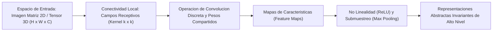
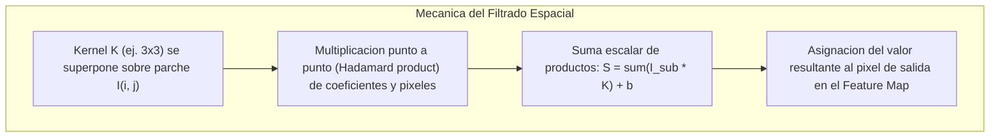
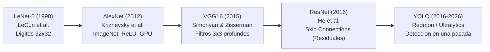
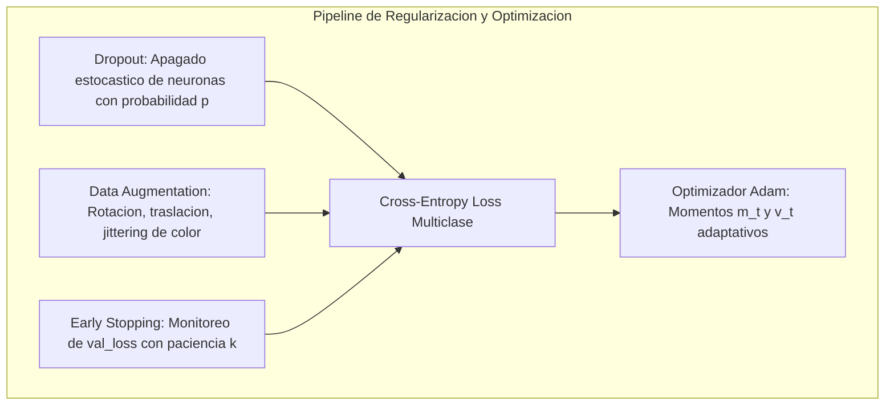
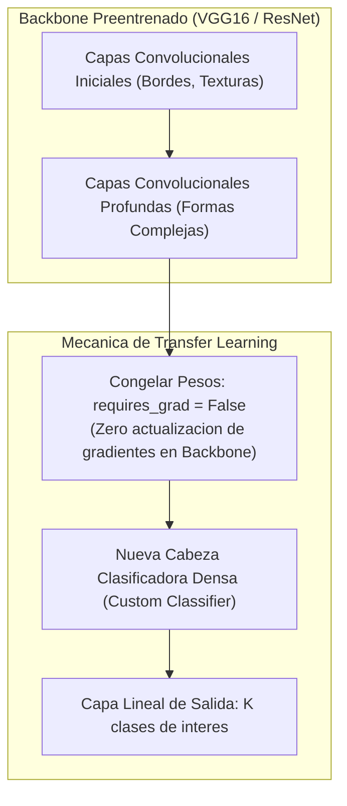
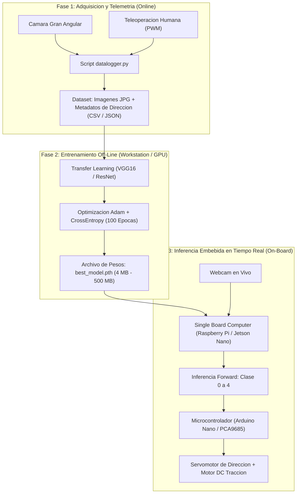

# Clase 5: Redes Neuronales Convolucionales (CNN), Transfer Learning y Arquitecturas de Percepcion Autonoma

Fuente de analisis primario: clase5.txt  

Material complementario: Diapositivas oficiales y proyectos de vehiculos autonomos (Donkey Car, Duckietown, DeepRacer, Ultralytics YOLO)  

Area tematica: Modulo 8 - Machine Learning \| Maestria en Ciencia de Datos e Inteligencia Artificial

> **Objetivo Academico y Pedagogico**<br>
> 
> 
> Comprender los fundamentos matematicos y computacionales de las Redes Neuronales Convolucionales (CNN) para vision por computadora; dominar la mecanica del filtrado espacial, extraccion jerarquica de caracteristicas y regularizacion por dropout y aumento de datos (*data augmentation*); formalizar el paradigma de Transfer Learning sobre backbones preentrenados (VGG16, ResNet); e implementar arquitecturas completas de entrenamiento e inferencia en PyTorch para la clasificacion y control de conduccion autonoma en sistemas embebidos de tiempo real.

---

## 1\. Contexto y Marco Conceptual

### 1.1 De las Redes Neuronales Densas (MLP) al Aprendizaje Profundo Convolucional

En las etapas iniciales del modelado de patrones mediante Inteligencia Artificial, las Redes Neuronales Artificiales clasicas (Multilayer Perceptrons - MLP) procesaban datos estructurados vectoriales donde cada nodo de una capa se conectaba exhaustivamente con todos los nodos de la siguiente (*Fully Connected Layers*).

Sin embargo, al aplicar este esquema denso al analisis de senales multidimensionales como imagenes digitales, surgen tres limitaciones criticas fundamentales:

1. **Explosion Dimensional del Espacio de Parametros:** Una imagen a color estandar de resolucion moderada ($300 \times 300 \times 3$) contiene $270,000$ valores numericos de entrada. Una primera capa oculta con tan solo 1,000 neuronas requeriria $270,000,000$ de pesos sinapticos, demandando recursos computacionales insostenibles e induciendo un sobreajuste (*overfitting*) devastador.

1. **Destruccion de la Topologia y Coherencia Espacial:** El aplanamiento (*flattening*) de una matriz bidimensional en un vector unidimensional ignora que la correlacion estadistica entre pixeles adyacentes es exponencialmente mayor que entre pixeles distantes.

1. **Ausencia de Invarianza Traslacional:** En un clasificador denso, si un patron visual (por ejemplo, el faro de un automovil o una senal vial) se desplaza unos pocos pixeles en el plano de la imagen, las activaciones caen sobre nodos neuronales distintos, impidiendo reconocer el objeto a menos que se reentrene con millones de traslaciones redundantes.

Para superar este cuello de botella, el Aprendizaje Profundo (*Deep Learning*) introduce las **Redes Neuronales Convolucionales (CNN)**, fundamentadas en dos principios biologicos y computacionales:

- **Campos Receptivos Locales (Conectividad Local):** Cada unidad oculta se conecta unicamente a una pequena subregion del espacio de entrada.

- **Pesos Compartidos (Shared Weights):** El mismo conjunto de parametros (kernel o filtro) se desplaza sistematicamente sobre toda la imagen, detectando la misma caracteristica elemental con independencia de su ubicacion espacial.



### 1.2 El Operador de Convolucion en Procesamiento de Senales e Imagenes

Matematicamente, la convolucion continua entre dos funciones $f(t)$ y $g(t)$ representa la integral del producto de ambas senales tras desplazar e invertir una de ellas:

$(f * g)(t) = \int_{-\infty}^{\infty} f(\tau) g(t - \tau) d\tau$

En el dominio unidimensional discreto (senales temporales o acusticas), la operacion se traduce en una suma ponderada deslizante:

$(f * g)[n] = \sum_{m=-\infty}^{\infty} f[m] g[n - m]$

Al transitar a dos dimensiones (imagenes en escala de grises o canales espectrales), la convolucion espacial discreta transforma una matriz de entrada $I$ mediante un nucleo o kernel $K \in \mathbb{R}^{k_h \times k_w}$:

$(I * K)(i, j) = \sum_{m} \sum_{n} I(i - m, j - n) K(m, n)$

En la practica computacional de deep learning, se suele prescindir de la inversion de ejes, operando estrictamente mediante correlacion cruzada, lo cual resulta matematicamente equivalente durante el entrenamiento puesto que los coeficientes del kernel son parametros libres que la red aprende por retropropagacion (*backpropagation*).



### 1.3 Taxonomia y Evolucion Cronologica de las Arquitecturas CNN

La evolucion de las redes convolucionales describe una transicion desde pequenos clasificadores de caracteres manuscritos hacia gigantescos modelos de percepcion visual en tiempo real:



1. **LeNet-5 (Yann LeCun, 1998):**

   - Disenada para el reconocimiento de digitos postales manuscritos (dataset MNIST) con imagenes de entrada de $32 \times 32$ pixeles.
   
   - Introdujo el patron clasico: ` Convolucion -> Submuestreo (Average Pooling) -> Convolucion -> Submuestreo -> Capas Densas `.
   
   - Limitada por la capacidad computacional de la epoca (entrenamiento en CPU secuencial).

1. **AlexNet (Alex Krizhevsky, Ilya Sutskever, Geoffrey Hinton, 2012):**

   - Ganadora contundente del concurso ImageNet Large Scale Visual Recognition Challenge (ILSVRC 2012), reduciendo la tasa de error top-5 de 26% a 15.3%.
   
   - Arquitectura de 8 capas entrenada en paralelo sobre 2 GPUs Nvidia GTX 580.
   
   - Claves tecnicas: Adopcion de la activacion no lineal ReLU para evitar desvanecimiento de gradiente, regularizacion mediante Dropout (50%) y tecnicas intensivas de data augmentation.

1. **VGG16 (Visual Geometry Group, Oxford - Simonyan &amp; Zisserman, 2015):**

   - Demostro que la profundidad de la red es un factor determinante en la precision representacional.
   
   - Regla estructural homogenea: Reemplazo de filtros grandes (ej. 11x11 de AlexNet) por pilas de filtros pequenos de $3 \times 3$. Dos capas convolucionales de $3 \times 3$ tienen el mismo campo receptivo efectivo que un filtro de $5 \times 5$, pero con un 28% menos de parametros y el doble de no linealidades intermedias.
   
   - 138 millones de parametros, con una alta demanda de memoria en capas convolucionales iniciales y densas terminales.

1. **ResNet - Residual Networks (Kaiming He et al., 2016):**

   - Introdujo las **conexiones residuales** (*skip connections* o atajos de identidad), permitiendo entrenar de manera estable redes de 50, 101 y hasta 152 capas.
   
   - En lugar de forzar a las capas a aprender una funcion mapeo directa $\mathcal{H}(\mathbf{x})$, la red aprende el residuo $\mathcal{F}(\mathbf{x}) = \mathcal{H}(\mathbf{x}) - \mathbf{x}$, de modo que el bloque calcula:
   
     $\mathcal{H}(\mathbf{x}) = \mathcal{F}(\mathbf{x}) + \mathbf{x}$
   
   - Si una capa no aporta informacion, los pesos se van a cero y el bloque colapsa de forma trivial a la funcion identidad $\mathbf{x}$, evitando la degradacion del gradiente durante la retropropagacion.

1. **Paradigmas de Deteccion de Objetos: De Sliding Window a YOLO:**

   - **Ventana Deslizante (Sliding Window):** Evaluaba un clasificador en cientos de recortes de imagen a multiples escalas. Computacionalmente prohibitivo para inferencia en tiempo real.
   
   - **R-CNN (Regions with CNN Features - Girshick et al., 2014):** Emplea busqueda selectiva (*Selective Search*) para proponer \~2,000 regiones de interes (RoI), procesando cada una con una CNN y un clasificador SVM.
   
   - **YOLO (You Only Look Once - Joseph Redmon et al., 2016):** Revoluciono la vision por computadora al formular la deteccion de objetos no como una clasificacion repetitiva de regiones, sino como un unico problema de regresion espacial directa. Divide la imagen en una cuadricula $S \times S$ y predice en una sola pasada hacia adelante las coordenadas de las cajas delimitadoras (*bounding boxes*), la confianza objetual y las probabilidades de clase.

---

## 2\. Fundamentos Teoricos y Arquitectura Matematica

### 2.1 Formulacion Analitica de la Capa Convolucional 2D

Sea una imagen o tensor intermedio $\mathbf{X} \in \mathbb{R}^{H \times W \times C_{\text{in}}}$, donde $H$ es la altura, $W$ el ancho y $C_{\text{in}}$ el numero de canales (ej. 3 para RGB).

Un banco de $C_{\text{out}}$ filtros convolucionales $\mathbf{W} \in \mathbb{R}^{C_{\text{out}} \times C_{\text{in}} \times k_h \times k_w}$ con sesgos $\mathbf{b} \in \mathbb{R}^{C_{\text{out}}}$ transforma la entrada en un tensor de activaciones $\mathbf{Y} \in \mathbb{R}^{H' \times W' \times C_{\text{out}}}$:

$Y(i, j, c_{\text{out}}) = b_{c_{\text{out}}} + \sum_{c_{\text{in}}=1}^{C_{\text{in}}} \sum_{m=-M}^{M} \sum_{n=-N}^{N} X(i \cdot s + m, j \cdot s + n, c_{\text{in}}) \cdot W(c_{\text{out}}, c_{\text{in}}, m, n)$

Donde:

- $s$ es el **stride** (paso de desplazamiento del filtro).

- Las dimensiones espaciales de salida $H'$ y $W'$ con padding $p$ se determinan formalmente por:

  $H' = \left\lfloor \frac{H - k_h + 2p}{s} \right\rfloor + 1, \quad W' = \left\lfloor \frac{W - k_w + 2p}{s} \right\rfloor + 1$

| Parametro Hiperespacial | Notacion | Funcion Matematica y Rol en la Arquitectura |
| --- | --- | --- |
| **Tamano del Kernel** | $k_h \times k_w$ (ej. 3x3) | Define el soporte espacial local sobre el que se calculan correlaciones. |
| **Numero de Canales (Filtros)** | $C_{\text{out}}$ (ej. 32, 64, 128) | Numero de rasgos o patrones independientes extraidos en esa capa. |
| **Stride (Paso)** | $s \ge 1$ | Intervalo de salto del kernel; reduce la resolucion espacial si $s > 1$. |
| **Padding (Relleno)** | $p \ge 0$ | Adicion de ceros perimetrales para preservar las dimensiones espaciales ("same"). |

### 2.2 Funciones de Activacion No Lineales

La no linealidad es indispensable para que las capas sucesivas colapsen en representaciones funcionales complejas no reducibles a una sola transformacion lineal matricial.

1. **Unidad Lineal Rectificada (ReLU - Rectified Linear Unit):**

   $\text{ReLU}(z) = \max(0, z)$
   
   - **Gradiente:** $\frac{d}{dz}\text{ReLU}(z) = 1$ si $z > 0$, y $0$ si $z < 0$.
   
   - **Ventajas:** Computacionalmente barata (un simple corte condicional), no presenta saturacion asintotica positiva y acelera la convergencia por descenso de gradiente hasta 6 veces respecto a la tangente hiperbolica.

1. **Softmax (Capa de Salida Multiclase):**

   Para un vector de logits no normalizados $\mathbf{z} = [z_1, z_2, \dots, z_K]^T$:
   
   $\text{Softmax}(z_k) = \frac{\exp(z_k)}{\sum_{j=1}^K \exp(z_j)}$
   
   Garantiza que $\sum_{k=1}^K \text{Softmax}(z_k) = 1$ y $\text{Softmax}(z_k) \in (0, 1)$, permitiendo su interpretacion formal como una distribucion condicional de probabilidad $P(y = k \mid \mathbf{x})$.

### 2.3 Operaciones de Submuestreo Espacial: Max Pooling

La operacion de pooling particiona el mapa de caracteristicas en ventanas disjuntas o solapadas de tamano $p_h \times p_w$ (tipicamente $2 \times 2$ con stride 2) y extrae el valor maximo:

$\text{MaxPool}(X)(i, j, c) = \max_{0 \le m < p_h, 0 \le n < p_w} X(i \cdot s + m, j \cdot s + n, c)$

- **Invarianza Traslacional Local:** Si la caracteristica detectada sufre una leve traslacion dentro de la ventana $2 \times 2$, el valor maximo permanece inalterado.

- **Compresion Dimensional:** Reduce el numero de activaciones espaciales en un 75% ($H/2 \times W/2$), disminuyendo el costo computacional de las capas posteriores y controlando el sobreajuste.

### 2.4 Tecnicas de Regularizacion y Optimizacion



- **Dropout (Srivastava et al., 2014):** Durante el entrenamiento, cada neurona se desconecta estocasticamente con probabilidad $p$ (habitualmente $p \in [0.2, 0.5]$), multiplicando su activacion por una variable de Bernoulli $r_j \sim \text{Bernoulli}(1-p)$. Esto impide la co-adaptacion compleja de caracteristicas, forzando a cada unidad a extraer senales representativas robustas e independientes.

- **Funcion de Perdida de Entropia Cruzada Categorica:**

  $\mathcal{L}_{\text{CE}}(\mathbf{y}, \hat{\mathbf{y}}) = - \sum_{k=1}^K y_k \ln(\hat{y}_k)$

- **Optimizador Adam (Adaptive Moment Estimation):** Actualiza los pesos $\mathbf{w}$ rastreando promedios moviles exponenciales del gradiente ($m_t$) y del gradiente al cuadrado ($v_t$):

  $m_t = \beta_1 m_{t-1} + (1 - \beta_1) g_t, \quad v_t = \beta_2 v_{t-1} + (1 - \beta_2) g_t^2$
  
  $\hat{m}_t = \frac{m_t}{1 - \beta_1^t}, \quad \hat{v}_t = \frac{v_t}{1 - \beta_2^t}$
  
  $\mathbf{w}_{t+1} = \mathbf{w}_t - \frac{\eta}{\sqrt{\hat{v}_t} + \epsilon} \hat{m}_t$

### 2.5 Transfer Learning y Congelamiento de Capas (Layer Freezing)

El aprendizaje por transferencia capitaliza la representacion jerarquica aprendida por una red entrenada sobre datasets masivos (como ImageNet con 1.4 millones de imagenes y 1,000 clases):

1. **Capas Iniciales (Genericas):** Detectan caracteristicas elementales de bajo nivel (bordes de Gabor, gradientes de color, texturas simples). Son universales e independientes del dominio especifico.

1. **Capas Intermedias:** Sintetizan formas geometricas, motivos, uniones y patrones de partes.

1. **Capas Finales (Especificas):** Mapean los patrones de alto nivel hacia las clases meta del dataset de origen.



Al congelar el *backbone* (` requires_grad = False `), los millones de parametros convolucionales actuan como un extractor de caracteristicas fijo. Unicamente se calculan gradientes y se actualizan los pesos de la nueva cabeza clasificadora densa, logrando un entrenamiento ultrarrapido y altamente preciso aun con datasets reducidos.

---

## 3\. Implementacion Tecnica y Laboratorio en PyTorch

A continuacion se presentan dos pipelines rigurosos y reproducibles desarrollados en ` PyTorch `:

### 3.1 Pipeline Didactico: Clasificador Convolucional desde Cero (Horses vs. Humans)

Este script implementa el preprocesamiento, arquitectura CNN multicapa con Dropout y bucle de entrenamiento completo:

```python
"""
Pipeline 1: Red Neuronal Convolucional (CNN) desde Cero en PyTorch
Dataset: Horses vs. Humans (Clasificacion Binaria)
Modulo 8: Machine Learning - Nivel Posgrado
"""

import os
import torch
import torch.nn as nn
import torch.optim as optim
from torch.utils.data import DataLoader
from torchvision import datasets, transforms
import matplotlib.pyplot as plt

# 1. Definicion de Transformaciones y Data Augmentation
# Nota metodologica: Se emplean transformaciones que no alteran la semantica
train_transforms = transforms.Compose([
    transforms.Resize((300, 300)),
    transforms.RandomRotation(degrees=15),
    transforms.RandomHorizontalFlip(p=0.5),
    transforms.ToTensor(),
    transforms.Normalize(mean=[0.485, 0.456, 0.406], std=[0.229, 0.224, 0.225])
])

val_transforms = transforms.Compose([
    transforms.Resize((300, 300)),
    transforms.ToTensor(),
    transforms.Normalize(mean=[0.485, 0.456, 0.406], std=[0.229, 0.224, 0.225])
])

# 2. Arquitectura CNN Multicapa con Dropout
class BinaryCNN(nn.Module):
    def __init__(self):
        super(BinaryCNN, self).__init__()
        # Bloque Convolucional 1: 3 -> 32
        self.conv1 = nn.Conv2d(in_channels=3, out_channels=32, kernel_size=3, padding=1)
        self.relu1 = nn.ReLU()
        self.pool1 = nn.MaxPool2d(kernel_size=2, stride=2)  # 300x300 -> 150x150
        
        # Bloque Convolucional 2: 32 -> 64
        self.conv2 = nn.Conv2d(32, 64, kernel_size=3, padding=1)
        self.relu2 = nn.ReLU()
        self.pool2 = nn.MaxPool2d(2, 2)  # 150x150 -> 75x75
        
        # Bloque Convolucional 3: 64 -> 128
        self.conv3 = nn.Conv2d(64, 128, kernel_size=3, padding=1)
        self.relu3 = nn.ReLU()
        self.pool3 = nn.MaxPool2d(2, 2)  # 75x75 -> 37x37
        
        # Bloque Convolucional 4: 128 -> 256
        self.conv4 = nn.Conv2d(128, 256, kernel_size=3, padding=1)
        self.relu4 = nn.ReLU()
        self.pool4 = nn.MaxPool2d(2, 2)  # 37x37 -> 18x18
        
        # Clasificador Denso con Dropout
        self.flatten = nn.Flatten()
        self.fc1 = nn.Linear(256 * 18 * 18, 512)
        self.relu_fc = nn.ReLU()
        self.dropout = nn.Dropout(p=0.5)
        self.fc2 = nn.Linear(512, 2)  # Logits para 2 clases (0: Caballo, 1: Humano)
        
    def forward(self, x):
        x = self.pool1(self.relu1(self.conv1(x)))
        x = self.pool2(self.relu2(self.conv2(x)))
        x = self.pool3(self.relu3(self.conv3(x)))
        x = self.pool4(self.relu4(self.conv4(x)))
        x = self.flatten(x)
        x = self.dropout(self.relu_fc(self.fc1(x)))
        x = self.fc2(x)
        return x

# 3. Protocolo de Entrenamiento con Early Stopping
def entrenar_modelo_cnn(model, dataloaders, criterion, optimizer, device, num_epochs=20, patience=4):
    model.to(device)
    best_loss = float('inf')
    patience_counter = 0
    history = {'train_loss': [], 'val_loss': [], 'train_acc': [], 'val_acc': []}
    
    for epoch in range(num_epochs):
        for phase in ['train', 'val']:
            if phase == 'train':
                model.train()
            else:
                model.eval()
                
            running_loss = 0.0
            correct_preds = 0
            total_samples = 0
            
            for inputs, labels in dataloaders[phase]:
                inputs, labels = inputs.to(device), labels.to(device)
                optimizer.zero_grad()
                
                with torch.set_grad_enabled(phase == 'train'):
                    outputs = model(inputs)
                    loss = criterion(outputs, labels)
                    _, preds = torch.max(outputs, 1)
                    
                    if phase == 'train':
                        loss.backward()
                        optimizer.step()
                        
                running_loss += loss.item() * inputs.size(0)
                correct_preds += torch.sum(preds == labels.data).item()
                total_samples += inputs.size(0)
                
            epoch_loss = running_loss / total_samples
            epoch_acc = correct_preds / total_samples
            history[f'{phase}_loss'].append(epoch_loss)
            history[f'{phase}_acc'].append(epoch_acc)
            
        print(f"Epoca {epoch+1:02d}/{num_epochs:02d} | "
              f"Train Loss: {history['train_loss'][-1]:.4f} - Acc: {history['train_acc'][-1]*100:.2f}% | "
              f"Val Loss: {history['val_loss'][-1]:.4f} - Acc: {history['val_acc'][-1]*100:.2f}%")
              
        # Criterio Early Stopping basado en val_loss
        if history['val_loss'][-1] < best_loss:
            best_loss = history['val_loss'][-1]
            patience_counter = 0
            torch.save(model.state_dict(), 'best_model.pth')
        else:
            patience_counter += 1
            if patience_counter >= patience:
                print(f"Early stopping activado en la epoca {epoch+1}.")
                break
                
    return history
```

### 3.2 Pipeline Profesional: Transfer Learning con VGG16 para Vehiculo Autonomo (Donkey Car)

Este script implementa la clasificacion de 5 clases direccionales con VGG16 preentrenado, destacando la omision deliberada del volteo horizontal:

```python
"""
Pipeline 2: Transfer Learning con VGG16 para Percepcion y Control Autonomo
5 Clases de Giro: 0 (Izq Total), 1 (Izq Suave), 2 (Adelante), 3 (Der Suave), 4 (Der Total)
"""

import time
import torch
import torch.nn as nn
import torch.optim as optim
from torchvision import models, transforms, datasets
from torch.utils.data import DataLoader

# 1. Pipeline de Transformaciones Estricto para Guiado de Carril
# REGLA CRITICA: Queda prohibido RandomHorizontalFlip en vision de carriles
autonomous_train_transforms = transforms.Compose([
    transforms.Resize((224, 224)),
    transforms.ColorJitter(brightness=0.2, contrast=0.2),  # Variaciones de iluminacion y sombras
    transforms.ToTensor(),
    transforms.Normalize(mean=[0.485, 0.456, 0.406], std=[0.229, 0.224, 0.225])
])

autonomous_val_transforms = transforms.Compose([
    transforms.Resize((224, 224)),
    transforms.ToTensor(),
    transforms.Normalize(mean=[0.485, 0.456, 0.406], std=[0.229, 0.224, 0.225])
])

# 2. Carga y Congelacion de VGG16
def instanciar_vgg16_transfer(num_classes=5):
    # Cargar backbone con pesos de ImageNet
    model = models.vgg16(weights=models.VGG16_Weights.DEFAULT)
    
    # Congelar capas convolucionales del extractor
    for param in model.features.parameters():
        param.requires_grad = False
        
    # Reemplazar la ultima capa lineal del clasificador
    in_features = model.classifier[6].in_features
    model.classifier[6] = nn.Sequential(
        nn.Dropout(p=0.5),
        nn.Linear(in_features, num_classes)
    )
    return model

# 3. Script Desacoplado de Inferencia Embebida en Tiempo Real
def predecir_direccion_cuadro(frame_tensor, model, device):
    """
    Inferencia de baja latencia para Raspberry Pi / Jetson Nano
    """
    model.eval()
    with torch.no_grad():
        frame_tensor = frame_tensor.to(device)
        logits = model(frame_tensor)
        probabilities = torch.softmax(logits, dim=1)
        pred_class = torch.argmax(probabilities, dim=1).item()
        confidence = probabilities[0][pred_class].item()
    return pred_class, confidence
```

---

## 4\. Analisis Critico de Casos y Auditoria Practica

### 4.1 Caso 1: El Dilema de la Generalizacion en Datos No Vistos (Centauros)

Durante la experimentacion con el clasificador Horses vs Humans, se sometio al modelo a imagenes hibridas de centauros (patron corporal inferior equino con torso humano):

- **Diagnostico:** La red convolucional no posee un entendimiento conceptual u ontologico del mundo; unicamente calcula correlaciones espaciales ponderadas por pesos.

- **Resultado Empirico:** En imagenes donde dominaba el pelaje, patas o musculatura cuadrupede, el modelo colapso a *Caballo (100%)*; en planos cerrados o con siluetas axiales dominantes, colapso a *Humano (100%)*.

- **Leccion Metodologica:** Un clasificador con alta confianza probabilistica en Softmax ($P > 0.99$) puede estar conceptualmente equivocado ante entradas que violan la distribucion de entrenamiento (*Out-of-Distribution - OOD*).

### 4.2 Caso 2: Arquitectura del Vehiculo Autonomo Scale-Model (Donkey Car / Duckietown)

El proyecto Donkey Car ilustra el ciclo de vida completo de un sistema de Inteligencia Artificial para conduccion autonoma:



| Plataforma Embebida | Arquitectura y GPU | Consumo y Costo | Rendimiento de Inferencia (FPS) | Viabilidad Operacional |
| --- | --- | --- | --- | --- |
| **Raspberry Pi 3 / 4** | ARM Cortex-A53 / A72 (Sin GPU dedicada) | 5V / 3A (Bajo costo) | 3 - 8 FPS (VGG16 podado o ResNet liviano) | Apta para control reactivo discreto a baja velocidad. |
| **NVIDIA Jetson Nano / Orin** | NVIDIA Maxwell 128 cores / Ampere | 5V - 12V (Costo medio/alto) | 25 - 45 FPS (TensorRT vectorizado) | Apta para navegacion suave en tiempo real y deteccion YOLO. |
| **Google Colab / Servidor Cloud** | NVIDIA T4 / A100 (Entorno remoto) | Suscripcion / GPU remota | 60+ FPS (Sujeto a latencia Wi-Fi 50-200 ms) | Excelente para entrenamiento; riesgo de colision por lag de red. |

### 4.3 Tabla Comparativa de Arquitecturas de Vision Artificial

| Arquitectura | Ano y Referencia | Profundidad y Parametros | Innovacion Estructural Central | Caso de Uso Optimo |
| --- | --- | --- | --- | --- |
| **AlexNet** | 2012 (Krizhevsky) | 8 capas / 60M params | ReLU, Dropout, Convoluciones paralelas en 2 GPUs. | Benchmark historico, clasificacion simple. |
| **VGG16** | 2015 (Simonyan) | 16 capas / 138M params | Convoluciones profundas con filtros pequenos de $3 \times 3$. | Transfer Learning en datasets pequenos, extraccion de features. |
| **ResNet-50** | 2016 (Kaiming He) | 50 capas / 25.6M params | Conexiones residuales (*skip connections*), residual learning. | Backbone estandar para clasificacion y segmentacion profunda. |
| **YOLOv8** | 2023 (Ultralytics) | Variable (Nano a X-Large) | Prediccion anchor-free, deteccion en una sola pasada. | Deteccion y seguimiento de multiples objetos en tiempo real. |

---

## 5\. Principios de Diseno, Buenas Practicas y Anti-patrones

### 5.1 Reglas de Oro en Deep Learning para Vision

1. **Auditoria Semantica en Data Augmentation:** Antes de aplicar cualquier operador de aumento de datos, verificar si la transformacion altera la etiqueta fisica del problema. En conduccion autonoma, el volteo horizontal invierte las clases de giro; en OCR, rotar 180° invierte los digitos 6 y 9.

1. **Normalizacion y Alineamiento Distribucional:** Aplicar exactamente la misma normalizacion (medias y desviaciones tipicas de ImageNet) que se empleo durante el entrenamiento del *backbone* base.

1. **Desacoplamiento Estricto entre Entrenamiento e Inferencia:** Entrenar en GPU de alta potencia guardando exclusivamente el diccionario de pesos (` torch.save(model.state_dict(), 'weights.pth') `). El script de inferencia a bordo debe cargar los pesos sin dependencias de entrenamiento.

1. **Tratamiento del Desbalance Muestral en Conduccion:** En pistas de pruebas, el vehiculo pasa la mayor parte del tiempo desplazandose en linea recta (clase "Adelante"), generando un desbalance de hasta 80/20 frente a las curvas. Sin remuestreo o ponderacion de perdidas (` weight=class_weights `), el modelo aprende a ir siempre recto, saliendose en la primera curva.

### 5.2 Anti-patrones Comunes

| Anti-patron | Descripcion del Error | Consecuencia Tecnica | Solucion Recomendada |
| --- | --- | --- | --- |
| **"Cocinar Datos" (Data Cooking)** | Entrenar y evaluar con imagenes tomadas bajo iluminacion y angulos identicos. | Precision aparente del 100% que colapsa catastroficamente en la vida real. | Evaluar con imagenes ruidosas, fondos cambiantes y pruebas no controladas. |
| **Desalineacion Hardware-Modelo** | Desplegar modelos masivos (ej. YOLOv8x) en una Raspberry Pi sin acelerador. | Inferencia a menor a 1 FPS que genera retrasos fatales en el control dinamico. | Optimizar con quantizacion INT8, TensorRT o usar arquitecturas MobileNet/Nano. |
| **Sobreajuste Ciego por Falta de Early Stopping** | Entrenar durante 100+ epocas sin vigilar la perdida de validacion. | Memorizacion de ruido en pixeles; ` train_loss ` baja mientras ` val_loss ` explota. | Implementar ` EarlyStopping ` con ventana de paciencia entre 4 y 10 epocas. |
| **Fuga de Informacion Temporal (Data Leakage)** | Extraer cuadros contiguos de un video y repartirlos al azar en Train y Test. | El conjunto de prueba contiene imagenes casi identicas a las de entrenamiento. | Particionar por secuencias completas de tiempo o vueltas de pista independientes. |

---

## 6\. Sintesis Conceptual y Profundizacion Academica

### 6.1 Sintesis Comparativa Global

El Aprendizaje Profundo Convolucional representa una revolucion frente a los clasificadores estadisticos tradicionales (como Naive Bayes, SVM o Random Forest) al eliminar la necesidad de disenar caracteristicas manuales (*handcrafted features*), integrando la extraccion de representaciones y la clasificacion en un unico flujo diferenciable de extremo a extremo (*end-to-end*).

Sin embargo, su caracter predominantemente determinista expone una debilidad estructural: una red CNN asignara una clase con alta probabilidad de Softmax incluso ante senales corruptas, ruido extremo o entidades ajenas al dominio.

### 6.2 Proyeccion hacia Modelos Probabilisticos y Seguridad Critica

Para transitar desde prototipos de laboratorio hacia sistemas criticos de produccion (vehiculos autonomos a escala real, salud humana y diagnostico clinico), es imperativo trascender el score puntual determinista y avanzar hacia la **cuantificacion formal de la incertidumbre**, integrando la Teoria de Decision Bayesiana y el Aprendizaje Profundo Probabilistico.

### 6.3 Referencias Bibliograficas Seminales

- **LeCun, Y., Bottou, L., Bengio, Y., &amp; Haffner, P. (1998).** Gradient-based learning applied to document recognition. *Proceedings of the IEEE*, 86(11), 2278-2324.

- **Krizhevsky, A., Sutskever, I., &amp; Hinton, G. E. (2012).** Imagenet classification with deep convolutional neural networks. *Advances in Neural Information Processing Systems (NeurIPS)*, 25, 1097-1105.

- **Simonyan, K., &amp; Zisserman, A. (2014).** Very deep convolutional networks for large-scale image recognition. *arXiv preprint arXiv:1409.1556*.

- **He, K., Zhang, X., Ren, S., &amp; Sun, J. (2016).** Deep residual learning for image recognition. *Proceedings of the IEEE Conference on Computer Vision and Pattern Recognition (CVPR)*, 770-778.

- **Redmon, J., Divvala, S., Girshick, R., &amp; Farhadi, A. (2016).** You only look once: Unified, real-time object detection. *Proceedings of the IEEE Conference on Computer Vision and Pattern Recognition (CVPR)*, 779-788.

- **Roscoe, W., &amp; Conway, A. (2017).** *Donkey Car: An Open Source DIY Self Driving Platform for Small Scale Cars*.

---
