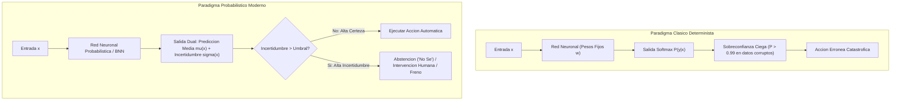
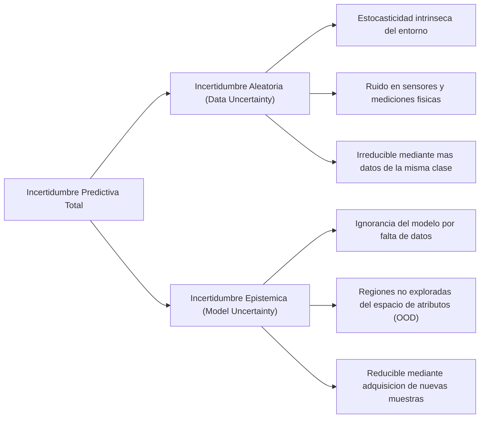
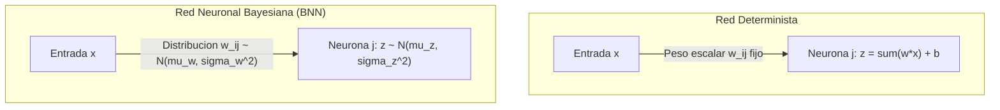
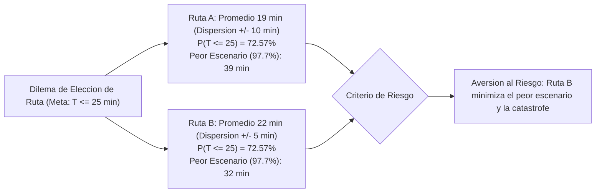
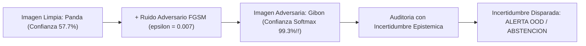
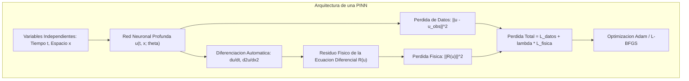
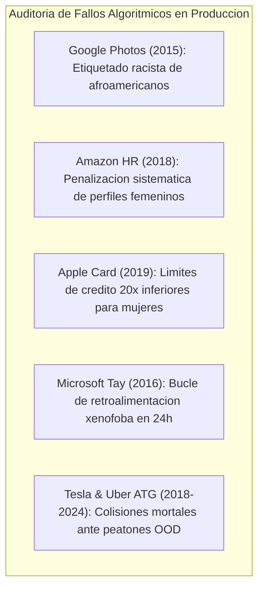
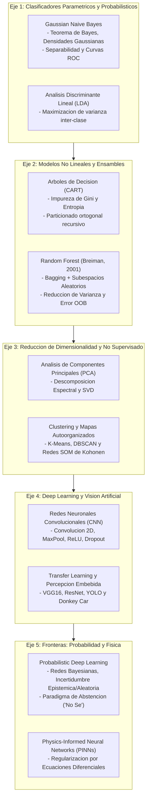

# Clase 6: Aprendizaje Profundo Probabilistico, Cuantificacion de Incertidumbre y Auditoria de Sesgos en Produccion

Fuente de analisis primario: clase6.txt  

Material complementario: Diapositivas oficiales, papers de redes informadas por la fisica (PINNs), y literatura de Probabilistic Machine Learning (Murphy, 2022; Dürr et al., 2020)  

Area tematica: Modulo 8 - Machine Learning \| Maestria en Ciencia de Datos e Inteligencia Artificial

> **Objetivo Academico y Pedagogico**<br>
> 
> 
> Formalizar los limites epistemologicos del Aprendizaje Profundo convencional y analizar la patologia de los modelos sobreconfiados en entornos criticos de produccion; derivar los fundamentos matematicos del Aprendizaje Profundo Probabilistico (Probabilistic Deep Learning) y las Redes Neuronales Bayesianas (BNN); modelar e interpretar la incertidumbre aleatoria y epistemica; examinar la integracion de leyes fisicas mediante Redes Neuronales Informadas por la Fisica (PINNs); y auditar de forma rigurosa los sesgos algoritmicos, los costos asimetricos de clasificacion y el paradigma de abstencion ("I don't know") en sistemas de alta trascendencia social, medica y operativa.

---

## 1\. Contexto y Marco Conceptual

### 1.1 La Ilusion del Rendimiento Determinista y la Falibilidad del Deep Learning Moderno

El vertiginoso auge del Aprendizaje Profundo ha consolidado modelos con precisiones de laboratorio cercanas al 99% en vision computacional, procesamiento de lenguaje natural y conduccion autonoma.

Sin embargo, en entornos operacionales reales de mision critica, esta aparente omnisciencia se desmorona ante eventos fuera de distribucion (*Out-of-Distribution - OOD*):

- **Sobreconfianza Patologica:** Una red neuronal tradicional con capa de salida Softmax no sabe cuando "no sabe". Tiende a emitir probabilidades superiores al 95% incluso ante imagenes distorsionadas, ruido blanco o entradas absurdas.

- **Fragilidad en Movimiento y Video en Vivo:** Como se evidencia en sistemas de deteccion continua (como YOLO), un cambio leve de perspectiva, una pose no convencional (ej. un musico agachandose clasificado subitamente como "perro" u "oso") o una oclusion transitoria desatan oscilaciones erraticas.

- **Accidentes Catastroficos:** Desde la colision de prototipos de vehiculos autonomos durante demostraciones televisivas en vivo hasta colisiones mortales en carreteras abiertas, la causa raiz radica en que los algoritmos tradicionales carecen de una metrica interna para calibrar su propia ignorancia.



### 1.2 La Necesidad de Cuantificar el Error: El Retorno al Pensamiento Estadistico

Para superar estas fallas estructurales, autores seminales como Kevin Murphy (*Probabilistic Machine Learning*, MIT Press, 2022/2023) y Olivier Dürr (*Probabilistic Deep Learning*, 2020) promueven una reconciliacion epistemologica: rescatar las herramientas rigurosas de la estadistica clasica, la inferencia bayesiana y la teoria de decision, e integrarlas en el corazon del aprendizaje profundo.

El objetivo central deja de ser unicamente minimizar una funcion de costo puntual en el conjunto de entrenamiento, y pasa a ser la **cuantificacion formal y calibrada de la incertidumbre**.

### 1.3 Taxonomia Fundamental de la Incertidumbre

En la teoria del aprendizaje estadistico contemporaneo, la incertidumbre total se descompone en dos categorias ortogonales:



1. **Incertidumbre Aleatoria (Aleatoric / Data Uncertainty):**

   - Corresponde a la variabilidad estocastica inherente al fenomeno fisico o proceso de medicion.
   
   - *Ejemplo Fisico:* Aun si se fija una camara sobre un tripode rigido y se capturan imagenes consecutivas de una escena estatica, la sustraccion de dos cuadros contiguos nunca arroja una matriz de ceros exactos; el ruido termico en el sensor CMOS, fluctuaciones de iluminacion y particulas atmosfericas inducen variaciones inevitables.
   
   - *Propiedad:* Es irreducible mediante la mera acumulacion de mas datos de entrenamiento bajo las mismas condiciones.

1. **Incertidumbre Epistemica (Epistemic / Model Uncertainty):**

   - Refleja la falta de conocimiento del propio modelo respecto al verdadero proceso generativo, originada por la escasez de datos en regiones especificas del espacio de entrada.
   
   - *Ejemplo de Conduccion:* Si el vehiculo entrenado en lineas de pista se enfrenta repentinamente a un cruce peatonal inundado o una bifurcacion con senales no vistas, la incertidumbre epistemica se dispara.
   
   - *Propiedad:* Es teoricamente reducible incorporando nuevas observaciones en las regiones deficientes del espacio de caracteristicas.

---

## 2\. Fundamentos Teoricos y Arquitectura Matematica

### 2.1 De Pesos Deterministas a Distribuciones: Redes Neuronales Bayesianas (BNN)

En una red neuronal convencional, el entrenamiento por retropropagacion busca una estimacion puntual de maxima verosimilitud de los parametros: $\mathbf{w}^* = \arg\min_\mathbf{w} \mathcal{L}(\mathbf{w})$.

En una **Red Neuronal Bayesiana (Bayesian Neural Network - BNN)**, los pesos sinapticos dejan de ser escalares estaticos y se modelan formalmente como variables aleatorias dotadas de una distribucion a priori $P(\mathbf{w}) \sim \mathcal{N}(\mathbf{0}, \sigma_0^2 \mathbf{I})$.

Al observar un dataset $\mathcal{D} = \{(\mathbf{x}_i, y_i)\}_{i=1}^N$, se aplica el Teorema de Bayes para obtener la distribucion a posteriori sobre los pesos:

$P(\mathbf{w} \mid \mathcal{D}) = \frac{P(\mathcal{D} \mid \mathbf{w}) P(\mathbf{w})}{P(\mathcal{D})} = \frac{P(\mathcal{D} \mid \mathbf{w}) P(\mathbf{w})}{\int P(\mathcal{D} \mid \mathbf{w}) P(\mathbf{w}) d\mathbf{w}}$

Para clasificar o predecir sobre un nuevo vector $\mathbf{x}^*$, la inferencia predictiva marginaliza sobre todo el espacio de pesos posibles:

$P(y^* \mid \mathbf{x}^*, \mathcal{D}) = \int P(y^* \mid \mathbf{x}^*, \mathbf{w}) P(\mathbf{w} \mid \mathcal{D}) d\mathbf{w}$

Debido a que la integral sobre millones de parametros es analiticamente intratable, se recurre a metodos de aproximacion como la **Inferencia Variacional (Variational Inference - Bayes by Backprop)** o a tecnicas de muestreo estocastico como **Monte Carlo Dropout**.



### 2.2 Modelado de Salidas Distribucionales (Media e Incertidumbre)

Una alternativa directa a la inferencia sobre pesos consiste en forzar a que la red neuronal prediga directamente los parametros de una distribucion de probabilidad condicional sobre la variable dependiente.

Para un problema de regresion unidimensional, la salida de la red modela una densidad gaussiana heterocedastica:

$P(y \mid \mathbf{x}, \boldsymbol{\theta}) = \mathcal{N}\left(y \mid \mu(\mathbf{x}; \boldsymbol{\theta}), \sigma^2(\mathbf{x}; \boldsymbol{\theta})\right)$

Donde la red emite un vector dual:

$\mathbf{f}(\mathbf{x}; \boldsymbol{\theta}) = \begin{bmatrix} \mu(\mathbf{x}) \\ s(\mathbf{x}) \end{bmatrix}$

Con $\sigma(\mathbf{x}) = \text{softplus}(s(\mathbf{x})) = \ln(1 + e^{s(\mathbf{x})})$ para asegurar estrictamente $\sigma(\mathbf{x}) > 0$.

El entrenamiento se realiza optimizando la **Perdida de Maxima Verosimilitud Negativa (Negative Log-Likelihood - NLL)**:

$\mathcal{L}_{\text{NLL}}(\boldsymbol{\theta}) = - \sum_{i=1}^N \ln P(y_i \mid \mathbf{x}_i, \boldsymbol{\theta}) = \frac{1}{2} \sum_{i=1}^N \left[ \ln\left(2\pi \sigma^2(\mathbf{x}_i)\right) + \frac{(y_i - \mu(\mathbf{x}_i))^2}{\sigma^2(\mathbf{x}_i)} \right]$

- El primer termino $\ln(\sigma^2)$ actua como penalizador de dispersion, impidiendo que el modelo asigne varianza infinita para trivializar el error.

- El segundo termino pondera el residuo cuadratico por la precision $1/\sigma^2$: si una muestra es altamente ruidosa o anomala, la red aprende a incrementar $\sigma^2$ para mitigar el impacto del error sin distorsionar la media $\mu$.

### 2.3 Teoria de Decision Bayesiana y el Problema del Taxista

Para formalizar como la cuantificacion de incertidumbre gobierna la toma de decisiones bajo riesgo, se presenta el dilema clasico del taxista debatido en clase:

- **Escenario Operacional:** Un pasajero ofrece una prima de \$500 si y solo si el taxista arriba al Museo de Arte Moderno (MOMA) en un tiempo $T \le 25$ minutos.

- **Ruta A (Camino Corto con Alta Congestion / Trancadera):**

  $T_A \sim \mathcal{N}(\mu_A = 19, \sigma_A = 10)$

- **Ruta B (Camino Largo con Flujo Fluido / Menor Varianza):**

  $T_B \sim \mathcal{N}(\mu_B = 22, \sigma_B = 5)$



#### Derivacion Analitica de Probabilidad de Exito

Calculando la variable tipificada $Z = \frac{T - \mu}{\sigma}$:

$z_A = \frac{25 - 19}{10} = \frac{6}{10} = 0.60 \implies P(T_A \le 25) = \Phi(0.60) \approx 0.7257 \quad (72.57\%)$

$z_B = \frac{25 - 22}{5} = \frac{3}{5} = 0.60 \implies P(T_B \le 25) = \Phi(0.60) \approx 0.7257 \quad (72.57\%)$

- Aunque ambas opciones presentan exactamente la misma probabilidad puntual del 72.57% para el umbral de 25 minutos, la naturaleza del riesgo es asimetrica:

- **Analisis de Peor Escenario (**$\mu + 2\sigma$**, intervalo de confianza del 97.7% unilateral):**

  - Para la Ruta A: $T_{A,\max} = 19 + 2(10) = 39$ minutos (retraso catastrofico de 14 minutos).
  
  - Para la Ruta B: $T_{B,\max} = 22 + 2(5) = 32$ minutos (retraso moderado de 7 minutos).

- **Sensibilidad ante Ventanas de Tiempo Mas Estrictas (ej.** $T \le 23$ **min):**

  - $z_A = \frac{23 - 19}{10} = 0.40 \implies P(T_A \le 23) = \Phi(0.40) \approx 65.54\%$
  
  - $z_B = \frac{23 - 22}{5} = 0.20 \implies P(T_B \le 23) = \Phi(0.20) \approx 57.93\%$

- **Conclusion:** La decision racional depende de la funcion de utilidad del agente. Si el costo de sobrepasar el umbral es asintotico o destructivo (ruina economica o peligro fisico), la minimizacion de la varianza (Ruta B) domina a la busqueda ingenua del valor esperado minimo.

### 2.4 Ataques Adversarios (Adversarial Attacks) y la Fragilidad de Superficies

Los modelos de deep learning deterministas sufren de vulnerabilidad estructural ante perturbaciones optimizadas sobre el gradiente del error.

Mediante el metodo **Fast Gradient Sign Method (FGSM - Goodfellow et al., 2015)**:

$\mathbf{x}_{\text{adv}} = \mathbf{x} + \epsilon \cdot \text{sign}\left(\nabla_\mathbf{x} \mathcal{J}(\boldsymbol{\theta}, \mathbf{x}, y)\right)$

- Para una perturbacion infinitesimal $\epsilon = 0.007$ (imperceptible para la retina humana), una imagen clasificada correctamente como *Panda* con 57.7% de confianza transmuta en un *Gibon* clasificado con **99.3% de certeza**.

- **La Cuantificacion de Incertidumbre como Mecanismo de Defensa:** Mientras la capa Softmax tradicional es enganada con alta confianza, una red probabilistica o con Monte Carlo Dropout detecta que la dispersion entre pases estocasticos se multiplica exponencialmente ($\sigma^2 \to \infty$), identificando la muestra como un ataque adversario o anomalia OOD.



### 2.5 Redes Neuronales Informadas por la Fisica (PINNs)

Las **Physics-Informed Neural Networks (PINNs - Raissi et al., 2019)** nacen de la constatacion de que los modelos puramente guiados por datos (*pure data-driven*) violan principios elementales de conservacion de masa, energia y momento al extrapolar fuera del rango de entrenamiento.

Una PINN integra ecuaciones diferenciales ordinarias o parciales (EDO/EDP) directamente dentro de la funcion de perdida del grafo computacional:

$\mathcal{L}_{\text{total}}(\boldsymbol{\theta}) = \mathcal{L}_{\text{datos}}(\boldsymbol{\theta}) + \lambda \mathcal{L}_{\text{fisica}}(\boldsymbol{\theta})$

Donde:

$\mathcal{L}_{\text{datos}}(\boldsymbol{\theta}) = \frac{1}{N_d} \sum_{i=1}^{N_d} \left| u(t_i, \mathbf{x}_i; \boldsymbol{\theta}) - u_i \right|^2$

$\mathcal{L}_{\text{fisica}}(\boldsymbol{\theta}) = \frac{1}{N_f} \sum_{j=1}^{N_f} \left| \mathcal{R}\left( u(t_j, \mathbf{x}_j; \boldsymbol{\theta}) \right) \right|^2$

Siendo $\mathcal{R}(u)$ el residuo diferencial evaluado en puntos de colocacion mediante diferenciacion automatica (*Autograd*).



#### Caso Didactico: Enfriamiento de Newton

Para la dinamica termica de enfriamiento de un liquido:

$\frac{dT}{dt} = -k (T - T_{\text{env}})$

El residuo fisico evaluado por la red es:

$\mathcal{R}(t) = \frac{d\hat{T}}{dt} + k(\hat{T}(t) - T_{\text{env}})$

La derivada temporal $\frac{d\hat{T}}{dt}$ se obtiene directamente mediante el grafo computacional tensorial, garantizando que el modelo respete la termodinamica aun en presencia de sensores termicos defectuosos o escasos.

#### Caso de Estudio Cientifico: Modelado de Contaminantes en la Cuenca del Rio Loa

En investigaciones aplicadas en el norte de Chile (Atacama), los autores combinan ecuaciones de transporte advectivo-dispersivo con redes neuronales para estimar la concentracion hidroquimica de arsenico (As), sulfatos ($\text{SO}_4$) y boro (B) provenientes de fuentes geotermicas y descargas mineras.

La integracion de la fisica hidrologica actua como un regularizador implacable que impide que el modelo prediga concentraciones negativas o balances de masa imposibles.

---

## 3\. Implementacion Tecnica y Laboratorio de Cuantificacion de Incertidumbre

A continuacion se implementa un marco analitico completo en Python para estimar la incertidumbre predictiva utilizando **Monte Carlo Dropout** (Gal &amp; Ghahramani, 2016) y aplicar el **Paradigma de Clasificacion con Opcion de Abstencion**:

```python
"""
Laboratorio Avanzado: Cuantificacion de Incertidumbre Predictiva y Clasificacion Selectiva
Metodo: Monte Carlo Dropout (MC Dropout) en PyTorch
Modulo 8: Machine Learning - Nivel Posgrado
"""

import torch
import torch.nn as nn
import torch.nn.functional as F
import numpy as np
from typing import Tuple, Dict

# 1. Definicion de Arquitectura con Dropout Activo en Inferencia
class MCDropoutClassifier(nn.Module):
    def __init__(self, input_dim: int = 64, num_classes: int = 10, dropout_rate: float = 0.5):
        super(MCDropoutClassifier, self).__init__()
        self.fc1 = nn.Linear(input_dim, 128)
        self.dropout1 = nn.Dropout(p=dropout_rate)
        self.fc2 = nn.Linear(128, 64)
        self.dropout2 = nn.Dropout(p=dropout_rate)
        self.out = nn.Linear(64, num_classes)
        
    def forward(self, x: torch.Tensor) -> torch.Tensor:
        x = F.relu(self.fc1(x))
        x = self.dropout1(x)
        x = F.relu(self.fc2(x))
        x = self.dropout2(x)
        logits = self.out(x)
        return logits

# 2. Mecanismo de Inferencia Estocastica Monte Carlo
def inferencia_monte_carlo(
    model: nn.Module, 
    x_sample: torch.Tensor, 
    num_forward_passes: int = 100
) -> Tuple[np.ndarray, np.ndarray, np.ndarray]:
    """
    Ejecuta T pases hacia adelante manteniendo el Dropout activo para muestrear
    la distribucion a posteriori aproximada.
    """
    # CLAVE METODOLOGICA: Habilitar modo train para activar el Dropout estocastico
    model.train()
    
    probabilidades_muestreadas = []
    
    with torch.no_grad():
        for _ in range(num_forward_passes):
            logits = model(x_sample)
            probs = F.softmax(logits, dim=-1)
            probabilidades_muestreadas.append(probs.cpu().numpy())
            
    # Tensor de dimensiones (T, Batch_size, Num_classes)
    prob_tensor = np.array(probabilidades_muestreadas)
    
    # 1. Media Predictiva (Probabilidad consensuada)
    media_predictiva = np.mean(prob_tensor, axis=0)
    
    # 2. Varianza Epistemica (Incertidumbre del modelo)
    varianza_predictiva = np.var(prob_tensor, axis=0)
    
    # 3. Entropia Predictiva Total (H = - sum(p * log(p)))
    epsilon = 1e-12
    entropia_predictiva = - np.sum(
        media_predictiva * np.log(media_predictiva + epsilon), 
        axis=-1
    )
    
    return media_predictiva, varianza_predictiva, entropia_predictiva

# 3. Clasificador Selectivo con Opcion de Abstencion ("I Don't Know")
def clasificador_selectivo_con_abstencion(
    model: nn.Module, 
    x_input: torch.Tensor, 
    umbral_entropia_maxima: float = 1.20,
    umbral_varianza_maxima: float = 0.05
) -> Dict[str, any]:
    """
    Aplica la regla de decision bayesiana con rechazo:
    Si la incertidumbre es inaceptable, el sistema se abstiene de clasificar.
    """
    media, varianza, entropia = inferencia_monte_carlo(model, x_input, num_forward_passes=50)
    
    clase_predicha = int(np.argmax(media, axis=-1)[0])
    prob_confianza = float(np.max(media, axis=-1)[0])
    incertidumbre_var = float(np.max(varianza, axis=-1)[0])
    incertidumbre_ent = float(entropia[0])
    
    # Evaluacion de Criterios de Seguridad
    requiere_abstencion = (
        incertidumbre_ent > umbral_entropia_maxima or 
        incertidumbre_var > umbral_varianza_maxima or
        prob_confianza < 0.65
    )
    
    diagnostico = {
        "clase_candidata": clase_predicha,
        "confianza_media": round(prob_confianza, 4),
        "varianza_epistemica": round(incertidumbre_var, 6),
        "entropia_shannon": round(incertidumbre_ent, 4),
        "estado_decision": "ABSTENCION_NO_SE" if requiere_abstencion else "ACCION_CONFIRMADA",
        "protocolo_operativo": (
            "Transferir a perito humano / Activar frenado de seguridad preventivo"
            if requiere_abstencion else "Ejecucion automatica autorizada"
        )
    }
    return diagnostico
```

---

## 4\. Analisis Critico de Casos y Auditoria de Fallos en Produccion

### 4.1 Auditoria de Casos Reales de Sesgo y Falla Catastrofica en la Industria

La literatura y la practica industrial registran incidentes paradigmaticos donde modelos sin evaluacion probabilistica o entrenados sobre datos historicamente viciados causaron dano reputacional, social y fisico:



| Caso y Entidad | Ano | Causa Raiz Algoritmica y Estadistica | Impacto Operacional y Social | Solucion Probabilistica y Mitigacion |
| --- | --- | --- | --- | --- |
| **Google Photos** | 2015 | Dataset de entrenamiento severamente sesgado hacia tez clara; ausencia de clases minoritarias en el espacio de caracteristicas. | Etiquetado ofensivo y racista de personas negras como "gorilas". Grave crisis reputacional. | Muestreo estratificado multietnico, auditoria de distancias en espacio latente y barreras de abstencion semantica. |
| **Amazon Recruiting Tool** | 2018 | Aprendizaje supervisado sobre 10 anos de curriculums de la industria tecnologica historicamente dominada por hombres. | Penalizacion sistematica de CVs que incluyeran terminos como "women's" o universidades de mujeres. Proyecto cancelado. | Anonimizacion de variables protegidas, metricas de paridad demografica (*Fairness ML*) y descorrelacion adversarial. |
| **Apple Card (Goldman Sachs)** | 2019 | Modelos de riesgo crediticio opacos entrenados sobre historicos bancarios con correlaciones espurias de genero no auditadas. | Asignacion de lineas de credito hasta 20 veces menores a mujeres con historiales identicos o superiores a sus conyuges. | Auditoria formal de igualdad de oportunidades (*Equal Opportunity*), regularizacion de paridad y explicabilidad SHAP/LIME. |
| **Microsoft Tay Chatbot** | 2016 | Actualizacion de pesos en linea sin filtrado adversarial ni verificacion de coherencia etica. | En menos de 24 horas el bot absorbio ataques de trolls y emitio mensajes de odio, nazismo y xenofobia. Retirado de emergencia. | Inferencia congelada (*frozen weights*), deteccion probabilistica de toxicidad e intervencion mediante barreras de seguridad. |
| **Accidentes de Vehiculos Autonomos** | 2018-2024 | Clasificador visual sobreconfiado que descarto a una persona con bicicleta fuera de paso cebra como Falso Positivo / Ruido. | Colisiones fatales (Uber Tempe, Tesla Autopilot contra camiones en cruce). | Fusion sensorial multimodal (Camara + LiDAR + Radar), BNNs para detectar OOD y frenado de emergencia ante incertidumbre. |

### 4.2 Matriz de Costos Asimetricos y Teoria de Deteccion en Salud y Seguridad

En medicina y control de procesos, los errores de clasificacion exhiben costos radicalmente asimetricos:

- **Diagnostico de Diabetes Mellitus:**

  - **Falso Positivo (Error Tipo I -** $\alpha$**):** Asignar condicion diabetica a un paciente sano. Conlleva estres psicologico transitorio y realizacion de una prueba confirmatoria de glucosa en sangre de bajo costo.
  
  - **Falso Negativo (Error Tipo II -** $\beta$**):** Diagnosticar como "sano" a un individuo con hiperglucemia severa no detectada. El paciente abandona los cuidados preventivos, derivando potencialmente en neuropatia, ceguera, insuficiencia renal o coma diabetico.

- **Formulacion del Riesgo Bayesiano:**

  $\mathcal{R}(\hat{y}) = C(\text{FP}) \cdot P(\text{FP}) + C(\text{FN}) \cdot P(\text{FN})$
  
  Dado que $C(\text{FN}) \gg C(\text{FP})$, el umbral de clasificacion bayesiano optimo $\theta^*$ debe desplazarse drasticamente:
  
  $\theta^* = \frac{C(\text{FP})}{C(\text{FP}) + C(\text{FN})}$
  
  Si $C(\text{FN}) = 100 \cdot C(\text{FP})$, entonces $\theta^* \approx 0.0099$, dictando que ante la menor evidencia probabilistica de patologia, el modelo debe emitir alerta positiva o transferir a estudio prioritario.

---

## 5\. Principios de Diseno, Buenas Practicas y Anti-patrones

### 5.1 Reglas de Oro en Machine Learning Probabilistico y Seguro

1. **Desacoplar la Probabilidad de Softmax de la Certeza Epistemica:** Las puntuaciones de Softmax estan normalizadas para sumar 1, lo que enmascara la ignorancia en regiones donde no hay datos. Se debe evaluar la calibracion de probabilidades (diagramas de confiabilidad y *Expected Calibration Error - ECE*) y aplicar tecnicas de escalamiento (*Temperature Scaling*).

1. **Implementar el Paradigma de Abstencion (*****Fail-Safe*****):** Disenar todo clasificador de mision critica con una salida reservada para la abstencion formal ("No Se"). Es infinitamente preferible detener un vehiculo o solicitar intervencion humana que ejecutar un giro intempestivo fundamentado en una alucinacion sensorial.

1. **Auditoria Algoritmica de Equidad (*****Fairness Testing*****):** Comprobar sistematicamente que las tasas de Falsos Positivos y Falsos Negativos se mantengan homogeneas a traves de subgrupos demograficos sensibles (genero, etnia, edad), evitando reproducir injusticias historicas enmascaradas en datos bancarios o laborales.

1. **Monitoreo Continuo de Desplazamiento de Datos (*****Dataset Shift*****):** Monitorear la divergencia de Kullback-Leibler o distancia de Wasserstein entre la distribucion de entrada observada en produccion y la registrada durante el entrenamiento para detectar obsolescencia antes de que ocurran fallos.

### 5.2 Anti-patrones Comunes

| Anti-patron | Descripcion del Error | Consecuencia Analitica | Solucion Tecnica |
| --- | --- | --- | --- |
| **Falacia de la Objetividad Muestral** | Creer que un modelo no tiene sesgo "porque solo se alimento con datos historicos reales del banco/empresa". | Perpetuacion y amplificacion a escala masiva de los prejuicios humanos del pasado. | Re-balanceo adversarial, tecnicas de desacoplamiento y eliminacion de correlaciones espurias. |
| **Optimizacion Monocriterio de Accuracy** | Reportar unicamente exactitud global en datasets con costos dispares o desbalance. | Modelos ciegos ante eventos catastroficos de baja frecuencia (Falsos Negativos graves). | Optimizar curvas de Riesgo Bayesiano, Curvas Costo-Beneficio y matrices de perdida asimetrica. |
| **Sobreconfianza en Regiones Fuera de Distribucion** | Evaluar unicamente muestras IID (*Independent and Identically Distributed*) en validacion. | Colapso impredecible al enfrentar entradas OOD, perturbaciones climaticas o ataques adversarios. | Someter al modelo a pruebas de estres (*stress testing*), inyeccion de ruido y MC Dropout. |
| **Reentrenamiento No Supervisado en Linea** | Actualizar pesos en tiempo real a partir de interacciones abiertas de usuarios en internet. | Degradacion inmediata por envenenamiento de datos (*data poisoning*) como en Microsoft Tay. | Cuarentena estricta de datos de produccion, validacion humana y pipelines de reentrenamiento batch. |

---

## 6\. Sintesis Conceptual y Cierre del Modulo de Machine Learning

### 6.1 Mapa Integrador del Modulo 8: Machine Learning

El Modulo 8 ha transitado por una trayectoria metodologica rigurosa que conecta los fundamentos del aprendizaje estadistico con las fronteras contemporaneas del Deep Learning:



### 6.2 Proyeccion Academica y Lineas de Investigacion de Tesis de Posgrado

1. **Redes Neuronales Informadas por la Fisica (PINNs) en Recursos Naturales y Medio Ambiente:**

   - Modelado de balances hidricos, flujo de aguas subterraneas y transporte de contaminantes en cuencas de alta vulnerabilidad (ej. Cuenca del Rio Loa, Rio Pilcomayo, o salares de litio).

1. **Deep Learning Probabilistico y Clasificacion Selectiva en Medicina:**

   - Deteccion temprana de retinopatia diabetica, patologias oncologicas o lesiones pulmonares incorporando mecanismos formales de abstencion para garantizar que solo los casos de alta certidumbre se automaticen, canalizando los ambiguos a comites medicos.

1. **Robustez y Conduccion Autonoma Confiable:**

   - Arquitecturas multimodales basadas en BNNs para la cuantificacion en tiempo real de incertidumbre ante condiciones meteorologicas adversas y oclusiones en sistemas embebidos de bajo consumo.

### 6.3 Referencias Bibliograficas Seminales

- **Murphy, K. P. (2022).** *Probabilistic Machine Learning: An Introduction*. MIT Press, Cambridge, MA.

- **Murphy, K. P. (2023).** *Probabilistic Machine Learning: Advanced Topics*. MIT Press, Cambridge, MA.

- **Dürr, O., Sick, B., &amp; Murina, E. (2020).** *Probabilistic Deep Learning: With Python, Keras and TensorFlow Probability*. Manning Publications.

- **Gal, Y., &amp; Ghahramani, Z. (2016).** Dropout as a Bayesian approximation: Representing model uncertainty in deep learning. *International Conference on Machine Learning (ICML)*, 1050-1059.

- **Raissi, M., Perdikaris, P., &amp; Karniadakis, G. E. (2019).** Physics-informed neural networks: A deep learning framework for solving forward and inverse problems involving nonlinear partial differential equations. *Journal of Computational Physics*, 378, 686-707.

- **Goodfellow, I. J., Shlens, J., &amp; Szegedy, C. (2015).** Explaining and harnessing adversarial examples. *International Conference on Learning Representations (ICLR)*.

- **O'Neil, C. (2016).** *Weapons of Math Destruction: How Big Data Increases Inequality and Threatens Democracy*. Crown Publishing Group, New York.
