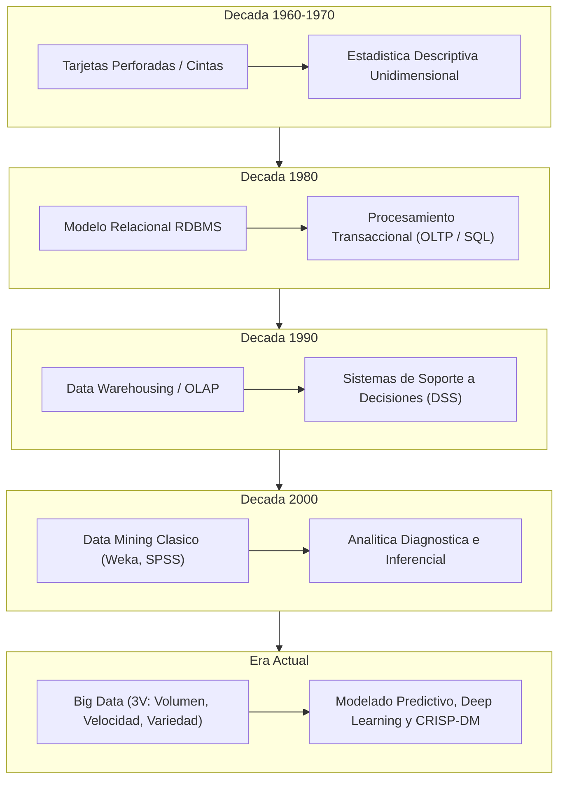
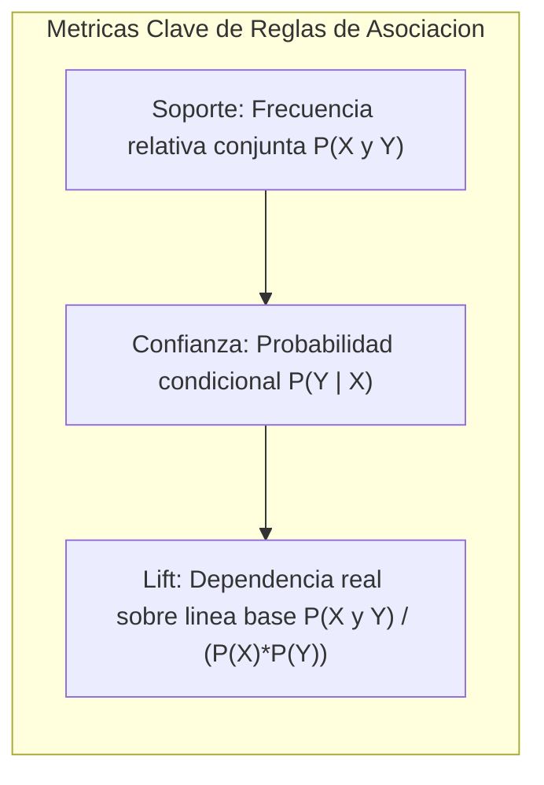
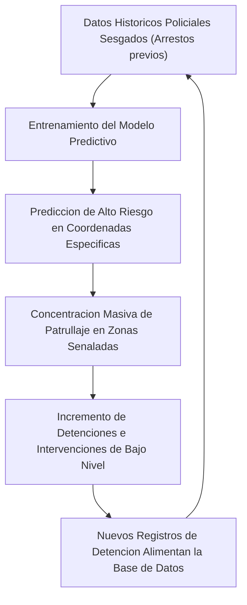

# Clase 1: Fundamentos de Mineria de Datos, Evolucion Historica y Analitica Predictiva en Sistemas Sociotecnicos

> Proposito pedagogico: Comprender la genesis epistemologica de la mineria de datos (KDD), su evolucion historica frente a las arquitecturas relacionales y Big Data, su formalizacion matematica en analitica asociativa y predictiva, y auditar de forma critica el impacto etico, sociotecnico y sistemico del sesgo algoritmico en sistemas de seguridad y justicia predictiva.

## 1\. Contexto y Marco Conceptual

### Epistemologia del Descubrimiento de Conocimiento (KDD)

La mineria de datos (Data Mining) se define formalmente como el proceso analitico y computacional orientado al descubrimiento no trivial de patrones validos, novedosos, potencialmente utiles y comprensibles a partir de volumenes masivos de datos. Dentro del marco metodologico interdisciplinario, la mineria de datos no opera de manera aislada, sino como la etapa algoritmica central del proceso integral de Descubrimiento de Conocimiento en Bases de Datos (Knowledge Discovery in Databases - KDD).

La disciplina responde a la asimetria informativa contemporanea sintetizada en la maxima: **"Somos ricos en datos, pero pobres en conocimiento"**. La explosion tecnologica de las telecomunicaciones, el almacenamiento distribuido e internet provoco una transicion dramatica desde la escasez de informacion hacia la saturacion de datos crudos (Data Deluge), donde el factor critico de exito radica en la densidad cognitiva y el valor accionable que se extrae de dichos repositorios.


### El Axioma de W. Edwards Deming

El rigor del analisis de datos se apoya en el axioma de W. Edwards Deming:

> "In God we trust, all others must bring data" (En Dios confiamos, los demas deben traer datos).

En la toma de decisiones directivas y cientificas, este principio exige sustituir la heuristica subjetiva, la intuicion empirica no verificada y la suposicion no contrastada por evidencia estocastica, modelos cuantitativos reproducibles y metricas de rendimiento verificables.

### Taxonomia de los Paradigmas Analiticos

La evolucion de las capacidades analiticas en las organizaciones transita por cuatro horizontes de madurez conceptual y tecnica:

| **Paradigma** | **Pregunta Clave** | **Metodologias y Herramientas** | **Aporte Estrategico** |
| --- | --- | --- | --- |
| **Descriptivo** | ¿Que paso? | Estadistica descriptiva, agregaciones SQL, histogramas, distribuciones de frecuencia, dashboards de reporte. | Visibilidad retroactiva del estado operativo del sistema. |
| **Diagnostico** | ¿Por que paso? | Analisis de correlacion, segmentacion multivariada, tecnicas de perforacion (Drill-down), mineria asociativa. | Comprension de causales subyacentes y dependencias funcionales. |
| **Predictivo** | ¿Que pasara? | Modelos supervisados de clasificacion, regresion, series temporales, ensamblajes (Random Forest, XGBoost), redes neuronales. | Estimacion probabilistica de escenarios futuros y alertas tempranas. |
| **Prescriptivo** | ¿Que accion tomar? | Optimizacion estocastica, programacion matematica, simulacion de Monte Carlo, sistemas de recomendacion automatizados. | Optimizacion dinamica de politicas operativas y toma autonoma de decisiones. |

## 2\. Fundamentos Teoricos y Arquitectura

### Evolucion Cronologica de la Gestion y Analisis de Datos

La arquitectura tecnologica que soporta la ciencia de datos moderna es producto de una progresion computacional a lo largo de seis decadas:

1. **Decadas de 1960 y 1970 (Almacenamiento Físico y Estadistica Descriptiva):** Almacenamiento en tarjetas perforadas y cintas magneticas. Enfoque exclusivo en procesamiento batch, reportes univariados retrospectivos y contabilidad transaccional basica.

1. **Decada de 1980 (Consolidacion Relacional y SQL):** Formalizacion del modelo relacional por Edgar F. Codd y estandarizacion del lenguaje SQL. Gestion estructurada orientada al procesamiento de transacciones en linea (OLTP) y normalizacion (3NF) para garantizar integridad referencial.

1. **Decada de 1990 (Bodegas de Datos y Procesamiento Analitico):** Surgimiento del Data Warehousing impulsado por Ralph Kimball y Bill Inmon. Modelado dimensional (esquemas en estrella y copo de nieve), Procesamiento Analitico en Linea (OLAP) y Sistemas de Soporte a Decisiones (DSS).

1. **Decada de 2000 (Mineria de Datos Clasica):** Transicion hacia el descubrimiento de patrones y modelos predictivos preliminares. Difusion de algoritmos estadisticos y de machine learning mediante herramientas guiadas (Weka, SPSS Clementine, SAS Enterprise Miner). Estandarizacion del ciclo de vida con CRISP-DM.

1. **Decada de 2010 a la actualidad (Era Big Data y Deep Learning):** Concurrencia de las tres dimensiones fundamentales del Big Data:

   - **Volumen:** Crecimiento masivo desde gigabytes hacia petabytes y exabytes.
   
   - **Velocidad:** Flujos de datos en tiempo real (streaming analytics, eventos iot).
   
   - **Variedad:** Ruptura de la exclusividad tabular mediante datos semiestructurados y no estructurados (JSON, texto natural, grafos, imagenes, audio, video) soportados en bases de datos NoSQL y Data Lakes.



## 3\. Implementacion Tecnica y Logica de Negocio

### Analisis de Cesta de la Compra (Market Basket Analysis)

Uno de los pilares fundacionales de la mineria de datos en entornos comerciales es la extraccion de patrones de co-ocurrencia mediante Reglas de Asociacion (Association Rules).

Formalmente, dado un conjunto de items $I = \{i_1, i_2, \dots, i_m\}$ y una base de transacciones $D = \{t_1, t_2, \dots, t_n\}$ donde cada transaccion $t_k \subseteq I$, una regla de asociacion se expresa como la implicacion:

$$
X \Rightarrow Y
$$

donde $X \subset I$, $Y \subset I$ y $X \cap Y = \emptyset$. El conjunto $X$ se denomina antecedente y el conjunto $Y$ consecuente.

### Metricas Matematicas de Evaluacion de Reglas

1. **Soporte (Support):** Proporcion de transacciones en la base de datos que contienen la union de los conjuntos $X$ e $Y$:

$$
Support(X \Rightarrow Y) = \frac{\sigma(X \cup Y)}{|D|} = P(X \cap Y)
$$

donde $\sigma(S)$ es la funcion de conteo de frecuencia del itemset $S$.

1. **Confianza (Confidence):** Probabilidad condicional de que una transaccion contenga el itemset $Y$ dado que ya contiene el itemset $X$:

$$
Confidence(X \Rightarrow Y) = \frac{Support(X \cup Y)}{Support(X)} = \frac{P(X \cap Y)}{P(X)} = P(Y | X)
$$

1. **Sustentacion / Elevacion (Lift):** Grado de dependencia estocastica entre el antecedente y el consecuente, controlando el efecto de la frecuencia marginal de $Y$:

$$
Lift(X \Rightarrow Y) = \frac{Confidence(X \Rightarrow Y)}{Support(Y)} = \frac{P(X \cap Y)}{P(X) \cdot P(Y)}
$$

Interpretacion rigurosa del valor de Lift:

- $Lift = 1$: Independencia estadistica estricta. La ocurrencia de $X$ no altera la probabilidad de ocurrencia de $Y$.

- $Lift > 1$: Co-ocurrencia positiva o atraccion complementaria. La presencia de $X$ incrementa significativamente la probabilidad de adquisicion de $Y$.

- $Lift < 1$: Sustitucion o repulsion mutua. La presencia de $X$ inhibe o reduce la probabilidad de adquisicion de $Y$.



### Implementacion Computacional en Python

```python
import pandas as pd
from mlxtend.preprocessing import TransactionEncoder
from mlxtend.frequent_patterns import apriori, association_rules

# Dataset transaccional ilustrativo de canasta matutina
transacciones = [
    ['pan_molde', 'cafe_instantaneo', 'mantequilla', 'queso'],
    ['mermelada', 'cafe_instantaneo'],
    ['pan_molde', 'mantequilla', 'queso'],
    ['leche', 'pan_molde', 'mantequilla'],
    ['cafe_instantaneo', 'pan_molde', 'mantequilla', 'mermelada']
]

# Transformacion One-Hot Encoding matricial
te = TransactionEncoder()
te_ary = te.fit(transacciones).transform(transacciones)
df_transaccional = pd.DataFrame(te_ary, columns=te.columns_)

# Mineria de itemsets frecuentes (Umbral minimo de soporte: 40%)
itemsets_frecuentes = apriori(df_transaccional, min_support=0.4, use_colnames=True)

# Generacion y filtrado de reglas asociativas (Umbral minimo de confianza: 60%)
reglas = association_rules(itemsets_frecuentes, metric="confidence", min_threshold=0.6)

# Seleccion de atributos analiticos relevantes ordenados por Lift
columnas_interes = ['antecedents', 'consequents', 'support', 'confidence', 'lift']
reglas_destiladas = reglas[columnas_interes].sort_values(by='lift', ascending=False)
```

## 4\. Analisis Critico de Casos y Auditoria Practica

### Caso Comercial: El Paradigma de "Cerveza y Panales"

El relato sobre la asociacion entre cerveza y panales los viernes por la tarde en cadenas de retail estadounidenses ilustra la capacidad de la mineria de datos para descubrir relaciones no obvias y contraintuitivas que escapan a la deduccion teorica tradicional.

Estrategias de Merchandising Derivadas de Reglas Asociativas:

1. **Colocacion Adyacente (Cross-Merchandising Directo):** Ubicar productos complementarios en la misma cabecera de gondola para acelerar la decision de compra por conveniencia y reducir friccion.

1. **Separacion Espacial Estrategica (Cross-Merchandising Inducido):** Situar el producto ancla en el fondo del establecimiento comercial y el producto complementario en una zona de transito obligatorio, forzando al comprador a recorrer pasillos intermedios e incrementando la probabilidad de compras impulsivas adicionales.

1. **Empaquetado y Descuento Cruzado (Bundling):** Aplicar promociones cruzadas (ej. descuento en salchichas por la compra de pan en visperas de festividades), donde el margen cedido en un item se compensa ampliamente por el volumen de venta del conjunto.

### Sistemas de Recomendacion Automatizados

En el comercio electronico y servicios digitales (Amazon, Netflix, Coursera, TikTok), la mineria de datos alimenta sistemas de recomendacion basados en dos arquitecturas principales:

- **Filtrado Basado en Contenido (Content-Based Filtering):** Perfilamiento de atributos intrinsecos de los items consumidos previamente (genero, director, etiquetas tematicas).

- **Filtrado Colaborativo (Collaborative Filtering):** Modelado matricial de similitud entre usuarios o entre items (User-Item Interaction Matrix), infiriendo preferencias a partir de vecindades estocasticas de comportamiento homogeneo.

### Auditoria Sociotecnica: Policia Predictiva en el LAPD

El despliegue de modelos predictivos en areas de alto riesgo social representa uno de los debates contemporaneos mas criticos en la ciencia de datos aplicada. El Departamento de Policia de Los Angeles (LAPD) implemento una sucesion de programas analiticos orientados a la vigilancia territorial:

| **Programa** | **Periodo** | **Fundamento Tecnico y Heuristica** | **Vulnerabilidades y Resultados Criticos** |
| --- | --- | --- | --- |
| **Operation LASER** | 2011 - 2019 | Identificacion de puntos de anclaje territorial (Anchor Points) y zonas de patrullaje intensivo (Laser Zones). Generacion de boletines de delincuentes cronicos puntuando personas mediante matrices de riesgo basadas en paradas y arrestos previos. | Falta total de transparencia en los criterios de puntaje. Concentracion desproporcionada de vigilancia sobre minorias afroamericanas y latinas. Violacion de garantias procesales y estigmatizacion barrial. |
| **PredPol** | 2012 - 2020 | Algoritmo de procesos de puntos estocasticos derivado de modelos sismologicos de replicas de terremotos (ETAS - Epidemic-Type Aftershock Sequence). Consideraba que la ocurrencia de delitos menores contra la propiedad genera replicas espaciotemporales inmediatas en cuadras de 150x150 metros. | Sesgo de retroalimentacion acumulativa: los patrulleros enviados intensivamente a una zona registran mas delitos menores, lo que induce al algoritmo a predecir mayor criminalidad futura en la misma coordenada geografica. |
| **DFP (Data-Informed Community-Focused Policing)** | 2020 - Actualidad | Estrategia de relevo tras la cancelacion forzada de LASER y PredPol. Formalmente orientada a la resolucion comunitaria y transparencia institucional basada en datos. | Rebranding institucional: opero con fuentes de datos no saneadas y mantuvo practicas subyacentes de patrullaje focalizado sin una reforma estructural de las heuristicas algoritmicas ni supervision civil independiente. |

### El Bucle de Retroalimentacion Algoritmica (Runaway Feedback Loop)

La falla metodologica fundamental de PredPol y sistemas analogos radica en confundir **tasa de delito real** con **tasa de arrestos documentados**. Los modelos se entrenan con datos operativos de intervencion policial historica, no con una observacion omnisciente del crimen.



## 5\. Principios de Diseno, Buenas Practicas y Anti-patrones

### Reglas de Oro en Mineria de Datos Aplicada

1. **La Tecnologia Predictiva no es Axiologicamente Neutra:** Los algoritmos no operan en un vacio formal; heredan, codifican y amplifican las asimetrias, discriminaciones y sesgos de seleccion intrinsecos a los datos con los que fueron parametrizados.

1. **Interpretabilidad y Explicabilidad (XAI):** En dominios de alto impacto institucional (seguridad, justicia penal, salud, evaluacion de riesgo crediticio), es inaceptable emplear modelos de "caja negra" que carezcan de trazabilidad sobre los pesos o factores causales de la inferencia.

1. **Supervision Externa y Gobernanza Multidisciplinaria:** Todo sistema sociotecnico automatizado debe estar sujeto a auditorias periodicas conducidas por observatorios independientes, integrando fiscalizacion tecnica, etica y legal para salvaguardar los derechos fundamentales de la poblacion.

### Anti-patrones Metodologicos Identificados

| **Anti-patron** | **Descripcion del Error** | **Impacto Tecnico / Social** | **Mitigacion Metodologica** |
| --- | --- | --- | --- |
| **Lavado de Sesgos (Data Laundering)** | Creer que la transformacion matematica o algoritmica purifica datos de entrada sesgados o corruptos. | Institucionalizacion del sesgo bajo una falsa percepcion de objetividad cientifica. | Auditorias de equidad (Fairness Metrics), desbalance de representacion y paridad estadistica demografica. |
| **Rebranding Cosmetico** | Renombrar un sistema o producto tras una falla sin modificar el codigo fuente, las variables explicativas o los datos base. | Perdida de confianza de los interesados y perpetuacion de deficiencias estructurales. | Redefinicion del pipeline, depuracion de atributos discriminatorios y cambio del marco de modelado. |
| **Confabulacion de Muestra con Poblacion** | Asumir que las observaciones registradas por conveniencia u operatividad representan fielmente a la poblacion universal. | Inferencia invalida y sobreajuste sistematico hacia zonas o perfiles hipervigilados. | Disenos de muestreo probabilistico y control sistematico de variables de confusion (Confounders). |

## 6\. Sintesis Conceptual y Profundizacion Academica

### Sintesis Integradora

La mineria de datos constituye una disciplina cientifica rigurosa orientada a transformar datos masivos en conocimiento de alto valor predictivo. Su aplicacion en analitica de negocios y retail revela correlaciones complejas que potencian la optimizacion comercial y operativa. No obstante, cuando los modelos predictivos se trasladan a la esfera publica y de seguridad ciudadana sin las debidas salvaguardas de gobernanza, reproducen bucles de retroalimentacion que amenazan la equidad social. La excelencia en ciencia de datos exige tanto pericia matematica como responsabilidad etica en el diseno algoritmico.

### Preguntas Guia para la Investigacion de Posgrado

1. ¿Como formular matematicamente funciones de perdida en algoritmos supervisados que penalicen la disparidad de impacto sobre subgrupos demograficos vulnerables sin degradar el rendimiento global del modelo?

1. ¿De que manera los metodos de explicabilidad local agnosticos del modelo (como SHAP o LIME) permiten desarticular bucles de retroalimentacion en sistemas de soporte a decisiones criticas?

### Referencias Bibliograficas Fundamentales

- Agrawal, R., &amp; Srikant, R. (1994). *Fast Algorithms for Mining Association Rules in Large Databases*. Proceedings of the 20th International Conference on Very Large Data Bases (VLDB).

- Fayyad, U., Piatetsky-Shapiro, G., &amp; Smyth, P. (1996). *From Data Mining to Knowledge Discovery in Databases*. AI Magazine, 17(3), 37-54.

- O'Neil, C. (2016). *Weapons of Math Destruction: How Big Data Increases Inequality and Threatens Democracy*. Crown Publishing Group.

- Ferguson, A. G. (2017). *The Rise of Big Data Policing: Surveillance, Race, and the Future of Law Enforcement*. NYU Press.

- Deming, W. E. (1986). *Out of the Crisis*. MIT Center for Advanced Educational Services.

---
