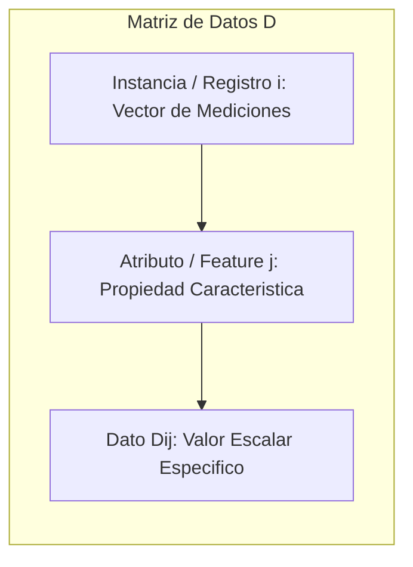
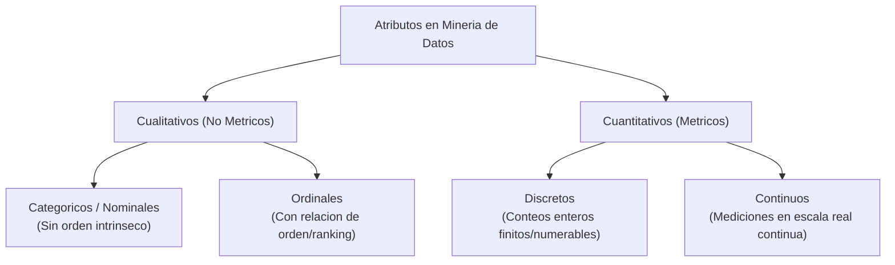
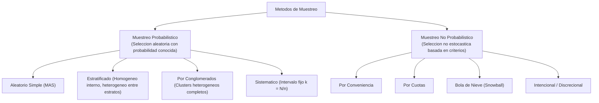
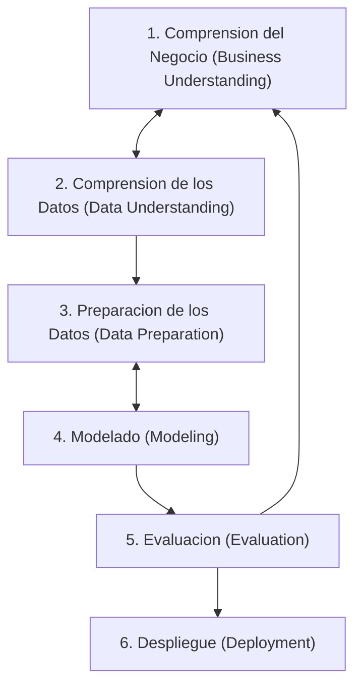
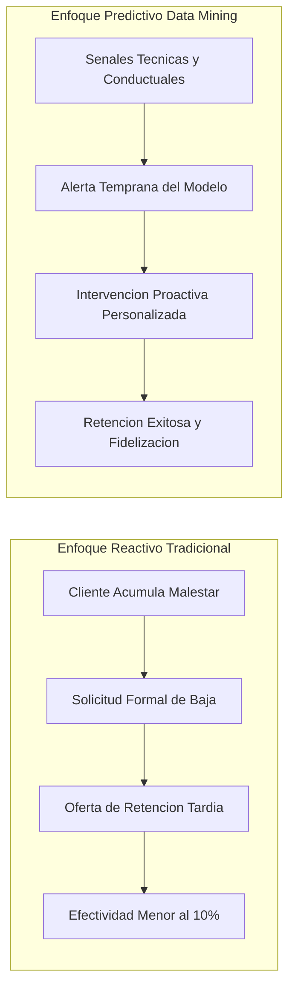

# Clase 2: Tipologia de Datos, Teoria del Muestreo, Limpieza y Ciclo de Vida CRISP-DM

> Proposito pedagogico: Dominar la taxonomia formal de tipos de datos y escalas de medicion de atributos, formalizar el diseno teorico del muestreo estadistico probabilistico y no probabilistico, sistematizar protocolos de depuracion y saneamiento de datos (Data Wrangling), y estructurar proyectos analiticos integrales bajo el estandar metodologico CRISP-DM aplicado a la prediccion de abandono de clientes (Churn).

## 1\. Contexto y Marco Conceptual

### Ontologia del Dato y el Atributo

En la ingenieria y mineria de datos, es fundamental establecer una distincion rigurosa entre las unidades fundamentales de observacion:

- **Dato / Instancia:** Es la representacion simbolica, formal y concreta de un hecho u observacion empirica (un registro, tupla o vector de observaciones dentro de un espacio dimensional).

- **Atributo / Variable / Feature:** Es una caracteristica o propiedad cuantitativa o cualitativa que describe a una entidad u objeto de estudio (la dimension o columna en una matriz estructurada).



### El Principio "Garbage In, Garbage Out" (GIGO)

El desempeno de cualquier algoritmo de machine learning o mineria predictiva esta estrictamente acotado por la calidad intrinseca del conjunto de datos de entrada. En la practica profesional y academica, las fases de adquisicion, saneamiento y preparacion de datos consumen entre el **50% y el 80% del tiempo y esfuerzo total** de un proyecto analitico. Un dataset contaminado con redundancias, errores ortograficos, tipos inconsistentes o valores faltantes no modelados invalidara cualquier optimizacion algoritmica posterior.

### El Aforismo de Benjamin Disraeli y Mark Twain

En la interpretacion de informacion cuantitativa rige la sentencia clasica:

> "Hay tres clases de mentiras: mentiras, grandes mentiras y estadisticas."

Este adagio sintetiza el riesgo sistemico de instrumentalizar tecnicas cuantitativas rigurosas sobre datos recolectados bajo disenos muestrales sesgados o deficientes (como se evidencia frecuentemente en encuestas electorales de opinion publica o sondeos con cobertura no representativa). La validez de una inferencia depende primordialmente de la pureza metodologica del muestreo y de la integridad del preprocesamiento.

## 2\. Fundamentos Teoricos y Arquitectura

### Taxonomia Formal de Tipos de Atributos y Escalas de Medicion

De acuerdo con la teoria de escalas de medicion de Stanley Smith Stevens, los atributos se categorizan segun las operaciones algebraicas admisibles sobre sus valores:

| **Escala / Tipo** | **Subtipo** | **Operaciones Matematicas Validas** | **Estadisticos Admisibles** | **Ejemplos Ilustrativos** |
| --- | --- | --- | --- | --- |
| **Categorico (Nominal)** | Dicotomico / Politomico | Igualdad y diferencia ($=, \neq$) | Moda, conteo de frecuencias, entropia de informacion | Estado clinico (sano/enfermo), tipos de queso (cheddar, suizo), URLs, identificadores alfanumericos |
| **Ordinal** | Ranking / Escala discreta | Orden y jerarquia ($\lt, \gt, \le, \ge$) | Mediana, percentiles, correlacion de rangos (Spearman, Kendall) | Tallas de cafe (alto, grande, venti), escalas Likert de satisfaccion (1 a 5), rankings 'Top N' de produccion |
| **Cuantitativo** | Discreto ($X \in \mathbb{N}_0$) | Aritmetica completa ($+, -, \times, \div$) | Media, varianza, desviacion estandar, coeficientes de asimetria | Numero de hijos, cantidad de transacciones, copas de cafe diarias |
| **Cuantitativo** | Continuo ($X \in \mathbb{R}$) | Aritmetica completa ($+, -, \times, \div$) | Densidades de probabilidad continuas, momentos estadisticos superiores | Presion en PSI, tasa de desempleo (%), temperatura, ingresos financieros |



### Representacion Computacional y Neutralidad Axiologica

Cuando un atributo categorico (ej. genero o presencia de enfermedad) se codifica numericamente como $0$ y $1$, dicha transformacion obedece exclusivamente a requerimientos de calculo vectorial en computacion. No introduce ninguna relacion de superioridad aritmetica ($1 \gt 0$). Para evitar que los algoritmos basados en distancias (KNN, SVM, redes neuronales) interpreten magnitudes ordinales falsas, se debe emplear **One-Hot Encoding** (variables dummy binarias) en atributos nominales politomicos.

### Teoria y Metodos de Muestreo Estadistico (Sampling Theory)

En la exploracion de datos masivos, examinar la poblacion completa resulta computacionalmente inviable o economicamente prohibitivo. El censo captura la totalidad poblacional ($N$), mientras que el muestreo extrae un subconjunto representativo ($n \ll N$) disenado para minimizar la varianza de los estimadores y controlar el margen de error muestral $e$.



#### Caracterizacion de Tecnicas de Muestreo

1. **Muestreo Probabilistico:**

   - **Aleatorio Simple (MAS):** Cada elemento poblacional tiene identica probabilidad de inclusion: $P(i) = \frac{n}{N}$. Garantiza la insesgadez teorica del estimador de la media.
   
   - **Estratificado:** La poblacion se divide en $L$ subgrupos mutuamente excluyentes (estratos) con baja varianza interna y alta varianza externa (ej. clasificacion por grupo etario o tipo de transporte). Permite asignacion proporcional o asignacion optima de Neyman segun la dispersion interna de cada estrato.
   
   - **Por Conglomerados (Cluster Sampling):** La poblacion se agrupa en unidades naturales multivariadas (colegios, manzanas urbanas). Se seleccionan conglomerados al azar y se censan exhaustivamente sus integrantes.
   
   - **Sistematico:** Se selecciona un elemento cada intervalo regular $k = \lfloor \frac{N}{n} \rfloor$, a partir de un punto de partida aleatorio $r \in [1, k]$. Requiere validar la ausencia de periodicidades ocultas en el ordenamiento del padron.

1. **Muestreo No Probabilistico:**

   - **Por Conveniencia:** Basado en la accesibilidad inmediata del investigador. Produce sesgos severos de autoseleccion.
   
   - **Por Cuotas:** Asignacion de metas numericas por segmento demografico sin seleccion estocastica dentro de la cuota.
   
   - **Bola de Nieve (Snowball):** Un sujeto inicial refiere a contactos sucesivos dentro de su red social. Tecnica estandar para relevar poblaciones ocultas, marginales o hiperespecializadas (ej. expertos en nichos de Inteligencia Artificial).

### Diseno Metodologico de Instrumentos de Captura (Encuestas)

El diseno de encuestas constituye la interfaz directa entre el fenomeno real y el repositorio analitico:

- **Preguntas Cerradas vs Abiertas:** Las preguntas abiertas introducen alta dispersion semantica y elevan la complejidad del procesamiento. Las preguntas cerradas (escalas Likert ordenadas de 1 a 5 o de seleccion multiple mutualmente excluyente) permiten una parametrizacion cuantitativa directa.

- **Formulacion de Reactivos Sensibles:** Preguntas invasivas (temas financieros, salud reproductiva, violencia domestica) exigen diseno indirecto y tecnicas de respuesta aleatorizada o preguntas filtro contextuales para mitigar el sesgo de deseabilidad social.

- **Eficiencia Ergonomica:** Eliminar variables redundantes que el encuestador pueda inferir directamente o derivar de fuentes secundarias (como geolocalizacion automatica o contabilidad física visual), reduciendo la fatiga cognitiva del participante.

### Metodologia Estandar CRISP-DM

El proceso estandar de la industria para mineria de datos (Cross-Industry Standard Process for Data Mining - CRISP-DM) estructura el ciclo de vida de los proyectos en seis fases interconectadas e iterativas:



## 3\. Implementacion Tecnica y Logica de Negocio

### Protocolos de Depuracion y Preprocesamiento (Data Wrangling)

El saneamiento estructurado de bases de datos comprende cuatro intervenciones algoritmicas cardinales:

1. **Tratamiento de Valores Faltantes (Missing Values):**

   - *Eliminacion por filas (Listwise Deletion):* Admisible unicamente cuando el patron de perdida es Completamente al Azar (MCAR) y la proporcion de omision es inferior al 5% del dataset.
   
   - *Imputacion Logica/Deductiva:* Reconstruccion deterministica basada en dependencias funcionales entre atributos (ej. si el consumo reportado es de 3 tazas diarias, el indicador de consumo habitual de cafe debe inferirse como afirmativo).
   
   - *Imputacion Estadistica / Predictiva:* Asignacion de la media (para distribuciones simetricas gaussianas), mediana (para distribuciones con sesgo o colas pesadas), o imputacion multivariada por k-vecinos mas cercanos (KNN Imputer).

1. **Deteccion y Tratamiento de Outliers (Valores Atipicos):**

   - *Criterio del Rango Intercuartilico (Tukey IQR):* Definido por la diferencia $IQR = Q_3 - Q_1$. Las observaciones fuera del intervalo $[Q_1 - 1.5 \cdot IQR, \; Q_3 + 1.5 \cdot IQR]$ se etiquetan como anomalias potenciales.
   
   - *Criterio Z-Score:* Para variables con distribucion normal, $|z| = \left|\frac{x - \mu}{\sigma}\right| \gt 3$ senala anomalias extremas.
   
   - *Correccion Contextual:* Errores tipograficos evidentes (ej. edad registrada como 138 anos en lugar de 38, o 512 por error numerico de teclado) deben depurarse o excluirse formalmente bajo documentacion de auditoria.

1. **Escalamiento y Normalizacion:**

   - *Min-Max Normalization (Escalamiento al rango \[0, 1\]):*

$$
x_{scaled} = \frac{x - x_{min}}{x_{max} - x_{min}}
$$

- *Estandarizacion Z-Score (Media nula y varianza unitaria):*

$$
z = \frac{x - \mu}{\sigma}
$$

1. **Saneamiento Lexico y Normalizacion de Atributos Categoricos:**

   - Conversion sistematica a minusculas (Lowercasing).
   
   - Eliminacion de acentos y caracteres especiales diacriticos para prevenir inconsistencias de codificacion (UTF-8 vs ASCII).
   
   - Consolidacion de sinonimia y variaciones ortograficas multilingues (` milk ` $\rightarrow$ ` leche `, ` mermedada ` $\rightarrow$ ` mermelada `, ` mantequillla ` $\rightarrow$ ` mantequilla `, unificacion de ` yogurt ` y ` yogur `).

### Pipeline de Limpieza Transaccional en Python

```python
import pandas as pd
import unicodedata

def normalizar_texto(texto):
    """Limpia caracteres especiales, acentos y espacios superfluos."""
    if not isinstance(texto, str) or pd.isna(texto):
        return None
    # Descomposicion canonica para remover diacriticos
    texto_normalizado = unicodedata.normalize('NFD', texto)
    texto_sin_acentos = ''.join(c for c in texto_normalizado if unicodedata.category(c) != 'Mn')
    return texto_sin_acentos.strip().lower()

# Diccionario canonico de normalizacion lexica y correccion de inconsistencias
DICCIONARIO_CORRECCION = {
    'mantequillla': 'mantequilla',
    'mermedada': 'mermelada',
    'milk': 'leche',
    'yogurt': 'yogur'
}

def ejecutar_pipeline_limpieza(ruta_archivo_csv):
    """Carga y procesa un dataset transaccional con productos en columnas."""
    # Carga de datos crudos
    df_crudo = pd.read_csv(ruta_archivo_csv, sep=';', header=None)
    
    # Procesamiento elemento a elemento
    df_procesado = df_crudo.applymap(normalizar_texto)
    df_limpio = df_procesado.replace(DICCIONARIO_CORRECCION)
    
    # Extraccion de catalogo de productos unicos consolidados
    valores_totales = df_limpio.values.flatten()
    productos_unicos = sorted([p for p in set(valores_totales) if p is not None and p != ''])
    
    return df_limpio, productos_unicos
```

## 4\. Analisis Critico de Casos y Auditoria Practica

### Estudio de Caso: Modelado de Abandono de Clientes (Customer Churn Analytics)

El termino *Churn* proviene etimologicamente de *churning* (agitar/batir) y describe en gestion empresarial la tasa de rotacion o cancelacion de usuarios en modelos basados en suscripcion (telecomunicaciones, streaming, SaaS).

La aplicacion practica de CRISP-DM a la problematica de Churn revela la superioridad de los enfoques predictivos modernos:

| **Fase CRISP-DM** | **Actividades Tecnicas Clave** | **Entregables y Metricas de Evaluacion** |
| --- | --- | --- |
| **1\. Comprension del Negocio** | Formalizar el costo financiero del abandono. Calcular el Costo de Adquisicion de Clientes (CAC) frente al Costo de Retencion (CRC). Formular el KPI objetivo: reducir la tasa mensual de Churn en un porcentaje medible. | Plan del proyecto analitico y definicion de la funcion de perdida sensible a costos. |
| **2\. Comprension de los Datos** | Extraccion de bases transaccionales, consumo de banda ancha, antiguedad contractual, intermitencias tecnicas registradas y reportes al centro de atencion telefonica. | Analisis Exploratorio de Datos (EDA), identificacion de desbalances de clase (tasa de churn tipicamente entre 5% y 15%). |
| **3\. Preparacion de los Datos** | Imputacion de nulos, ingenieria de variables derivadas (ej. frecuencia de reclamos en los ultimos 90 dias, caidas de conexion), escalamiento numerico y balanceo de clases (SMOTE o submuestreo aleatorio). | Matriz de caracteristicas normalizada, particionada estrictamente en Train (70%), Validation (15%) y Test (15%). |
| **4\. Modelado** | Entrenamiento comparativo de algoritmos supervisados: Regresion Logistica regularizada, Arboles de Decision, Random Forest y XGBoost. Optimizacion de hiperparametros mediante Busqueda en Malla con Validacion Cruzada (Stratified K-Fold CV). | Modelos calibrados con ajuste probabilistico de scores de salida. |
| **5\. Evaluacion** | Validacion mediante metricas robustas ante desbalance: Area Bajo la Curva ROC (ROC-AUC), Curva Precision-Recall (PR-AUC) y matriz de confusion ponderada por costo economico de Falsos Negativos. | Determinacion del umbral de decision optimo segun rentabilidad operativa. |
| **6\. Despliegue** | Implementacion del pipeline de scoring batch diario o en tiempo real. Clasificacion semaforizada del riesgo de abandono (Alto, Medio, Bajo) integrada en los paneles del equipo de fidelizacion. | Monitoreo continuo de deriva conceptual (Concept Drift) y degradacion del rendimiento del modelo. |

### Transicion Paradigmatica en Telecomunicaciones: Reactivo vs Proactivo

- **Paradigma Reactivo Tradicional:** Esperar la recepcion formal de la solicitud de cancelacion de linea. En la era de la conexion por discado telefonico (Dial-Up) y primeras etapas de ADSL, los operadores ofrecian incentivos fisicos (telefonos inalambricos de obsequio) a clientes con baja en curso. Esta politica lograba tasas de retencion insignificantes (inferiores al 10%), dado que la decision de retiro ya habia madurado.

- **Paradigma Predictivo Contemporaneo:** Mediante mineria de datos, se detectan micro-patrones de insatisfaccion acumulada (incremento de latencia en el modem, consultas recurrentes de facturacion, reduccion gradual del consumo de datos) semanas antes de que el cliente formule su solicitud de baja. Esto permite ejecutar intervenciones de retencion proactivas de alto impacto (optimizacion tecnica remota, bonificaciones personalizadas).



### Evaluacion Comparativa de Enfoques de Muestreo

| **Metodo de Muestreo** | **Grado de Control de Sesgo** | **Costo y Complejidad Logistica** | **Escenario de Aplicacion Optimo** |
| --- | --- | --- | --- |
| **Aleatorio Simple** | Alto (Insesgado teorico) | Bajo / Moderado | Poblaciones homogeneas con padron nominal exhaustivo accesible. |
| **Estratificado** | Maximo (Representatividad balanceada) | Moderado / Alto | Poblaciones con subgrupos de alta disparidad demografica o clinica (ej. cohortes etnicas en prevalencia de enfermedades). |
| **Conglomerados** | Moderado (Sujeto a correlacion intra-cluster) | Bajo (Altamente eficiente geograficamente) | Estudios de campo territorialmente dispersos (ciudades, distritos escolares). |
| **Bola de Nieve** | Bajo (Alto sesgo de homofilia en la red) | Bajo | Comunidades cerradas, expertos tecnicos o grupos de dificil individualizacion. |

## 5\. Principios de Diseno, Buenas Practicas y Anti-patrones

### Reglas de Oro en Ingenieria y Mineria de Datos

1. **Inmutabilidad de la Fuente Cruda (Raw Data Immutability):** Los archivos de datos originales jamas deben sobrescribirse ni alterarse manualmente. Toda operacion de limpieza, filtrado y transformacion debe ejecutarse de forma programatica mediante scripts reproducibles y versionados en pipelines de datos.

1. **Estandarizacion de Nomenclaturas:** Adoptar convenciones estructuradas (` snake_case `, caracteres alfanumericos ASCII en minusculas) para nombres de columnas y atributos, evitando espacios en blanco, caracteres especiales y tildes que originen errores de serializacion en entornos distribuidos.

1. **Control Estricto de Separacion de Datos:** Toda transformacion con estado (calculo de medias, varianzas, imputadores, codificadores One-Hot) debe ajustarse (` fit `) **exclusivamente sobre el conjunto de entrenamiento (Train)** y aplicarse posteriormente (` transform `) sobre validacion y test, erradicando el riesgo de fuga de informacion.

### Anti-patrones Metodologicos en Muestreo y Preprocesamiento

| **Anti-patron** | **Mecanismo del Error** | **Impacto Tecnico / Consecuencia** | **Estrategia de Mitigacion** |
| --- | --- | --- | --- |
| **Fuga de Datos (Data Leakage)** | Normalizar o imputar el dataset completo antes de particionar en conjuntos de entrenamiento y prueba. | Estimaciones de rendimiento artificialmente optimistas que colapsan al desplegar el modelo en produccion. | Encapsular los pasos de saneamiento dentro de un ` Pipeline ` de scikit-learn o similar. |
| **Imputacion Ciega Central** | Reemplazar valores faltantes utilizando la media aritmetica en variables con asimetria pronunciada o distribuciones multimodales. | Distorsion de la varianza natural de la variable y creacion de artefactos estadisticos no existentes. | Usar la mediana en distribuciones asimetricas o metodos de imputacion multivariada predictiva (KNN, MICE). |
| **Sobre-limpieza (Over-cleaning)** | Eliminar sistematicamente todos los valores categorizados como outliers sin analisis de dominio. | Eliminacion inadvertida de las senales de mayor valor predictivo (ej. fraudes financieros, fallas severas de red). | Separar errores de tipeo de anomalias genuinas y documentar formalmente cada exclusion. |
| **Muestreo Ilusorio** | Extrapolar conclusiones a toda una poblacion a partir de muestras voluntarias de autoseleccion (ej. sondeos telefonicos abiertos). | Sesgo de participacion extremo donde solo responden los perfiles con posiciones polarizadas. | Implementar marcos de muestreo probabilistico con ponderacion de pesos post-estratificacion. |

## 6\. Sintesis Conceptual y Profundizacion Academica

### Sintesis Integradora

La tipologia de datos gobierna las tecnicas matematicas y algoritmos aplicables a cada problema analitico. El diseno riguroso del muestreo garantiza que la informacion capturada refleje fielmente la dinamica de la poblacion objetivo. El preprocesamiento y limpieza de datos constituye el cimiento operativo del cual depende la validez de los modelos predictivos. Finalmente, la metodologia CRISP-DM proporciona el marco de gobernanza estandarizado para articular los objetivos estrategicos del negocio con el rigor matematico de la ciencia de datos, posibilitando transiciones operativas trascendentales como la gestion proactiva de retencion de clientes.

### Preguntas Guia para la Investigacion de Posgrado

1. ¿Bajo que condiciones teoricas la imputacion multiple por ecuaciones encadenadas (MICE) supera asintoticamente a los modelos de completitud basados en autoencoders variacionales en datasets transaccionales de alta dimensionalidad?

1. ¿Como cuantificar la sensibilidad del estimador de Churn ante variaciones en la tasa de muestreo estratificado cuando existe un desbalance de clases extremo (razon superior a 1:100)?

### Referencias Bibliograficas Fundamentales

- Chapman, P., Clinton, J., Kerber, R., Khabaza, T., Reinartz, T., Shearer, C., &amp; Wirth, R. (2000). *CRISP-DM 1.0: Step-by-step data mining guide*. SPSS inc.

- Han, J., Kamber, M., &amp; Pei, J. (2011). *Data Mining: Concepts and Techniques* (3rd ed.). Morgan Kaufmann.

- Cochran, W. G. (1977). *Sampling Techniques* (3rd ed.). John Wiley &amp; Sons.

- Little, R. J., &amp; Rubin, D. B. (2019). *Statistical Analysis with Missing Data* (3rd ed.). John Wiley &amp; Sons.

- Stevens, S. S. (1946). *On the Theory of Scales of Measurement*. Science, 103(2684), 677-680.
