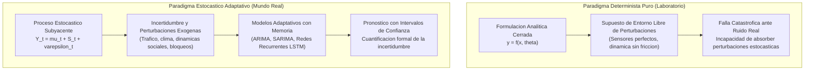
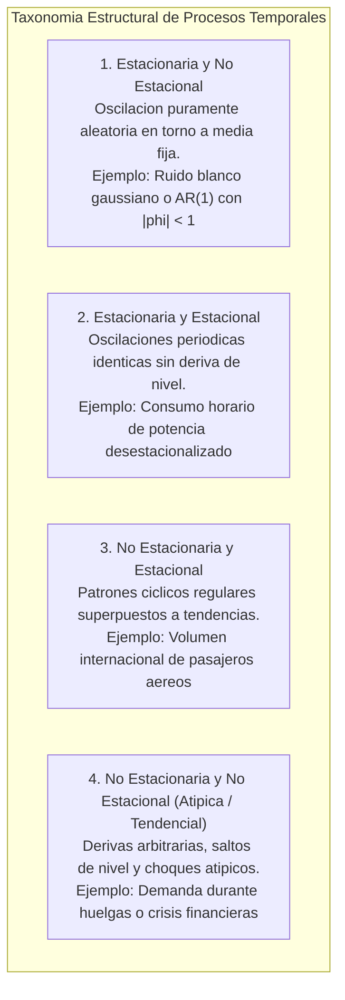
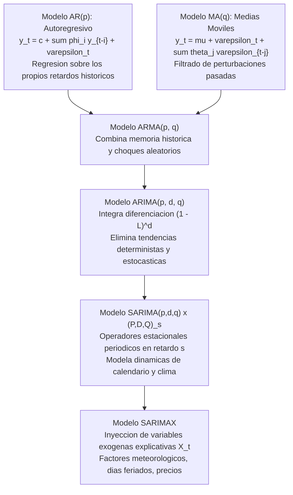
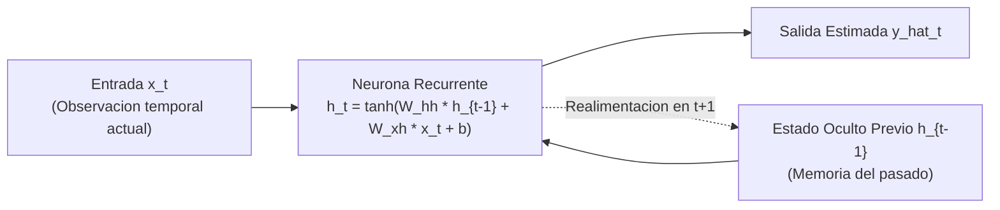
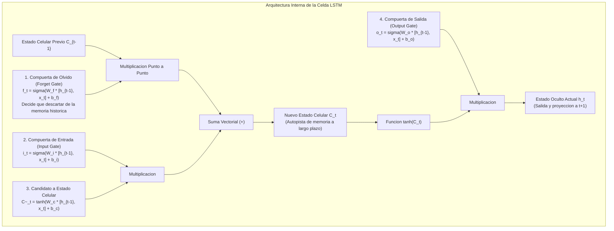
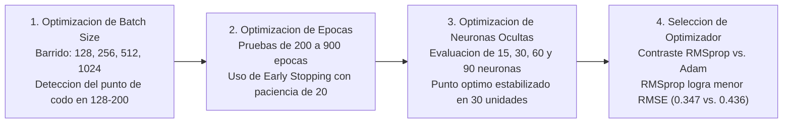
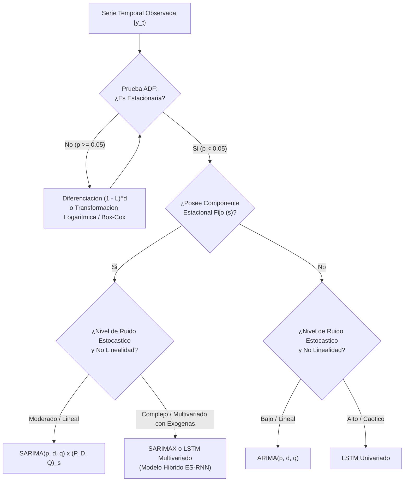

> **Objetivo de la Sesion**<br>
> 
> 
> Comprender y formalizar los principios epistemologicos y matematicos del modelado de series de tiempo en entornos estocasticos con alta incertidumbre; diferenciar rigurosamente entre estacionariedad y estacionalidad; analizar la jerarquia de modelos lineales de la familia Box-Jenkins (AR, MA, ARMA, ARIMA, SARIMA y ARMAX) y sus criterios de seleccion AIC/BIC; contrastar las limitaciones estructurales de los modelos estadisticos clasicos frente a las Redes Neuronales Recurrentes (RNN) y arquitecturas de Memoria de Corto y Largo Plazo (LSTM); examinar la evolucion historica de las competencias mundiales de pronostico de Spyros Makridakis (M1 a M6) y el hito de Deep Learning en M4; analizar casos practicos reales de proyeccion epidemiologica multivariada (HFMD en China) y prediccion de demanda estocastica en transporte publico masivo (buses de La Paz y Quillabamba-Cusco); estructurar protocolos de optimizacion por etapas en Deep Learning evaluando el sobreajuste y la deriva de conceptos (Concept Drift); y fundamentar las directrices de gobernanza de datos y privacidad en entornos de produccion corporativa.

---
# Clase 5: Series Temporales Estocasticas, Modelos Estadisticos Box-Jenkins (ARIMA/SARIMAX) y Redes Neuronales Recurrentes (RNN/LSTM)

## 1\. Contexto y Marco Conceptual: Estocasticidad, Incertidumbre y Complejidad Temporal

### 1.1. Epistemologia del Mundo Real: Sistemas Deterministas vs. Procesos Estocasticos

En el modelado cientifico, existe una discrepancia fundamental entre las formulaciones analiticas ideales de laboratorio y la naturaleza estocastica de los sistemas abiertos del mundo real. Mientras la fisica clasica asume relaciones deterministas puras (por ejemplo, la ley cinematica elemental de velocidad constante $v = d/t$), la aplicacion practica en entornos industriales, urbanos o corporativos colapsa ante la presencia ineludible de variables no controladas: friccion mecanica, pulsos de medicion inexactos, irregularidades del terreno, contingencias climaticas y decisiones humanas impredecibles.

Para ilustrar este fenomeno, se formaliza la analogia entre el "Fisico de Laboratorio" y el "Taxista Experimentado":

- **El Modelo Determinista (El Fisico de Laboratorio):** Suponiendo una competencia vehicular en una carretera sinuosa, un investigador con modelos cinematicos cerrados puede calcular la velocidad teorica de convergencia en curvas ideales; no obstante, carece de la capacidad de ajuste en tiempo real frente a perturbaciones imprevistas (desgaste irregular de neumaticos, baches en el asfalto, peatones cruzando intempestivamente, deslumbramiento solar).

- **El Modelo Estocastico Adaptativo (El Taxista):** Mediante la incorporacion iterativa de experiencia empirica directa frente a miles de escenarios estocasticos, el conductor ajusta dinamicamente sus reflejos y trayectorias. En terminos analiticos, este operador no resuelve una formula determinista rigida, sino que actualiza probabilidades y distribuciones condicionadas en tiempo real.



- **La Regla de Complejidad en Data Mining:** La red neuronal no constituye la primera opcion universal ante cualquier problema analitico. Si un sistema fisico o economico responde linealmente a una relacion funcional directa sin ruido espurio, despejar o calibrar un modelo matematico simple es computacionalmente optimo y metodologicamente transparente. Por el contrario, cuando los fenomenos se encuentran saturados de ruido estocastico, dinamicas no lineales y variabilidad externa multivariada, las arquitecturas de Deep Learning recurrente demuestran su verdadero valor explicativo y predictivo.

### 1.2. Taxonomia Estructural de Series Temporales: Estacionariedad vs. Estacionalidad

El analisis riguroso de una serie cronologica $\{y_t\}_{t \in T}$ exige clasificar de forma exhaustiva sus componentes parametricos:

- **Estacionariedad (Stationarity):** Un proceso estocastico es debilmente estacionario (estacionario de segundo orden) si sus momentos estadisticos fundamentales no dependen del origen temporal:

  1. Esperanza matematica constante: $\mathbb{E}[y_t] = \mu \quad \forall t$
  
  1. Varianza finita y homogenea: $\text{Var}(y_t) = \sigma^2 < \infty \quad \forall t$
  
  1. Autocovarianza dependiente exclusivamente del desfase o rezago $k$: $\text{Cov}(y_t, y_{t-k}) = \gamma_k \quad \forall t, k$
  
  En la practica, normalizar una serie implica centrar su media en $\mu = 0$ y escalar su varianza a $\sigma^2 = 1$ para asegurar comparabilidad numerica en algoritmos de aprendizaje.

- **Estacionalidad (Seasonality):** Representa fluctuaciones periodicas, predecibles y ciclicas que se repiten en intervalos regulares de tiempo $s$ (por ejemplo, ciclos semanales en transporte urbano, demandas trimestrales en retail o picos anuales en viajes aereos).



### 1.3. Descomposicion Clasica de Series y Pruebas de Hipotesis

Toda serie temporal puede desagregarse analiticamente en cuatro componentes ortogonales:

- **Tendencia (**$T_t$**):** Direccion sostenida a largo plazo (creciente, decreciente o constante).

- **Estacionalidad (**$S_t$**):** Oscilacion con periodicidad fija conocida $s$.

- **Ciclo (**$C_t$**):** Variaciones plurianuales asociadas a ciclos macroeconomicos o industriales (a menudo absorbidas en la tendencia en ventanas de estudio cortas).

- **Residuo o Ruido (**$R_t$**):** Perturbacion estocastica remanente no explicada, modelada como ruido blanco $\varepsilon_t \sim \mathcal{N}(0, \sigma^2)$.

La interaccion entre componentes puede formularse como:

- **Esquema Aditivo:** $Y_t = T_t + S_t + R_t$ (adecuado cuando la magnitud de la estacionalidad permanece constante independientemente del nivel global de la serie).

- **Esquema Multiplicativo:** $Y_t = T_t \times S_t \times R_t$ (adecuado cuando la amplitud de las oscilaciones estacionales crece de forma proporcional a la tendencia ascendente).

Para contrastar formalmente la estacionariedad de una serie se recurre a la **Prueba Aumentada de Dickey-Fuller (ADF Test)**:

$\Delta y_t = \alpha + \beta t + \gamma y_{t-1} + \sum_{i=1}^p \delta_i \Delta y_{t-i} + \varepsilon_t$

- **Hipotesis Nula (**$H_0$**):** $\gamma = 0$ (el proceso posee raiz unitaria, es decir, es no estacionario).

- **Hipotesis Alternativa (**$H_1$**):** $\gamma < 0$ (el proceso es estacionario).

- **Criterio de Decision:** Si el $p\text{-valor} < 0.05$, se rechaza $H_0$ a un nivel de significancia del 5%, certificando la estacionariedad requerida para el modelado autorregresivo.

---

## 2\. Fundamentos Teoricos: De los Modelos Box-Jenkins a las Redes Recurrentes

### 2.1. Jerarquia de Procesos Lineales Box-Jenkins (ARIMA / SARIMA / SARIMAX)

La metodologia econometrica clasica de Box-Jenkins aborda series temporales mediante combinaciones lineales de valores pasados y perturbaciones estocasticas:



1. **Modelo Autoregresivo AR(**$p$**):** La variable actual depende linealmente de sus $p$ observaciones inmediatamente anteriores ponderadas por los coeficientes $\phi_i$. Exige la condicion de estacionariedad (raices del polinomio caracteristico fuera del circulo unitario).

1. **Modelo de Medias Moviles MA(**$q$**):** Modela la serie como un promedio ponderado de los $q$ errores de pronostico previos $\varepsilon_{t-j}$. Exige invertibilidad del polinomio de choques.

1. **Modelo ARIMA(**$p, d, q$**):** Aplica $d$ rondas de diferenciacion ordinaria $\Delta^d = (1 - L)^d$ (donde $L$ representa el operador de retardo $L^k y_t = y_{t-k}$) para estabilizar la media de series no estacionarias con tendencia:

   $\Phi_p(L) (1 - L)^d y_t = c + \Theta_q(L) \varepsilon_t$

1. **Modelo SARIMA(**$p, d, q$**)**$\times$**(**$P, D, Q$**)**$_s$**:** Extiende el operador a rezagos estacionales de frecuencia $s$:

   $\Phi_p(L) \tilde{\Phi}_P(L^s) (1 - L)^d (1 - L^s)^D y_t = c + \Theta_q(L) \tilde{\Theta}_Q(L^s) \varepsilon_t$

1. **Extension Exogena (SARIMAX):** Permite incorporar matrices de covariables externas contemporaneas o rezagadas $\mathbf{X}_t$ (temperatura, feriados, precios de combustibles), modulando la dinamica interna de la serie.

### 2.2. Metricas de Distancia y Criterios de Informacion

Para calibrar y comparar modelos cuantitativamente se definen dos familias de metricas:

- **Criterios de Informacion para Seleccion de Orden (**$p, d, q$**):**

  - **Criterio de Akaike (AIC):** $\text{AIC} = 2k - 2\ln(\hat{L})$
  
  - **Criterio Bayesiano (BIC):** $\text{BIC} = k\ln(N) - 2\ln(\hat{L})$
  
  donde $k$ es el numero de parametros libres ajustados, $\hat{L}$ la maxima verosimilitud del modelo y $N$ el tamano muestral. El modelo optimo minimiza AIC/BIC, penalizando la complejidad estructural para mitigar el sobreajuste.

- **Metricas de Error de Pronostico en Test:**

  - **Error Cuadratico Medio (MSE) y RMSE:** $\text{RMSE} = \sqrt{\frac{1}{N} \sum_{t=1}^N (y_t - \hat{y}_t)^2}$. Mide la distancia euclidiana en las unidades naturales del fenomeno; penaliza severamente los errores grandes debido a la formulacion cuadratica.
  
  - **Error Absoluto Medio (MAE):** $\text{MAE} = \frac{1}{N} \sum_{t=1}^N |y_t - \hat{y}_t|$. Metrica robusta frente a observaciones atipicas transitorias.
  
  - **Error Porcentual Absoluto Medio (MAPE):** $\text{MAPE} = \frac{100\%}{N} \sum_{t=1}^N \left| \frac{y_t - \hat{y}_t}{y_t} \right|$. Proporciona interpretabilidad relativa porcentual.

### 2.3. Transicion hacia Redes Neuronales Recurrentes (RNN)

Las redes neuronales densas feedforward (MLP) tradicionales operan bajo el supuesto epistemologico de que las muestras de entrada son independientes e identicamente distribuidas ($iid$). Esta hipotesis es totalmente invalida en datos secuenciales y temporales, donde el valor observado en $t$ se encuentra intrinsecamente correlacionado con la historia $\{t-1, t-2, \dots\}$.

Para dotar a la red de dinamica temporal, las **Redes Neuronales Recurrentes (RNN)** introducen bucles ciclicos de realimentacion interna:



- **Formulacion de Recurrencia:**

  $h_t = \tanh(W_{hh} h_{t-1} + W_{xh} x_t + b_h)$
  
  $\hat{y}_t = W_{hy} h_t + b_y$

- **Patologia del Gradiente:** Durante el entrenamiento mediante Retropropagacion a Traves del Tiempo (BPTT - *Backpropagation Through Time*), los gradientes se multiplican sucesivamente por la matriz de pesos recurrentes $W_{hh}^k$. Conforme la longitud de la secuencia temporal $k$ se expande, los gradientes tienden a cero exponencialmente (**desvanecimiento del gradiente**) o crecen de forma descontrolada hacia el infinito (**explosion del gradiente**), inhabilitando a la RNN estandar para recordar dependencias a largo plazo.

### 2.4. Arquitectura de Memoria de Corto y Largo Plazo (LSTM)

Introducida por Sepp Hochreiter y Juergen Schmidhuber (1997), la celda **LSTM (Long Short-Term Memory)** neutraliza el desvanecimiento del gradiente introduciendo una autopista lineal de informacion denominada **Estado de Celda (**$C_t$**)**, regulada por compuertas diferenciables no lineales:



- **Ecuaciones Formales del Paso Hacia Adelante (Forward Pass):**

  1. **Compuerta de Olvido:** $f_t = \sigma(W_f [h_{t-1}, x_t] + b_f)$
  
  1. **Compuerta de Entrada:** $i_t = \sigma(W_i [h_{t-1}, x_t] + b_i)$
  
  1. **Candidato Celular:** $\tilde{C}_t = \tanh(W_c [h_{t-1}, x_t] + b_c)$
  
  1. **Actualizacion Celular:** $C_t = f_t \odot C_{t-1} + i_t \odot \tilde{C}_t$
  
  1. **Compuerta de Salida:** $o_t = \sigma(W_o [h_{t-1}, x_t] + b_o)$
  
  1. **Estado Oculto Emitido:** $h_t = o_t \odot \tanh(C_t)$

La adicion aditiva ($+$) en la celda permite que el gradiente fluya sin decaer exponencialmente hacia atras en el tiempo, confiriendo a la red la capacidad de modelar patrones secuenciales de cientos de pasos.

### 2.5. Epistemologia Historica del Pronostico: Las Competencias Mundiales de Makridakis (M-Competitions)

El desarrollo y validacion de las teorias de pronostico han sido catalizados historicamente por las competencias internacionales organizadas por Spyros Makridakis:

| Competencia | Ano | Volumen de Series | Dominio de Datos | Hallazgo Epistemologico Central | Hito Tecnologico Destacado |
| --- | --- | --- | --- | --- | --- |
| **M1** | 1982 | 1,001 | Macroeconomia, demografia, empresas | Los metodos estadisticos complejos no siempre superan al suavizamiento exponencial simple. | Consolidacion de modelos AR, MA y combinaciones ponderadas simples. |
| **M2** | 1993 | 29 | Series corporativas de alta extension | La inclusion de juicio de expertos y descomposicion formal mejora el desempeno. | Apogeo de los modelos de la familia ARIMA (Lawrence &amp; Fildes). |
| **M3** | 2000 | 3,003 | Finanzas, industria, demografia global | La combinacion de metodos disimiles reduce sistematicamente la varianza del pronostico. | Madurez de SARIMA y modelos hibridos estadisticos. |
| **M4** | 2018 | 100,000 | Demanda a escala masiva internacional | **Victoria historica del Deep Learning:** Las redes neuronales baten categoricamente a la econometria tradicional. | Modelo ES-RNN (Suavizamiento Exponencial + LSTM) creado por Slawek Smyl (Data Scientist de Uber). |
| **M5** | 2020 | 42,840 | Retail jeraquico (Walmart, EE.UU.) | Los ensembles de Gradient Boosting (LightGBM) combinados con DL dominan datos agregados. | Triunfo de Yanyuan (J.J.) Gu; integracion de precios, feriados y promociones exogenas. |
| **M6** | 2022-2024 | Finanzas / Portafolios | Activos bursatiles y factores ambientales | Validacion del Teorema de No Free Lunch: la efectividad depende de la relacion senal-ruido del dominio. | Modelos multifactoriales y evaluacion simultanea de retorno y riesgo de pronostico. |

El hito de **Slawek Smyl (Uber)** en M4 demostro que el modelo hibrido ES-RNN resolvio el dilema de la demanda estocastica de viajes de pasajeros: el componente de suavizamiento exponencial absorbe la tendencia y estacionalidad local individual, mientras que la red LSTM profunda aprende relaciones cruzadas no lineales y patrones latentes compartidos entre miles de series concurrentes.

---

## 3\. Implementacion Tecnica y Logica de Negocio en Python

A continuacion se presenta un pipeline completo y modular en Python que preprocesa datos de series de tiempo, genera tensores tridimensionales para redes recurrentes y contrasta el desempeno de ARIMA, SARIMA y una red neuronal LSTM:

```python
import numpy as np
import pandas as pd
from sklearn.preprocessing import MinMaxScaler
from sklearn.metrics import mean_squared_error, mean_absolute_error, mean_absolute_percentage_error
from statsmodels.tsa.statespace.sarimax import SARIMAX
from tensorflow.keras.models import Sequential
from tensorflow.keras.layers import LSTM, Dense, Dropout
from tensorflow.keras.callbacks import EarlyStopping

# 1. Generacion controlada de serie cronologica estocastica con estacionalidad y ruido
np.random.seed(42)
N = 144  # Por ejemplo, 12 anos de observaciones mensuales
t = np.arange(N)
tendencia = 0.5 * t
estacionalidad = 20.0 * np.sin(2 * np.pi * t / 12)
ruido_estocastico = np.random.normal(0, 4.0, N)
serie = 120.0 + tendencia + estacionalidad + ruido_estocastico

# 2. Particion cronologica rigurosa (80% Train, 20% Test) - Sin shuffle aleatorio
n_train = int(N * 0.8)
train_raw, test_raw = serie[:n_train], serie[n_train:]

# 3. Modelado Estadistico Lineal: ARIMA y SARIMA
# Modelo no estacional ARIMA(2, 1, 1)
modelo_arima = SARIMAX(train_raw, order=(2, 1, 1))
res_arima = modelo_arima.fit(disp=False)
pred_arima = res_arima.forecast(steps=len(test_raw))

# Modelo estacional SARIMA(2, 1, 1) x (1, 1, 1, 12)
modelo_sarima = SARIMAX(train_raw, order=(2, 1, 1), seasonal_order=(1, 1, 1, 12))
res_sarima = modelo_sarima.fit(disp=False)
pred_sarima = res_sarima.forecast(steps=len(test_raw))

# 4. Pipeline para Red Neuronal Recurrente LSTM
# Escalado estricto MinMax fit solo en train para mitigar Data Leakage
scaler = MinMaxScaler(feature_range=(0, 1))
train_scaled = scaler.fit_transform(train_raw.reshape(-1, 1))
test_scaled = scaler.transform(test_raw.reshape(-1, 1))

# Construccion de tensores con ventana deslizante (Lookback Window)
def crear_secuencias(datos, lookback=12):
    X, y = [], []
    for i in range(len(datos) - lookback):
        X.append(datos[i:i + lookback, 0])
        y.append(datos[i + lookback, 0])
    return np.array(X), np.array(y)

LOOKBACK = 12
X_train, y_train = crear_secuencias(train_scaled, LOOKBACK)
# Reshape tridimensional requerido por Keras: (samples, time_steps, features)
X_train = np.reshape(X_train, (X_train.shape[0], X_train.shape[1], 1))

# Preparacion de secuencias para evaluacion en Test
serie_total_scaled = np.vstack((train_scaled, test_scaled))
inputs_test = serie_total_scaled[len(train_scaled) - LOOKBACK:]
X_test, y_test_scaled = crear_secuencias(inputs_test, LOOKBACK)
X_test = np.reshape(X_test, (X_test.shape[0], X_test.shape[1], 1))

# 5. Definicion, regularizacion y compilacion del modelo LSTM
modelo_lstm = Sequential([
    LSTM(units=30, return_sequences=False, input_shape=(LOOKBACK, 1)),
    Dropout(0.15),
    Dense(units=1)
])
modelo_lstm.compile(optimizer="rmsprop", loss="mean_squared_error")

# Early stopping para prevenir sobreajuste
parada_temprana = EarlyStopping(monitor="loss", patience=20, restore_best_weights=True)
modelo_lstm.fit(X_train, y_train, epochs=250, batch_size=16, callbacks=[parada_temprana], verbose=0)

# Inferencia y transformacion inversa de escala
pred_lstm_scaled = modelo_lstm.predict(X_test, verbose=0)
pred_lstm = scaler.inverse_transform(pred_lstm_scaled).flatten()

# 6. Tabla Auditora de Rendimiento y Comparacion de Distancias
metricas = []
for nombre, y_estimado in [("ARIMA(2,1,1)", pred_arima), 
                           ("SARIMA(2,1,1)x(1,1,1)12", pred_sarima), 
                           ("LSTM(30 units, RMSprop)", pred_lstm)]:
    rmse = np.sqrt(mean_squared_error(test_raw, y_estimado))
    mae = mean_absolute_error(test_raw, y_estimado)
    mape = mean_absolute_percentage_error(test_raw, y_estimado) * 100.0
    metricas.append({"Modelo": nombre, "RMSE": round(rmse, 2), "MAE": round(mae, 2), "MAPE (%)": round(mape, 2)})

df_eval = pd.DataFrame(metricas).sort_values(by="RMSE")
print(df_eval.to_markdown(index=False))
```

---

## 4\. Analisis Critico de Casos y Auditoria Practica

### 4.1. Caso 1: Incidencia Epidemiologica de HFMD en Ningbo (China) con Covariables Exogenas

En la literatura cientifica aplicada (evaluacion comparativa de series de salud publica en Ningbo, China), se audito la transmision de la enfermedad de manos, pies y boca (HFMD - *Hand, Foot, and Mouth Disease*), la cual exhibe una fuerte correlacion biologica con factores climaticos estacionales:

- **Variables Exogenas Analizadas:** Temperatura media superficial, humedad relativa (RH), velocidad del viento, indices de radiacion solar y dias de precipitacion continua.

- **Bateria de Modelos Contrastados:**

  1. ARIMA univariado ($5, 1, 4$).
  
  1. ARIMAX con componentes meteorologicos exogenos.
  
  1. LSTM univariado (alimentado unicamente por la serie de casos historicos).
  
  1. LSTM multivariado (incorporando la matriz multivariada de parametros meteorologicos).

- **Resultados y Diagnostico:**

| Modelo Evaluado | Tipo Arquitectonico | RMSE | MAE | MAPE (%) | Conclusiones Metodologicas |
| --- | --- | --- | --- | --- | --- |
| **ARIMA (5, 1, 4)** | Estadistico Lineal Univariado | Alto | Alto | Elevado | Captura la estacionalidad base pero sufre desfases ante anomalias termicas repentinas. |
| **ARIMAX (5, 1, 4)** | Lineal con Variables Exogenas | Moderado | Moderado | Moderado | La relacion lineal entre temperatura y contagio satura en valores extremos. |
| **LSTM Univariado** | Deep Learning Recurrente | Bajo | Bajo | Bajo | Mejora la precision gracias a su capacidad de absorcion de choques no lineales. |
| **LSTM Multivariado (Clima)** | Deep Learning Recurrente No Lineal | Minimo Optimo | Minimo Optimo | Minimo Optimo | **Ganador categórico:** La interaccion dinamica no lineal entre humedad y temperatura reduce significativamente el error. |

### 4.2. Caso 2: Demanda Estocastica en Sistemas de Transporte Municipal de Buses

El dimensionamiento de flotas de transporte urbano representa un problema canonico de optimizacion operativa. Si se asignan unidades en defecto, se producen colapsos de servicio y demoras excesivas; si se asignan en exceso, se incurre en consumo innecesario de combustible y desgaste mecanico.

#### A. Optimizacion Arquitectonica por Etapas (Proyecto de Transporte Urbano PumaKatari, La Paz)

A partir de un registro de mas de 25 millones de viajes en 11 rutas municipales entre 2016 y 2019 (con contrastes marcados como la ruta hacia Chasquipampa, caracterizada por alta densidad y trayecto extenso), se ejecuto una estrategia sistematica de optimizacion en cuatro etapas:



- **Hallazgo Empirico:** En problemas de series temporales no estacionarias con ruido estocastico concentrado, el optimizador **RMSprop** supero a Adam, ya que modula la tasa de aprendizaje mediante la media movil del cuadrado de los gradientes recientes sin aceleraciones por momento inercial que puedan desviar la busqueda ante choques transitorios.

#### B. Dinamica de Alta Estocasticidad (Buses Interprovinciales Quillabamba - Cusco)

Al trasladar el modelado a rutas con alta variabilidad estocastica (paros civicos, bloqueos carreteros, eventos festivos locales y condiciones geograficas complejas):

- **ARIMA (5, 1, 6):** Presenta un RMSE de 3,041 pasajeros; tiende a converger hacia una trayectoria media plana, incapaz de adaptarse a picos repentinos.

- **SARIMA (5, 0, 3)**$\times$**(0, 1, 1)**$_7$**:** Logra capturar la ciclicidad de 7 dias (lunes laboral vs. domingo de baja demanda), pero alcanza un RMSE de 3,626 debido al desfase de amplitud en dias de demanda extraordinaria.

- **LSTM Multicapa:** Reduce el RMSE a niveles significativamente inferiores al capturar relaciones no lineales y variaciones bruscas de la distribucion.

- **Construccion de Bandas de Incertidumbre:** Al presentar resultados a directivos o instancias gerenciales, es mandatorio emitir estimaciones probabilísticas con intervalos de prediccion (cota superior e inferior). Esto permite justificar discrepancias operativas: el pronostico no asegura una cifra determinista exacta, sino una banda de oscilacion admisible fundamentada estadisticamente.

### 4.3. Auditoria del Riesgo de Sobreajuste en Deep Learning

Un error metodologico recurrente en la aplicacion de redes neuronales consiste en sobredimensionar la capacidad del modelo asumiendo falsamente que mas capas y neuronas garantizan mayor precision.

**Evidencia Experimental en Vivo:**

Al incrementar arbitrariamente la complejidad de una LSTM para pasajeros aereos de 1,024 neuronas a una arquitectura hipertrofiada de 2,048 + 1,024 + 512 + 256 unidades:

- La curva de funcion de perdida (*loss*) presento oscilaciones caoticas (de 0.09 a 0.01, saltando a 0.17 y divergiendo).

- El modelo memorizo el ruido aleatorio del conjunto de entrenamiento perdiendo capacidad de generalizacion en el conjunto de prueba.

- **Resultado:** El RMSE final fue sustancialmente superior al obtenido por el modelo simple y quedo por debajo del desempeno del SARIMA tradicional.

- **Principio Fundamental:** En Machine Learning y Deep Learning rige el principio de parsimonia (*Navaja de Ockham*). El modelo optimo es la arquitectura mas simple capaz de generalizar adecuadamente los datos no vistos.

---

## 5\. Principios de Diseno, Ciclo de Vida y Anti-patrones

### 5.1. Reglas de Oro en Series Temporales y Produccion Industrial

1. **Particion Temporal Estricta:** Queda terminantemente prohibido utilizar validacion cruzada aleatoria (` KFold ` estandar) o desordenar aleatoriamente (*shuffle*) series temporales. Se debe emplear siempre particion cronologica contigua o ventanas deslizantes hacia adelante (*TimeSeriesSplit*) para evitar fuga temporal de datos (*lookahead bias*).

1. **Monitoreo Continuo de Deriva (Concept Drift y Data Drift):** Ningun modelo en produccion es estatico. Cambios en las condiciones de contorno (incorporacion de nuevos buses a la flota, cambio en regulaciones viales, impacto de festividades de carnaval, huelgas) alteran la distribucion de probabilidad $P(y \mid x)$ o la funcion generadora $P(x)$. Es indispensable programar reentrenamientos periodicos (mensuales o semanales).

1. **El Prerrequisito Ineludible de la Digitalizacion:** Es imposible aplicar inteligencia artificial o mineria de datos sin una infraestructura subyacente de captura digital limpia. Las promesas institucionales de IA colapsan si los registros no estan digitalizados, depurados y estructurados en bases de datos confiables.

1. **Cumplimiento Etico y Normativo de Datos (GDPR y Restricciones Institucionales):** El acceso a datos corporativos o gubernamentales exige estricta subordinacion a regulaciones de privacidad (GDPR, eliminacion efectiva de identificadores de usuarios a peticion, secreto estadistico). Traspasar estos limites por imprudencia analitica conlleva responsabilidades administrativas, legales y penales graves.

### 5.2. Anti-patrones Comunes en Modelado Secuencial

| Anti-patron | Descripcion del Error | Consecuencia Analitica | Remedio Metodologico |
| --- | --- | --- | --- |
| **Hipertrofia Arquitectonica (Over-parameterization)** | Agregar miles de neuronas y decenas de capas LSTM a series de unos pocos cientos de registros. | Sobreajuste masivo (*overfitting*), memorizacion de ruido y colapso de la capacidad de generalizacion. | Comenzar con arquitecturas esbeltas (15 a 50 neuronas), regularizacion con Dropout y parada temprana. |
| **La Trampa del Pronostico a Un Solo Paso (One-Step Trap)** | Evaluar unicamente predicciones a un paso adelante ($h=1$) para concluir que el modelo es robusto. | A un paso casi cualquier metodo trivial parece exacto; al proyectar a $h=20$ o $h=50$, el error explota exponencialmente. | Evaluar el cono de incertidumbre multi-paso y auditar el crecimiento del RMSE conforme avanza el horizonte $h$. |
| **Uso Desproporcionado de Deep Learning (Silver Bullet Fallacy)** | Implementar redes neuronales profundas para series deterministicas o altamente lineales sin ruido. | Costo computacional disparado, falta de interpretabilidad y resultados inferiores a modelos analiticos o lineales simples. | Realizar siempre pruebas de hipotesis (ADF) y contrastar contra modelos base lineales (ARIMA, SARIMA, OLS). |
| **Data Leakage por Escalado Global** | Ajustar el escalador ` MinMaxScaler ` sobre todo el dataset unificado antes de dividir en Train y Test. | Los valores maximos y minimos del futuro contaminan el entrenamiento, arrojando metricas de desempeno artificialmente infladas. | Ajustar el escalador (` fit `) estrictamente sobre el conjunto de entrenamiento y aplicar (` transform `) sobre el conjunto de prueba. |

---

## 6\. Sintesis Conceptual y Profundizacion Academica

### 6.1. Marco Sinoptico de Seleccion de Modelos



### 6.2. Referencias Epistemologicas y Lecturas Recomendadas

- **Box, G. E., Jenkins, G. M., Reinsel, G. C., &amp; Ljung, G. M.** (2015). *Time Series Analysis: Forecasting and Control* (5ta Ed., John Wiley &amp; Sons). Obra fundacional indispensable para comprender la formulacion matematica de los procesos AR, MA, ARIMA y funciones de autocorrelacion.

- **Hochreiter, S., &amp; Schmidhuber, J.** (1997). *Long Short-Term Memory*. Neural Computation, 9(8), 1735-1780. Articulo original que introduce la estructura de compuertas de la arquitectura LSTM para solucionar el desvanecimiento del gradiente.

- **Makridakis, S., Spiliotis, E., &amp; Assimakopoulos, V.** (2020). *The M4 Competition: Results, findings, problems and ways forward*. International Journal of Forecasting, 36(1), 54-74. Analisis riguroso del hito historico donde las redes neuronales superaron formalmente a los metodos econometricos tradicionales.

- **Smyl, S.** (2020). *A hybrid method of exponential smoothing and recurrent neural networks for time series forecasting*. International Journal of Forecasting, 36(1), 75-85. Diseno de la arquitectura ES-RNN desarrollada en Uber para proyeccion de demanda de movilidad.

---
