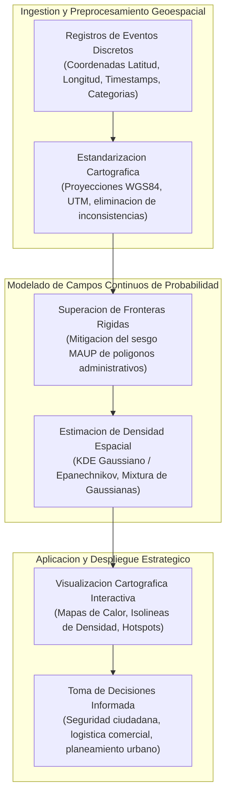
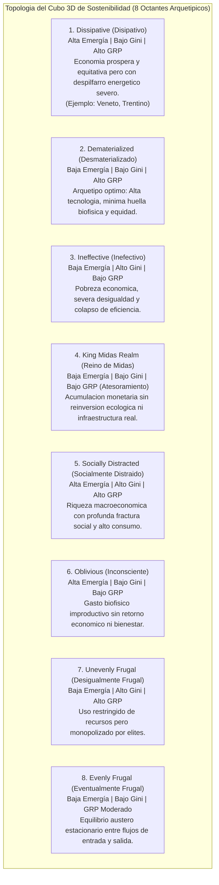
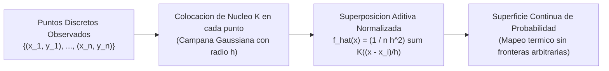
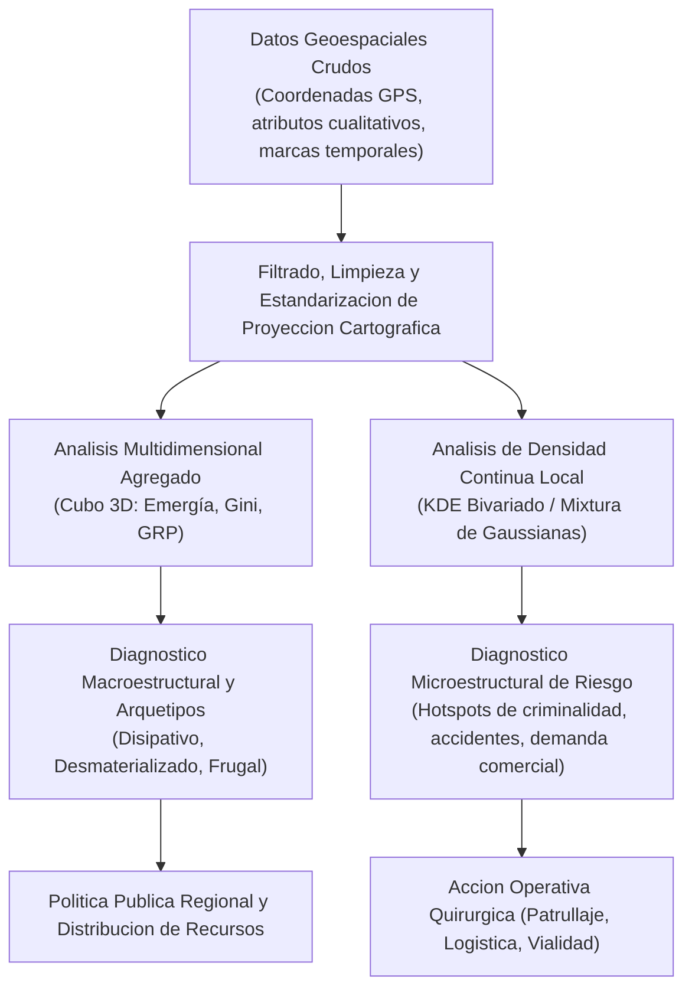

> **Objetivo de la Sesion**<br>
> 
> 
> Formalizar los fundamentos teoricos y metodologicos de la Mineria de Datos Espaciales (Spatial Data Mining) orientada al descubrimiento de patrones no triviales en fenomenos geograficos continuos y discretos; analizar el marco tridimensional de sostenibilidad regional evaluando las relaciones de intercambio entre emergia per capita, inequidad distributiva (indice de Gini) y producto bruto regional (GRP); examinar la delimitacion funcional urbana a traves de Puntos de Interes (POI), mapas de calor de demanda comercial corporativa y analisis de siniestralidad vial; derivar la formulacion matematica de la distribucion Gaussiana bivariada, los Modelos de Mixtura de Gaussianas (GMM) y la Estimacion de Densidad por Kernel (KDE); implementar pipelines geoespaciales interactivos para la generacion de superficies continuas de densidad aplicadas a la criminologia urbana en Santa Cruz de la Sierra; y establecer criterios epistemologicos estrictos para la fundamentacion cuantitativa de hipotesis en investigaciones cientificas y tesis de posgrado.

---
# Clase 6: Mineria de Datos Espaciales, Estimacion de Densidad por Kernel (KDE) y Modelos Multidimensionales de Sostenibilidad

## 1\. Contexto y Marco Conceptual de la Mineria de Datos Espaciales

### 1.1. Epistemologia del Descubrimiento de Patrones Espaciales No Triviales

El postulado fundamental de la Mineria de Datos radica en descubrir conocimiento, dependencias y patrones latentes no observables a simple vista en volumenes masivos de informacion. Cuando los datos incorporan coordenadas geograficas, la naturaleza del analisis transiciona desde vectores alfanumericos aislados hacia estructuras gobernadas por la **Primera Ley de la Geografia de Waldo Tobler (1970)**:

> *"Todas las cosas estan relacionadas entre si, pero las cosas cercanas estan mas relacionadas que las cosas distantes."*

En consecuencia, el modelado geoespacial no puede tratar las observaciones espaciales como variables aleatorias independientes e identicamente distribuidas ($iid$). Existe una dependencia espacial intrinseca (**Autocorrelacion Espacial**) que induce la formacion de conglomerados (*clusters*), gradientes de dispersion y agrupamientos de intensidad.



### 1.2. Transicion de Puntos Discretos a Campos Continuos (Superacion del MAUP)

Representar eventos discretos unicamente mediante marcadores puntuales o conteos agregados por poligonos administrativos (barrios, municipios, cantones) introduce severas distorsiones analiticas conocidas como el **Problema de la Unidad de Area Modificable (MAUP -** ***Modifiable Areal Unit Problem*****)**:

- Si una frontera administrativa arbitraria corta un cluster de criminalidad por la mitad, ambos sectores pareceran de bajo riesgo en un mapa de coropletas, distorsionando la realidad operativa.

- La transicion hacia la **Estimacion de Densidad Continua** resuelve este problema al modelar el territorio como una superficie de probabilidad suave bidimensional, donde cada punto discreto irradia una probabilidad de influencia en su entorno continuo.

---

## 2\. Fundamentos Teoricos: Marcos Multidimensionales y Modelado de Densidades

### 2.1. Marco Tridimensional de Sostenibilidad Regional: El Cubo de Sostenibilidad (20 Regiones de Italia)

En el analisis de politicas publicas y ecologia economica, evaluar la sostenibilidad regional mediante un unico indicador financiero (como el PIB) es incompleto y metodologicamente sesgado. Un marco multidimensional robusto integra tres dimensiones fundamentales:

1. **Emergia per Capita (*****Emergy*****):** Concepto biofisico fundado por Howard T. Odum que cuantifica la memoria de energia solar directa e indirecta consumida para generar un producto, bien o servicio. Abarca el gasto biofisico integral: electricidad, agua, materiales, servidores de computo y degradacion ambiental. Expresada en emjulios solares (*solar emjoules* \- seJ).

1. **Indice de Gini (**$G$**):** Coeficiente normalizado $G \in [0, 1]$ que mide la inequidad distributiva de los ingresos. Valores proximos a 0 denotan equidad perfecta; valores cercanos a 1 reflejan concentracion extrema del ingreso.

1. **Producto Regional Bruto per Capita (GRP / PIB per capita):** Valor monetario agregado bruto producido por habitante en la region.



#### Caracterizacion de los 8 Octantes de Sostenibilidad Regional

| Octante Arquetipico | Emergia (Flujo Biofisico) | Indice de Gini (Desigualdad) | GRP (PIB per capita) | Diagnostico y Recomendacion de Politica Publica |
| --- | --- | --- | --- | --- |
| **Disipativo (Dissipative)** | Alto | Bajo (Equitativo) | Alto | Existe un derroche estructural de recursos (calor no recuperado, aguas residuales sin tratar). Urge inversion en economia circular y eficiencia energetica. |
| **Desmaterializado (Dematerialized)** | Bajo | Bajo (Equitativo) | Alto | **El cuadrante meta:** Economia basada en servicios de alto valor cognitivo, energias renovables y equidad social sostenible. |
| **Inefectivo (Ineffective)** | Bajo | Alto (Inequitativo) | Bajo | Region en trampa de pobreza estructural. Requiere subsidios focalizados e inversion basica en capital humano y sanitario. |
| **Reino de Midas (King Midas)** | Variable | Variable | Ficticio / Desbalanceado | Riesgo de atesoramiento o conversion destructiva: transformacion de recursos naturales no renovables en activos liquidos que agotan el soporte vital. |
| **Socialmente Distraido** | Alto | Alto (Inequitativo) | Alto | Crecimiento economico extractivista que destruye el tejido social y sobrecalienta el ecosistema regional. |
| **Inconsciente (Oblivious)** | Alto | Bajo (Equitativo) | Bajo | Consumo energetico parasitario en infraestructura obsoleta sin generar desarrollo economico medible. |
| **Desigualmente Frugal** | Bajo | Alto (Inequitativo) | Alto | Poblacion sometida a privacion mientras una cupula minoritaria retiene el producto financiero. |
| **Eventualmente Frugal** | Bajo | Bajo (Equitativo) | Moderado | Sociedad en homeostasis austera; resiliente pero con limitaciones para financiar grandes innovaciones tecnologicas. |

### 2.2. Delimitacion Funcional Urbana y Puntos de Interes (POI)

La delimitacion funcional del territorio mediante Puntos de Interes (POI - *Points of Interest*) geocodificados (sucursales bancarias, hospitales, colegios, industrias, espacios verdes y terminales de transporte) permite identificar la vocacion funcional del espacio:

- **Mapas de Calor de Demanda Comercial (Caso Corporativo de Distribucion de Alimentos):** En la comercializacion de productos no tradicionales (como la produccion de trucha enlatada en la cuenca del lago Titicaca), la dependencia de canales institucionales estatales limita severamente el volumen de venta. La estrategia analitica optima consistio en geocodificar las ventas de tiendas de barrio y supermercados para generar un mapa de calor comercial continuo. Esto permitio optimizar las rutas logisticas hacia zonas de rotacion acelerada y redisenar inventarios segun la capacidad adquisitiva local.

- **Analisis Espacial de Siniestralidad Vial (Caso Toluca, Mexico):** Geocodificacion de siniestros de transito y atropellamientos. Mediante agregacion en mallas regulares y calculo de densidad, se identificaron puntos negros (*black spots*) donde concurrian sincronizaciones semaforicas deficientes, falta de pasarelas peatonales o geometrias viales de alta velocidad, orientando la intervencion preventiva de ingenieria vial.

### 2.3. Formalizacion Matematica: De la Gaussiana Bivariada a la Estimacion de Densidad por Kernel (KDE)

#### A. La Distribucion Gaussiana Bivariada en $\mathbb{R}^2$

Sea un vector espacial $\mathbf{x} = [x, y]^T \in \mathbb{R}^2$ correspondiente a coordenadas planas de un evento:

$f(\mathbf{x}) = \frac{1}{2\pi \sqrt{\det(\boldsymbol{\Sigma})}} \exp\left( -\frac{1}{2} (\mathbf{x} - \boldsymbol{\mu})^T \boldsymbol{\Sigma}^{-1} (\mathbf{x} - \boldsymbol{\mu}) \right)$

- El vector de medias $\boldsymbol{\mu} = [\mu_x, \mu_y]^T$ define el centro geometrico o moda de la distribucion.

- La matriz de varianzas-covarianzas $\boldsymbol{\Sigma}$ determina la geometria de dispersion elipsoidal:

  $\boldsymbol{\Sigma} = \begin{bmatrix} \sigma_x^2 & \sigma_{xy} \\ \sigma_{xy} & \sigma_y^2 \end{bmatrix}$
  
  Los autovectores de $\boldsymbol{\Sigma}$ orientan los ejes principales de la elipse de dispersion espacial, mientras que los autovalores $\lambda_1, \lambda_2$ definen la magnitud del radio de dispersion.

#### B. Fenomenos Multimodales y Modelos de Mixtura de Gaussianas (GMM)

En geografia humana y criminologia urbana, el espacio jamas es unimodal: no existe un unico centro de gravedad. Existen multiples polos simultaneos de atraccion. El **Modelo de Mixtura de Gaussianas (GMM)** descompone la densidad global como una combinacion convexa de $K$ densidades gaussianas ponderadas:

$p(\mathbf{x}) = \sum_{k=1}^K \pi_k \mathcal{N}(\mathbf{x} \mid \boldsymbol{\mu}_k, \boldsymbol{\Sigma}_k), \quad \sum_{k=1}^K \pi_k = 1, \quad \pi_k \ge 0$

Los parametros $(\pi_k, \boldsymbol{\mu}_k, \boldsymbol{\Sigma}_k)$ se optimizan iterativamente mediante el algoritmo de Esperanza-Maximizacion (EM).

#### C. Estimacion de Densidad por Kernel (KDE - Kernel Density Estimation)

Cuando la determinacion a priori del numero de componentes $K$ es restrictiva, la **Estimacion de Densidad por Kernel (KDE)** (Rosenblatt &amp; Parzen) proporciona una solucion no parametrica rigurosa. Cada punto observado $\mathbf{x}_i$ irradia una funcion de nucleo $K(\cdot)$ sobre el espacio continuo:

$\hat{f}_h(\mathbf{x}) = \frac{1}{N h^2} \sum_{i=1}^N K\left( \frac{\mathbf{x} - \mathbf{x}_i}{h} \right)$

- $N$: Numero total de eventos puntuales observados.

- $h$: Ancho de banda o radio de suavizado (*bandwidth*).

- $K(\mathbf{u})$: Funcion de nucleo radialmente simetrica que satisface $\int K(\mathbf{u}) d\mathbf{u} = 1$.

  - **Kernel Gaussiano:** $K(\mathbf{u}) = \frac{1}{2\pi} \exp\left( -\frac{1}{2} \|\mathbf{u}\|^2 \right)$
  
  - **Kernel de Epanechnikov:** $K(\mathbf{u}) = \frac{2}{\pi} (1 - \|\mathbf{u}\|^2) \mathbb{I}_{(\|\mathbf{u}\| \le 1)}$ (matematicamente optimo en minimizacion del error cuadratico medio integrado MISE).



- **Sensibilidad Critica del Ancho de Banda (**$h$**):**

  - $h$ **excesivamente pequeno (*****Undersmoothing*****):** La superficie degenera en picos aislados alrededor de cada observacion, con varianza muy alta e incapacidad de revelar tendencias macroestructurales.
  
  - $h$ **excesivamente grande (*****Oversmoothing*****):** La superficie sobre-suaviza el espacio, diluyendo clusters reales y fusionando polos independientes en una masa uniforme amorfa.
  
  - **Regla de Silverman para dos dimensiones:** $h \approx \left(\frac{4}{d + 2}\right)^{\frac{1}{d + 4}} N^{-\frac{1}{d + 4}} \bar{\sigma} = N^{-\frac{1}{6}} \bar{\sigma}$ (para $d=2$).

---

## 3\. Implementacion Tecnica y Logica de Negocio en Python

A continuacion se formaliza un pipeline reproducible para procesar incidentes georreferenciados, estimar la funcion de densidad espacial bidimensional continua con ` scipy.stats.gaussian_kde ` y renderizar un mapa de calor cartografico interactivo con la libreria ` folium `:

```python
import numpy as np
import pandas as pd
from scipy.stats import gaussian_kde
import folium
from folium.plugins import HeatMap

# 1. Simulacion controlada de coordenadas de incidentes urbanos (ej. Santa Cruz)
np.random.seed(42)
# Generacion de clusters multimodales representativos (Centro, Plan 3000, 4to Anillo)
c1 = np.random.multivariate_normal([-17.783, -63.182], [[0.00015, 0.00003], [0.00003, 0.00015]], 120)
c2 = np.random.multivariate_normal([-17.820, -63.140], [[0.00025, -0.00005], [-0.00005, 0.00020]], 90)
c3 = np.random.multivariate_normal([-17.760, -63.195], [[0.00010, 0.00000], [0.00000, 0.00010]], 60)

coords = np.vstack([c1, c2, c3])
df_crimenes = pd.DataFrame(coords, columns=["latitud", "longitud"])
df_crimenes["tipo_delito"] = np.random.choice(["Robo agravado", "Hurto", "Agresion"], size=len(df_crimenes))

print(f"Total de registros geocodificados procesados: {len(df_crimenes)}")

# 2. Inferencia Estadistica de Densidad Continua con Gaussian KDE
latitudes = df_crimenes["latitud"].values
longitudes = df_crimenes["longitud"].values
coordenadas_apiladas = np.vstack([latitudes, longitudes])

# Ajuste del operador KDE con calculo automatico de bandwidth (regla de Scott / Silverman)
kde_estimator = gaussian_kde(coordenadas_apiladas, bw_method="scott")

# 3. Muestreo de densidad sobre una malla regular bidimensional
grid_lat, grid_lon = np.mgrid[
    latitudes.min():latitudes.max():100j,
    longitudes.min():longitudes.max():100j
]
grid_puntos = np.vstack([grid_lat.ravel(), grid_lon.ravel()])
densidad_evaluada = kde_estimator(grid_puntos).reshape(grid_lat.shape)

print(f"Rango de Densidad Estimada: Min={densidad_evaluada.min():.4f}, Max={densidad_evaluada.max():.4f}")

# 4. Construccion del Mapa Interactivo Geoespacial con Folium
centro_urbano = [float(np.mean(latitudes)), float(np.mean(longitudes))]
mapa_calor = folium.Map(location=centro_urbano, zoom_start=12, tiles="CartoDB positron")

# Preparacion de datos de intensidad para capa HeatMap: [lat, lon, peso]
densidades_individuales = kde_estimator(coordenadas_apiladas)
datos_calor = [
    [lat, lon, float(peso)] 
    for lat, lon, peso in zip(latitudes, longitudes, densidades_individuales)
]

# Inyeccion de capa de calor continuo con gradiente termico profesional
HeatMap(
    datos_calor,
    radius=18,
    blur=15,
    max_zoom=14,
    gradient={0.2: "blue", 0.4: "lime", 0.6: "yellow", 0.8: "orange", 1.0: "red"}
).add_to(mapa_calor)

# Guardar mapa interactivo
# mapa_calor.save("mapa_densidad_criminal_santa_cruz.html")
print("Capa de densidad continua integrada exitosamente en el mapa base.")
```

---

## 4\. Analisis Critico de Casos y Auditoria Practica

### 4.1. Caso 1: Cartografia Probabilistica de Criminalidad Urbana en Santa Cruz de la Sierra

En el proyecto de investigacion de seguridad ciudadana para Santa Cruz de la Sierra, se conformo una base de datos georreferenciada de delitos de alto impacto (robos con arma de fuego, agresiones y homicidios) recopilados a traves de reportes de la Fuerza Especial de Lucha Contra el Crimen (FELCC) y cobertura de medios de prensa:

- **Estructura Multimodal de la Densidad:**

  El analisis de densidad por kernel demostro categoricamente que la distribucion espacial del delito no es uniforme ni unimodal. Se evidenciaron focos calientes independientes:
  
  - **Sector Central / Primer Anillo:** Concentracion de delitos patrimoniales (robos y hurtos) impulsados por alta afluencia peatonal y actividad financiera.
  
  - **Plan 3000 y La Cuchilla:** Conglomerados densos de robos agravados y disputas violentas asociados a periferias de alta densidad residencial y menor cobertura de patrullaje preventivo.
  
  - **Corredor Radial 27 y 4to Anillo:** Incidentes asociados a vias de escape rapido vehicular.

- **Auditoria de Sesgos de Muestreo (Cifra Negra):**

  Es mandatorio que el cientifico de datos reconozca las limitaciones intrinsecas de las fuentes. Los reportes de prensa y denuncias policiales presentan un sesgo sistematico hacia eventos violentos graves, mientras que los delitos menores sufren de un severo sub-registro (*cifra negra de la criminalidad*). El mapa refleja la distribucion de los *delitos formalmente registrados*, no necesariamente la totalidad ontologica del fenomeno.

### 4.2. Caso 2: Criterios de Rigor Epistemologico y Evidencia Cuantitativa en Posgrado

Durante la exposicion de tesis y defensas de grado en Ciencia de Datos e Inteligencia Artificial, los tribunales evaluadores sancionan con rigor el uso de afirmaciones cualitativas no sustentadas en metricas reproducibles:

| Afirmacion Inaceptable (Subjetiva) | Deficiencia Epistemologica | Formulacion Academica Rigurosa (Basada en Datos) |
| --- | --- | --- |
| *"El modelo predictivo desarrollado es sumamente robusto."* | Falta de definicion operacional. ¿Que significa 'robusto' en terminos cuantificables? | *"El clasificador mantuvo un AUC-ROC de 0.89 ± 0.03 bajo validacion cruzada de 10 particiones y supero a la linea base del azar en 39 puntos porcentuales."* |
| *"La ciudad presenta un altisimo indice de narcotrafico y violencia."* | Juicio de valor dogmatico sin comparador relativo ni soporte de fuentes verificables. | *"Se registraron 28 incidentes confirmados por cada 100,000 habitantes durante el periodo 2021-2023 segun registros policiales oficiales, ubicandose en el percentil 75 a nivel nacional."* |
| *"La red neuronal converge con una calidad excepcional."* | Adjetivacion emocional. No informa sobre la funcion de perdida ni el compromiso sesgo-varianza. | *"La funcion de perdida de entrenamiento redujo el MSE de 0.42 a 0.08, estabilizandose en la epoca 180 con una discrepancia inferior al 5% respecto a la perdida de validacion."* |

---

## 5\. Principios de Diseno, Buenas Practicas y Anti-patrones

### 5.1. Reglas de Oro en Mineria de Datos Espaciales

1. **Calibracion Objetiva del Ancho de Banda (**$h$**):** Queda terminantemente desaconsejado seleccionar el radio de suavizado $h$ de forma visual o intuitiva para forzar agrupamientos deseados. Se debe aplicar la formulacion de Silverman, la regla de Scott o metodos de Validacion Cruzada por Minimizacion del Error Cuadratico Medio Integrado (LSCV - *Least Squares Cross-Validation*).

1. **Normalizacion por Densidad Poblacional Subyacente:** Un error clasico en criminologia y epidemiologia consiste en graficar un mapa de calor de incidentes que, en realidad, no refleja la intensidad intrinseca del riesgo, sino simplemente la concentracion demografica de la poblacion (donde hay mas gente, habra mas eventos totales). Es indispensable calcular tasas relativas per capita o densidades relativas condicionadas.

1. **Consistencia de Sistemas de Referencia Espacial (CRS):** En calculos euclidianos y de distancia en KDE, las coordenadas geograficas angulares (grados de latitud y longitud) introducen distorsiones metricas severas al variar la longitud metrica de un grado segun la latitud. Para analisis de precision metrica, transformar las coordenadas a proyecciones proyectadas conformes (como UTM).

### 5.2. Anti-patrones Comunes en Analisis Geoespacial

| Anti-patron | Descripcion del Error | Consecuencia Analitica | Remedio Metodologico |
| --- | --- | --- | --- |
| **El Mapa de Poblacion Oculto (Population Map Fallacy)** | Graficar mapas de densidad sobre conteos absolutos sin ponderar por la poblacion expuesta. | El mapa simplemente 'redescubre' que el centro urbano tiene mas habitantes que la periferia rural. | Dividir la densidad estimada del evento entre la densidad poblacional base ($f_{\text{evento}} / f_{\text{poblacion}}$). |
| **Sobre-suavizado Ciego (Blind Oversmoothing)** | Configurar un bandwidth $h$ desproporcionadamente amplio para generar graficos visualmente esteticos. | Focalizaciones espaciales criticas quedan borradas y diluidas en manchas globales desinformativas. | Auditar la sensibilidad del modelo evaluando multiples anchos de banda ($h/2, h, 2h$) y justificar estadisticamente. |
| **Falacia Ecologica por MAUP** | Atribuir a los individuos que residen en un poligono censal las propiedades estadisticas promedio del area. | Inferencia causal espuria y estigmatizacion espacial de zonas heterogeneas. | Complementar agregaciones zonales con analisis de densidad puntual continua (KDE) y modelos jerarquicos multinivel. |
| **Ignorar la Geometria de la Red Vial** | Medir distancias espaciales en linea recta euclidiana pura en fenomenos subordinados a calles y avenidas. | Subestimacion de tiempos de traslado e identificacion erronea de proximidad en incidentes viales o patrullaje. | Implementar KDE sobre redes (Network-based KDE) utilizando matrices de distancia sobre grafos de calles. |

---

## 6\. Sintesis Conceptual y Profundizacion Academica

### 6.1. Marco Sinoptico de Mineria Espacial y Toma de Decisiones Territoriales



### 6.2. Referencias Epistemologicas y Bibliografia Fundamental

- **Tobler, W. R.** (1970). *A computer movie simulating urban growth in the Detroit region*. Economic Geography, 46(sup1), 234-240. Articulo historico donde se formaliza la Primera Ley de la Geografia y los conceptos de dependencia espacial.

- **Silverman, B. W.** (1986). *Density Estimation for Statistics and Data Analysis* (Chapman and Hall / CRC). Texto de referencia universal para la fundamentacion matematica del KDE, funciones de nucleo y formulas del ancho de banda optimo.

- **Odum, H. T.** (1996). *Environmental Accounting: EMERGY and Environmental Decision Making*. John Wiley &amp; Sons. Fundamento biofisico de la emergia y contabilidad ecologica integral para modelos de sostenibilidad.

- **Fotheringham, A. S., &amp; Rogerson, P. A.** (2013). *Spatial Analysis and GIS*. CRC Press. Tratado exhaustivo sobre el problema de la unidad de area modificable (MAUP) y metodologias de autocorrelacion espacial.
