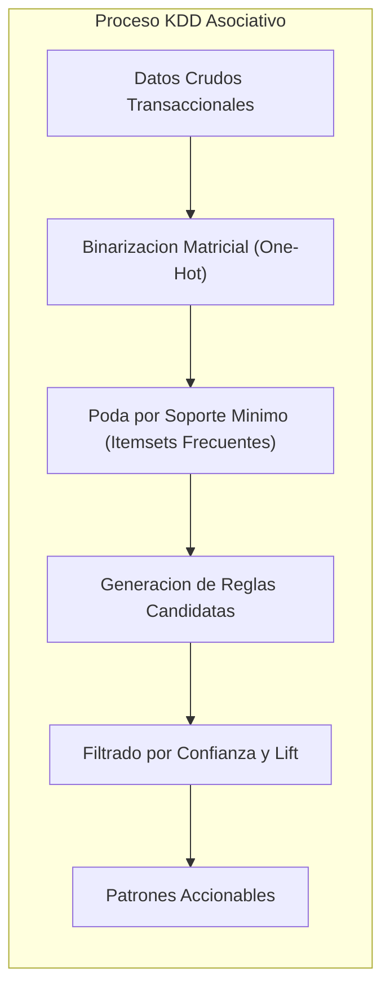
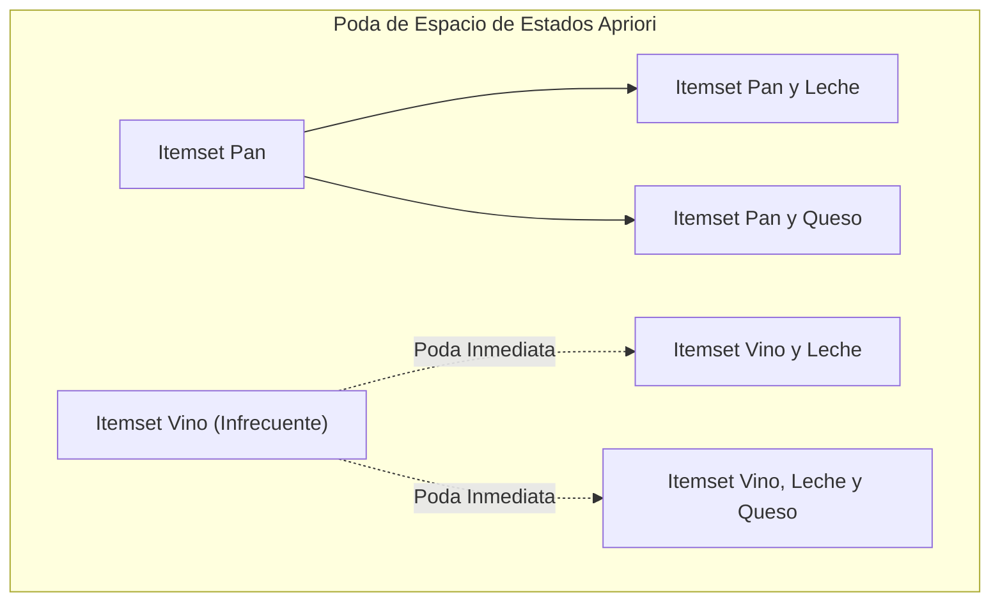
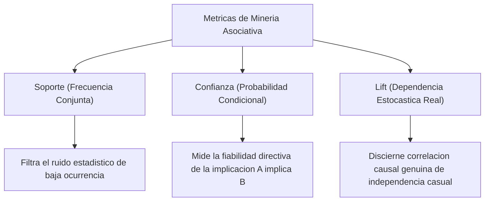
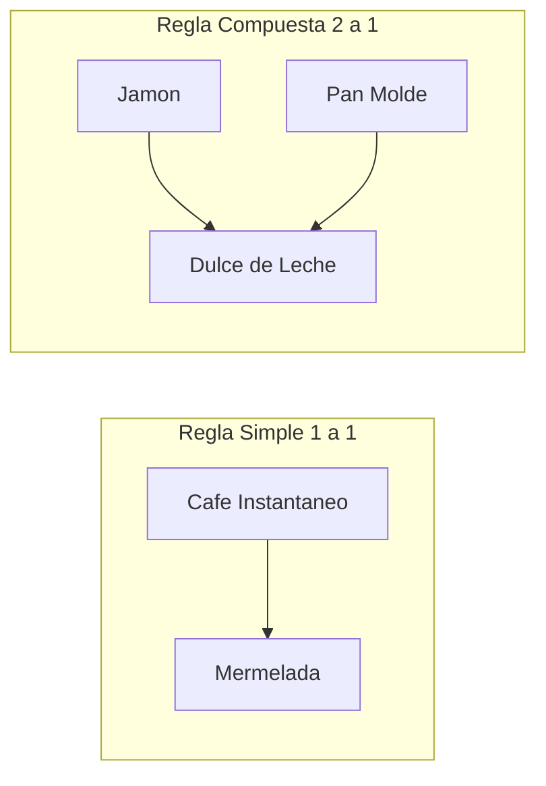
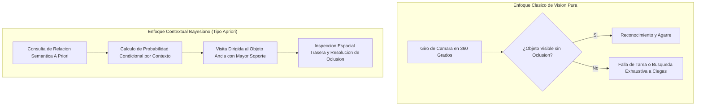

# Clase 7: Mineria de Reglas de Asociacion, Algoritmo Apriori y Modelado Contextual Espaciotemporal

> Proposito pedagogico: Dominar la formalizacion probabilistica y conjuntista de la mineria de reglas de asociacion, analizar exhaustivamente la mecanica del algoritmo Apriori mediante sus metricas cardinales (Soporte, Confianza y Sustentacion/Lift), implementar canalizaciones computacionales vectoriales de extraccion de patrones frecuentes, y explorar aplicaciones interdisciplinarias de frontera como el razonamiento contextual bayesiano en robotica de servicio y navegacion autonoma.

## 1\. Contexto y Marco Conceptual

### Fundamentos Epistemologicos de la Mineria Asociativa

Dentro de la mineria de datos no supervisada, el analisis asociativo persigue identificar dependencias estocasticas, afinidades y co-ocurrencias recurrentes entre entidades discretas dentro de transacciones masivas. A diferencia de las tareas predictivas supervisadas orientadas a un atributo objetivo predeterminado (como la clasificacion o la regresion), la mineria de asociaciones busca describir relaciones intrinsecas globales en el espacio de items sin etiquetas a priori.

El analisis de reglas de asociacion se origino en el contexto del analisis de canasta de mercado (*Market Basket Analysis*), pero su formulacion matematica basada en probabilidades condicionales y teoria de conjuntos le confiere un caracter agnostico aplicable a bioinformatica (co-expresion genica), ciberseguridad (deteccion de vectores complejos de intrusion), telecomunicaciones y robotica autonoma.



### El Principio de Monotonicidad de Apriori (Propiedad Downward-Closure)

El espacio de busqueda de combinaciones de items crece exponencialmente: para un catalogo de $d$ productos, existen $2^d - 1$ posibles itemsets candidatos. El algoritmo Apriori, introducido por Rakesh Agrawal y Ramakrishnan Srikant en 1994, resuelve esta explosion combinatoria apoyandose en la **propiedad de monotonicidad anti-monotona del soporte**:

> **Lema Fundamental de Apriori:** Si un conjunto de items es frecuente, todos sus subconjuntos deben ser obligatoriamente frecuentes. En consecuencia, si un itemset $S$ es infrecuente ($Support(S) \lt min\_sup$), cualquier superconjunto $S' \supset S$ sera infrecuente y puede ser podado del arbol de busqueda sin necesidad de computar su frecuencia en la base de datos.



## 2\. Fundamentos Teoricos y Arquitectura

### Formalizacion Matematica de Transacciones e Itemsets

Sea $I = \{i_1, i_2, \dots, i_m\}$ el dominio universal de items discretos.

Sea $D = \{t_1, t_2, \dots, t_n\}$ una base de datos transaccional, donde cada transaccion $t_k \subseteq I$ posee un identificador unico ($TID$).

Una regla de asociacion es una expresion de implicacion logica de la forma:

$$
A \Rightarrow B
$$

donde $A \subset I$, $B \subset I$ y $A \cap B = \emptyset$. El conjunto $A$ se denomina **antecedente** (o condicion previa) y $B$ **consecuente** (o prediccion resultante).

### Metricas Cardinales de Evaluacion

1. **Soporte (Support):** Proporcion o probabilidad marginal conjunta de transacciones que contienen tanto el antecedente como el consecuente:

$$
Support(A \Rightarrow B) = P(A \cap B) = \frac{|\{t \in D \mid A \cup B \subseteq t\}|}{|D|}
$$

1. **Confianza (Confidence):** Medida de certeza condicional o probabilidad a posteriori de observar $B$ dado que la transaccion contiene $A$:

$$
Confidence(A \Rightarrow B) = P(B \mid A) = \frac{P(A \cap B)}{P(A)} = \frac{Support(A \cup B)}{Support(A)}
$$

1. **Sustentacion / Elevacion (Lift):** Cociente entre la confianza observada de la regla y la frecuencia basal marginal del consecuente:

$$
Lift(A \Rightarrow B) = \frac{Confidence(A \Rightarrow B)}{P(B)} = \frac{P(A \cap B)}{P(A) \cdot P(B)}
$$



### Dinamica Interpretativa del Lift frente a la Confianza

La metrica de confianza presenta un sesgo estructural critico: una regla puede exhibir una confianza numericamente elevada simplemente porque el consecuente $B$ es un articulo omnipresente de alta rotacion en la tienda (ej. leche o pan), independientemente de la presencia del antecedente $A$. El **Lift** actua como el corrector de referencia:

| **Valor de Lift** | **Relacion Estocastica** | **Interpretacion Operativa y de Negocio** | **Decision Estrategica** |
| --- | --- | --- | --- |
| **Lift = 1** | Independencia estocastica pura ($P(A \cap B) = P(A) \cdot P(B)$) | La adquisicion de $A$ no altera en absoluto la probabilidad de compra de $B$. La co-ocurrencia observada es mero producto del azar estadistico. | Rechazar la regla; no justificar gasto comercial ni colocacion conjunta en tienda. |
| **Lift &amp;gt; 1** | Atraccion positiva / Co-ocurrencia complementaria ($P(A \cap B) \gt P(A) \cdot P(B)$) | La compra previa de $A$ incrementa sensiblemente la probabilidad de demanda de $B$. Existe complementariedad de consumo real. | Aceptar la regla; implementar estrategias de empaquetado (*bundling*), colocacion estrategica o cross-selling. |
| **Lift &amp;lt; 1** | Repulsion / Sustitucion mutua ($P(A \cap B) \lt P(A) \cdot P(B)$) | La compra de $A$ inhibe o reduce la probabilidad de adquisicion de $B$. Los articulos suelen comportarse como sustitutos competitivos. | Evitar promociones conjuntas; distribuir los articulos en secciones independientes. |

## 3\. Implementacion Tecnica y Logica de Negocio

### Desglose Matematico de Casos de Estudio Experimentales

#### Caso Experimental 1: Alta Confianza pero Sustitucion Estocastica (Lift &amp;lt; 1)

Considere una muestra de 10 transacciones con los siguientes conteos:

- $P(A \cap B) = \frac{6}{10} = 0.60$

- $P(A) = \frac{8}{10} = 0.80$

- $P(B) = \frac{8}{10} = 0.80$

Calculo de Confianza y Lift:

$$
Confidence(A \Rightarrow B) = \frac{P(A \cap B)}{P(A)} = \frac{0.60}{0.80} = 0.75 \; (75\%)
$$

$$
Lift(A \Rightarrow B) = \frac{Confidence(A \Rightarrow B)}{P(B)} = \frac{0.75}{0.80} = 0.9375 \approx 0.94
$$

**Auditoria Analitica:** A pesar de que la regla parece atractiva bajo un umbral de confianza del 75%, el $Lift = 0.94 \lt 1$. Esto demuestra que el articulo $B$ tiene una tasa de adquisicion global del 80% en toda la poblacion; cuando el cliente compra $A$, su probabilidad de comprar $B$ en realidad decrece ligeramente del 80% al 75%. La regla es un artefacto enganoso inducido por la alta popularidad marginal de $B$.

#### Caso Experimental 2: Item Ubicuo e Independencia Estricta (Lift = 1.0)

Considere un articulo $A$ presente en el 100% de las canastas ($P(A) = 1.0$):

- $P(A \cap B) = \frac{5}{10} = 0.50$

- $P(A) = \frac{10}{10} = 1.0$

- $P(B) = \frac{5}{10} = 0.50$

Calculo de Confianza y Lift:

$$
Confidence(A \Rightarrow B) = \frac{0.50}{1.0} = 0.50 \; (50\%)
$$

$$
Lift(A \Rightarrow B) = \frac{0.50}{0.50} = 1.0
$$

**Auditoria Analitica:** Al estar $A$ en el 100% de los registros, no discrimina ningun patron predictivo. La probabilidad de observar $B$ condicionado a $A$ es exactamente identica a su probabilidad basal marginal. El Lift es exactamente $1.0$, confirmando independencia estocastica absoluta.

#### Caso Experimental 3: Complementariedad Fuerte y Regla Genuina (Lift &amp;gt; 1)

Considere una muestra con articulos no saturados:

- $P(A \cap B) = \frac{5}{10} = 0.50$

- $P(A) = \frac{7}{10} = 0.70$

- $P(B) = \frac{6}{10} = 0.60$

Calculo de Confianza y Lift:

$$
Confidence(A \Rightarrow B) = \frac{0.50}{0.70} \approx 0.7143 \; (71.4\%)
$$

$$
Lift(A \Rightarrow B) = \frac{0.7143}{0.60} \approx 1.19
$$

**Auditoria Analitica:** La regla exhibe tanto una alta confianza (71.4%) como un $Lift = 1.19 \gt 1$. La adquisicion de $A$ incrementa en un 19% la propension de compra de $B$ sobre la tasa basal de mercado. Esta regla califica como patron comercial robusto y accionable.

### Pipeline Completo de Mineria de Reglas en Python

El siguiente script formaliza la ingesta de transacciones crudas separadas por punto y coma, la limpieza y normalizacion de cadenas, la codificacion booleana y la extraccion filtrada de reglas:

```python
import pandas as pd
import numpy as np
import unicodedata
from mlxtend.preprocessing import TransactionEncoder
from mlxtend.frequent_patterns import apriori, association_rules

def sanear_texto(cadena):
    """Normaliza texto: remueve diacriticos, espacios superfluos y homogeneiza a minusculas."""
    if not isinstance(cadena, str) or pd.isna(cadena):
        return None
    descompuesto = unicodedata.normalize('NFD', cadena)
    sin_diacriticos = ''.join(c for c in descompuesto if unicodedata.category(c) != 'Mn')
    return sin_diacriticos.strip().lower()

# Diccionario canonico de correccion lexico-semantica
MAPEO_SINONIMOS = {
    'mantequillla': 'mantequilla',
    'mermedada': 'mermelada',
    'milk': 'leche',
    'yogurt': 'yogur'
}

def ejecutar_mineria_apriori(ruta_archivo_csv, min_support=0.098, min_lift=1.0):
    """
    Carga dataset transaccional crudo, sanea nombres de productos,
    binariza la matriz y extrae itemsets y reglas asociativas.
    """
    # 1. Carga de datos crudos
    df_crudo = pd.read_csv(ruta_archivo_csv, sep=';', header=None, dtype=str)
    
    # 2. Saneamiento lexico y resolucion de inconsistencias
    transacciones_limpias = []
    for _, fila in df_crudo.iterrows():
        items_fila = []
        for val in fila.dropna():
            item_saneado = sanear_texto(val)
            if item_saneado and item_saneado != '':
                # Homogeneizacion sinonimica
                item_canonico = MAPEO_SINONIMOS.get(item_saneado, item_saneado)
                items_fila.append(item_canonico)
        if len(items_fila) > 0:
            # Eliminar duplicados intra-transaccionales garantizando unicidad conjuntista
            transacciones_limpias.append(list(set(items_fila)))
            
    # 3. Transformacion a matriz booleana One-Hot
    te = TransactionEncoder()
    matriz_binaria = te.fit(transacciones_limpias).transform(transacciones_limpias)
    df_booleano = pd.DataFrame(matriz_binaria, columns=te.columns_)
    
    # 4. Extraccion de itemsets frecuentes por Apriori
    itemsets_frecuentes = apriori(df_booleano, min_support=min_support, use_colnames=True)
    itemsets_frecuentes['longitud'] = itemsets_frecuentes['itemsets'].apply(lambda x: len(x))
    
    # 5. Generacion de reglas de asociacion evaluadas por Lift
    reglas = association_rules(itemsets_frecuentes, metric="lift", min_threshold=min_lift)
    
    # Desglose estructurado de resultados
    columnas_reporte = ['antecedents', 'consequents', 'support', 'confidence', 'lift']
    reglas_ordenadas = reglas[columnas_reporte].sort_values(by=['lift', 'confidence'], ascending=[False, False])
    
    return itemsets_frecuentes, reglas_ordenadas
```

### Reglas Simples (1 a 1) frente a Reglas Compuestas (2 a 1)

En la practica analitica sobre datasets de consumo matutino (desayuno), se identifican dos estructuras de reglas:

1. **Reglas Simples (**$1 \Rightarrow 1$**):**

   - $\text{Café Instantáneo} \Rightarrow \text{Mermelada}$ ($Support = 0.20$, $Confidence = 0.46$).
   
   - $\text{Dulce de Leche} \Rightarrow \text{Pan Molde}$ ($Support = 0.20$, $Confidence = 0.46$).

1. **Reglas Compuestas Multivariadas (**$2 \Rightarrow 1$**):**

   - $\{\text{Jamón}, \text{Pan Molde}\} \Rightarrow \text{Dulce de Leche}$ ($Lift \gt 1.0$).
   
   - $\{\text{Dulce de Leche}, \text{Pan Molde}\} \Rightarrow \text{Mantequilla}$ ($Lift \gt 1.0$).
   
   - $\{\text{Leche}, \text{Café Instantáneo}\} \Rightarrow \text{Yogur}$ ($Lift \gt 1.0$).



### Visualizacion Multidimensional de Reglas

Para auditar la validez de cientos de reglas asociativas simultaneas, la representacion grafica estandar de mineria de datos utiliza un plano tridimensional:

- **Eje Horizontal (X):** Soporte de la regla ($Support$).

- **Eje Vertical (Y):** Confianza ($Confidence$).

- **Intensidad Cromatica (Color):** Magnitud del $Lift$ (los tonos mas intensos denotan el maximo grado de complementariedad estocastica).

- **Interpretacion ergonomica:** Las reglas optimas se ubican en el cuadrante superior derecho (alto soporte y alta confianza) con tonalidades de alto Lift.

## 4\. Analisis Critico de Casos y Auditoria Practica

### Estudio de Caso Interdisciplinario: Razonamiento Contextual Espacial en Robotica de Servicio (RoboCup @Home)

Un aporte doctoral y cientifico relevante expuesto en la sesion demuestra como los principios de la mineria asociativa trascienden el comercio de retail y resuelven cuellos de botella en la inteligencia artificial corporeizada (*Embodied AI*).

#### La Problematica de la Busqueda de Objetos en Robotica

En la competencia internacional **RoboCup @Home** (plataforma de robots de servicio domestico como el *Robot Bender* desarrollado en la Universidad de Chile), una tarea estandar consiste en solicitar al robot que localice y transporte un objeto cotidiano (ej. "Trae una lata de bebida").

- **Anti-patron de los algoritmos de vision pura (2010-2020):** Los robots rotaban sobre su propio eje y aplicaban reconocimiento visual exhaustivo asumiendo que el objeto estaria en linea de vista despejada. Si el objeto sufria **oclusion** (bloqueado por una caja, una cafetera o una laptop) o se encontraba fuera del campo de vision directo, el algoritmo de busqueda colapsaba por costo computacional y recorrido aleatorio del entorno.



#### Formulacion del Razonamiento Contextual A Priori

En lugar de tratar el espacio como un plano homogeneo sin estructura, la cognicion humana organiza los objetos segun relaciones semanticas funcionales:

- Los tenedores se ubican adyacentes a las cucharas en la cocina.

- El dentifrico se ubica junto al cepillo de dientes en el bano.

- Una taza se ubica sobre una mesa y proxima a la cafetera.

Mediante una base de conocimiento empirica de co-ocurrencias espaciales (construida a partir de encuestas y registros de observacion de interaccion humana), el robot cuantifica la probabilidad condicional de encontrar el objeto objetivo $B$ proximo a objetos ancla visibles $A_k$:

| **Objeto Ancla Visible (**$A$**)** | **Objeto Objetivo Ocluido (**$B$**)** | **Probabilidad Empirica de Co-ocurrencia P(A y B)** | **Prioridad de Inspeccion Espacial** |
| --- | --- | --- | --- |
| **Cafetera** | Lata de Refresco | 30% | Prioridad 1 (Ruta de navegacion inmediata para inspeccionar detras) |
| **Monitor de Computadora** | Lata de Refresco | 15% | Prioridad 2 (Inspeccion secundaria en caso de no hallazgo) |
| **Basurero** | Lata de Refresco | 5% | Prioridad 3 (Baja probabilidad a priori) |

#### Evaluacion y Validacion Experimental

El despliegue de esta heuristica asociativa a priori fue sometido a mas de 1,000 ensayos en entornos simulados y reales, demostrando una reduccion estadisticamente significativa en el tiempo medio de localizacion frente a detectores puramente geometricos o reactivos. Dicha investigacion derivo en una publicacion en el *Journal of Intelligent &amp; Robotic Systems*, evidenciando como la formulacion teorica de reglas de asociacion resuelve problemas de optimizacion de trayectorias y razonamiento bajo incertidumbre en robotica movil.

## 5\. Principios de Diseno, Buenas Practicas y Anti-patrones

### Reglas de Oro en Mineria de Reglas de Asociacion

1. **La Simetria Conjuntista frente a la Direccionalidad de la Regla:** Si bien el soporte de $A \cup B$ es identico al soporte de $B \cup A$ por la conmutatividad conjuntista, la **confianza es asimetrica y estrictamente direccional** ($P(B \mid A) \neq P(A \mid B)$ a menos que $P(A) = P(B)$). La interpretacion de reglas debe preservar rigurosamente la distincion entre causa/antecedente y consecuencia.

1. **Priorizacion por Antecedente de Mayor Frecuencia:** En la formulacion operativa de reglas con afinidad comprobada ($Lift \gt 1$), se recomienda posicionar como antecedente el producto con mayor frecuencia marginal de venta. Si el pan se vende masivamente frente a una salsa especial, la regla $\{\text{Pan}\} \Rightarrow \text{Salsa}$ posee mayor impacto de volumen comercial que la regla inversa.

1. **Poda Rigurosa por Lift para Descartar Reglas Espurias:** Jamas debe seleccionarse una regla asociativa basandose unicamente en altos niveles de confianza. Toda regla con $Lift \le 1.0$ debe ser excluida de la capa de toma de decisiones.

### Anti-patrones Metodologicos Identificados

| **Anti-patron** | **Mecanismo del Error** | **Consecuencia Tecnica / Operativa** | **Mitigacion Metodologica** |
| --- | --- | --- | --- |
| **La Ilusion de Alta Confianza (High Confidence Trap)** | Validar reglas de asociacion evaluando unicamente la confianza sin contrastar contra la probabilidad basal del consecuente ($P(B)$). | Aceptar relaciones espurias donde el consecuente se compra masivamente por si solo y no por influjo del antecedente ($Lift \lt 1$). | Aplicar un filtro estricto de sustentacion minima ($Lift \gt 1.1$) en conjunto con la confianza. |
| **Duplicacion Combinatoria Espuria** | Generar y graficar permutaciones conmutativas del mismo conjunto de items (ej. $\{A, B\} \Rightarrow C$, $\{A, C\} \Rightarrow B$ y $\{B, C\} \Rightarrow A$) sin consolidacion previa. | Saturacion del analista con reportes redundantes y sobrecarga en dashboards ejecutivos. | Agrupar a nivel de itemset frecuente no dirigido antes de la generacion de implicaciones direccionales. |
| **Umbral de Soporte Extremo** | Fijar umbrales de soporte excesivamente altos (descartando asociaciones raras de nicho de alto margen) o excesivamente bajos (explosion combinatoria de millones de reglas irrelevantes). | Perdida de conocimiento valioso o colapso de la memoria computacional por saturacion de candidatos. | Ajustar iterativamente el soporte minimo mediante cuantiles de la distribucion de frecuencias de transacciones. |

## 6\. Sintesis Conceptual y Profundizacion Academica

### Sintesis Integradora

La mineria de reglas de asociacion y el algoritmo Apriori constituyen un paradigma fundamental para descubrir conocimiento estructurado en bases de datos masivas. La comprension rigurosa de sus tres metricas rectoras —el Soporte para filtrar la relevancia empirica, la Confianza para ponderar la certeza condicional y el Lift para aislar la dependencia estocastica genuina de la independencia casual— permite evitar distorsiones analiticas severas. Como demuestra su transposicion exitosa a la robotica autonoma de servicio, el modelado probabilistico de co-ocurrencias espaciotemporales transforma la mera observacion geometrica en inferencia contextual inteligente de alto nivel.

### Preguntas Guia para la Investigacion de Posgrado

1. ¿De que manera los algoritmos de arbol de patrones frecuentes (FP-Growth) mitigan la sobrecarga de I/O y multiples lecturas de disco intrinsecas al algoritmo Apriori en grafos transaccionales que superan la memoria RAM disponible?

1. ¿Como integrar formalmente metricas de causalidad intervencional (como el calculo de Judea Pearl $P(B \mid do(A))$) dentro de la formulacion tradicional de reglas de asociacion para garantizar que el $Lift \gt 1$ responda a un vinculo causal y no a un confusor latente?

### Referencias Bibliograficas Fundamentales

- Agrawal, R., &amp; Srikant, R. (1994). *Fast Algorithms for Mining Association Rules in Large Databases*. Proceedings of the 20th International Conference on Very Large Data Bases (VLDB), 487-499.

- Han, J., Pei, J., &amp; Yin, Y. (2000). *Mining Frequent Patterns without Candidate Generation*. ACM SIGMOD Record, 29(2), 1-12.

- Tan, P. N., Steinbach, M., &amp; Kumar, V. (2018). *Introduction to Data Mining* (2nd ed.). Pearson.

- Ruiz-del-Solar, J., Mascaró, M., Correa, M., &amp; Bernuy, F. (2018). *Context-aware object search in service robotics using spatial relations and semantic knowledge*. Journal of Intelligent &amp; Robotic Systems, 91(1), 127-142.

- Brin, S., Motwani, R., Ullman, J. D., &amp; Tsur, S. (1997). *Dynamic Itemset Counting and Implication Rules for Market Basket Data*. ACM SIGMOD Record, 26(2), 255-264.
