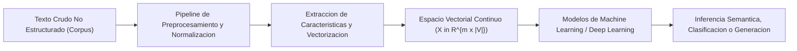
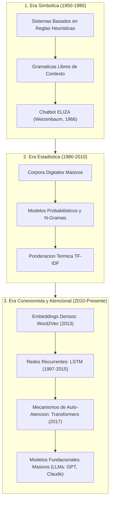
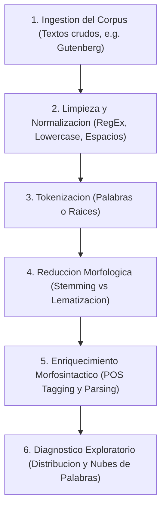

# Clase 1: Fundamentos de Procesamiento de Lenguaje Natural, Arquitectura de Datos y Pipeline de Preprocesamiento de Corpus

> **Objetivo de la sesion:** Comprender el rol del Procesamiento del Lenguaje Natural (NLP) dentro del ecosistema moderno de ciencia de datos e inteligencia artificial; analizar la evolucion historica de los modelos de lenguaje desde las tecnicas simbolicas y estadisticas hasta la era contemporanea de los Transformers; y dominar el diseno e implementacion del pipeline clasico de preprocesamiento, normalizacion por expresiones regulares, tokenizacion, reduccion morfologica y estructuracion sintactica sobre corpus textuales no estructurados.

## 1\. Contexto y Marco Conceptual

### El Rol de NLP en la Cadena de Valor de Datos Analiticos

En la arquitectura corporativa contemporanea, los activos de datos se dividen estructuralmente en tres categorias fundamentales:

1. **Datos Estructurados:** Registros con esquema rigido predefinido (tablas relacionales, sistemas ERP/CRM). Su procesamiento analitico optimo se realiza en bases de datos analiticas columnares (Exadata, Teradata, ClickHouse, Greenplum) orientadas a procesamiento OLAP de alta velocidad, a diferencia de los motores transaccionales tradicionales (OLTP) orientados a consistencia por filas.

1. **Datos Semiestructurados:** Archivos con estructura flexible y autodescriptiva (JSON, XML, CSV, Parquet) que implementan el principio de **Esquema en Lectura (Schema on Read)**, donde los tipos de datos y metadatos se validan en el momento de la ingesta y no en la persistencia.

1. **Datos No Estructurados:** Informacion carente de una estructura relacional predeterminada (texto libre, grabaciones de voz, imagenes, telemetria). En este dominio opera el **Procesamiento del Lenguaje Natural (NLP)**, residiendo habitualmente en **Data Lakes** estructurados bajo patrones de arquitectura Medallion (capas Bronze de datos crudos, Silver de datos refinados/normalizados y Gold de datos agregados para modelado analitico).

### La Conexion entre Machine Learning Tabular y NLP

En el Machine Learning tradicional sobre datos estructurados, el objetivo consiste en aprender una funcion de hipotesis $h_\theta(X)$ que mapee un vector de caracteristicas observadas $X \in \mathbb{R}^{m \times d}$ hacia una variable objetivo real $Y$, optimizando una funcion de coste $J(\theta)$ en un espacio de parametros convexo:

$\min_{\theta} J(\theta) = \frac{1}{m} \sum_{i=1}^m \mathcal{L}(h_\theta(x^{(i)}), y^{(i)})$

En el Procesamiento del Lenguaje Natural, la representacion de la realidad no proviene de variables tabulares discretas directas, sino de secuencias de simbolos linguisticos discretos (documentos, oraciones, palabras). La tarea central de NLP consiste en mapear estos simbolos cualitativos no estructurados hacia **espacios vectoriales numericos continuos (vectores de caracteristicas o espacios semanticos)**, de tal manera que las tecnicas de optimizacion matematica, regresion, clasificacion supervisada y clustering puedan ser ejecutadas sin distorsion semantica.



### Espacios Latentes y Multimodalidad

La evolucion de las arquitecturas neuronales profundas ha convergido hacia la unificacion de representaciones. Tanto el texto (NLP) como las imagenes (Computer Vision) se proyectan en **espacios latentes (latent spaces)** continuos de representacion densa. En este espacio geometrico compartido, las relaciones semanticas se preservan como distancias euclidianas o angulares (similitud coseno), permitiendo el surgimiento de modelos multimodales capaces de correlacionar texto e imagen directamente.

### Dilemas Eticos y Desafios en la Era de los Modelos Masivos

El despliegue de modelos de lenguaje en entornos productivos conlleva responsabilidades tecnicas y eticas criticas:

- **Responsabilidad y Alucinacion:** Imputabilidad legal y financiera cuando un modelo generativo produce informacion falsa o sesgada en sectores regulados (banca, salud, legal).

- **Soberania Linguistica e Inclusion:** Mitigacion de la brecha digital para dialectos locales y lenguas minoritarias frente al predominio de corpus de entrenamiento anglocentricos.

- **Eficiencia Bioenergetica y Huella de Carbono:** Compensacion entre la escala de parametros en modelos densos masivos y su huella ecologica durante las fases intensivas de preentrenamiento.

---

## 2\. Fundamentos Teoricos y Arquitectura

### Evolucion Historica de los Paradigmas de NLP

A lo largo de siete decadas, la disciplina ha transitado por tres revoluciones paradigmaticas principales:

1. **Revolucion Simbolica y Basada en Reglas (1950 - 1980):**

   - Basada en gramaticas formales libres de contexto, analisis sintactico deductivo y reglas heuristicas programadas manualmente.
   
   - Hito fundamental: **ELIZA (Joseph Weizenbaum, 1966)**, programa pionero de simulacion conversacional psicoterapeutica basado en reconocimiento de patrones simples y sustitucion de cadenas. Demostro el fenomeno psicologico conocido como *Efecto ELIZA*, donde los usuarios atribuyen comprension y empatia humana a sistemas computacionales puramente deterministicos.

1. **Revolucion Estadistica y Probabilistica (1980 - 2010):**

   - Desplazamiento hacia el modelado de frecuencias relativas, cadenas de Markov y probabilidades condicionales sobre corpus linguisticos masivos (como el Proyecto Gutenberg).
   
   - Introduccion formal de modelos de lenguaje de N-Gramas, etiquetado gramatical probabilistico (HMM) y ponderacion ponderada de documentos (TF-IDF).

1. **Revolucion Conexionista, Neuronal y Atencional (2010 - Presente):**

   - Transicion de representaciones dispersas y de alta dimensionalidad hacia vectores densos continuos con **Word2Vec (Mikolov et al., 2013)**.
   
   - Modelado secuencial mediante redes neuronales recurrentes (**RNN**) y celdas de memoria de largo-corto plazo (**LSTM, Hochreiter &amp; Schmidhuber, 1997**), resolviendo el desvanecimiento de gradiente en secuencias temporales.
   
   - Ruptura epistemologica con la arquitectura **Transformer (Vaswani et al., 2017: "Attention Is All You Need")**, eliminando la recurrencia estricta mediante mecanismos de auto-atencion (*self-attention*) y paralelizacion masiva en GPUs, base de los modelos de lenguaje modernos (codificadores tipo BERT y decodificadores autorregresivos tipo GPT).



---

## 3\. Implementacion Tecnica y Logica de Negocio

### Pipeline Canonico de Preprocesamiento de Corpus

El preprocesamiento de texto es una fase critica: la calidad y coherencia semantica del modelo resultante depende de la rigurosidad de las transformaciones previas.



#### Paso 1: Recoleccion e Ingestion del Corpus

- **Corpus (**$\mathcal{C}$**):** Conjunto integral de documentos textuales que circunscriben un dominio linguistico o cientifico de interes.

- **Vocabulario (**$\mathcal{V}$**):** Conjunto finito de terminos unicos distintos presentes en el corpus ($\mathcal{V} \subseteq \mathcal{C}$ tal que $|\mathcal{V}| \le |\mathcal{C}|$).

- **Regla Metodologica de Muestreo en NLP:** A diferencia del muestreo aleatorio independiente e identicamente distribuido (i.i.d.) de muestras tabulares, en NLP el muestreo debe preservar secuencias continuas contiguas para no destruir la estructura gramatical y distribucional del lenguaje.

#### Paso 2: Limpieza y Normalizacion con Expresiones Regulares

Consiste en depurar ruido ortotipografico no informativo mediante transformaciones deterministas:

1. Filtrado de caracteres no alfabeticos mediante expresiones regulares (` re.sub(r'[^a-zA-Z\s]', '', text) `).

1. Normalizacion de espacios en blanco (` re.sub(r'\s+', ' ', text).strip() `).

1. Descapitalizacion a minusculas (` text.lower() `).

*Criterio de diseno critico:* En modelos frecuentistas estadisticos (BoW, N-Gramas), remover puntuacion y pasar a minusculas reduce drasticamente el tamano del vocabulario y compacta la matriz de caracteristicas. En modelos neuronales atencionales modernos (BERT/GPT), la puntuacion y la capitalizacion codifican informacion sintactica y limites de clausulas, por lo que su eliminacion indiscriminada constituye un anti-patron.

#### Paso 3: Tokenizacion

Division de cadenas textuales continuas en unidades minimas discretas de analisis denominadas tokens (palabras, subpalabras o caracteres).

#### Paso 4: Reduccion Morfologica: Stemming vs Lematizacion

1. **Stemming (Algoritmo de Porter):** Truncamiento heuristico de sufijos y prefijos para aislar una raiz grafica cruda. Es computacionalmente liviano pero puede producir pseudopalabras inexistentes (e.g., *happy* $\rightarrow$ *happi*, *computadora* $\rightarrow$ *comput*).

1. **Lematizacion (WordNet Lemmatizer):** Reduccion lexica hacia el lema canonico formal mediante consulta a diccionarios morfologicos y consideracion del contexto sintactico (e.g., *better* $\rightarrow$ *good*, *children* $\rightarrow$ *child*). Garantiza validez morfologica a expensas de mayor coste computacional.

#### Paso 5: Etiquetado Gramatical (POS Tagging) y Analisis Sintactico (Parsing)

- **Part-of-Speech (POS) Tagging:** Asignacion de etiquetas funcionales a cada token (sustantivo ` NN `, verbo ` VB `, determinante ` DT `, adjetivo ` JJ `).

- **Parsing (Analisis de Dependencias / Constituyentes):** Reconstruccion del arbol sintactico jerarquico que define que entidad ejecuta que accion sobre que objeto en la oracion.

### Implementacion de Referencia en Python (NLTK)

A continuacion se presenta la implementacion modular del pipeline clasico ejecutado sobre el corpus de Jane Austen (*Emma*):

```python
import re
import nltk
from nltk.corpus import gutenberg, stopwords
from nltk.stem import PorterStemmer, WordNetLemmatizer
from nltk import pos_tag, word_tokenize

# 1. Descarga e ingesta del corpus
nltk.download('gutenberg')
nltk.download('punkt')
nltk.download('stopwords')
nltk.download('wordnet')
nltk.download('averaged_perceptron_tagger')

raw_text = gutenberg.raw('austen-emma.txt')

# 2. Limpieza y normalizacion mediante RegEx
cleaned_text = re.sub(r'[^a-zA-Z\s]', ' ', raw_text)
cleaned_text = re.sub(r'\s+', ' ', cleaned_text).strip().lower()

# 3. Muestreo secuencial contiguo y Tokenizacion
sample_text = cleaned_text[:500]
tokens = word_tokenize(sample_text)

# 4. Reduccion Morfologica: Comparacion de metodos
stemmer = PorterStemmer()
lemmatizer = WordNetLemmatizer()

processed_tokens = []
for token in tokens:
    stem_val = stemmer.stem(token)
    lemma_val = lemmatizer.lemmatize(token)
    processed_tokens.append((token, stem_val, lemma_val))

# 5. Etiquetado Gramatical (POS Tagging)
pos_tags = pos_tag(tokens)
```

### Paradigmas de Almacenamiento: Esquema en Escritura vs Esquema en Lectura

El debate sobre la persistencia y lectura de datos se formaliza bajo dos filosofias de diseno:

- **Schema on Write (Bases de Datos Relacionales / Tablas Tipadas):** El esquema y los metadatos se validan rigurosamente antes de persistir el dato. Si un campo no cumple con el tipo declarado, la transaccion falla.

- **Schema on Read (Lagos de Datos / Archivos Semiestructurados):** Los datos se almacenan en su formato bruto o semiestructurado (texto, CSV, Parquet). El esquema se aplica dinamicamente en el instante de la lectura por la aplicacion consumidora.

- **Formalizacion:** Un arreglo multidimensional crudo (NumPy Array) adquiere significado de negocio cuando se le vincula una estructura de metadatos (nombres de variables, indices de entidad y tipos de datos), conformando un DataFrame estructurado.

---

## 4\. Analisis Critico de Casos y Auditoria Practica

### Comparativa de Paradigmas en Procesamiento de Lenguaje Natural

| Dimension Analitica | Paradigma Simbolico (1960) | Paradigma Estadistico (1990) | Paradigma Neuronal / Transformer (2020) |
| --- | --- | --- | --- |
| **Mecanismo Central** | Reglas deterministas y gramaticas | Frecuencias relativas y cadenas de Markov | Espacios latentes continuos y auto-atencion |
| **Representacion del Texto** | Simbolos discretos y reglas IF-THEN | Vectores dispersos de alta dimensionalidad (BoW/TF-IDF) | Vectores densos de baja dimension (Embeddings) |
| **Dependencia Temporal** | Nula o fija mediante arboles | Limitada a ventana local corta ($N \le 3$) | Contexto global bidireccional masivo |
| **Costo Computacional** | Minimo (CPU tradicional) | Bajo a moderado (escalable en CPU) | Extremo (entrenamiento distribuido en clusters de GPUs) |
| **Casos de Falla Criticos** | Ambiguedad lexica no reglada | Matrices hiperdispersas y probabilidad nula | Alucinaciones plausibles y opacidad (*Black Box*) |

### Comparativa de Reduccion Morfologica

| Criterio | Stemming (Porter) | Lematizacion (WordNet) |
| --- | --- | --- |
| **Metodologia** | Algoritmo determinista de remocion de sufijos | Busqueda en diccionario morfologico y lexico |
| **Validez Lexica** | No garantizada (produce pseudopalabras) | Siempre garantizada (produce palabras existentes) |
| **Sensibilidad Contextual** | Aislada, token a token sin contexto sintactico | Dependiente de la categoria gramatical (POS) |
| **Consumo de Memoria** | Minimo (operaciones sobre cadenas) | Moderado (requiere cargar base lexica en RAM) |
| **Caso de Uso Optimo** | Busqueda heuristica en motores indexados clasicos | Analisis de sentimiento, clasificacion y modelos semanticos |

---

## 5\. Principios de Diseno, Buenas Practicas y Anti-patrones

### Reglas de Oro en Ingenieria de Corpus

1. **Preservar el Contexto Secuencial en el Muestreo:** Nunca extraer muestras aleatorias descontextualizadas de un texto continuo; utilizar ventanas temporales o parrafos contiguos completos.

1. **Modularidad en el Pipeline:** Separar formalmente las etapas de limpieza cruda, normalizacion lexica, transformacion morfosintactica y vectorizacion matematica.

1. **Adecuar el Rigor de Limpieza al Modelo Destino:**

   - Para clasificadores lineales clasicos (Regresion Logistica con BoW/TF-IDF): Maximizar normalizacion (remover signos, digitos, stopwords y minusculas para reducir dispersión).
   
   - Para modelos contextuales profundos (BERT, GPT): Limitar la limpieza; preservar mayusculas, acentos y signos de puntuacion que codifican estructura discursiva.

### Anti-patrones Comunes

- **Anti-patron de Sobre-Ingenieria Tecnologica:** Intentar resolver tareas de enrutamiento o clasificacion de tickets corporativos con modelos masivos de lenguaje (LLMs) cuando un clasificador supervisado tradicional (e.g., regresion logistica sobre TF-IDF) entrega 95%+ de exactitud con latencia de milisegundos y cero costo de GPU.

- **Anti-patron de Dispersión Extrema de Vocabulario:** Mantener vocabularios sin podar en corpus extensos, generando matrices dispersas que consumen memoria exponencialmente con varianza nula.

- **Anti-patron de Supresion Ciega de Stopwords:** Eliminar stopwords en tareas donde las relaciones entre pronombres y negaciones alteran radicalmente el significado (e.g., "no es malo" vs "es malo").

---

## 6\. Sintesis Conceptual y Profundizacion Academica

### Sintesis de la Sesion

El Procesamiento del Lenguaje Natural ha evolucionado desde la manipulacion rigida de reglas simbolicas hasta la construccion de representaciones continuas en espacios latentes. El preprocesamiento canonico de datos textuales transforma cadenas arbitrarias no estructuradas en estructuras numericas analizables. Dominar este pipeline es requisito indispensable para discernir cuando aplicar modelos computacionales simples y eficientes frente a arquitecturas neuronales complejas.

### Lineas de Profundizacion y Literatura de Referencia

- **Jurafsky, D., &amp; Martin, J. H. (2025).** *Speech and Language Processing (3rd ed. draft).* Capítulos 2 y 3 (Regular Expressions, Text Normalization, and Edit Distance).

- **Weizenbaum, J. (1966).** *ELIZA—a computer program for the study of natural language communication between man and machine.* Communications of the ACM, 9(1), 36-45.

- **Vaswani, A., et al. (2017).** *Attention Is All You Need.* Advances in Neural Information Processing Systems (NeurIPS 2017).

- **Domingos, P. (2015).** *The Master Algorithm: How the Quest for the Ultimate Learning Machine Will Remake Our World.* Capitulo sobre conexionistas y probabilistas.

---
