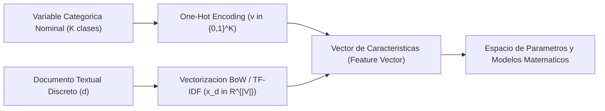
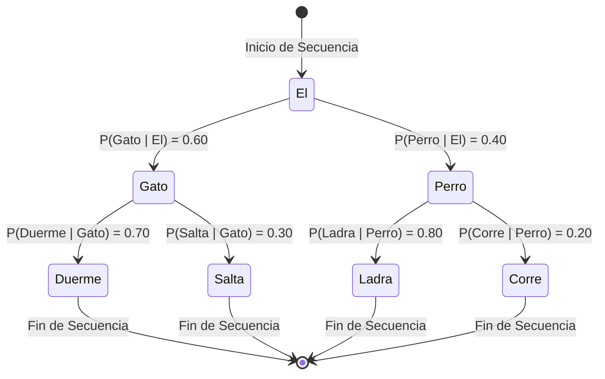
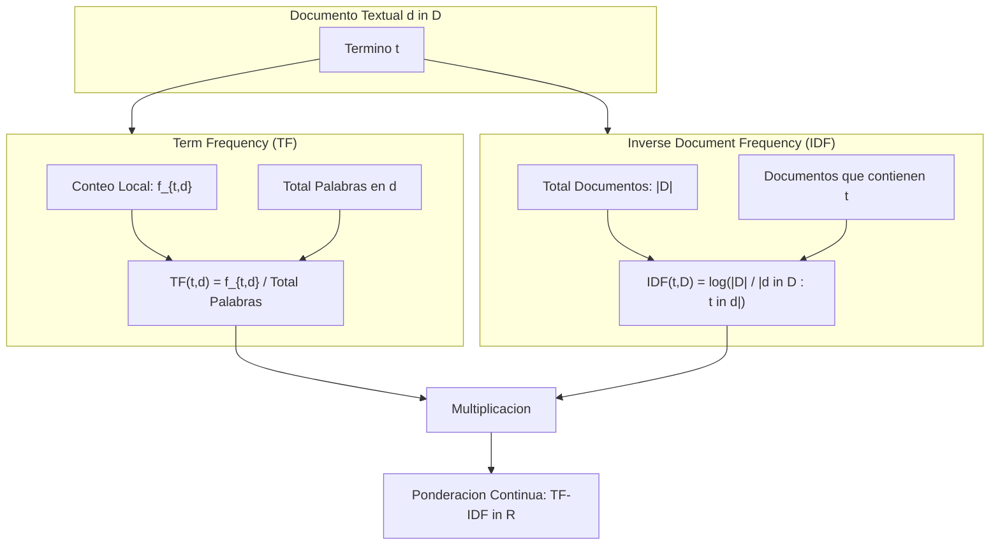

# Clase 2: Modelos Estadisticos Tradicionales: Bag of Words, Modelos de Lenguaje N-Gramas, Cadenas de Markov y Ponderacion Inteligente TF-IDF

> **Objetivo de la sesion:** Formalizar matematicamente la vectorizacion de documentos textuales mediante el modelo Bag of Words (BoW); comprender la formulacion de modelos de lenguaje autorregresivos probabilistas mediante N-Gramas, la regla de la cadena y la suposicion de Markov; y dominar la metrica de ponderacion TF-IDF como mecanismo para atenuar terminos no informativos y generar representaciones continuas en espacios vectoriales para tareas de clasificacion y clustering.

## 1\. Contexto y Marco Conceptual

### La Transicion de Simbolos Cualitativos a Tensores de Caracteristicas

Para que un algoritmo de aprendizaje automatico (e.g., regresion logistica binaria, maquinas de vectores de soporte, redes neuronales) procese texto, es indispensable proyectar el lenguaje humano en un espacio vectorial cuantitativo. 

En el modelado tabular convencional, la tecnica analoga primaria es el **One-Hot Encoding**, el cual transforma una variable categorica nominal con $K$ categorias mutuamente excluyentes en un vector ortogonal binario $v \in \{0, 1\}^K$, asegurando que ninguna categoria asuma artificialmente relaciones de orden u ordinalidad aritmetica.

En el Procesamiento del Lenguaje Natural estadistico, este concepto se extrapola a nivel de documentos: cada documento $d$ se mapea a un vector $x_d \in \mathbb{R}^{|V|}$, donde la dimension total del espacio cartesiano esta determinada por la cardinalidad del vocabulario global $|V|$.



### La Definicion Formal de Modelo de Lenguaje

Un **Modelo de Lenguaje (Language Model - LM)** es un sistema probabilistico disenado para asignar una medida de probabilidad a cualquier secuencia arbitraria de palabras $W = (w_1, w_2, \dots, w_m)$, o alternativamente, calcular la distribucion de probabilidad condicional de observar una palabra determinada $w_k$ dado un contexto precedente:

$P(w_k \mid w_1, w_2, \dots, w_{k-1})$

Los modelos generativos de lenguaje modernos (LLMs) operan bajo este principio rector fundamental: generan texto realizando predicciones iterativas de la siguiente palabra token a token. Lo que diferencia a los enfoques historicos de los contemporaneos es la funcion matematica utilizada para estimar dicha distribucion condicional de probabilidad.

### El Desafio Estructural de las Matrices Dispersas (Sparse Matrices)

Cuando el vocabulario del corpus crece ($|V| > 10^4$), la representacion de documentos individuales genera **matrices dispersas (sparse matrices)** dominadas en mas del 99% por valores nulos (ceros). Esto produce:

- **Sobrecarga de Almacenamiento:** Consumo ineficiente de memoria RAM si se almacenan como arreglos bidimensionales continuos densos.

- **Riesgo de Sobreajuste (Overfitting):** La maldicion de la dimensionalidad debilita la capacidad de generalizacion en modelos lineales.

- **Solucion Arquitectonica:** Uso de estructuras comprimidas por filas (**Compressed Sparse Row - CSR**) y tecnicas de compresion de representacion semantica continua (Embeddings).

---

## 2\. Fundamentos Teoricos y Arquitectura

### 1\. El Modelo Bag of Words (BoW)

El modelo **Bag of Words (Bolsa de Palabras)** representa un documento como un conjunto multiset o coleccion no ordenada de sus palabras constituyentes, conservando unicamente sus frecuencias de aparicion y desechando deliberadamente la sintaxis, la estructura gramatical y el orden secuencial.

Dado un vocabulario ordenado $V = [v_1, v_2, \dots, v_{|V|}]$, el vector de caracteristicas de un documento $d$ se define como:

$x_d = [c(v_1, d), c(v_2, d), \dots, c(v_{|V|}, d)]^T$

Donde $c(v_j, d)$ denota el conteo entero de veces que el termino $v_j$ ocurre en el documento $d$.

#### Limitaciones Epistemologicas de BoW:

1. **Perdida del Orden y Semantica Local:** Asigna representaciones vectoriales identicas a oraciones con significados diametralmente opuestos pero identico lexico (e.g., *"no es bueno, es malo"* vs *"no es malo, es bueno"*).

1. **Ortogonalidad Lexica Estricta:** Ignora sinonimos y jerarquias semanticas; el producto punto entre los vectores de terminos semanticamente proximos (e.g., *"computadora"* y *"ordenador"*) es nulo.

### 2\. Modelos de Lenguaje Basados en N-Gramas y Suposicion de Markov

Para reincorporar el orden secuencial local, se formulan los **N-Gramas**: secuencias continuas de $N$ tokens contiguos extraidos de un texto.

- $N=1$: Unigrama (equivalente a los terminos del modelo BoW).

- $N=2$: Bigrama (pares de tokens adyacentes, e.g., *"el gato"*, *"gato duerme"*).

- $N=3$: Trigrama (tripletas de tokens adyacentes, e.g., *"el gato duerme"*).

#### Descomposicion mediante la Regla de la Cadena de Probabilidad:

Para calcular la probabilidad conjunta de una secuencia completa de tokens $W = (w_1, w_2, \dots, w_m)$:

$P(w_1, w_2, \dots, w_m) = P(w_1) P(w_2 \mid w_1) P(w_3 \mid w_1, w_2) \dots P(w_m \mid w_1, \dots, w_{m-1}) = \prod_{k=1}^m P(w_k \mid w_1^{k-1})$

#### La Suposicion de Markov (Markov Assumption):

A medida que la oracion se alarga, condicionar sobre toda la historia previa ($w_1^{k-1}$) se vuelve computacionalmente intratable y estadisticamente imposible debido a la ausencia de muestras en cualquier corpus finito.

La **Suposicion de Markov de primer orden** postula que la probabilidad de ocurrencia de un token futuro depende unicamente de su estado inmediatamente anterior (el token precedente):

$P(w_k \mid w_1^{k-1}) \approx P(w_k \mid w_{k-1})$

Bajo esta aproximacion, el **Estimador de Maxima Verosimilitud (Maximum Likelihood Estimation - MLE)** para un modelo de Bigramas se calcula como la proporcion de conteos relativos:

$P_{MLE}(w_k \mid w_{k-1}) = \frac{C(w_{k-1}, w_k)}{C(w_{k-1})} = \frac{C(w_{k-1}, w_k)}{\sum_{w} C(w_{k-1}, w)}$

Donde $C(w_{k-1}, w_k)$ es el conteo de co-ocurrencia contigua del bigrama en el corpus, y $C(w_{k-1})$ es la frecuencia marginal del unigrama antecedente.



### 3\. Ponderacion Inteligente TF-IDF (Term Frequency - Inverse Document Frequency)

Un defecto fundamental del conteo simple (BoW) es que sobrerrepresenta palabras comunes de alta frecuencia (como articulos, preposiciones y verbos auxiliares) que aparecen transversalmente en todo el corpus sin aportar poder discriminante entre documentos.

En terminos de teoria estadistica, una variable que asume valores identicos en casi todas las observaciones exhibe una varianza proxima a cero ($\sigma^2 \approx 0$), careciendo de capacidad informativa para la separacion o clasificacion de patrones.

El algoritmo **TF-IDF** resuelve este problema mediante una ponderacion proporcional a la frecuencia del termino en el documento y castigada logaritmicamente por su ubicuidad en el corpus.

#### A. Frecuencia del Termino (Term Frequency - TF):

Mide la densidad de ocurrencia de un termino $t$ en un documento especifico $d$:

$\text{TF}(t, d) = \frac{f_{t,d}}{\sum_{t' \in d} f_{t', d}}$

Donde $f_{t,d}$ es el numero de veces que $t$ ocurre en $d$, y el denominador es la extension total de tokens del documento.

#### B. Frecuencia Inversa de Documento (Inverse Document Frequency - IDF):

Cuantifica la rareza o especificidad informativa del termino a lo largo de todo el corpus de documentos $D$:

$\text{IDF}(t, D) = \log\left(\frac{|D|}{|\{d \in D : t \in d\}|}\right)$

Donde $|D|$ es el numero total de documentos en la coleccion, y el denominador es el conteo de documentos que contienen al menos una aparicion de $t$.

#### C. Calculo Combinado y Propiedad de Colapso a Cero:

La metrica final se define como el producto punto escalar:

$\text{TF-IDF}(t, d, D) = \text{TF}(t, d) \times \text{IDF}(t, D)$

**Propiedad Matematica de Colapso a Cero:**

Si un termino $t$ esta presente en absolutamente todos los documentos de la coleccion ($|\{d \in D : t \in d\}| = |D|$):

$\text{IDF}(t, D) = \log\left(\frac{|D|}{|D|}\right) = \log(1) = 0 \implies \text{TF-IDF}(t, d, D) = 0$

Esta propiedad actua como un **filtro matematico intrinseco de stopwords**: elimina automaticamente la influencia de palabras omnipresentes sin requerir listas estaticas preconstruidas.



---

## 3\. Implementacion Tecnica y Logica de Negocio

### Implementacion de Referencia *From Scratch* en Python

A continuacion se formaliza el calculo algoritmico directo de BoW, probabilidades de transicion de Bigramas y ponderacion TF-IDF:

```python
import math
from collections import Counter

# Corpus de evaluacion minimalista
corpus = [
    "el gato duerme mi gato",
    "el perro corre"
]

# 1. Tokenizacion e identificacion de Vocabulario
tokenized_corpus = [doc.split() for doc in corpus]
vocabulary = sorted(list(set(word for doc in tokenized_corpus for word in doc)))
num_docs = len(corpus)

# 2. Construccion del vector Bag of Words (BoW)
bow_matrix = []
for doc_tokens in tokenized_corpus:
    counts = Counter(doc_tokens)
    vector = [counts.get(term, 0) for term in vocabulary]
    bow_matrix.append(vector)

# 3. Modelado de Bigramas y Probabilidad Condicional MLE
def extract_bigrams(tokens):
    return [(tokens[i], tokens[i+1]) for i in range(len(tokens)-1)]

corpus_bigrams = [extract_bigrams(doc) for doc in tokenized_corpus]
all_bigrams = [bg for doc in corpus_bigrams for bg in doc]
all_unigrams = [w for doc in tokenized_corpus for w in doc]

bigram_counts = Counter(all_bigrams)
unigram_counts = Counter(all_unigrams)

# Probabilidad de transicion: P(corre | perro) = C(perro, corre) / C(perro)
p_corre_dado_perro = bigram_counts.get(('perro', 'corre'), 0) / unigram_counts['perro']

# 4. Ponderacion TF-IDF manual
tf_matrix = []
for doc_tokens in tokenized_corpus:
    doc_len = len(doc_tokens)
    counts = Counter(doc_tokens)
    tf_vector = {term: counts.get(term, 0) / doc_len for term in vocabulary}
    tf_matrix.append(tf_vector)

idf_dict = {}
for term in vocabulary:
    docs_containing = sum(1 for doc_tokens in tokenized_corpus if term in doc_tokens)
    idf_dict[term] = math.log(num_docs / docs_containing)

tfidf_matrix = []
for tf_vector in tf_matrix:
    tfidf_vector = [tf_vector[term] * idf_dict[term] for term in vocabulary]
    tfidf_matrix.append(tfidf_vector)
```

### Implementacion Industrial con Scikit-Learn

En entornos de ingenieria de produccion, se emplean estimadores optimizados en C que retornan matrices dispersas comprimidas:

```python
from sklearn.feature_extraction.text import CountVectorizer, TfidfVectorizer

corpus_industrial = [
    "el gato duerme sobre la alfombra",
    "el perro corre en el parque velozmente",
    "el gato persigue al raton rapidamente"
]

# A. Unigramas (Bag of Words tradicional)
bow_vec = CountVectorizer(ngram_range=(1, 1), stop_words=None)
X_bow = bow_vec.fit_transform(corpus_industrial)  # Retorna scipy.sparse.csr_matrix

# B. Bigramas y Trigramas combinados
ngram_vec = CountVectorizer(ngram_range=(2, 3))
X_ngrams = ngram_vec.fit_transform(corpus_industrial)

# C. Vectorizacion TF-IDF con normalizacion L2
tfidf_vec = TfidfVectorizer(ngram_range=(1, 1), norm='l2', smooth_idf=True)
X_tfidf = tfidf_vec.fit_transform(corpus_industrial)

# Recuperacion del vocabulario de caracteristicas
feature_names = tfidf_vec.get_feature_names_out()
dense_tfidf_sample = X_tfidf.toarray()
```

### Gestion de Memoria y Eficiencia Computacional

- **Almacenamiento Disperso:** Una matriz densa de $100,000 \times 50,000$ valores de tipo ` float64 ` consume aproximadamente $40 \text{ GB}$ de RAM. La misma matriz en formato ` csr_matrix ` con densidad del $0.1\%$ consume menos de $80 \text{ MB}$.

- **Vectorizacion para Tareas Downstream:** Una vez generada la matriz $X \in \mathbb{R}^{m \times |V|}$ con TF-IDF, los documentos pueden alimentar directamente estimadores lineales como:

  - **Regresion Logistica Multiclase:** Para enrutamiento de tickets de soporte y clasificacion tematica.
  
  - **Naive Bayes Multinomial:** Para filtrado de spam y deteccion de sentimientos.
  
  - **Algoritmos de Clustering (K-Means / DBSCAN):** Empleando la distancia coseno ($1 - \text{similitud coseno}$) para agrupar tematicamente documentos afines.

---

## 4\. Analisis Critico de Casos y Auditoria Practica

### Comparativa Estructural de Representaciones Estadisticas

| Criterio Tecnico | Bag of Words (BoW) | Modelos N-Gramas ($N \ge 2$) | TF-IDF |
| --- | --- | --- | --- |
| **Naturaleza del Valor** | Conteo discreto entero ($\mathbb{N}$) | Conteo discreto de co-ocurrencia | Ponderacion continua en $\mathbb{R}$ |
| **Preservacion de Secuencia** | Ninguna (invariante a permutaciones) | Local acotada a ventana de tamano $N$ | Ninguna (a nivel unigrama) |
| **Crecimiento Dimensional** | Lineal con el vocabulario: \$mathcal&\#123;O&\#125;(\\ | V\\ | )\$ |
| **Tratamiento de Stopwords** | Sensible (ruido de alta frecuencia) | Captura modismos pero amplifica ruido | Atenuacion automatica ($\text{IDF} \rightarrow 0$) |
| **Densidad de la Matriz** | Muy baja (alta dispersion) | Extremadamente baja (hiperdispersa) | Muy baja (valores continuos) |
| **Utilidad en Modelado** | Clasificacion simple con vocabularios pequenos | Modelos de lenguaje tempranos y autocompletado | Busqueda vectorial, clustering y clasificacion |

### Auditoria de Casos Reales

1. **Deteccion de Entidades Geograficas y Compuestas:**

   En el analisis de quejas de clientes o registros de telecomunicaciones, palabras como *"Santa Cruz"* o *"La Paz"* se destruyen si se procesan exclusivamente como unigramas aislados (*"Santa"*, *"Cruz"*, *"La"*, *"Paz"*). La inclusion de **Bigramas** permite preservar la entidad semantica completa como una unidad irreductible de significado.

1. **Filtrado de Temas Criticos en Reclamos Financieros:**

   Al aplicar Bag of Words a quejas de usuarios, palabras genericas como *"cuenta"*, *"banco"*, *"tarjeta"* dominan los recuentos absolutos sin aportar diferenciacon. Al transformar el corpus con **TF-IDF**, emergen como terminos con mayor peso especifico conceptos de alto impacto o anomalias criticas (e.g., *"ejecucion hipotecaria"*, *"clausula abusiva"*, *"suplantacion de identidad"*), habilitando alertas de negocio focalizadas.

---

## 5\. Principios de Diseno, Buenas Practicas y Anti-patrones

### Principios de Diseno

1. **Poda Controlada del Vocabulario (**` min_df ` **y** ` max_df `**):**

   - Configurar ` max_df ` (e.g., 0.85) para descartar automaticamente palabras que aparezcan en mas del 85% de los documentos.
   
   - Configurar ` min_df ` (e.g., 5 o 0.001) para descartar errores tipograficos o palabras raras que aparezcan en menos de 5 documentos, evitando sobreajuste.

1. **Normalizacion L2 en Vectores TF-IDF:**

   Aplicar normalizacion euclidiana para que la longitud del documento no distorsione la ponderacion (evitando que documentos largos tengan puntuaciones artificialmente infladas).

### Anti-patrones Criticos

- **Anti-patron de Conversion a Matriz Densa (**` toarray() ` **indiscriminado):** Invocar ` .toarray() ` sobre matrices de corpus masivos en memoria sin evaluar previamente las dimensiones resultantes, ocasionando errores criticos de memoria (*Out of Memory - OOM*).

- **Anti-patron de Evaluacion de N-Gramas sin Suavizado (Zero-Frequency Problem):** En modelos de lenguaje de N-Gramas puros, si una combinacion de palabras nunca fue observada en el entrenamiento ($C(w_{k-1}, w_k) = 0$), el modelo asigna probabilidad 0 a toda la oracion. Para mitigar esto, se debe emplear **suavizado de Laplace (Add-1 smoothing)** o esquemas avanzados de descuento como Kneser-Ney.

- **Anti-patron de Descarte Ciego de Modelos Estadisticos:** Asumir que toda tarea de NLP moderna requiere Transformers masivos, ignorando que clasificadores lineales entrenados sobre representaciones TF-IDF son altamente interpretables, faciles de auditar y capaces de servir miles de inferencias por segundo con consumo energetico minimo.

---

## 6\. Sintesis Conceptual y Profundizacion Academica

### Sintesis de la Sesion

Los modelos estadisticos tradicionales representan el puente formal entre el analisis linguistico y el calculo tensorial. El modelo Bag of Words introdujo la primera aproximacion para vectorizar texto; los modelos de N-Gramas formalizaron la prediccion secuencial fundamentada en la teoria de probabilidades y cadenas de Markov; y la metrica TF-IDF introdujo el concepto de ponderacion informativa diferencial. Estos fundamentos matematicos constituyen la base teorica que subyace a los mecanismos contemporaneos de atencion y representacion densa.

### Literatura de Referencia y Marcos Teoricos

- **Manning, C. D., Raghavan, P., &amp; Schütze, H. (2008).** *Introduction to Information Retrieval.* Cambridge University Press. Capitulos 6 (Scoring, term weighting and the vector space model) y 7 (Computing scores in a search system).

- **Jurafsky, D., &amp; Martin, J. H. (2025).** *Speech and Language Processing.* Capitulo 4 (N-gram Language Models).

- **Shannon, C. E. (1948).** *A Mathematical Theory of Communication.* Bell System Technical Journal, 27(3), 379–423.

- **Salton, G., &amp; Buckley, C. (1988).** *Term-weighting approaches in automatic text retrieval.* Information Processing &amp; Management, 24(5), 513-523.
