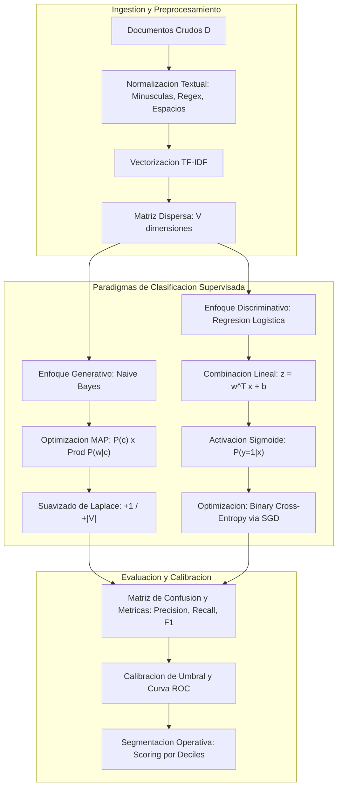

# Clase 3: Clasificacion Tradicional de Texto Supervisada y Fundamentos de Modelado No Supervisado

> Proposito pedagogico: Comprender los fundamentos matematicos y computacionales del aprendizaje supervisado aplicado al procesamiento del lenguaje natural (NLP), contrastando modelos generativos (Naive Bayes multinomial con suavizado de Laplace) y modelos discriminativos (Regresion Logistica Binaria). Evaluar el impacto de la vectorizacion dispersa (TF-IDF), la seleccion de metricas segun balance de clases, y auditar el colapso del aprendizaje no supervisado (K-Means) ante la maldicion de la dimensionalidad en espacios dispersos.

## Seccion 1 - Contexto y Marco Conceptual

### 1.1 Evolucion Metodologica en el Analisis de Texto

Historicamente, el procesamiento y analisis de texto comenzo bajo el paradigma de la Inteligencia Artificial Simbolica, sustentado en sistemas expertos y arboles rigidos de reglas heuristicas (expresiones regulares, listas negras de terminos, condicionales anidados if-else / case). Un ejemplo seminal de esta era fue el agente conversacional ELIZA (Weizenbaum, decada de 1960), basado en coincidencia de patrones sintacticos.

En el ambito de la clasificacion (por ejemplo, el filtrado de correo no deseado o spam), la aproximacion inicial consistio en definir listas de palabras prohibidas o sospechosas (ej. "dolares", "ha sido seleccionado", "verificar transaccion bancaria").

Sin embargo, este enfoque presenta fallas estructurales insalvables a escala:

- Fragilidad e inestabilidad temporal: El lenguaje humano es dinamico y evolutivo; los generadores de spam modifican deliberadamente el lexico y la ortografia.

- Costo de mantenimiento: Requiere ingenieria manual intensiva y permanente para actualizar bancos lexicos en expansion constante.

- Asimetria en rendimiento estadistico: Aunque puede alcanzar una alta precision en un dominio cerrado y controlado, presenta un recall extraordinariamente bajo, generando un volumen inaceptable de falsos negativos ante cualquier variacion no contemplada en las reglas.

### 1.2 Formalizacion del Problema de Clasificacion de Texto

El paso hacia el paradigma del Aprendizaje Automatico (Machine Learning) formula el analisis textual como una tarea estadistica formal:

- Entrada: Un documento $d \in \mathcal{D}$, representado como una entidad textual sujeta a representacion vectorial.

- Conjunto de Clases: Un espacio discreto y exhaustivo de categorias $\mathcal{C} = \{c_1, c_2, \dots, c_k\}$.

  - Tarea Binaria: $|\mathcal{C}| = 2$ (ej. $c \in \{0, 1\}$, representando spam vs. ham, o polaridad de sentimiento positivo vs. negativo).
  
  - Tarea Multiclase: $|\mathcal{C}| > 2$ (ej. clasificacion tematica de articulos medicos en categorias farmacologicas, o categorizacion de emociones en tristeza, enojo, alegria, amor, sorpresa).

- Hipotesis del Clasificador: Una funcion parametrizada $\hat{y} = f(d; \theta)$ que asigna a cada documento una clase estimada $\hat{c} \in \mathcal{C}$ minimizando una funcion de perdida respecto a la etiqueta real $y$.

- Casos de Uso Empresariales:

  - Ciberseguridad y Deteccion de Amenazas: Clasificacion de correos maliciosos y phishing corporativo.
  
  - Enrutamiento Operativo y Auditoria Financiera: Deteccion de anomalias en reclamos de riesgo crediticio y transacciones financieras.
  
  - Priorizacion Comercial: Estimacion de propension a fuga de clientes (churn) y focalizacion de estrategias de retencion mediante segmentacion decilica.

---

## Seccion 2 - Fundamentos Teoricos y Arquitectura

### 2.1 Paradigma Generativo vs. Paradigma Discriminativo

Una de las distinciones teoricas cardinales en el aprendizaje estadistico radica en la naturaleza de la distribucion que el modelo intenta capturar:

1. Enfoque Generativo (Naive Bayes):

   - Modela la distribucion de probabilidad conjunta $P(x, c) = P(c) \cdot P(x|c)$.
   
   - Aprende como se generan los datos para cada categoria individual. Responde a la pregunta: "Dada la clase $c$, ¿cual es la probabilidad de observar este perfil de palabras?".
   
   - Requiere estimar dos componentes: la probabilidad a priori de la clase ($P(c)$) y la verosimilitud condicional del documento dada la clase ($P(d|c)$).
   
   - Analogia conceptual: Equivale a construir un modelo representativo de cada entidad (ej. como luce un felino vs. como luce un canino) y evaluar a cual modelo se asemeja mas una nueva observacion.

1. Enfoque Discriminativo (Regresion Logistica Binaria):

   - Modela directamente la distribucion condicional posterior $P(c|x)$.
   
   - Aprende la frontera de separacion o limite de decision optimo entre las clases sin intentar modelar el proceso generador de los datos.
   
   - Ajusta un conjunto de coeficientes ponderados ($w$) para optimizar la funcion discriminante basada en las caracteristicas observadas.



### 2.2 Naive Bayes Multinomial y Criterio MAP

La formulacion de Naive Bayes parte del Teorema de Bayes:

$P(c|d) = \frac{P(c) \cdot P(d|c)}{P(d)}$

Dado que el objetivo consiste en determinar la clase mas probable para un documento dado, se aplica la regla de decision del Maximo A Posteriori (MAP):

$\hat{c}_{\text{MAP}} = \arg\max_{c \in \mathcal{C}} P(c|d) = \arg\max_{c \in \mathcal{C}} \frac{P(c) \cdot P(d|c)}{P(d)}$

El denominador $P(d) = \sum_{c' \in \mathcal{C}} P(c') P(d|c')$ representa la probabilidad marginal de la evidencia y es estrictamente constante respecto a la variable de optimizacion $c$. Por tanto, se descarta del calculo:

$\hat{c}_{\text{MAP}} = \arg\max_{c \in \mathcal{C}} \left[ P(c) \cdot P(d|c) \right]$

Bajo el modelo de Bolsa de Palabras (Bag of Words, BoW), un documento $d$ se descompone en una secuencia de tokens o terminos $(w_1, w_2, \dots, w_n)$. La asuncion fundamental (y deliberadamente simplificadora) de Naive Bayes es la independencia condicional de los terminos dada la clase:

$P(d|c) = P(w_1, w_2, \dots, w_n | c) = \prod_{i=1}^n P(w_i | c)$

Sustituyendo en la ecuacion MAP:

$\hat{c}_{\text{MAP}} = \arg\max_{c \in \mathcal{C}} \left[ P(c) \prod_{i=1}^n P(w_i | c) \right]$

Para evitar problemas de subdesbordamiento numerico (arithmetic underflow) derivados del producto continuo de probabilidades pequeñas, computacionalmente se evalua la suma de logaritmos:

$\hat{c}_{\text{MAP}} = \arg\max_{c \in \mathcal{C}} \left[ \log P(c) + \sum_{i=1}^n \log P(w_i | c) \right]$

### 2.3 Estimacion de Parametros y Suavizado de Laplace

La probabilidad a priori de la clase se calcula mediante la proporcion frecuentista de documentos en el corpus de entrenamiento:

$P(c) = \frac{N_c}{N_{\text{total}}}$

donde $N_c$ es el numero de documentos pertenecientes a la clase $c$ y $N_{\text{total}}$ es el total de documentos.

Bajo la estimacion de Maxima Verosimilitud (Maximum Likelihood Estimation, MLE), la verosimilitud de una palabra dada la clase corresponde a su frecuencia relativa:

$P_{\text{MLE}}(w_i | c) = \frac{\text{count}(w_i, c)}{\sum_{w \in V} \text{count}(w, c)}$

Patologia de Probabilidad Cero: Si una palabra del documento a clasificar no aparecio durante el entrenamiento dentro de los documentos de la clase $c$, entonces $\text{count}(w_i, c) = 0$, lo que conduce a $P(w_i | c) = 0$. En consecuencia, todo el producto $\prod P(w_i | c)$ colapsa a cero, anulando por completo cualquier otra evidencia positiva aportada por los demas terminos.

Solucion Matematica: Suavizado de Laplace (Laplace Add-1 Smoothing):

Se añade una unidad al numerador y se compensa el denominador sumando el tamaño del vocabulario global $|V|$ (numero de palabras unicas observadas en el conjunto de entrenamiento):

$P_{\text{Laplace}}(w_i | c) = \frac{\text{count}(w_i, c) + 1}{\sum_{w \in V} \text{count}(w, c) + |V|}$

Esta correccion garantiza que:

- La distribucion permanezca propiamente normalizada ($\sum_{w \in V} P(w|c) = 1$).

- Ninguna palabra tenga probabilidad nula, preservando la estabilidad del clasificador.

### 2.4 Regresion Logistica Binaria

En la Regresion Logistica, la probabilidad posterior de pertenencia a la clase positiva ($y=1$) se modela aplicando la funcion logistica (sigmoide) sobre una combinacion lineal de las variables predictoras:

$z = w^T x + b = \sum_{j=1}^m w_j x_j + b$

$\hat{y} = P(y = 1 | x) = \sigma(z) = \frac{1}{1 + e^{-z}}$

Propiedades de la funcion sigmoide:

- Rango asintotico estrictamente acotado en $(0, 1)$, permitiendo una interpretacion probabilistica directa.

- Simetria central en $z = 0$, donde $\sigma(0) = 0.5$.

- Derivada analitica sumamente eficiente para optimizacion: $\sigma'(z) = \sigma(z)(1 - \sigma(z))$.

Para optimizar los pesos $w$ y el sesgo $b$, se formula la funcion de perdida de Entropia Cruzada Binaria (Binary Cross-Entropy / Log Loss):

$\mathcal{L}(w, b) = -\frac{1}{N} \sum_{i=1}^N \left[ y^{(i)} \log(\hat{y}^{(i)}) + (1 - y^{(i)}) \log(1 - \hat{y}^{(i)}) \right]$

La optimizacion se efectua mediante el algoritmo de Descenso de Gradiente (Gradient Descent):

$w_j \leftarrow w_j - \eta \frac{\partial \mathcal{L}}{\partial w_j}, \quad b \leftarrow b - \eta \frac{\partial \mathcal{L}}{\partial b}$

donde $\eta > 0$ es la tasa de aprendizaje (learning rate).

---

## Seccion 3 - Implementacion Tecnica y Logica de Negocio

### 3.1 Resolucion Analitica Paso a Paso: Naive Bayes con Suavizado de Laplace

A continuacion se presenta la resolucion exhaustiva del caso practico abordado en la sesion:

- Conjunto de Entrenamiento:

  - Documento 1 (Negativo): "just plain boring" (3 palabras)
  
  - Documento 2 (Negativo): "entirely predictable and lacks energy" (5 palabras)
  
  - Documento 3 (Negativo): "no surprise and very few laughs" (6 palabras)
  
  - Documento 4 (Positivo): "very powerful" (2 palabras)
  
  - Documento 5 (Positivo): "the most fun film of the summer" (7 palabras)

- Total de documentos: $N = 5$.

  - Documentos Negativos: $N_{\text{Neg}} = 3 \implies P(\text{Neg}) = \frac{3}{5} = 0.60$.
  
  - Documentos Positivos: $N_{\text{Pos}} = 2 \implies P(\text{Pos}) = \frac{2}{5} = 0.40$.

- Recuento de tokens totales por clase:

  - Total tokens clase Negativa: $n_{\text{Neg}} = 3 + 5 + 6 = 14$ palabras.
  
  - Total tokens clase Positiva: $n_{\text{Pos}} = 2 + 7 = 9$ palabras.

- Tamaño del Vocabulario Unico ($|V|$):

  Extrayendo el conjunto de palabras distintas de todo el corpus de entrenamiento:
  
  $V = \{\text{just, plain, boring, entirely, predictable, and, lacks, energy, no, surprise, very, few, laughs, powerful, the, most, fun, film, of, summer}\} \implies |V| = 20$

- Documento de Prueba (Test): "predictable with no fun"

  - La palabra "with" no pertenece al vocabulario de entrenamiento $V$, por lo que se descarta de la evaluacion en este modelo de lexico cerrado.
  
  - Palabras a evaluar: \["predictable", "no", "fun"\].

Calculo de verosimilitudes con Suavizado de Laplace:

Denominadores:

$\text{Den}_{\text{Neg}} = n_{\text{Neg}} + |V| = 14 + 20 = 34$

$\text{Den}_{\text{Pos}} = n_{\text{Pos}} + |V| = 9 + 20 = 29$

1. Para la clase Negativa:

   - $\text{count}(\text{predictable}, \text{Neg}) = 1 \implies P(\text{predictable} | \text{Neg}) = \frac{1 + 1}{34} = \frac{2}{34}$
   
   - $\text{count}(\text{no}, \text{Neg}) = 1 \implies P(\text{no} | \text{Neg}) = \frac{1 + 1}{34} = \frac{2}{34}$
   
   - $\text{count}(\text{fun}, \text{Neg}) = 0 \implies P(\text{fun} | \text{Neg}) = \frac{0 + 1}{34} = \frac{1}{34}$
   
   - Probabilidad posterior no normalizada para Negativo:
   
     $P(\text{Neg} | d) \propto P(\text{Neg}) \cdot \prod P(w_i | \text{Neg}) = \frac{3}{5} \times \left( \frac{2 \times 2 \times 1}{34^3} \right) = \frac{3}{5} \times \frac{4}{39,304} = \frac{12}{196,520} \approx 6.106 \times 10^{-5}$

1. Para la clase Positiva:

   - $\text{count}(\text{predictable}, \text{Pos}) = 0 \implies P(\text{predictable} | \text{Pos}) = \frac{0 + 1}{29} = \frac{1}{29}$
   
   - $\text{count}(\text{no}, \text{Pos}) = 0 \implies P(\text{no} | \text{Pos}) = \frac{0 + 1}{29} = \frac{1}{29}$
   
   - $\text{count}(\text{fun}, \text{Pos}) = 1 \implies P(\text{fun} | \text{Pos}) = \frac{1 + 1}{29} = \frac{2}{29}$
   
   - Probabilidad posterior no normalizada para Positivo:
   
     $P(\text{Pos} | d) \propto P(\text{Pos}) \cdot \prod P(w_i | \text{Pos}) = \frac{2}{5} \times \left( \frac{1 \times 1 \times 2}{29^3} \right) = \frac{2}{5} \times \frac{2}{24,389} = \frac{4}{121,945} \approx 3.280 \times 10^{-5}$

Conclusion de la Decision MAP:

Dado que $6.106 \times 10^{-5} > 3.280 \times 10^{-5}$, el argumento maximo corresponde a la clase Negativa:

$\hat{c}_{\text{MAP}} = \text{Negativo}$

El suavizado evita la anulacion: sin Laplace, $P(\text{fun}|\text{Neg}) = 0$ y $P(\text{predictable}|\text{Pos}) = 0$, colapsando ambas probabilidades a cero absoluto e impidiendo toda discriminacion.

### 3.2 Implementacion con Scikit-Learn Pipeline

A continuacion se expone la estructura de codigo estandarizada en Python utilizando ` sklearn.pipeline.Pipeline `, encapsulando vectorizacion dispersa TF-IDF y el estimador:

```python
import re
import numpy as np
import pandas as pd
from sklearn.model_selection import train_test_split
from sklearn.feature_extraction.text import TfidfVectorizer
from sklearn.naive_bayes import MultinomialNB
from sklearn.linear_model import LogisticRegression
from sklearn.pipeline import Pipeline
from sklearn.metrics import classification_report, confusion_matrix, ConfusionMatrixDisplay

def clean_text(text: str) -> str:
    """Normaliza texto eliminando caracteres especiales y estandarizando espacios."""
    text = str(text).lower()
    text = re.sub(r'[^a-zA-Z0-9\s]', ' ', text)
    text = re.sub(r'\s+', ' ', text).strip()
    return text

# Carga de datos de clasificacion (ej. SMS Spam: label, message)
# df['message_clean'] = df['message'].apply(clean_text)
# X = df['message_clean']
# y = df['label'].map({'ham': 0, 'spam': 1})

# Division estratificada para preservar la proporcion relativa de clases
X_train, X_test, y_train, y_test = train_test_split(
    X, y, test_size=0.20, random_state=42, stratify=y
)

# Pipeline 1: Naive Bayes Multinomial
nb_pipeline = Pipeline([
    ('tfidf', TfidfVectorizer(max_features=5000, stop_words='english')),
    ('classifier', MultinomialNB(alpha=1.0)) # alpha=1.0 activa suavizado de Laplace
])
nb_pipeline.fit(X_train, y_train)

# Pipeline 2: Regresion Logistica Binaria
lr_pipeline = Pipeline([
    ('tfidf', TfidfVectorizer(max_features=5000, stop_words='english')),
    ('classifier', LogisticRegression(C=1.0, max_iter=1000, solver='lbfgs'))
])
lr_pipeline.fit(X_train, y_train)
```

### 3.3 Metricas de Evaluacion y Diagnostico de Desbalance

En clasificacion de texto, la matriz de confusion contrasta la prediccion con la realidad:

- Verdaderos Positivos ($TP$): Prediccion Positiva, Realidad Positiva.

- Falsos Positivos ($FP$): Prediccion Positiva, Realidad Negativa (Error Tipo I).

- Falsos Negativos ($FN$): Prediccion Negativa, Realidad Positiva (Error Tipo II).

- Verdaderos Negativos ($TN$): Prediccion Negativa, Realidad Negativa.

Formulaciones y Diagnostico de Sesgo:

1. Exactitud (Accuracy):

   $\text{Accuracy} = \frac{TP + TN}{TP + TN + FP + FN}$
   
   Falla Critica en Clases Desbalanceadas: Si en una muestra de 1,000,000 mensajes solo 100 son spam (0.01%), un clasificador trivial que etiquete sistematicamente todo como "no spam" alcanza un Accuracy del $99.99\%$, pero su capacidad de detectar la clase de interes es nula ($Recall = 0$).

1. Precision:

   $\text{Precision} = \frac{TP}{TP + FP}$
   
   Mide la fidelidad de las alertas positivas. Prioritaria cuando el costo de un Falso Positivo es alto (ej. bloquear correos legitimos y criticos).

1. Sensibilidad / Exhaustividad (Recall):

   $\text{Recall} = \frac{TP}{TP + FN}$
   
   Mide la tasa de recuperacion de la clase positiva real. Prioritaria cuando el costo de un Falso Negativo es elevado (ej. omitir spam malicioso o fraude bancario).

1. Puntuacion F1 (F1-Score):

   $F1 = 2 \cdot \frac{\text{Precision} \cdot \text{Recall}}{\text{Precision} + \text{Recall}}$
   
   Media armonica; penaliza desbalances extremos entre precision y recall.

1. Extension a Problemas Multiclase:

   - Macro-Average: Promedio aritmetico no ponderado de la metrica sobre cada clase $k$:
   
     $\text{Precision}_{\text{macro}} = \frac{1}{K} \sum_{k=1}^K \text{Precision}_k$
     
     Otorga el mismo peso a todas las clases, revelando deficiencias en categorias poco representadas.
   
   - Micro-Average: Agregacion directa de todos los $TP$, $FP$ y $FN$ a nivel global antes de computar la proporcion:
   
     $\text{Precision}_{\text{micro}} = \frac{\sum_{k=1}^K TP_k}{\sum_{k=1}^K TP_k + \sum_{k=1}^K FP_k}$
     
     Tiende a reflejar el desempeno predominante de las clases mayoritarias.

### 3.4 Calibracion de Umbrales y Scoring Decilico

Los modelos probabilisticos devuelven $P(y=1|x) \in [0, 1]$. El punto de corte estandar de $0.5$ puede calibrarse segun objetivos de negocio:

- Modificar el umbral $\tau \in [0, 1]$ induce un balanceo entre Precision y Recall (curva ROC).

- Aplicacion Operativa en Deciles de Churn: En analitica de clientes, ordenar las predicciones por probabilidad descendente y dividirlas en 10 deciles permite enfocar campañas de retencion en el Decil 1 (top 10% con mayor riesgo), optimizando el retorno de inversion sin requerir una clasificacion binaria rigida.

### 3.5 Validacion Cruzada ($k$-fold Cross Validation) y Reduccion de Varianza

Frente a una simple division Train/Test, la validacion cruzada en $k$ pliegues entrena $k$ modelos independientes rotando el pliegue de evaluacion:

- Fundamento: Reduce la varianza del estimador al promediar metricas sobre diferentes particiones muestrales.

- Conexion con Metodos de Ensamble: Es analoga al principio de Bagging (Bootstrap Aggregating) de Random Forest: promediar multiples modelos independientes atenua la variabilidad estocastica sin sesgar la prediccion.

### 3.6 Auditoria de Espacios Dispersos y la Maldicion de la Dimensionalidad

Cuando un corpus de texto se vectoriza mediante TF-IDF, la matriz resultante posee dimensiones de orden $|D| \times |V|$:

- En el dataset de SMS, el vocabulario produjo 5,572 columnas.

- En el dataset de sentimientos, alcanzo 13,535 dimensiones.

- Mas del $99\%$ de las celdas son ceros (matrices dispersas ` scipy.sparse `).

- La Maldicion de la Dimensionalidad (Curse of Dimensionality): A medida que la dimension $m$ crece, el volumen del espacio se expande exponencialmente y la distancia euclidiana entre cualesquiera dos puntos tiende a converger a un valor casi constante:

  $\lim_{m \to \infty} \frac{\text{dist}_{\max} - \text{dist}_{\min}}{\text{dist}_{\min}} \to 0$

- Colapso del Clustering No Supervisado: Al aplicar K-Means ($k=5$) sobre la matriz TF-IDF de sentimientos y reducir a 2 componentes principales (PCA) para visualizacion, los grupos aparecen totalmente superpuestos y el Coeficiente de Silueta (Silhouette Score) resultante colapsa a valores del orden de $0.0004$ (practicamente cero). Esto demuestra que las representaciones dispersas y de alta dimensionalidad son inaptas para modelos basados en distancias geometricas euclidianas.

---

## Seccion 4 - Analisis Critico de Casos y Auditoria Practica

### 4.1 Matriz Comparativa de Modelos Tradicionales

| Dimension de Analisis | Naive Bayes Multinomial | Regresion Logistica Binaria | K-Means sobre TF-IDF |
| --- | --- | --- | --- |
| **Tipo de Aprendizaje** | Supervisado | Supervisado | No Supervisado |
| **Paradigma** | Generativo ($P(x, c)$) | Discriminativo ($P(c \mid x)$) | Particionamiento Geometrico |
| **Supuesto Matematico** | Independencia condicional de terminos | Relacion log-lineal en probabilidades | Esfericidad y compacidad euclidiana |
| **Espacio de Caracteristicas** | Disperso (Conteos / TF-IDF) | Disperso (TF-IDF ponderado) | Disperso (TF-IDF normalizado) |
| **Parametros Aprendidos** | Conteos frecuentistas / Probabilidades | Vector de pesos $w$ y sesgo $b$ | Centroides de clusters $\mu_k$ |
| **Costo Computacional** | Muy bajo ($O(N \cdot V_{\text{size}})$, una pasada) | Moderado (Iterativo via gradiente) | Moderado a alto en alta dimension |
| **Comportamiento ante Desbalance** | Vulnerable al prior desbalanceado | Ajustable via ponderacion de clases | Genera clusters triviales o vacios |
| **Sensibilidad a Dimensionalidad** | Robusto (multiplicacion desacoplada) | Sensible (requiere regularizacion L1/L2) | Colapso severo (Silhouette $\approx 0$) |

### 4.2 Evaluacion Comparativa en Deteccion de SMS Spam

En la experimentacion practica sobre la coleccion de SMS (clases: ` ham ` \[mayoria\] vs. ` spam ` \[minoria\]):

- Naive Bayes Multinomial:

  - Precision en Spam: $1.00$ (cero falsos positivos; ningun mensaje legitimo fue etiquetado erroneamente como spam).
  
  - Recall en Spam: $0.66$ (dejo escapar un $34\%$ de los mensajes de spam reales como falsos negativos).
  
  - F1-Score en Spam: $0.79$.

- Regresion Logistica Binaria:

  - Precision en Spam: $0.99$ (ocurrencia marginal de falsos positivos).
  
  - Recall en Spam: $0.78$ (capturo sustancialmente mayor proporcion de spam real).
  
  - F1-Score en Spam: $0.87$.

- Veredicto Analitico: La Regresion Logistica supero a Naive Bayes en terminos de balance armónico global (F1-score de 0.87 vs 0.79), demostrando mayor robustez para capturar la frontera discriminante en la clase minoritaria sin un colapso severo de la precision.

---

## Seccion 5 - Principios de Diseno, Buenas Practicas y Anti-patrones

### 5.1 Reglas de Oro en Modelado Tradicional de Texto

1. Estratificacion Estricta de Muestras: En tareas con distribucion asimetrica de clases, siempre debe emplearse particion estratificada (` stratify=y `) para preservar la proporcion relativa de la variable objetivo tanto en entrenamiento como en validacion.

1. Aislamiento Estricto del Preprocesador (Fuga de Datos): El vocabulario y los pesos inversos (IDF) deben aprenderse exclusivamente sobre el conjunto de entrenamiento (` fit_transform `). En el conjunto de prueba o produccion solo debe ejecutarse transformacion (` transform `).

1. Evaluacion Guiada por el Costo del Error: En problemas reales de negocio, nunca debe seleccionarse un modelo unicamente por su Accuracy global. Debe identificarse explicitamente la penalizacion financiera de los Falsos Positivos vs. Falsos Negativos y calibrar el umbral de clasificacion en consecuencia.

### 5.2 Anti-patrones y Errores Metodologicos Comunes

- Anti-patron de Frecuencia Cero: Entrenar un modelo de Naive Bayes sin suavizado (Laplace $\alpha=0$), provocando que cualquier palabra no vista durante el entrenamiento anule el calculo global de probabilidad de un documento.

- Anti-patron de Distancia Euclidiana en Espacios Dispersos: Aplicar algoritmos de agrupamiento basados en distancia L2 (como K-Means tradicional) directamente sobre matrices TF-IDF de miles de dimensiones sin reduccion previa de dimensionalidad ni normalizacion angular/coseno.

- Anti-patron de la Hipotesis Independiente Estricta: Confiar en Naive Bayes para tareas donde el orden de las palabras, la negacion contextual o la polisemia alteran completamente el sentido semantico del texto (ej. "no es malo" interpretado negativamente por contener "no" y "malo").

---

## Seccion 6 - Sintesis Conceptual y Profundizacion Academica

### 6.1 Sintesis de Aprendizajes Clave

Los modelos clasicos de clasificacion supervisada (Naive Bayes y Regresion Logistica) combinados con tecnicas de vectorizacion dispersa (Bag-of-Words y TF-IDF) constituyeron el estandar computacional de la disciplina durante decadas gracias a su eficiencia algoritmica, bajo consumo de hardware y rapido entrenamiento.

Sin embargo, esta arquitectura presenta un limite teorico infranqueable:

- Las representaciones vectoriales son ortogonales entre si: la representacion de la palabra "auto" es geometricamente tan distante de "coche" como de "astronomia".

- Se ignora por completo la semantica, el contexto situacional y las relaciones de sinonimia o antonimia.

- Las matrices generadas son masivas, dispersas y sufren de la maldicion de la dimensionalidad, provocando el colapso de tecnicas no supervisadas como K-Means.

### 6.2 Puente Metodologico hacia las Representaciones Densas

Para superar la dispersion y la falta de significado en las representaciones de conteo, la evolucion del procesamiento del lenguaje natural requirio una transformacion epistemologica hacia la Semantica Vectorial Continua: aprender espacios latentes densos, compactos y continuos (Word Embeddings) de baja dimensionalidad ($50$ a $1,000$ dimensiones) mediante redes neuronales, donde la proximidad espacial capture directamente las relaciones semanticas y funcionales del lenguaje.

### 6.3 Referencias Bibliograficas y Lecturas Recomendadas

- Jurafsky, D., &amp; Martin, J. H. (2023). Speech and Language Processing (3rd ed. draft). Chapter 4: Naive Bayes, Logistic Regression, and Sentiment Classification.

- Manning, C. D., Raghavan, P., &amp; Schütze, H. (2008). Introduction to Information Retrieval. Cambridge University Press. Chapter 13: Text classification and Naive Bayes; Chapter 14: Vector space classification.

- Hastie, T., Tibshirani, R., &amp; Friedman, J. (2009). The Elements of Statistical Learning: Data Mining, Inference, and Prediction. Springer. Chapter 4: Linear Methods for Classification.

---
