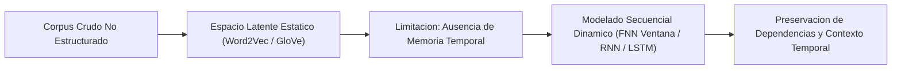
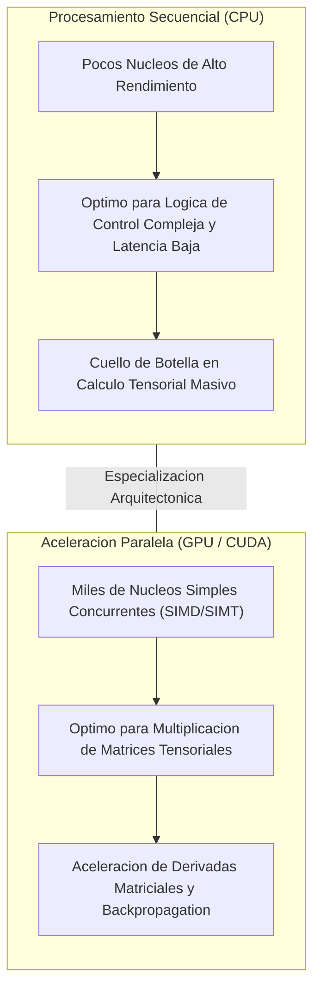
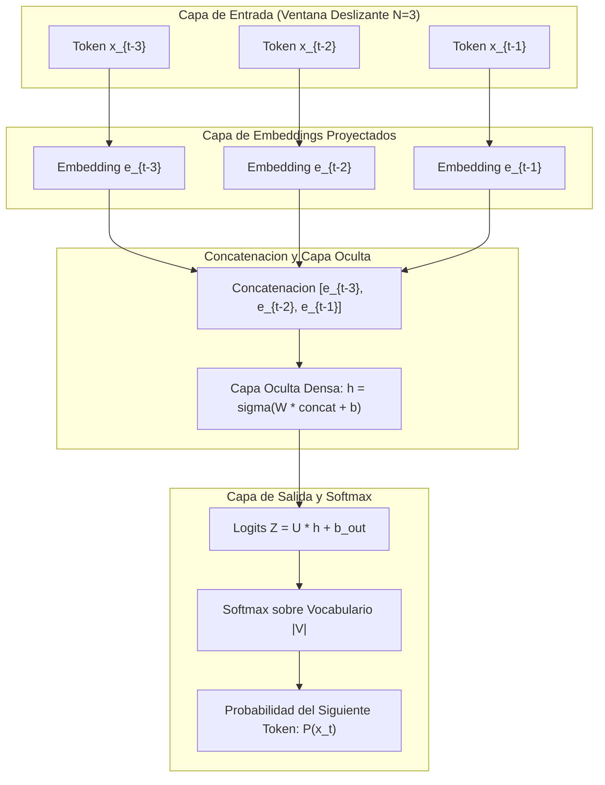
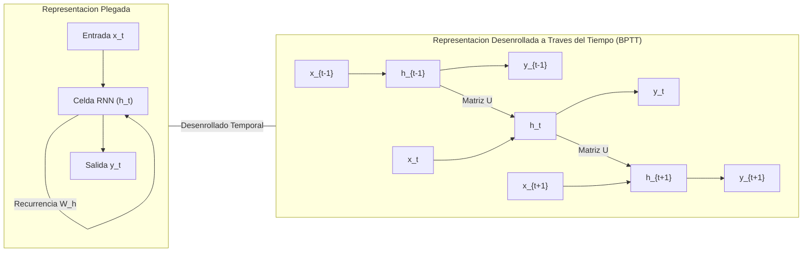
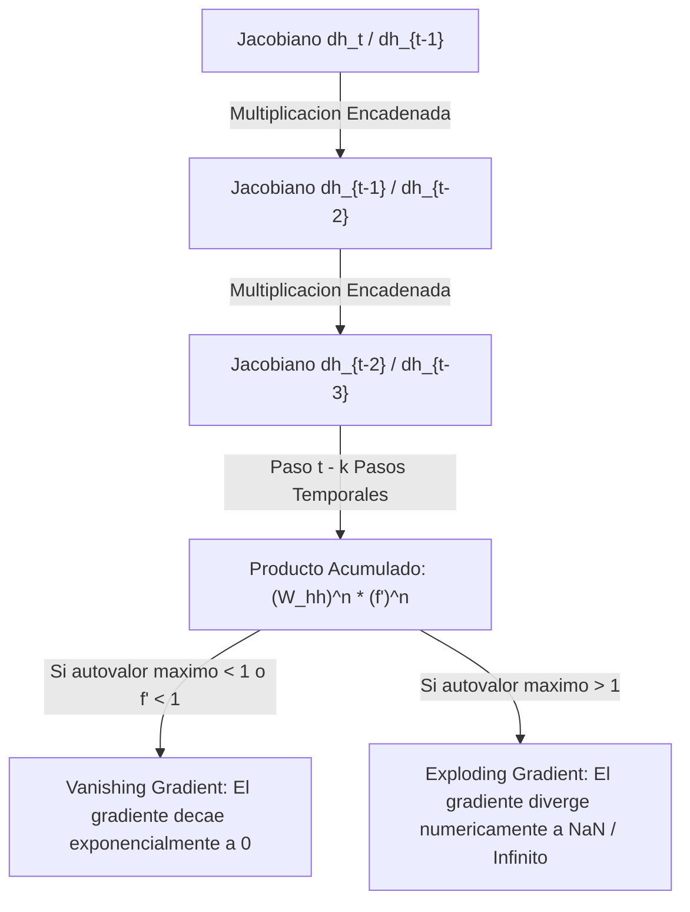
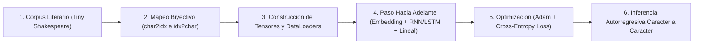

# Clase 5: Modelado Secuencial en NLP, Aceleracion por GPU con CUDA, Redes Neuronales Recurrentes (RNN) y Arquitectura Long Short-Term Memory (LSTM)

> **Objetivo de la sesion:** Comprender la necesidad epistemologica de transitar desde los embeddings estaticos hacia el modelado temporal y dinamico de secuencias; dominar los fundamentos de aceleracion tensorial por hardware mediante la arquitectura NVIDIA CUDA; analizar el modelado secuencial con redes neuronales Feed-Forward (FNN) mediante ventanas de contexto rodantes; diagnosticar las limitaciones matematicas de las Redes Neuronales Recurrentes (RNN) tradicionales, particularmente el problema del desvanecimiento y explosion del gradiente (Vanishing / Exploding Gradient); e introducir la arquitectura Long Short-Term Memory (LSTM) como solucion formal basada en compuertas de filtrado y celdas de estado para la preservacion de dependencias temporales de largo alcance.

## 1\. Contexto y Marco Conceptual

### La Naturaleza Temporal del Lenguaje y de las Secuencias

En los enfoques fundamentales de NLP estudiados previamente (modelos estadisticos como TF-IDF y modelos distribucionales densos como Word2Vec y GloVe), los documentos y las palabras se transforman en representaciones vectoriales estaticas dentro de un espacio geometrico latente. Si bien estas tecnicas capturan relaciones de similitud semantica y analogias algebraicas mediante distancia angular (similitud coseno), presentan una limitacion estructural decisiva: ignoran la dinamica temporal inherente al discurso.

El lenguaje humano es esencialmente un proceso secuencial y continuo: el significado de una palabra o token no reside unicamente en su identidad lexica, sino en su posicionamiento relativo, el orden de aparicion y la composicionalidad temporal de los elementos que lo preceden y suceden.



### Generalizacion del Modelado Secuencial Mas Alla del Texto

El paradigma secuencial formulado para el lenguaje natural es matematicamente transferible a cualquier fenomeno discreto o continuo indexado en el tiempo:

1. **Modelado de Navegacion Web y Comportamiento de Usuario:** Una secuencia cronologica de dominios y URLs visitados por un usuario (e.g., YouTube, Facebook, TikTok) puede interpretarse analiticamente como una oracion dentro de un vocabulario restringido de dominios web, permitiendo construir embeddings conductuales que agrupan patrones de navegacion y segmentacion digital sin intervencion heuristica manual.

1. **Bioinformatica y Biologia Molecular:** Las secuencias de nucleotidos en acidos nucleicos (ADN y ARN: adenina, timina, citosina, guanina, uracilo) o de aminoacidos en cadenas polipeptidicas (proteinas) constituyen lenguajes biologicos formales. Modelar estas secuencias permite proyectar cadenas macromoleculares en espacios latentes para predecir afinidades de union a farmacos, plegamientos conformacionales o mutaciones funcionales.

1. **Series Temporales Cuantitativas:** Series de precios financieros, indices bursatiles o telemetria industrial son sucesiones numericas donde cada valor mantiene una dependencia estocastica y fisica estricta con sus observaciones historicas antecedentes.

### Aceleracion Computacional Tensorial: De CPU a GPU con Arquitectura NVIDIA CUDA

El entrenamiento de arquitecturas neuronales profundas (Deep Learning) impone una carga de computo dominada casi exclusivamente por el algebra lineal matricial de alta dimensionalidad: productos tensoriales, proyecciones afines, operaciones punto a punto y el calculo simultaneo de gradientes multidimensionales (matrices jacobianas y hessianas) durante la retropropagacion.



- **NVIDIA CUDA (Compute Unified Device Architecture):** Capa de abstraccion de hardware y entorno de ejecucion que permite compilar y ejecutar kernels directamente en los multiprocesadores de flujo (SM) de las unidades de procesamiento grafico de NVIDIA.

- **Integracion con PyTorch:** La gestion de dispositivos en PyTorch (` device = torch.device('cuda' if torch.cuda.is_available() else 'cpu') `) transfiere los tensores de pesos ($W, U, b$) y los lotes de datos ($X, y$) directamente a la memoria de video (VRAM), ejecutando las transformaciones afines en paralelo masivo y reduciendo los tiempos de entrenamiento en ordenes de magnitud.

---

## 2\. Fundamentos Teoricos y Arquitectura

### Modelado Secuencial con Redes Feed-Forward (FNN) y Ventanas Deslizantes

La primera aproximacion neuronal para predecir el siguiente token dentro de una secuencia consiste en adaptar una red neuronal densa (Feed-Forward Neural Network) mediante el paradigma de **Ventana Deslizante (Rolling Window)** de tamano fijo $N$.

Dado un contexto temporal compuesto por $N$ tokens antecedentes ($x_{t-N}, \dots, x_{t-1}$), el objetivo consiste en modelar la distribucion de probabilidad condicional del token objetivo $x_t$:

$P(x_t \mid x_{t-N}, \dots, x_{t-1})$



**Limitaciones Estructurales de la FNN para Secuencias:**

1. **Contexto Rigido e Inflexible:** La ventana de observacion es estrictamente fija ($N$). La red es fundamentalmente ciega a dependencias sintacticas o causales que se originen fuera de dicha ventana.

1. **Explosion Parametrica:** Incrementar el tamano de la ventana $N$ incrementa linealmente el numero de parametros de entrada en la matriz de pesos inicial, lo que aumenta la susceptibilidad al sobreajuste (*overfitting*) y el consumo de memoria computacional.

1. **Ausencia de Invarianza Temporal:** La red aprende pesos independientes para cada posicion dentro de la ventana, sin compartir parametros a lo largo de las distintas posiciones de la secuencia.

### Redes Neuronales Recurrentes (RNN Elman)

Para resolver la rigidez de las FNN, las **Redes Neuronales Recurrentes (RNN)** introducen un bucle de realimentacion temporal donde el estado oculto de la red en el instante $t$ ($h_t$) depende simultaneamente de la entrada actual ($x_t$) y del estado oculto producido en el instante anterior ($h_{t-1}$). De este modo, $h_t$ actua como una memoria interna que acumula el historial de la secuencia observada.



**Formulacion Matematica de la RNN:**

- **Calculo del Estado Oculto:**

  $h_t = \tanh(W_{xh} x_t + W_{hh} h_{t-1} + b_h)$
  
  donde $W_{xh} \in \mathbb{R}^{d_h \times d_x}$ mapea la entrada al espacio oculto, $W_{hh} \in \mathbb{R}^{d_h \times d_h}$ transmite la recurrencia temporal y $\tanh$ es la funcion de activacion no lineal simetrica acotada en $(-1, 1)$.

- **Emision de la Prediccion de Salida:**

  $\hat{y}_t = \text{softmax}(W_{hy} h_t + b_y)$
  
  donde $W_{hy} \in \mathbb{R}^{|\mathcal{V}| \times d_h}$ proyecta el estado oculto hacia la dimension total del vocabulario $|\mathcal{V}|$.

### Retropropagacion a Traves del Tiempo (BPTT) y el Colapso por Vanishing Gradient

El entrenamiento de una RNN se ejecuta mediante el algoritmo de **Retropropagacion a Traves del Tiempo (Backpropagation Through Time - BPTT)**. Para actualizar los pesos recurrentes $W_{hh}$, se aplica la regla de la cadena derivando la perdida total $\mathcal{L} = \sum_{t=1}^T \mathcal{L}_t$ con respecto a $W_{hh}$:

$\frac{\partial \mathcal{L}}{\partial W_{hh}} = \sum_{t=1}^T \sum_{k=1}^t \frac{\partial \mathcal{L}_t}{\partial \hat{y}_t} \frac{\partial \hat{y}_t}{\partial h_t} \left( \prod_{j=k+1}^t \frac{\partial h_j}{\partial h_{j-1}} \right) \frac{\partial h_k}{\partial W_{hh}}$

El termino critico de esta expresion es el producto de matrices jacobianas intermedias:

$\prod_{j=k+1}^t \frac{\partial h_j}{\partial h_{j-1}} = \prod_{j=k+1}^t W_{hh}^T \operatorname{diag}\left(1 - \tanh^2(a_j)\right)$



**Consecuencias del Desvanecimiento del Gradiente:**

1. **Perdida de Dependencias a Largo Plazo:** Conforme la distancia temporal ($t - k$) se expande, la magnitud del gradiente transmitido decae exponencialmente hacia cero. En consecuencia, la red es incapaz de ajustar sus pesos para recordar informacion lejana.

1. **Pseudo-Dropout Patologico:** A diferencia de una regularizacion controlada como el Dropout clasico, el decaimiento forzoso de pesos en pasos temporales distantes elimina informacion sintactica y contextualmente relevante sin criterio de optimizacion.

### Introduccion a la Arquitectura LSTM (Long Short-Term Memory)

Para mitigar de forma definitiva el problema del desvanecimiento del gradiente, **Hochreiter y Schmidhuber (1997)** propusieron la arquitectura **Long Short-Term Memory (LSTM)**.

La innovacion central de la celda LSTM consiste en desacoplar la memoria en dos canales paralelos:

1. **Memoria de Corto Plazo (Hidden State** $h_t$**):** Senal activa que transmite informacion local inmediata e interactua con la capa de salida.

1. **Memoria de Largo Plazo (Cell State** $C_t$**):** Canal continuo o autopista aditiva de transporte de informacion a lo largo del tiempo, donde las modificaciones se regulan estrictamente mediante compuertas (*gates*) compuestas por funciones sigmoideas y tangentes hiperbolicas.

---

## 3\. Implementacion Tecnica y Logica de Negocio

### Pipeline de Modelado a Nivel de Caracter en PyTorch

El modelado de lenguaje a nivel de caracter (*Character-Level Language Modeling*) representa una metodologia fundacional para analizar la dinamica secuencial sin la complejidad lexica ni la hiperdispersion de vocabularios basados en palabras completas.



#### Paso 1: Vectorizacion y Codificacion Biyectiva del Vocabulario

Dado un corpus $\mathcal{C}$ con caracteres unicos $\mathcal{V}$, se asigna a cada caracter un indice ordinal unico:

```python
# Extraccion de caracteres unicos y mapeo biyectivo
chars = sorted(list(set(raw_text)))
vocab_size = len(chars)  # e.g., 65 caracteres unicos en Tiny Shakespeare

char2idx = {ch: i for i, ch in enumerate(chars)}
idx2char = {i: ch for i, ch in enumerate(chars)}

# Codificacion tensorial del texto completo
encoded_text = torch.tensor([char2idx[ch] for ch in raw_text], dtype=torch.long)
```

#### Paso 2: Generacion de Lotes de Secuencias (Batch Processing)

Para optimizar el procesamiento en GPU, el texto continuo se segmenta en secuencias contiguas de longitud fija ` seq_length `:

```python
def generate_batches(data, batch_size, seq_length, device):
    num_batches = (len(data) - 1) // (batch_size * seq_length)
    data = data[:num_batches * batch_size * seq_length + 1]
    
    x_data = data[:-1].view(batch_size, -1)
    y_data = data[1:].view(batch_size, -1)
    
    for i in range(0, x_data.size(1), seq_length):
        x = x_data[:, i:i+seq_length].to(device)
        y = y_data[:, i:i+seq_length].to(device)
        yield x, y
```

#### Paso 3: Arquitectura de la Red Recurrente en PyTorch

A continuacion se presenta la implementacion modular en PyTorch que hereda de ` torch.nn.Module `:

```python
import torch
import torch.nn as nn

class CharacterRNN(nn.Module):
    def __init__(self, vocab_size, embedding_dim, hidden_dim):
        super(CharacterRNN, self).__init__()
        self.embedding = nn.Embedding(vocab_size, embedding_dim)
        self.rnn = nn.RNN(embedding_dim, hidden_dim, batch_first=True)
        self.fc = nn.Linear(hidden_dim, vocab_size)

    def forward(self, x, hidden=None):
        # x shape: [batch_size, seq_length]
        embeds = self.embedding(x)  # shape: [batch_size, seq_length, embedding_dim]
        out, hidden = self.rnn(embeds, hidden)  # out: [batch_size, seq_length, hidden_dim]
        logits = self.fc(out)  # logits: [batch_size, seq_length, vocab_size]
        return logits, hidden
```

#### Paso 4: Funcion de Perdida y Bucle de Optimizacion

La funcion de perdida utilizada es la Entropia Cruzada Multiclase (Cross-Entropy Loss), optimizada mediante el algoritmo Adam:

$\mathcal{L} = - \frac{1}{B \cdot T} \sum_{b=1}^B \sum_{t=1}^T \log P(x_{b, t+1} \mid x_{b, 1:t})$

```python
device = torch.device('cuda' if torch.cuda.is_available() else 'cpu')
model = CharacterRNN(vocab_size=65, embedding_dim=64, hidden_dim=128).to(device)
criterion = nn.CrossEntropyLoss()
optimizer = torch.optim.Adam(model.parameters(), lr=0.002)

# Bucle de entrenamiento estandar
for epoch in range(num_epochs):
    hidden = None
    for x_batch, y_batch in generate_batches(train_data, batch_size=32, seq_length=50, device=device):
        optimizer.zero_grad()
        if hidden is not None:
            hidden = hidden.detach()  # Truncado para BPTT
            
        logits, hidden = model(x_batch, hidden)
        loss = criterion(logits.view(-1, vocab_size), y_batch.contiguous().view(-1))
        loss.backward()
        optimizer.step()
```

---

## 4\. Analisis Critico de Casos y Auditoria Practica

### Comparativa Estructural de Modelos Secuenciales

| Dimension Analitica | Red Feed-Forward (Ventana Fija) | Red Recurrente Simple (RNN) | Long Short-Term Memory (LSTM) |
| --- | --- | --- | --- |
| **Horizonte de Contexto** | Rigido y estrictamente finito ($N$ tokens) | Teoricamente infinito; practicamente limitado (&lt; 10 pasos) | Prolongado (cientos de pasos temporales continuos) |
| **Complejidad Parametrica** | $\mathcal{O}(N \cdot d_{emb} \cdot d_h)$ dependiente del contexto | $\mathcal{O}(d_{emb} \cdot d_h + d_h^2)$ independiente de la secuencia | $\mathcal{O}(4 \cdot [d_{emb} \cdot d_h + d_h^2])$ por 4 compuertas neuronales |
| **Comportamiento del Gradiente** | Estable dentro de la ventana finita | Decaimiento o explosion exponencial por BPTT | Gradiente constante a traves de la celda de estado aditiva |
| **Paralelizacion en Entrenamiento** | Totalmente paralelizable a traves de los lotes | Estrictamente secuencial a traves del tiempo ($\mathcal{O}(T)$) | Estrictamente secuencial a traves del tiempo ($\mathcal{O}(T)$) |
| **Dominio Optimo de Aplicacion** | Modelado tabular estatico y clasificacion simple | Corpus con dependencias inmediatas de corto plazo | Series de tiempo cuantitativas y senales fisicas |

### Diagnostico de la Generacion Autorregresiva

En modelos generativos entrenados sobre corpus de Shakespeare:

1. **Nivel Caracter FNN:** Genera palabras ortograficamente validas en fragmentos de 3 letras, pero fracasa totalmente al articular estructuras gramaticales de mayor extension.

1. **Nivel Caracter RNN:** Aprende con exito la separacion por espacios, signos de puntuacion y sintaxis aproximada de dialogos (e.g., articulos vinculados a sustantivos), pero sufre de incoherencia tematica y alucinacion semantica en secuencias superiores a 50 caracteres debido al desvanecimiento del gradiente.

1. **Nivel Caracter LSTM:** Preserva la consistencia de personajes, lineas de verso y estructuras de clausula subordinada durante ventanas temporales sensiblemente mas amplias, demostrando el impacto directo de la celda de estado aditiva.

---

## 5\. Principios de Diseno, Buenas Practicas y Anti-patrones

### Principios de Diseno en Entornos de Aceleracion GPU

1. **Desacoplamiento de Tensores Ocultos (**` detach() `**):** Al procesar secuencias extensas en lotes continuos, es mandatorio ejecutar ` hidden = hidden.detach() ` entre iteraciones de lote. No desacoplar el estado oculto provoca que la historia computacional de PyTorch intente retropropagar a traves de todo el corpus acumulado, generando desbordamiento critico de memoria VRAM (` OutOfMemoryError `).

1. **Gestion Eficiente de VRAM con CUDA:** Monitorear activamente el consumo de memoria mediante ` torch.cuda.memory_allocated() ` y liberar memoria cache residual con ` torch.cuda.empty_cache() ` tras ciclos intensivos de validacion o evaluacion.

1. **Escalamiento Adecuado de Embeddings:** El tamano del embedding densamente proyectado ($d_{emb}$) debe guardar proporcion armonica con el tamano del vocabulario ($|\mathcal{V}|$). Para vocabularios compactos (como caracteres individuales, $|\mathcal{V}| \approx 65$), embeddings de dimension 32 o 64 previenen la dispersion excesiva de parametros.

### Anti-patrones Comunes

- **Anti-patron del Gradiente Desbocado (Exploding Gradient):** Omitir el truncado de gradientes (*Gradient Clipping*) en arquitecturas recurrentes profundas. La ausencia de ` torch.nn.utils.clip_grad_norm_(model.parameters(), max_norm=1.0) ` produce que pasos de gradiente desmesurados destruyan los pesos entrenados, arrojando perdidas ` NaN `.

- **Anti-patron de Sobre-Ingenieria con LLMs en Espacios Simples:** Emplear arquitecturas masivas de miles de millones de parametros para resolver secuencias con vocabularios pequenos y estructuras cerradas (como el enrutamiento de peticiones web o analisis de dominios), cuando una representacion compacta (LSTM o Word2Vec) entrega optimos resultados con minima latencia y costo computacional nulo.

---

## 6\. Sintesis Conceptual y Profundizacion Academica

### Sintesis de la Sesion

El modelado secuencial formaliza la transicion desde espacios semanticos puramente estaticos hacia representaciones conscientes del tiempo y del orden secuencial. Aunque las redes Feed-Forward con ventanas deslizantes introducen el modelado estocastico de secuencias, su rigidez parametrica limita su escalabilidad. Las Redes Neuronales Recurrentes resuelven esta limitacion mediante estados ocultos recursivos, pero enfrentan el colapso matematico del gradiente durante BPTT. La arquitectura LSTM surge como una solucion matematicamente estructurada que estabiliza el gradiente mediante canales aditivos de memoria a largo plazo y compuertas de control neuronal.

### Literatura de Referencia y Marcos Epistemologicos

- **Elman, J. L. (1990).** *Finding structure in time*. Cognitive Science, 14(2), 179-211.

- **Hochreiter, S., &amp; Schmidhuber, J. (1997).** *Long short-term memory*. Neural Computation, 9(8), 1735-1780.

- **Bengio, Y., Simard, P., &amp; Frasconi, P. (1994).** *Learning long-term dependencies with gradient descent is difficult*. IEEE Transactions on Neural Networks, 5(2), 157-166.

- **Pascanu, R., Mikolov, T., &amp; Bengio, Y. (2013).** *On the difficulty of training recurrent neural networks*. International Conference on Machine Learning (ICML), 1310-1318.

- **Goodfellow, I., Bengio, Y., &amp; Courville, A. (2016).** *Deep Learning*. MIT Press. Capitulo 10: Sequence Modeling: Recurrent and Recursive Nets.

---
