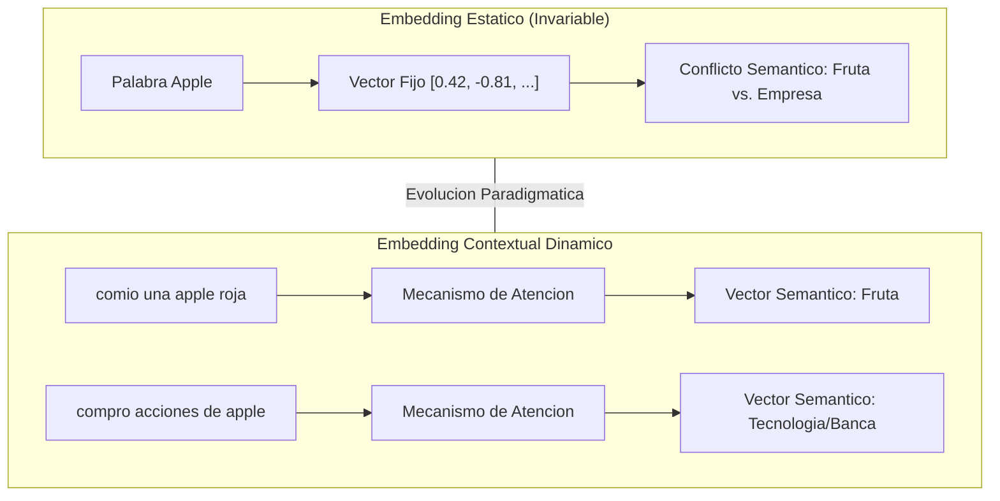
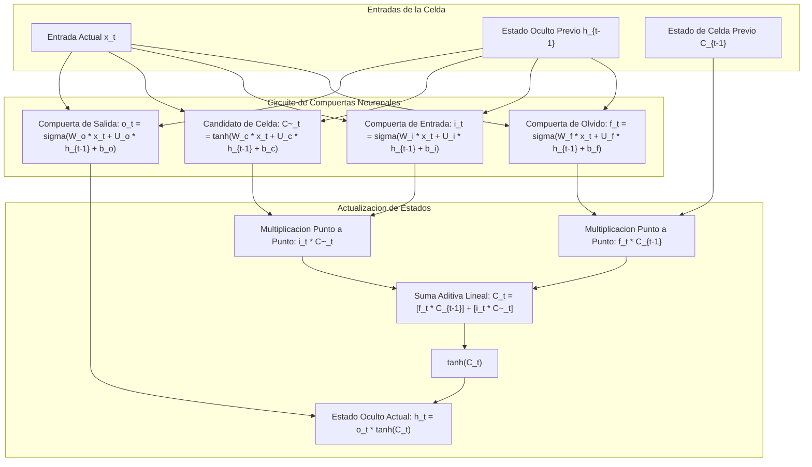
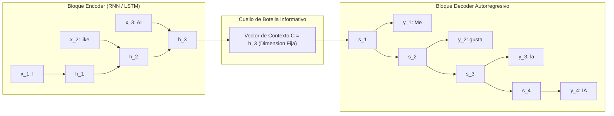
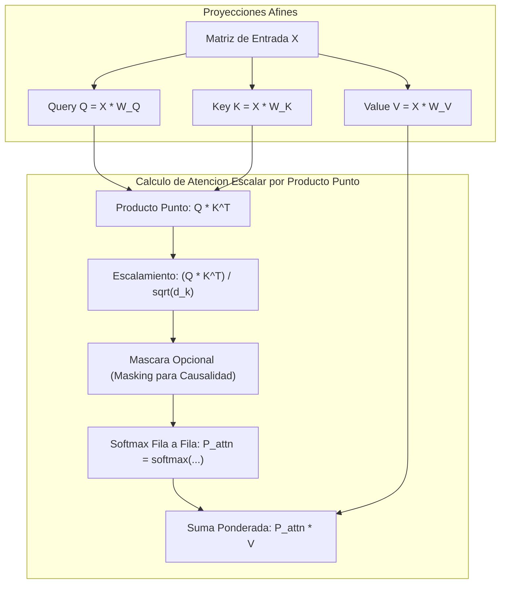
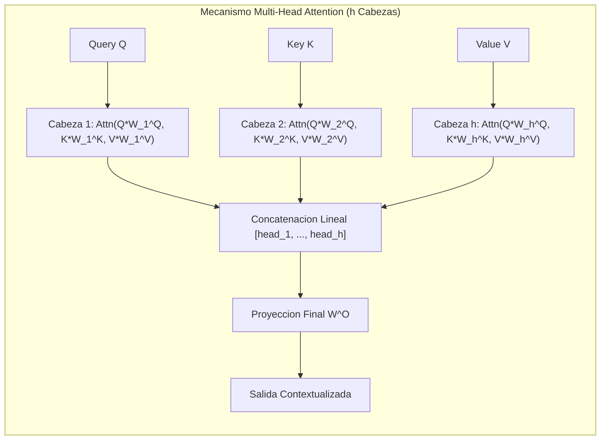

# Clase 6: Arquitectura LSTM en Detalle, Paradigma Sequence-to-Sequence (Encoder-Decoder) y Mecanismos de Atencion: El Origen de los Transformers

> **Objetivo de la sesion:** Desglosar rigurosamente la mecanica matematica de la celda LSTM y su sistema de compuertas neuronales (olvido, entrada y salida); estudiar la transicion epistemologica desde la traduccion automatica estadistica (SMT) hacia la traduccion automatica neuronal (NMT); formalizar la arquitectura Sequence-to-Sequence (Encoder-Decoder) e identificar el cuello de botella informativo del vector de contexto fijo; deducir el Mecanismo de Atencion Escalar por Producto Punto (Scaled Dot-Product Attention) y la descomposicion Query-Key-Value ($Q, K, V$); y analizar la arquitectura Transformer ("Attention Is All You Need"), su codificacion posicional sinusoidal y el impacto de los modelos fundacionales masivos y multimodales en el estado del arte.

## 1\. Contexto y Marco Conceptual

### El Limite Epistemologico de los Embeddings Estaticos y la Polisemia Dinamica

Los embeddings distribucionales estaticos asignan una representacion vectorial invariable a cada token del vocabulario. Sin embargo, en el lenguaje natural humano, las palabras presentan polisemia contextual intrinseca: el vocablo "Apple" denota una entidad biologica (fruta) en un contexto culinario o agricola, pero representa una corporacion multinacional de tecnologia y hardware en un contexto bursatil o informatico.

Un embedding estatico se ve forzado a promediar linealmente todas las acepciones semanticas observadas en el corpus de preentrenamiento, ubicando la palabra en una posicion intermedia suboptima del espacio latente. La resolucion rigurosa de este desafio exige **embeddings contextuales dinamicos**, donde el vector de un token se recalcula en tiempo real como una funcion de las relaciones de atencion con los tokens que lo rodean en la secuencia.



### De la Traduccion Estadistica (SMT) a la Traduccion Neuronal (NMT)

La disciplina del procesamiento del lenguaje natural alcanzo un punto de inflexion historico en la tarea de **Traduccion Automatica (Machine Translation)**:

1. **Statistical Machine Translation (SMT, 1990-2014):** Basada en modelos de probabilidades de coocurrencia, modelos de lenguaje de N-Gramas independientes y tablas masivas de alineamiento de frases bilingues extraidas de corpus paralelos. Presentaba fragilidad ante el ordenamiento gramatical dispar entre lenguas y una dispersion masiva de parametros.

1. **Neural Machine Translation (NMT, 2014-2016):** Abandono de los sistemas fragmentados para adoptar redes neuronales completas de extremo a extremo (*End-to-End*), mapeando directamente secuencias del idioma fuente ($X$) a secuencias del idioma objetivo ($Y$) dentro de espacios vectoriales densos unificados. Este avance desplazo de manera definitiva a la traduccion estadistica hacia 2016-2018.

### La Barrera de la Recurrencia y la Necesidad de Paralelizacion

Pese al exito teorico de las redes recurrentes y las LSTMs en tareas NMT, el procesamiento recurrente presenta un impedimento de escalabilidad fundamental: el calculo del estado $h_t$ es estrictamente secuencial y causal, dependiendo de $h_{t-1}$.

Esta dependencia temporal en cascada ($\mathcal{O}(T)$ pasos secuenciales) imposibilita la paralelizacion masiva en clusters de GPUs. La ruptura de este techo de rendimiento requeria eliminar la recurrencia estricta, conservando el modelado de secuencias unicamente a traves de mecanismos de autoatencion paralelos.

---

## 2\. Fundamentos Teoricos y Arquitectura

### Desglose Matematico Riguroso de la Celda LSTM

La celda LSTM estabiliza la dinamica del gradiente regulando el flujo de informacion mediante tres compuertas neuronales parametrizadas por funciones sigmoideas $\sigma(z) = \frac{1}{1 + e^{-z}} \in (0, 1)$ y moduladas por la tangente hiperbolica $\tanh(z) \in (-1, 1)$.



**Ecuaciones Fundamentales de la Celda LSTM:**

1. **Compuerta de Olvido (Forget Gate** $f_t$**):** Determina la fraccion de informacion del estado de celda anterior $C_{t-1}$ que debe descartarse:

   $f_t = \sigma(W_f x_t + U_f h_{t-1} + b_f)$

1. **Compuerta de Entrada (Input Gate** $i_t$**) y Candidato de Estado (**$\tilde{C}_t$**):** Regulan que nueva informacion candidata debe incorporarse a la memoria de largo plazo:

   $i_t = \sigma(W_i x_t + U_i h_{t-1} + b_i)$
   
   $\tilde{C}_t = \tanh(W_c x_t + U_c h_{t-1} + b_c)$

1. **Actualizacion del Estado de Celda (Cell State** $C_t$**):**

   $C_t = f_t \odot C_{t-1} + i_t \odot \tilde{C}_t$
   
   *Justificacion de la estabilidad del gradiente:* La transicion entre $C_{t-1}$ y $C_t$ es esencialmente una suma ponderada lineal, libre de multiplicaciones de matrices de pesos intermedias. Al retropropagar, $\frac{\partial C_t}{\partial C_{t-1}} = f_t$; si la compuerta de olvido esta activa ($f_t \approx 1$), el gradiente fluye intacto a lo largo de cientos de pasos temporales sin decaimiento exponencial.

1. **Compuerta de Salida (Output Gate** $o_t$**) y Estado Oculto (**$h_t$**):** Filtra y modula que porcion del estado de celda se exterioriza hacia la memoria de corto plazo y la prediccion:

   $o_t = \sigma(W_o x_t + U_o h_{t-1} + b_o)$
   
   $h_t = o_t \odot \tanh(C_t)$

### Arquitectura Sequence-to-Sequence (Seq2Seq / Encoder-Decoder)

El modelo Sequence-to-Sequence (Sutskever et al., 2014; Cho et al., 2014) acopla dos redes recurrentes diferenciadas para mapear secuencias de longitud variable de entrada a secuencias de longitud variable de salida:

- **Encoder:** Procesa la secuencia de entrada ($x_1, \dots, x_{T_x}$) y comprime todo el significado semantico e historico en un unico vector denso de dimensionalidad fija denominado **Vector de Contexto** ($C = h_{T_x}$).

- **Decoder:** Red autorregresiva inicializada con el vector de contexto $C$ que genera secuencialmente los tokens de salida ($y_1, \dots, y_{T_y}$), condicionando cada paso en el token previo y el estado latente acumulado.



**El Cuello de Botella Informativo (Information Bottleneck):**

Comprimir oraciones complejas de 50 o 100 palabras en un unico vector de dimensionalidad estatica ($d_h$) impone un cuello de botella critico. La capacidad de representacion de la red se satura, provocando la perdida severa de matices y clausulas subordinadas situadas al inicio de la oracion original.

### El Mecanismo de Atencion: Scaled Dot-Product Attention

Para superar el cuello de botella del vector de contexto fijo, Bahdanau et al. (2014) y Vaswani et al. (2017) introdujeron el **Mecanismo de Atencion**. En lugar de forzar toda la oracion en un solo vector, el decoder puede consultar dinamicamente y prestar atencion ponderada a todos los estados intermedios del encoder.

En la arquitectura Transformer pura, este concepto se formaliza mediante la proyeccion lineal de los embeddings en tres espacios de representacion: **Query (**$Q$**)**, **Key (**$K$**)** y **Value (**$V$**)**.



**Formulacion Matematica:**

$\text{Attention}(Q, K, V) = \text{softmax}\left(\frac{Q K^T}{\sqrt{d_k}}\right) V$

- **Query (**$Q \in \mathbb{R}^{n \times d_k}$**):** Representa lo que el token actual busca en el contexto circundante.

- **Key (**$K \in \mathbb{R}^{m \times d_k}$**):** Representa el vector descriptivo o clave con el cual los demas tokens se identifican ante la consulta.

- **Value (**$V \in \mathbb{R}^{m \times d_v}$**):** Contenido semantico explicito que se transfiere y recombina ponderadamente segun los pesos de afinidad.

- **Escalamiento por** $\sqrt{d_k}$**:** Para dimensiones $d_k$ elevadas, la magnitud de los productos punto $q \cdot k$ crece sustancialmente en varianza. Si no se escala por la raiz cuadrada de la dimension, los valores resultantes saturan la funcion softmax en regiones de gradiente practicamente nulo, bloqueando el aprendizaje durante la retropropagacion.

### Multi-Head Attention (MHA) y Codificacion Posicional

Para permitir que el modelo atienda simultaneamente a multiples tipos de relaciones linguisticas (sintacticas, correferenciales y semanticas de largo alcance), el mecanismo de atencion se paraleliza en $h$ **cabezas de atencion (Attention Heads)**:

$\text{MultiHead}(Q, K, V) = \text{Concat}(\text{head}_1, \dots, \text{head}_h) W^O$

$\text{donde } \text{head}_i = \text{Attention}(Q W_i^Q, K W_i^K, V W_i^V)$



**Codificacion Posicional Sinusoidal (Positional Encoding):**

Dado que la operacion de autoatencion es invariante ante permutaciones de orden (operacion de bolsa de vectores), el Transformer inyecta explícitamente informacion posicional sumando un vector de codificacion trigonometrica al embedding de cada token:

$PE_{(pos, 2i)} = \sin\left(\frac{pos}{10000^{2i/d_{model}}}\right)$

$PE_{(pos, 2i+1)} = \cos\left(\frac{pos}{10000^{2i/d_{model}}}\right)$

Esta codificacion permite al modelo calcular con facilidad posiciones relativas mediante identidades trigonometricas de suma de angulos.

---

## 3\. Implementacion Tecnica y Logica de Negocio

### Implementacion de Scaled Dot-Product Attention en PyTorch

A continuacion se presenta la implementacion vectorial de la atencion escalar por producto punto, incorporando soporte para mascaras de causalidad autorregresivas:

```python
import math
import torch
import torch.nn as nn

def scaled_dot_product_attention(query, key, value, mask=None):
    """
    Calculo eficiente de la Atencion Escalar por Producto Punto.
    Args:
        query: Tensor de forma [batch_size, n_heads, seq_len_q, d_k]
        key:   Tensor de forma [batch_size, n_heads, seq_len_k, d_k]
        value: Tensor de forma [batch_size, n_heads, seq_len_v, d_v]
        mask:  Mascara binaria opcional [batch_size, 1, 1, seq_len_k]
    """
    d_k = query.size(-1)
    
    # 1. Producto tensorial escalado: (Q * K^T) / sqrt(d_k)
    scores = torch.matmul(query, key.transpose(-2, -1)) / math.sqrt(d_k)
    
    # 2. Aplicacion de mascara causal o de padding
    if mask is not None:
        scores = scores.masked_fill(mask == 0, -1e9)
        
    # 3. Softmax a lo largo del ultimo eje
    attention_weights = torch.softmax(scores, dim=-1)
    
    # 4. Ponderacion lineal de los valores
    output = torch.matmul(attention_weights, value)
    return output, attention_weights
```

### Arquitectura Modular Multi-Head Attention (MHA)

```python
class MultiHeadAttention(nn.Module):
    def __init__(self, d_model, num_heads):
        super(MultiHeadAttention, self).__init__()
        assert d_model % num_heads == 0, "d_model debe ser divisible por num_heads"
        
        self.d_model = d_model
        self.num_heads = num_heads
        self.d_k = d_model // num_heads
        
        # Matrices de proyeccion lineal
        self.w_q = nn.Linear(d_model, d_model)
        self.w_k = nn.Linear(d_model, d_model)
        self.w_v = nn.Linear(d_model, d_model)
        self.w_o = nn.Linear(d_model, d_model)
        
    def forward(self, query, key, value, mask=None):
        batch_size = query.size(0)
        
        # Proyecciones lineales y particion en multiples cabezas
        Q = self.w_q(query).view(batch_size, -1, self.num_heads, self.d_k).transpose(1, 2)
        K = self.w_k(key).view(batch_size, -1, self.num_heads, self.d_k).transpose(1, 2)
        V = self.w_v(value).view(batch_size, -1, self.num_heads, self.d_k).transpose(1, 2)
        
        # Calculo de atencion paralela
        attn_out, _ = scaled_dot_product_attention(Q, K, V, mask=mask)
        
        # Concatenacion y proyeccion final de salida
        concat_out = attn_out.transpose(1, 2).contiguous().view(batch_size, -1, self.d_model)
        return self.w_o(concat_out)
```

### El Pipeline Moderno de Hugging Face y Clustering No Supervisado

En la practica analitica moderna, la utilizacion de modelos basados en Transformers se ejecuta mediante pipelines preentrenados y tecnicas avanzadas de agrupamiento semantico:

```python
from transformers import pipeline

# Pipeline de clasificacion de sentimientos y polaridad contextual
classifier = pipeline("text-classification", model="distilbert-base-uncased-finetuned-sst-2-english")
result = classifier("The architectural elegance of transformers is exceptional.")
# Retorna: [{'label': 'POSITIVE', 'score': 0.9998}]
```

**Clustering No Supervisado de Literatura Cientifica con Embeddings Densos:**

1. Ingestion de corpus de abstracts cientificos.

1. Extraccion de embeddings semanticos densos de alta dimensionalidad (768 dimensiones) mediante modelos preentrenados de Hugging Face.

1. Reduccion de dimensionalidad topologica no lineal con **UMAP (Uniform Manifold Approximation and Projection)** hacia 5 dimensiones para clustering y 2 dimensiones para inspeccion visual.

1. Agrupamiento jerarquico basado en densidad mediante **HDBSCAN**, segregando automaticamente clusters tematicos (e.g., medicina, inteligencia artificial, robotica) sin prefijar el numero de clusters $k$.

---

## 4\. Analisis Critico de Casos y Auditoria Practica

### Taxonomia y Comparativa de Familias de Transformers

| Familia Arquitectonica | Mecanismo Central | Modelos Representativos | Tareas Primarias de Dominio |
| --- | --- | --- | --- |
| **Solo Encoder (Autoencoding)** | Autoatencion Bidireccional Completa; enmascaramiento aleatorio de tokens (MLM) | BERT, RoBERTa, DeBERTa, DistilBERT | Clasificacion de texto, extraccion de entidades (NER), similitud semantica, extraccion de embeddings densos |
| **Solo Decoder (Autoregressive)** | Autoatencion Causal Enmascarada (solo atiende a tokens pasados e inmediatos) | GPT (1 a 4), LLaMA, Mistral, Claude, Gemma | Generacion de texto abierta, completado de codigo, modelos conversacionales y agentes de razonamiento |
| **Encoder-Decoder (Seq2Seq)** | Encoder bidireccional acoplado con Decoder causal autoregresivo | T5, BART, mBART, MarianMT | Traduccion automatica entre idiomas, resumen abstractivo de documentos y reformulacion de consultas |

### Matriz de Paradigmas de Traduccion Automatica

| Dimension Comparativa | Traduccion Estadistica (SMT) | Traduccion Neuronal Recurrente (NMT RNN/LSTM) | Traduccion con Transformers (Vaswani, 2017) |
| --- | --- | --- | --- |
| **Mapeo Semantico** | Tablas de frases discretas y frecuencias N-Grama | Espacio latente continuo intermediado por vector fijo | Atencion cruzada contextual directa entre tokens |
| **Manejo de Dependencias Remotas** | Pesimo (acotado por N-Gramas de longitud 3-5) | Deficiente en oraciones extensas (&gt; 30 palabras) | Excelente (dependencias globales sin degradacion) |
| **Capacidad de Paralelizacion** | Alta en alineamiento previo; nula en decodificacion | Nula en entrenamiento ($\mathcal{O}(T)$ secuencial) | Maxima en entrenamiento ($\mathcal{O}(1)$ pasos paralelos) |
| **Calidad BLEU Promedio** | Linea base historica baja (\~20-25 BLEU) | Mejora incremental sustancial (\~30-34 BLEU) | Estado del arte superior (&gt; 41+ BLEU) |

### Generalizacion Multimodal: Vision Transformers (ViT)

El principio de autoatencion no se limita al texto. En los **Vision Transformers (ViT, Dosovitskiy et al., 2020)**:

1. Una imagen 2D se segmenta en parches regulares no superpuestos (e.g., $16 \times 16$ pixeles).

1. Cada parche se aplana (*flatten*) y se proyecta linealmente a un embedding denso, analogo a un token de texto.

1. Se adicionan codificaciones posicionales 1D y se alimenta a un encoder Transformer estandar.

1. El mecanismo de autoatencion correlaciona parches distantes en la imagen directamente sin depender de kernels convolucionales locales, logrando un rendimiento superior en conjuntos masivos de entrenamiento.

---

## 5\. Principios de Diseno, Buenas Practicas y Anti-patrones

### Principios de Diseno en el Ecosistema Transformer

1. **Priorizar Transfer Learning y Modelos Preentrenados:** En entornos corporativos e investigativos aplicados, el preentrenamiento desde cero (*from scratch*) de un Transformer exige millones de dolares en computo de clusters de GPUs y corpus de petabytes. La regla de oro consiste en aplicar **Fine-Tuning**, adaptacion de bajo rango (**LoRA**) o inferencia sobre modelos fundacionales preentrenados disponibles en repositorios abiertos como Hugging Face.

1. **Uso Riguroso de Mascaras Causales en Decoders:** En tareas generativas autorregresivas, es mandatorio asegurar que la matriz de atencion del decoder este enmascarada triangularmente con $-\infty$ en posiciones futuras. Omitir esta mascara provoca fuga de datos (*data leakage*) y sobreajuste espurio durante el entrenamiento.

1. **Escalamiento del Factor de Atencion:** Jamas omitir la division por $\sqrt{d_k}$ en el calculo de atencion escalar. Su omision genera divergencia o saturacion del gradiente en modelos con cabezas de dimension $d_k \ge 64$.

### Anti-patrones Comunes

- **Anti-patron de Sobre-Ingenieria Masiva:** Desplegar LLMs generativos de billones de parametros (e.g., LLaMA-70B) para tareas deterministas o de clasificacion de polaridad simple, cuando un modelo compacto encoder (como RoBERTa-base o DistilBERT) o un clasificador lineal sobre TF-IDF entrega 98% de exactitud con latencia inferior a 15 ms y minima huella de carbono.

- **Anti-patron de Conflicto de Tokenizacion:** Entrenar o inferir un modelo Transformer utilizando un tokenizador no coincidente con el vocabulario exacto de preentrenamiento. Esto genera asignaciones de tokens fuera de vocabulario (` [UNK] `) y degradacion catastrofica de la coherencia generativa.

---

## 6\. Sintesis Conceptual y Profundizacion Academica

### Sintesis de la Sesion

La evolucion desde las celdas recurrentes especializadas (LSTM) hacia la arquitectura Transformer marca la transicion definitiva desde el procesamiento temporal secuencial estricto hacia el modelado contextual paralelo fundado en la autoatencion. La sustitucion de la recurrencia por mecanismos de atencion escalar ($Q, K, V$) y codificaciones posicionales permite capturar dependencias estructurales y semanticas de alcance arbitrario, eliminando el cuello de botella informativo de los modelos Sequence-to-Sequence clasicos y cimentando las bases de la inteligencia artificial generativa y multimodal contemporanea.

### Literatura de Referencia y Marcos Epistemologicos

- **Vaswani, A., Shazeer, N., Parmar, N., Uszkoreit, J., Jones, L., Gomez, A. N., Kaiser, L., &amp; Polosukhin, I. (2017).** *Attention Is All You Need*. Advances in Neural Information Processing Systems (NeurIPS 2017), 30, 5998-6008.

- **Bahdanau, D., Cho, K., &amp; Bengio, Y. (2014).** *Neural Machine Translation by Jointly Learning to Align and Translate*. International Conference on Learning Representations (ICLR 2015).

- **Sutskever, I., Vinyals, O., &amp; Le, Q. V. (2014).** *Sequence to sequence learning with neural networks*. Advances in Neural Information Processing Systems (NeurIPS 2014), 27, 3104-3112.

- **Devlin, J., Chang, M. W., Lee, K., &amp; Toutanova, K. (2018).** *BERT: Pre-training of Deep Bidirectional Transformers for Language Understanding*. NAACL-HLT 2019, 4171-4186.

- **Dosovitskiy, A., et al. (2020).** *An Image is Worth 16x16 Words: Transformers for Image Recognition at Scale*. International Conference on Learning Representations (ICLR 2021).
