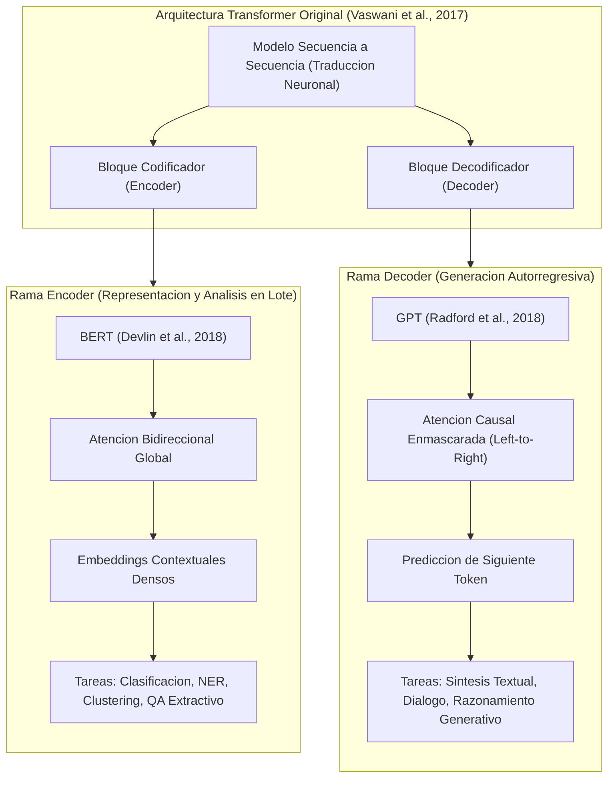
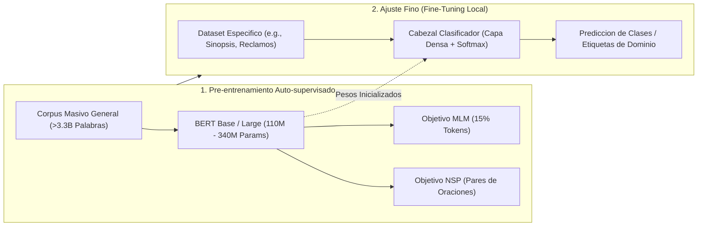
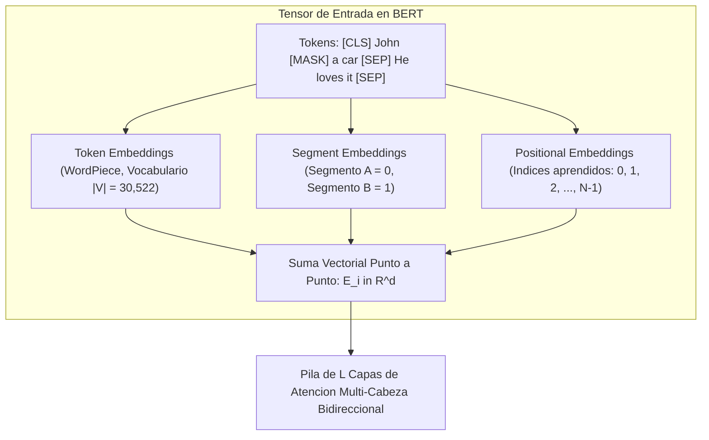

# Clase 7: Representaciones Bidireccionales con BERT, Pre-entrenamiento Auto-supervisado y Fine-Tuning de Encoders

> **Objetivo de la sesion:** Comprender los fundamentos arquitectonicos de la rama de codificadores (Encoders) en los modelos Transformer; formalizar matematicamente los objetivos de pre-entrenamiento auto-supervisado Masked Language Model (MLM) y Next Sentence Prediction (NSP); dominar el paradigma de Transfer Learning y Fine-Tuning sobre modelos densos (BERT, RoBERTa, BETO); y aplicar pipelines de clasificacion supervisada de secuencias, extraccion de entidades nombradas (NER) y resumen extractivo mediante embeddings contextuales sobre corpus no estructurados.

## 1\. Contexto y Marco Conceptual

### La Bifurcacion Arquitectonica de los Transformers: Encoders vs Decoders

A partir de la publicacion del modelo Transformer (*Vaswani et al., 2017*), la disciplina del Procesamiento de Lenguaje Natural experimento una bifurcacion estructural en dos grandes familias de arquitecturas neuronales:

1. **Rama de Codificadores (Encoders - BERT, RoBERTa, DeBERTa, BETO):** Modelos optimizados para el procesamiento analitico no causal e integral de secuencias completas en bloque (*bulk processing*). Emplean atencion bidireccional global sobre todos los tokens circundantes (izquierda y derecha simultaneamente), produciendo representaciones vectoriales densas contextuales de alta fidelidad semantica. Son idoneos para clasificacion supervisada, agrupamiento (*clustering*), busqueda semantica, similitud textual y reconocimiento de entidades nombradas.

1. **Rama de Decodificadores (Decoders - GPT, Llama, Mistral, Qwen):** Modelos generativos autorregresivos estructurados para la prediccion secuencial de proximo token de izquierda a derecha. Su funcion primordial es la sintesis continua de lenguaje natural.



### La Superacion de los Embeddings Estaticos

En fases previas del desarrollo de NLP (Word2Vec, FastText, GloVe), una palabra quedaba mapeada a un vector estatico invariante en $\mathbb{R}^d$, calculado a partir de co-ocurrencias distribucionales globales. Dicha formulacion sufria del problema estructural de la polisemia: terminos lexicamente identicos con acepciones dispares (e.g., *"banco"* como institucion de credito frente a *"banco"* como asiento de madera) compartian el mismo punto en el espacio vectorial.

La arquitectura de codificadores resuelve esta limitacion calculando **embeddings contextuales dinamicos**: la representacion vectorial final de cada token es el resultado ponderado de todas las relaciones de atencion establecidas con los demas tokens de la oracion, modulando su proyeccion segun el contexto contingente de la instancia.

### El Hito del Transfer Learning en NLP

Antes de 2018, la mayoria de los clasificadores de NLP requerian entrenar redes neuronales recurrentes (LSTM) o convolucionales desde cero para cada tarea particular, demandando millones de ejemplos anotados para alcanzar convergencia.

Con la introduccion de **BERT (Bidirectional Encoder Representations for Transformers)** por Devlin et al. (2018), se consolido formalmente el paradigma de **Pre-entrenamiento y Ajuste Fino (Pre-training &amp; Fine-Tuning)** en NLP, replicando la revolucion experimentada por Computer Vision tras la aparicion de ImageNet y arquitecturas convolucionales como ResNet o YOLO:

- **Fase de Pre-entrenamiento (No Supervisada / Auto-supervisada):** Se entrena un modelo base denso con miles de millones de parametros sobre volumenes enciclopedicos de texto (Wikipedia, BooksCorpus), aprendiendo las estructuras gramaticales, sintacticas y semanticas universales del idioma.

- **Fase de Fine-Tuning (Supervisada):** Se congela o reajusta suavemente el codificador pre-entrenado y se anade un cabezal de tarea liviano (*classification head*) en la capa superior, requiriendo unicamente cientos o miles de muestras etiquetadas locales para lograr un rendimiento optimo.



---

## 2\. Fundamentos Teoricos y Arquitectura

### 1\. Objetivos de Pre-entrenamiento Auto-supervisado en BERT

BERT no utiliza el modelado causal tradicional de predecir la siguiente palabra, pues la atencion bidireccional permitiria que cada token se atendiese a si mismo indirectamente en capas profundas, trivializando el problema. Para sortear esto, BERT se fundamenta en dos tareas simultaneas:

#### A. Masked Language Modeling (MLM)

Se selecciona aleatoriamente el 15% de los tokens de cada secuencia para su evaluacion. Dentro de ese subconjunto:

1. El **80%** se sustituye por el token especial ` [MASK] `.

1. El **10%** se reemplaza por un token aleatorio muestreado del vocabulario $\mathcal{V}$.

1. El **10%** restante se conserva intacto sin alteracion grafica.

Esta distribucion probabilistica 80/10/10 fuerza al codificador a mantener una representacion contextual valida para todos los tokens, mitigando la discrepancia estructural entre la fase de pre-entrenamiento (donde aparece ` [MASK] `) y la fase de inferencia (donde ` [MASK] ` nunca esta presente).

Matematicamente, la perdida se calcula mediante la entropia cruzada sobre el conjunto de posiciones enmascaradas $\mathcal{M}$:

$\mathcal{L}_{\text{MLM}}(\theta) = - \sum_{i \in \mathcal{M}} \log P(w_i \mid \mathbf{h}_i; \theta)$

Donde $\mathbf{h}_i$ es la salida oculta de la ultima capa del encoder en la posicion $i$, y la probabilidad condicional sobre el vocabulario se obtiene mediante una transformacion lineal seguida de Softmax:

$P(w_i = v \mid \mathbf{h}_i) = \frac{\exp(\mathbf{W}_v^T \mathbf{h}_i + b_v)}{\sum_{v' \in \mathcal{V}} \exp(\mathbf{W}_{v'}^T \mathbf{h}_i + b_{v'})}$

#### B. Next Sentence Prediction (NSP)

Para capturar relaciones discursivas inter-oracionales necesarias en Question Answering y razonamiento deductivo, BERT se entrena con pares de oraciones $(A, B)$:

- En el 50% de las instancias, $B$ es la oracion contigua real que sigue a $A$ en el corpus (etiqueta ` IsNext `).

- En el 50% restante, $B$ es una oracion seleccionada al azar del corpus (etiqueta ` NotNext `).

La perdida binaria se formula como:

$\mathcal{L}_{\text{NSP}}(\theta) = - y \log P(\text{IsNext} \mid \mathbf{C}) - (1 - y) \log (1 - P(\text{IsNext} \mid \mathbf{C}))$

Donde $\mathbf{C} \in \mathbb{R}^{d_{\text{model}}}$ representa el vector de activacion oculto asociado al primer token de la secuencia, el delimitador especial ` [CLS] `.

### 2\. Estructura del Tensor de Entrada

Para procesar secuencias oracionales simples o pareadas, el tensor de entrada de BERT se formula mediante la adicion elemento a elemento de tres proyecciones vectoriales:

$\mathbf{E}_i = \mathbf{E}_{\text{token}}(w_i) + \mathbf{E}_{\text{segment}}(s_i) + \mathbf{E}_{\text{position}}(i)$



1. **Token Embeddings:** Obtenidos mediante el tokenizador WordPiece, segmentando palabras morfologicamente complejas o raras en sub-palabras para evitar el problema de palabras fuera de vocabulario (OOV).

1. **Segment Embeddings:** Vectores aprendidos que senalan si un token pertenece al primer enunciado ($S_A$) o al segundo ($S_B$).

1. **Positional Embeddings:** A diferencia de Vaswani et al. (2017) que utilizaba senoides estaticas, BERT parametriza y aprende representaciones vectoriales para cada posicion absoluta dentro de una ventana maxima de 512 tokens.

### 3\. Configuraciones Estandar de BERT

| Parametro Arquitectonico | BERT-Base | BERT-Large |
| --- | --- | --- |
| **Capas de Codificacion (L)** | 12 capas | 24 capas |
| **Dimension Oculta (d\_model)** | 768 dimensiones | 1024 dimensiones |
| **Cabezas de Atencion (A)** | 12 cabezas | 16 cabezas |
| **Dimension Feed-Forward (d\_ff)** | 3072 dimensiones | 4096 dimensiones |
| **Total de Parametros** | 110 millones de parametros | 340 millones de parametros |
| **Limite de Secuencia** | 512 tokens | 512 tokens |

---

## 3\. Implementacion Tecnica y Logica de Negocio

### Pipeline de Clasificacion de Secuencias con Hugging Face y PyTorch

En tareas de clasificacion multiclase supervisada (como la clasificacion tematica de sinopsis de peliculas en generos: Western, Drama, Comedia), se anade una capa densa proyectiva sobre la representacion oculta del token ` [CLS] `.

```python
import torch
from torch.utils.data import Dataset
from transformers import BertTokenizerFast, BertForSequenceClassification, Trainer, TrainingArguments
from sklearn.model_selection import train_test_split
from sklearn.metrics import accuracy_score, f1_score
import pandas as pd
import numpy as np

# 1. Carga y Mapeo de Etiquetas (Label Encoding)
df = pd.read_csv("movie_plots.csv")
label_mapping = {"western": 0, "drama": 1, "comedy": 2}
id2label = {v: k for k, v in label_mapping.items()}
df["label_id"] = df["genre"].map(label_mapping)

# 2. Particionamiento Estricto para Prevenir Fuga de Datos (Data Leakage)
train_texts, val_texts, train_labels, val_labels = train_test_split(
    df["plot"].tolist(),
    df["label_id"].tolist(),
    test_size=0.20,
    random_state=42,
    stratify=df["label_id"]
)

# 3. Tokenizacion con BertTokenizerFast
model_checkpoint = "bert-base-uncased"
tokenizer = BertTokenizerFast.from_pretrained(model_checkpoint)

train_encodings = tokenizer(train_texts, truncation=True, padding=True, max_length=256)
val_encodings = tokenizer(val_texts, truncation=True, padding=True, max_length=256)

# 4. Estructuracion de Dataset en PyTorch
class MovieDataset(Dataset):
    def __init__(self, encodings, labels):
        self.encodings = encodings
        self.labels = labels

    def __getitem__(self, idx):
        item = {key: torch.tensor(val[idx]) for key, val in self.encodings.items()}
        item["labels"] = torch.tensor(self.labels[idx], dtype=torch.long)
        return item

    def __len__(self):
        return len(self.labels)

train_dataset = MovieDataset(train_encodings, train_labels)
val_dataset = MovieDataset(val_encodings, val_labels)

# 5. Definicion de Metricas de Evaluacion
def compute_metrics(eval_pred):
    logits, labels = eval_pred
    predictions = np.argmax(logits, axis=-1)
    acc = accuracy_score(labels, predictions)
    f1 = f1_score(labels, predictions, average="weighted")
    return {"accuracy": acc, "weighted_f1": f1}

# 6. Instanciacion del Modelo y Configuracion de Entrenamiento
model = BertForSequenceClassification.from_pretrained(
    model_checkpoint,
    num_labels=3,
    id2label=id2label,
    label2id=label_mapping
)

training_args = TrainingArguments(
    output_dir="./results_bert_classifier",
    num_train_epochs=4,
    per_device_train_batch_size=8,
    per_device_eval_batch_size=8,
    warmup_steps=100,
    weight_decay=0.01,
    logging_dir="./logs",
    evaluation_strategy="epoch",
    save_strategy="epoch",
    load_best_model_at_end=True,
    fp16=torch.cuda.is_available()
)

trainer = Trainer(
    model=model,
    args=training_args,
    train_dataset=train_dataset,
    eval_dataset=val_dataset,
    compute_metrics=compute_metrics
)

# 7. Ejecucion del Fine-Tuning
trainer.train()

# 8. Pipeline de Inferencia
def predict_genre(text, model, tokenizer):
    model.eval()
    inputs = tokenizer(text, return_tensors="pt", truncation=True, padding=True, max_length=256)
    device = torch.device("cuda" if torch.cuda.is_available() else "cpu")
    model.to(device)
    inputs = {k: v.to(device) for k, v in inputs.items()}
    
    with torch.no_grad():
        outputs = model(**inputs)
        logits = outputs.logits
        probabilities = torch.softmax(logits, dim=-1)
        predicted_class_id = torch.argmax(probabilities, dim=-1).item()
        
    return id2label[predicted_class_id], probabilities[0][predicted_class_id].item()
```

### Resumen Extractivo Mediante Sentence Transformers y Similitud Coseno

El procesamiento analitico en lote (*bulk*) permite calcular representaciones densas por cada oracion y extraer las unidades informativas nucleares mediante operaciones geometricas vectoriales:

```python
from sentence_transformers import SentenceTransformer
import numpy as np

# Carga de modelo siames especializado en similitud semantica oracional
embedder = SentenceTransformer("paraphrase-multilingual-MiniLM-L12-v2")

document_sentences = [
    "La independencia de Bolivia se consolido en agosto de 1825 tras anos de guerra de guerrillas.",
    "El mariscal Antonio Jose de Sucre convoco a la asamblea deliberante en la ciudad de Chuquisaca.",
    "Las tropas realistas fueron derrotadas definitivamente en las batallas de Junin y Ayacucho.",
    "El sector minero concentrado en el cerro rico de Potosi estructuro la economia virreinal durante siglos."
]

# Obtencion de representaciones densas para cada oracion (bulk encoding)
sentence_embeddings = embedder.encode(document_sentences)  # Matriz (N, d_embed)

# Calculo del centroide semantico medio del documento entero
centroid = np.mean(sentence_embeddings, axis=0, keepdims=True)

# Calculo de la similitud coseno de cada oracion respecto al centroide
norm_sentences = np.linalg.norm(sentence_embeddings, axis=1, keepdims=True)
norm_centroid = np.linalg.norm(centroid, axis=1, keepdims=True)
cosine_similarities = np.dot(sentence_embeddings, centroid.T) / (norm_sentences * norm_centroid)

# Seleccion de las K oraciones con mayor proximidad vectorial
top_k_indices = np.argsort(cosine_similarities.flatten())[::-1][:2]
extracted_summary = [document_sentences[i] for i in top_k_indices]
```

---

## 4\. Analisis Critico de Casos y Auditoria Practica

### Comparativa Estructural de Representaciones Vectoriales

| Dimension Analitica | Modelos Frecuentistas (TF-IDF) | Embeddings Estaticos (Word2Vec) | Encoders Bidireccionales (BERT) | Decoders Causal-LLM (GPT) |
| --- | --- | --- | --- | --- |
| **Naturaleza de Representacion** | Vectores dispersos de alta dimension ($\mathbb{R}^{\|V\|}$) | Vectores densos continuos estaticos ($\mathbb{R}^{300}$) | Vectores densos contextuales dinamicos ($\mathbb{R}^{768}$) | Vectores densos autorregresivos proyectados a vocabulario |
| **Resolucion de Polisemia** | Nula (ortogonalidad lexica estricta) | Nula (un solo vector por palabra) | Total (modulada por atencion bidireccional) | Total (modulada por atencion causal previa) |
| **Mecanismo de Atencion** | Inexistente | Ventana de contexto local fija ($c \le 5$) | Auto-atencion multi-cabeza bidireccional | Auto-atencion causal enmascarada (left-to-right) |
| **Modo Operativo Optimo** | Filtrado estadistico y clasificacion simple | Analogias semanticas y busqueda lexico-proxima | Analisis analitico en lote (*bulk*), clasificacion, NER | Generacion de texto, dialogo interactivo y sintesis |
| **Casos de Falla Criticos** | Sinonimia ignorada y matrices hiperdispersas | Ambiguedad contextual de terminos polisemicos | Limite rigido de 512 tokens y alto coste cuadratico | Alucinacion verosimil y latencia elevada |

### Auditoria de Casos Reales

1. **Clasificacion de Sinopsis Extensas con Jerga Tematica:**

   En documentos descriptivos con sintaxis compleja (como resenas y tramas cinematograficas), clasificadores basados en TF-IDF colapsan ante el uso metaforico o lexico compartido entre generos (e.g., palabras de accion presentes en dramas historicos y westerns por igual). BERT extrae la semantica contextual profunda de las relaciones sintacticas sujeto-verbo-objeto, superando en mas de 15 puntos porcentuales de $F_1$-Score a los modelos basados en bolsas de palabras.

1. **Reconocimiento de Entidades Nombradas en el Idioma Espanol:**

   Al evaluar modelos pre-entrenados para entidades geograficas y nombres propios en corpus regionales, los modelos anglocentricos fallan al segmentar incorrectamente toponimos locales. El uso de modelos especificamente pre-entrenados sobre corpus hispanicos (como **BETO** o **RoBERTa-BNE**) reduce drasticamente la fragmentacion indebida de subpalabras y preserva la coherencia del etiquetado gramatical.

---

## 5\. Principios de Diseno, Buenas Practicas y Anti-patrones

### Reglas de Oro en Fine-Tuning de Encoders

1. **Aislamiento Estricto de la Tokenizacion:** Nunca aplicar el tokenizador sobre la totalidad del conjunto de datos antes de la particion ` train_test_split `. La longitud de truncamiento y padding debe gestionarse asegurando que los hiperparametros y distribuciones de longitud no generen fuga de informacion (*Data Leakage*).

1. **Seleccion Adecuada de la Variante (Cased vs Uncased):** Para tareas de Reconocimiento de Entidades Nombradas (NER) o analisis gramatical estricto, utilizar obligatoriamente versiones ` cased ` que preservan la capitalizacion de nombres propios y organizaciones. Para tareas de analisis de sentimiento o clasificacion tematica generica, las variantes ` uncased ` compactan el vocabulario y aceleran la convergencia.

1. **Manejo Estrategico de la Ventana de 512 Tokens:** Cuando los documentos exceden el limite arquitectonico de BERT, no truncar indiscriminadamente el texto a las primeras 512 palabras (donde frecuentemente falta la conclusion o resolucion). Implementar estrategias de fragmentacion con solapamiento (*sliding window with stride*) o agregacion jerarquica de embeddings oracionales.

### Anti-patrones Comunes

- **Anti-patron de Sobre-Ingenieria con LLMs Generativos:** Recurrir a modelos decodificadores masivos de 70B parametros (GPT-4, Claude) mediante llamadas lentas y costosas a APIs para clasificar tickets o reclamos corporativos, ignorando que un modelo BERT-Base afinado localmente ejecuta la inferencia en 15 milisegundos con exactitud superior al 95% y coste operativo nulo.

- **Anti-patron de Ignorar la Perdida de Validacion (*****Validation Loss*****):** En el ajuste fino de modelos masivos, el sobreajuste (*overfitting*) suele manifestarse tras 3 a 5 epocas de entrenamiento intensivo. Entrenar sin mecanismos de ` EarlyStoppingCallback ` o sin persistir el mejor punto de control (*checkpoint*) genera modelos sobreajustados incapaces de generalizar.

- **Anti-patron de Descarte de Capas Ocultas Intermedias:** Limitarse exclusivamente al vector ` [CLS] ` de la ultima capa cuando tareas semanticas complejas se benefician de la concatenacion o promedio ponderado de las ultimas cuatro capas ocultas del codificador.

---

## 6\. Sintesis Conceptual y Profundizacion Academica

### Sintesis de la Sesion

La rama de codificadores de los Transformers consolido el paso definitivo desde representaciones estaticas hacia representaciones contextuales continuas de alta dimensionalidad. A traves de objetivos de pre-entrenamiento auto-supervisados como Masked Language Modeling y Next Sentence Prediction, modelos como BERT internalizan la gramatica profunda y la semantica contextual de los idiomas. El paradigma de Fine-Tuning permite transferir este conocimiento denso a problemas analiticos especificos con minimos requerimientos de computo y datos etiquetados.

### Literatura de Referencia y Marcos Teoricos

- **Devlin, J., Chang, M. W., Lee, K., &amp; Toutanova, K. (2018).** *BERT: Pre-training of Deep Bidirectional Transformers for Language Understanding.* Proceedings of NAACL-HLT 2019, 4171-4186.

- **Liu, Y., Ott, M., Goyal, N., et al. (2019).** *RoBERTa: A Robustly Optimized BERT Pretraining Approach.* arXiv:1907.11692.

- **Reimers, N., &amp; Gurevych, I. (2019).** *Sentence-BERT: Sentence Embeddings using Siamese BERT-Networks.* Proceedings of EMNLP-IJCNLP 2019, 3982-3992.

- **Cañete, J., Chaperon, G., Fuentes, R., et al. (2020).** *Spanish Pre-Trained Language Model (BETO).* PML4DC at ICLR 2020.

- **Vaswani, A., Shazeer, N., Parmar, N., et al. (2017).** *Attention Is All You Need.* Advances in Neural Information Processing Systems (NeurIPS 2017).

---
