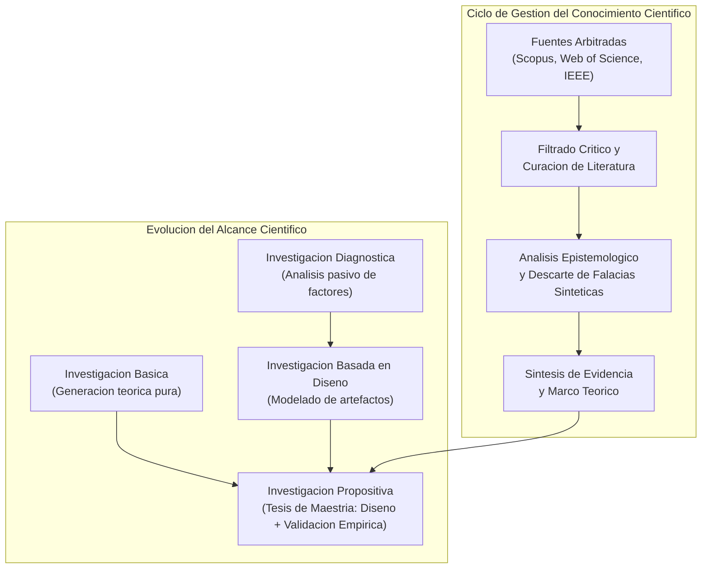
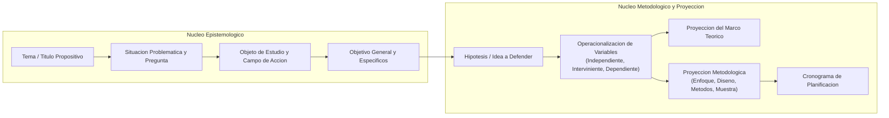

# Clase 1: Epistemologia de la Investigacion Cientifica en Posgrado, Gestion del Conocimiento y Estructura del Perfil de Tesis

> **Objetivo Pedagogico y Competencias Analiticas:**
> 
> Consolidar los fundamentos epistemologicos de la investigacion cientifica a nivel de maestria en Ciencias de la Computacion, Inteligencia Artificial y Ciencia de Datos. Comprender el ciclo de gestion del conocimiento cientifico, la naturaleza ontologica de la informacion arbitrada y la transicion desde una investigacion monografica hacia una investigacion aplicada de caracter propositivo, fundamentando la estructura anatomica del perfil de tesis conforme al protocolo institucional 2026.

## 1\. Contexto y Marco Conceptual: Epistemologia y Gestion de la Informacion Cientifica

### 1.1 Naturaleza Ontologica de la Informacion Cientifica en Nivel de Posgrado

La investigacion cientifica a nivel de maestria exige una comprension profunda de la naturaleza de la informacion. A diferencia de las etapas de pregrado o monografia donde prima la recopilacion y descripcion conceptual, en el nivel de maestria la informacion debe poseer propiedades epistemologicas rigurosas:

- **Contenido y Validez:** Informacion arbitrada por pares academicos ciegos, validada empiricamente, reproducible y con pertinencia demostrada en la comunidad cientifica internacional.

- **Forma y Tipologia:** Articulos en revistas indexadas (JCR, Scopus, SciELO), actas de congresos internacionales arbitrados (IEEE, ACM, Springer), patentes y libros especializados. Se trasciende la consulta de documentos informales, blogs o divulgaciones no certificadas.

- **Estructura Metodologica:** Publicaciones con diseno IMRyD (Introduccion, Metodos, Resultados y Discusion) que explicitan su marco de validez interna y externa.

- **Contextualizacion Espacio-Temporal:** Conocimiento situado, con vigencia temporal explicita y aplicabilidad delimitada a realidades organizacionales y territoriales concretas.

- **Proposito y Precision:** El conocimiento cientifico no es especulativo ni puramente algoritmico; busca dar respuesta a problematicas socio-tecnologicas concretas mediante un lenguaje tecnico, formal y reproducible.

### 1.2 Repositorios Institucionales y Certificacion del Conocimiento

El profesional de posgrado en Ciencia de Datos e Inteligencia Artificial no utiliza motores de busqueda generalistas para sustentar su investigacion. La busqueda sistematica de antecedentes y estado del arte debe restringirse a repositorios con revision por pares:

- **Bases de Datos Cientificas de Alto Impacto:** Scopus, Web of Science, ScienceDirect, IEEE Xplore, ACM Digital Library.

- **Repositorios de Acceso Abierto Arbitrado:** PubMed, Europe PMC, SciELO, Redalyc.

- **Indices Especializados y Motores Academicos:** Google Scholar (utilizando operadores booleanos avanzados y verificacion de indices h y citas).

### 1.3 El Desafio Epistemologico de la Inteligencia Artificial Generativa y Datos Sinteticos

El uso extendido de modelos de lenguaje masivo (LLMs) e Inteligencia Artificial Generativa en el proceso investigativo introduce riesgos epistemologicos criticos:

- **Alucinaciones y Fuentes Falsas:** Los modelos generativos son capaces de generar referencias bibliograficas formalmente verosimiles con codigos DOI, autores y revistas ficticias.

- **Datos Simulados vs Evidencia Empirica:** La generacion de datos sinteticos o informacion simulada sin una contrastacion de campo invalida el rigor cientifico de una tesis de maestria.

- **Imperativo de Auditoria:** Todo investigador tiene la responsabilidad etica de auditar manualmente cada fuente recuperada, contrastar el DOI en el repositorio oficial y validar la coherencia conceptual del texto fuente antes de incorporar cualquier cita a su perfil.

### 1.4 Gestion del Conocimiento Organizacional y Ciclo de la Informacion

La investigacion aplicada en Ciencia de Datos busca transformar datos brutos en conocimiento accionable dentro de organizaciones o sectores productivos. El ciclo epistemologico de la informacion comprende:

1. **Identificacion de la Necesidad:** Formulacion de la inquietud o vacio de conocimiento en un contexto profesional concreto.

1. **Busqueda y Filtrado:** Localizacion en fuentes arbitradas y depuracion de informacion irrelevante o metodologicamente debil.

1. **Analisis Critico y Evaluacion:** Contraste de teorias, algoritmos y marcos de referencia vigentes.

1. **Sintesis y Modelado:** Integracion del conocimiento para la conceptualizacion de la propuesta cientifica.

1. **Transferencia y Validacion:** Aplicacion del artefacto en el entorno real para evaluar su impacto y eficacia.

---

## 2\. Fundamentos Teoricos y Arquitectura: De la Monografia a la Tesis Propositiva

### 2.1 Taxonomia de la Investigacion: Basica, Aplicada y Propositiva

La investigacion cientifica se clasifica segun su proposito fundamental:

- **Investigacion Basica (Pura):** Orientada a incrementar el conocimiento teorico y fundamental sobre leyes y principios naturales o abstractos, sin una aplicacion practica inmediata (dominio comun de programas doctorales en ciencias basicas).

- **Investigacion Aplicada:** Emplea los conocimientos cientificos existentes para solucionar problemas practicos en organizaciones, optimizar procesos o disenar herramientas tecnologicas.

- **Investigacion Propositiva (Eje Central de la Maestria):** Subtipo avanzado de investigacion aplicada donde el investigador no se limita al diagnostico pasivo de una situacion problematica, sino que formula, desarrolla, modela y valida experimental o pericialmente un artefacto original (modelo predictivo, marco arquitectonico, sistema inteligente o algoritmo optimizado).

### 2.2 Diferenciacion Estructural entre Monografia y Tesis de Maestria

Es indispensable delimitar la brecha cualitativa y epistemologica entre una monografia y una tesis de maestria:

- **Nivel Monografico:** Enfocado en la revision documental, analisis descriptivo y sistematizacion teorica de un fenomeno. Puede incluir simulaciones exploratorias sin requerir implementacion ni validacion en un entorno real.

- **Nivel Tesis de Maestria:** Exige un caracter propositivo estricto. Requiere una contextualizacion rigurosa en el entorno productivo o social, la formulacion de hipotesis o ideas a defender, la operacionalizacion detallada de variables, y la validacion de la propuesta mediante juicio de expertos y pruebas empiricas de rendimiento o efectividad.

### 2.3 Modelado Visual del Ciclo de Investigacion y Transicion Metodologica

El siguiente diagrama ilustra el flujo de gestion del conocimiento cientifico y su convergencia hacia la investigacion propositiva:

### 2.4 Anatomia Sistemica del Perfil de Proyecto de Investigacion (Protocolo Institucional 2026)

Conforme a las directrices de posgrado aprobadas para 2026, el perfil de tesis representa la planificacion rigurosa de la investigacion y conforma la base estructural de la futura introduccion y capitulos metodologicos del informe final. Su estructura responde a un encadenamiento logico estricto:

Componentes estructurales del perfil institucional:

1. Portada oficial (con identidad institucional actualizada de la unidad de posgrado).

1. Indices: Contenido general, tablas, figuras y anexos.

1. Introduccion: Relevancia y pertinencia contextual (global, regional, nacional y local) mas fundamentacion de lineas y ejes tematicos.

1. Antecedentes del Problema y Situacion Problematica.

1. Formulacion del Problema (pregunta central de investigacion).

1. Objeto de Estudio (proceso global de la realidad investigado) y Campo de Accion (subconjunto o subsistema especifico donde se interviene).

1. Objetivos: Objetivo General (meta integradora en maxima habilidad taxonomica: Proponer...) y Objetivos Especificos (secuencia metodologica: diagnosticar, fundamentar, disenar/desarrollar, validar).

1. Justificacion multidimensional: Teorica, practica, economica, social, metodologica y personal.

1. Alcance y delimitaciones: Espacial, temporal y tematica.

1. Construccion teorica: Hipotesis (enfoque cuantitativo/mixto) o Idea a Defender (enfoque cualitativo).

1. Identificacion y operacionalizacion de variables o categorias conceptuales.

1. Proyeccion del Marco Teorico Referencial (estructura capitular del futuro estado del arte y teorias base).

1. Proyeccion Metodologica: Enfoque, diseno, tipo de investigacion, metodos teoricos y empiricos, tecnicas, instrumentos, poblacion y muestra.

1. Plan de analisis de datos y tecnicas de procesamiento analitico.

1. Cronograma de actividades de investigacion.

1. Referencias bibliograficas (bajo norma APA 7ma edicion) y bibliografia de consulta no citada.

1. Anexos: Instrumentos diagnosticos preliminares y matrices metodologicas.

---

## 3\. Implementacion Metodologica y Formulacion del Tema de Investigacion

### 3.1 Modelo Funcional del Tema y Titulo de Tesis

En la investigacion de maestria, el tema y el titulo coinciden formalmente. El titulo no debe redactarse de manera ambigua o literaria, sino responder a un modelo funcional riguroso:

$Tema = f(Propuesta, V_{interviniente}, V_{dependiente}, Contexto_{espacial}, Contexto_{temporal})$

Regla de oro sintactica: El titulo no debe comenzar con verbos en infinitivo (los verbos de accion corresponden con exclusividad a los objetivos de investigacion).

### 3.2 Desglose Estructural de Variables y Componentes

Todo titulo y tema de maestria debe contener de manera explicita:

1. **Propuesta (Variable Independiente** $X$**):** El artefacto tecnologico o computacional concebido para intervenir en la realidad (ej. Modelo predictivo, Sistema inteligente, Arquitectura de referencia, Algoritmo bioinspirado).

1. **Variable Interviniente (**$Z$**):** El paradigma, tecnica, marco o tecnologia mediadora que dota de potencia analitica al artefacto (ej. Deep Learning, Transformers, Redes Neuronales Convolucionales, Aprendizaje no supervisado, IoT, Sistemas Multiagente).

1. **Variable Dependiente (**$Y$**):** La variable de transformacion; el fenomeno, proceso critico o problema concreto que se modifica, optimiza o resuelve (ej. deteccion de anomalias, pensamiento critico, desercion estudiantil, control de calidad, diagnostico clinico).

1. **Unidad de Analisis:** Los sujetos o entidades tecnologicas sobre las que se recolectan los datos (ej. historias clinicas, logs de red, estudiantes, imagenes de vectores).

1. **Contexto Espacial (**$S$**):** Delimitacion geografica e institucional donde se aplicara y validara la solucion (organizacion, empresa o rubro en Bolivia).

1. **Delimitacion Temporal (**$T$**):** Horizonte temporal proyectivo de la investigacion (ej. 2026-2027).

### 3.3 Alineacion con las Lineas de Investigacion de Posgrado

Todo tema de maestria debe tributar de manera obligatoria a los intereses tematicos institucionales de la Unidad de Posgrado (Facultad de Ciencias de la Computacion - UAGRM):

- **Area:** Ciencias de la Computacion Aplicadas.

- **Lineas Principales:**

  - Inteligencia Artificial y Sistemas Inteligentes.
  
  - Sistemas Cognitivos e Informatica Aplicada.
  
  - Analisis de Datos No Estructurados y Gestion de la Informacion.
  
  - Ingenieria de Software y Sistemas de Informacion.
  
  - Ciberseguridad y Redes Complejas.

- **Requisito de Fundamentacion:** En el nivel de maestria no es admisible unicamente listar la linea; se debe redactar una argumentacion cientifica que demuestre como los resultados esperados del proyecto aportaran al desarrollo de esa linea y eje tematico especifico.

### 3.4 Estructura Formal de la Seccion Introductoria del Perfil

La introduccion del perfil debe redactarse en una extension de una a dos paginas bajo el metodo del embudo argumentativo:

- **Parrafo 1 (Nivel Global):** Magnitud, tendencias y estado actual del problema en el escenario internacional.

- **Parrafo 2 (Nivel Regional - Latinoamerica):** Comportamiento y limitaciones del fenomeno en el contexto latinoamericano.

- **Parrafo 3 (Nivel Nacional y Local - Bolivia):** Brechas tecnologicas, pertinencia e impacto directo en el contexto boliviano o departamental.

- **Parrafo 4 (Fundamentacion de Linea de Investigacion):** Vinculacion explicita con el area, linea y eje tematico de la unidad de posgrado, justificando la contribucion institucional.

---

## 4\. Analisis Critico de Casos y Auditoria Practica de Propuestas

### 4.1 Evaluacion de Propuestas Tematicas Expuestas en Sesion

Durante la sesion se evaluaron propuestas iniciales presentadas por los maestrandos, destacando lecciones metodologicas fundamentales:

#### Caso 1: Asistente tutorial para pensamiento critico

- Titulo Inicial: *Modelo de asistente tutorial basado en recuperacion de informacion para el pensamiento critico historico en estudiantes de secundaria de La Paz.*

- Auditoria Metodologica: La estructura del titulo posee claridad en su propuesta (modelo de asistente tutorial), variable interviniente (recuperacion de informacion - RAG) y variable dependiente (pensamiento critico historico). Se detecto la omision de la temporalidad proyectiva, recomendandose incorporar explicitamente el horizonte proyectado (2026-2027).

#### Caso 2: Procesamiento de notas clinicas en salud

- Titulo Inicial: *Implementacion de un modelo de procesamiento de lenguaje natural basado en Transformer para la extraccion y codificacion en diagnostico clinico en la Caja de Salud.*

- Auditoria Metodologica: Se identifico el uso inadecuado del termino *Implementacion*. En investigacion propositiva de maestria, implementar denota la ejecucion operativa de un artefacto preexistente (investigacion puramente aplicada sin caracter de innovacion). Se corrigio la formulacion hacia el desarrollo y formulacion del artefacto (*Modelo de procesamiento de lenguaje natural...*), asumiendo que la implementacion forma parte de la fase experimental de validacion.

### 4.2 Tabla de Auditoria Comparativa de Casos

| **Caso Evaluado** | **Propuesta (X) y Mediacion (Z)** | **Variable de Transformacion (Y)** | **Delimitacion Espacio-Temporal** | **Dictamen y Correccion Metodologica** |
| --- | --- | --- | --- | --- |
| Asistente Tutorial RAG | Asistente tutorial basado en recuperacion de informacion (RAG) | Desarrollo del pensamiento critico historico | Estudiantes de secundaria, La Paz (omitia temporalidad) | Adecuado. Se exige incorporar temporalidad explicita (2026-2027). |
| Procesamiento Clinico NLP | Modelo NLP basado en Transformers (iniciaba con 'Implementacion') | Extraccion y codificacion CIE-10 en diagnostico clinico | Caja de Salud Camiri, Santa Cruz (omitia temporalidad) | Observado por anti-patron de implementacion. Reenfocado a formulacion y propuesta de modelo con validacion empirica. |

---

## 5\. Principios de Diseno, Buenas Practicas y Anti-patrones

### 5.1 Reglas de Oro en la Formulacion de Perfiles de Tesis

1. **Invarianza Sintactica del Titulo:** Prohibido el uso de verbos en infinitivo en el titulo. La accion taxonomica mayor reside en el Objetivo General (*Proponer...*).

1. **Coherencia Biunivoca Titulo-Objetivo General:** El objetivo general se construye anteponiendo el verbo infinitivo de mayor alcance al texto integro del titulo validado.

1. **Pertinencia Territorial Nacional:** Toda investigacion de maestria de la universidad debe resolver una necesidad comprobable en el territorio boliviano. No se admiten temas desvinculados de la realidad socio-productiva del pais.

1. **Articulacion Integral de Variables:** En el titulo deben ser legibles la variable independiente (solucion tecnologica), interviniente (metodo/algoritmo) y dependiente (problema transformado).

### 5.2 Catalogo de Anti-patrones Metodologicos

- **Anti-patron de Implementacion Aislada:** Redactar el titulo iniciando con "Implementacion de...". Esto reduce la tesis a una tarea de ingenieria operativa, suprimiendo el aporte investigativo de diseno, formulacion y validacion cientifica.

- **Anti-patron de Ambiguedad Instrumental:** Mencionar la tecnologia mediadora sin explicitar que proceso se optimiza o mejora (omitir la variable dependiente $Y$).

- **Anti-patron de Desconexion Institucional:** Formular el perfil sin alinearlo a las lineas y ejes tematicos de la unidad de posgrado, impidiendo la asignacion idonea de directores y tribunales de tesis.

- **Anti-patron de Cita Sintetica no Auditada:** Aceptar referencias bibliograficas inferidas por herramientas de IA generativa sin verificacion directa en repositorios arbitrados indexados.

---

## 6\. Sintesis Conceptual y Profundizacion Academica

### 6.1 Matriz de 34 Componentes de la Rubrica Institucional

La evaluacion del perfil de tesis en la unidad de posgrado se efectua mediante una rubrica analitica de 34 componentes que valoran:

- Coherencia logica entre Titulo, Problema, Objetivos, Hipotesis y Variables.

- Rigor epistemologico en la justificacion de las lineas de investigacion.

- Solidez en la delimitacion del objeto de estudio y campo de accion.

- Calidad de la proyeccion metodologica y plan de analisis de datos.

### 6.2 Ejes Epistemologicos de Profundizacion

Para consolidar la formulacion teorica del perfil de tesis, se recomienda profundizar en:

- **Design Science Research (DSR):** Metodologia de investigacion en ciencias de la computacion que formaliza la creacion y evaluacion de artefactos tecnologicos para resolver problemas identificados (Hevner, March, Park y Ram).

- **Epistemologia de la Computacion:** Rigor en la formulacion de hipotesis algoritmicas y marcos de validacion empirica en inteligencia artificial y aprendizaje automatico.

---
