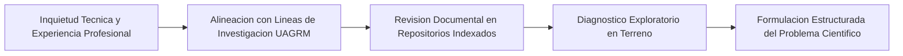
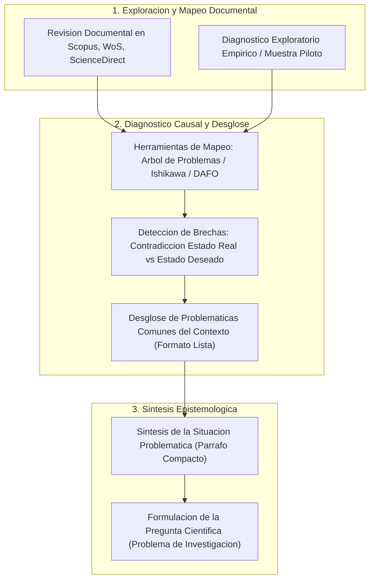
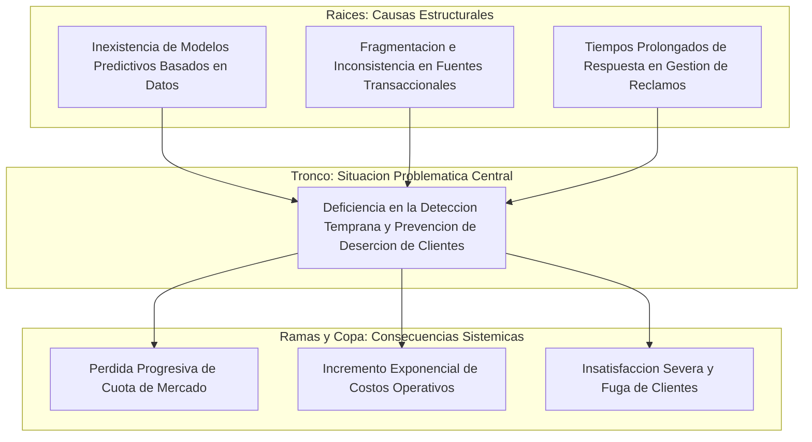

# Clase 3: Antecedentes de la Investigacion Cientifica, Diagnostico Exploratorio y Metodos Estructurados de Problematizacion

> **Objetivo de la sesion:** Comprender el rol epistemologico de los antecedentes teoricos y practicos en la construccion del perfil de tesis de maestria; diferenciar metodologicamente entre la revision de antecedentes y el estado del arte; y dominar las tecnicas de diagnostico exploratorio (Arbol de Problemas, Diagrama de Ishikawa y Matriz DAFO) para evidenciar la contradiccion entre el estado real y el deseado, delimitando con rigor analitico la situacion problematica previa a la formulacion del problema cientifico.

## 1\. Contexto y Marco Conceptual

### Epistemologia de la Investigacion Aplicada en Ciencias de la Computacion e IA

En el ambito de la ciencia de datos y la inteligencia artificial a nivel de posgrado, la investigacion cientifica supera los alcances meramente descriptivos o contemplativos. Se inscribe bajo el paradigma de la **Investigacion Basada en Diseno (Design Science Research)**, donde el rigor metodologico se orienta a la produccion, modelado y validacion de soluciones tecnologicas, artefactos algoritmicos o servicios computacionales capaces de intervenir y transformar una realidad operativa concreta.

Un proyecto de tesis de maestria no se restringe a replicar bibliotecas preexistentes o aplicar modelos estandares sobre conjuntos de datos academicos simplificados. Requiere identificar con precision una contradiccion medular entre el estado real observado en un entorno socioproductivo u organizacional y el estado deseado proyectado por los estandares de la disciplina.

### La Genesis de la Idea Cientifica y su Pertinencia Contextual

El proceso investigativo se inicia a partir de inquietudes tecnicas, experiencia profesional y observacion sistematica del contexto. No obstante, para alcanzar estatus cientifico, dicha idea debe transitar por un riguroso proceso de maduracion que contemple:

1. **Articulacion Disciplinar:** Inscripcion del estudio en las lineas de investigacion y ejes tematicos formalmente establecidos por la Unidad de Posgrado en Ciencias de la Computacion.

1. **Relevancia Territorial:** Correspondencia con demandas reales y brechas tecnicas observables en el contexto nacional y regional (Bolivia y Latinoamerica).

1. **Factibilidad y Alcance:** Disponibilidad verificable de activos de datos, infraestructura computacional, acceso institucional y limites temporales viables.

### La Revision Documental como Filtro Epistemologico

La revision bibliografica no constituye una recopilacion bibliografica pasiva, sino un metodo de investigacion documental sistematico. Su proposito consiste en:

- Identificar a los autores fundamentales (clasicos y contemporaneos) que han modelado formalmente las variables del tema.

- Detectar vacios del conocimiento (*research gaps*), inconsistencias y limitaciones teoricas no resueltas.

- Evitar la redundancia investigativa y fundamentar la novedad del artefacto o modelo que se pretende proponer.

Para ello, la exploracion documental debe ejecutarse prioritariamente en bases de datos cientificas y metabuscadores de alto impacto: Scopus, Web of Science, ScienceDirect, Dialnet, Latindex y Google Academico, recurriendo tanto a literatura primaria como secundaria y marcos normativos internacionales.

### Gobernanza Etica y Rigor en el Uso de Inteligencia Artificial Generativa

El empleo de modelos generativos de lenguaje en la etapa de exploracion documental exige directrices metodologicas estrictas:

- **Riesgo Critico de Alucinacion:** Los modelos probabilistas autorregresivos pueden generar citas verosimiles pero epistemologicamente inexistentes, distorsionar atribuciones de autoria o alterar fechas de publicacion.

- **Protocolo de Validacion Cruzada:** Toda referencia bibliografica identificada mediante herramientas computacionales debe ser auditada manualmente en repositorios formales, verificando la existencia real del DOI, la indexacion del articulo y la fidelidad del aporte cientifico original bajo normas internacionales APA 7ma edicion.

---

## 2\. Fundamentos Teoricos y Arquitectura

### Taxonomia y Jerarquia de las Fuentes de Informacion

En la revision documental previa a la formulacion del perfil, la literatura cientifica se estructura bajo dos categorias analiticas:

1. **Fuentes Primarias:** Documentos originales donde se publican aportes cientificos de primera mano: formulaciones matematicas de nuevos algoritmos, teoremas fundacionales, patentes tecnologicas y estandares tecnicos corporativos o internacionales (IEEE, ISO/IEC, ACM). Representan las bases clasicas e invariantes en el tiempo.

1. **Fuentes Secundarias:** Publicaciones que analizan, comparan, sintetizan o referencian aportes primarios: articulos de revision sistematica, meta-analisis y capitulos de libros. Constituyen el volumen mayoritario de la literatura indexada y permiten comprender la evolucion practica de las teorias fundamentales.

### Diferenciacion Epistemologica: Antecedentes de Investigacion vs. Estado del Arte

Uno de los desalineamientos metodologicos mas recurrentes en el nivel de posgrado radica en confundir los antecedentes con el estado del arte:

- **Antecedentes de la Investigacion (Teoricos y Practicos):** 

  - Constituyen una sintesis puntual de aportes previos directamente vinculados con el tema.
  
  - Se estructuran mediante la mencion concisa de entre 7 y 10 autores seminales o corporativos (preferentemente de los ultimos cinco anos).
  
  - Cada mencion debe articular de forma compacta: autor, ano, aporte esencial desarrollado y la postura critica o vinculacion del maestrante con respecto a su propia investigacion.
  
  - No profundizan en descripciones historicas ni debates exhaustivos; simplemente acreditan que el problema no parte de un vacio total y fijan la base previa al estudio.

- **Estado del Arte (Proyeccion Teorica):**

  - Constituye un analisis exhaustivo, diacronico y profundo de la evolucion del conocimiento en torno al problema.
  
  - Mapea cronologicamente hitos, controversias epistemologicas, comparaciones de rendimiento y escuelas de pensamiento.
  
  - Se ubica exclusivamente en el marco teorico formal de la tesis, no en la fase introductoria de antecedentes.

---

## 3\. Implementacion Tecnica y Logica de Negocio

### Herramientas Estructuradas de Diagnostico Exploratorio

Para transitar desde el malestar empirico contextual hacia una definicion cientifica rigurosa, el protocolo metodologico de la Unidad de Posgrado exige respaldar el diagnostico exploratorio mediante una de tres herramientas formales (destinada a conformar el Anexo 1 del Perfil de Tesis):

#### 1\. El Arbol de Problemas

Herramienta de analisis causa-efecto que modela la anatomia sistemica del fenomeno problemico:

- **Raices (Causas Raices):** Factores estructurales subyacentes e intermedios que originan la disfuncion operativa (e.g., datos desestructurados, ausencia de modelos predictivos, procesos manuales propensos a error).

- **Tronco (Problema Central / Situacion Problematica):** Insuficiencia o contradiccion medular que requiere ser transformada cientificamente.

- **Ramas y Copa (Efectos y Consecuencias):** Impactos organizacionales, perdidas financieras, degradacion de la calidad de servicio o riesgos sistemicos derivados de no resolver el problema central.

#### 2\. El Diagrama de Ishikawa (Causa-Efecto / Espina de Pescado)

Diseno analitico multinivel que categoriza las causas del problema central en ejes de influencia adaptados a la ciencia de datos y computacion:

- **Eje Datos e Ingesta:** Calidad, volumen, desbalance, ruido, heterogeneidad y fragmentacion de registros.

- **Eje Modelos y Algoritmos:** Sesgo arquitectonico, sobreajuste, supuestos estadisticos restrictivos, falta de explicabilidad.

- **Eje Infraestructura y Computo:** Latencia de red, capacidad GPU/CPU, escalabilidad y almacenamiento.

- **Eje Procesos de Negocio:** Flujos operativos manuales, burocracia documental, falta de estandarizacion.

- **Eje Validacion y Metricas:** Ausencia de indicadores tecnicos estandarizados, escasez de paneles de evaluacion experta.

#### 3\. La Matriz DAFO / FODA Diagnostica

Metodologia de valoracion estrategica del entorno:

- Focaliza el cruce entre **Debilidades** (insuficiencias internas del sistema/organizacion) y **Amenazas** (presiones competitivas o tecnologicas del entorno).

- La convergencia de debilidades criticas no atendidas sustenta objetivamente la urgencia de formular la propuesta cientifica.

### Protocolo de Redaccion en el Perfil de Proyecto

La formalizacion documental en el perfil debe ejecutarse bajo una secuencia rigurosa:

1. **Listado de Problematicas Comunes:** Enumeracion analitica y estructurada mediante vinetas de los problemas observados durante el estudio exploratorio en el contexto real.

1. **Redaccion de la Situacion Problematica:** Parrafo unico, compacto, denso y eminentemente descriptivo que sintetice la insuficiencia fundamental compartida por el listado de problemas.

1. **Formulacion de la Pregunta Cientifica:** Pregunta unívoca que problematiza las variables afectadas en su contexto espacial y temporal sin anticipar la propuesta de solucion.

---

## 4\. Analisis Critico de Casos y Auditoria Practica

### Comparativa de Metodologias de Diagnostico Causal

| Dimension Analitica | Arbol de Problemas | Diagrama de Ishikawa | Matriz DAFO / FODA |
| --- | --- | --- | --- |
| **Enfoque Primario** | Jerarquia causal directa (Causa - Problema - Efecto) | Categorizacion tematica multinivel de factores causales | Diagnostico estrategico interno y externo |
| **Granularidad Causal** | Lineal y vertical en dos o tres niveles jerarquicos | Arborescente y lateral con sub-espinas de detalle | Agrupacion matricial de factores cualitativos |
| **Idoneidad en Computacion** | Excelente para modelar impactos tecnicos y operativos | Optima para diagnosticar pipelines de datos e IA | Util para analisis de contexto organizacional y viabilidad |
| **Ubicacion en Perfil** | Anexo 1 (Respaldo del diagnostico exploratorio) | Anexo 1 (Respaldo del diagnostico exploratorio) | Anexo 1 (Respaldo del diagnostico exploratorio) |

### Auditoria Critica de Casos Expuestos en Clase

#### Caso 1: Deteccion de Talento Infanto-Juvenil en Futbol Cruceño mediante Modelos de Ensamble

- **Diagnostico Exploratorio:** Identificacion de la dependencia exclusiva del "ojo clinico" empirico y subjetivo de veedores tradicionales, contrastado con la existencia de bases de datos locales no normalizadas, sucias y fragmentadas.

- **Mapeo Causal (Arbol de Problemas):**

  - Causas Raices: Ausencia de registros tecnicos homologados; incompatibilidad con plataformas internacionales de analitica deportiva.
  
  - Situacion Problematica: Inexistencia de sistemas tecnicos automatizados para la identificacion y seguimiento objetivo del potencial deportivo infanto-juvenil.
  
  - Efectos Sistemicos: Perdida irreversible de prospectos deportivos de alto rendimiento y debilitamiento institucional de las academias formativas.

- **Dictamen Metodologico Docente:** Se corrigio la formulacion inicial del maestrante, precisando que el "problema general" expuesto correspondia a la descripcion de la **situacion problematica** y no a la formulacion interrogativa cientifica definitiva, la cual debe redactarse en funcion de las variables afectadas.

#### Caso 2: Arquitectura RAG para Respuestas Juridicas en Legislacion y Jurisprudencia Boliviana

- **Diagnostico Exploratorio:** Los motores convencionales del Tribunal Supremo de Justicia operan unicamente por coincidencia lexica de palabras clave, perdiendo documentos criticos debido a la riqueza sinonimica y semantica del derecho.

- **Mapeo Causal (Diagrama de Ishikawa en 5 Dimensiones):**

  - Datos Juridicos: Corpus boliviano ausente en el preentrenamiento de los LLMs base comerciales.
  
  - Modelos de Lenguaje: Alucinacion y falta de fundamentacion contextual estricta.
  
  - Recuperacion: Búsqueda basada en similitud superficial sin densidad vectorial ajustada al dominio legal.
  
  - Contexto Normativo: Dinamismo legislativo y disociacion interpretativa entre leyes y jurisprudencia.
  
  - Evaluacion: Inexistencia de metricas tecnicas validadas por juristas expertos.

- **Dictamen Metodologico Docente:** Se destaco el desglose multinivel de la herramienta y se oriento a que la situacion problematica debe sintetizar la limitacion de los sistemas actuales para entregar respuestas juridicas trazables, reservando la arquitectura RAG como la respuesta/propuesta de solucion.

#### Caso 3: Digitalizacion y Normalizacion de Historias Clinicas con Deep Learning

- **Diagnostico Exploratorio:** Manejo manual y fisico en papel de ordenes de transferencia e historias clinicas en la Caja de Salud de Caminos.

- **Mapeo Causal (Arbol de Problemas):** Cuellos de botella administrativos, demoras criticas en la atencion medica de pacientes con enfermedades de base y extravio documental.

- **Dictamen Metodologico Docente:** Se senalo la necesidad de formalizar explicitamente el mapeo grafico del arbol como anexo antes de redactar el cuerpo de la tesis, garantizando congruencia estricta entre las causas enumeradas y la situacion problematica resultante.

---

## 5\. Principios de Diseno, Buenas Practicas y Anti-patrones

### Reglas de Oro en la Fase Exploratoria y Antecedentes

1. **Regla de Integridad del Anexo 1:** Todo perfil de tesis debe incorporar en su primer anexo el diagrama grafico formal (Arbol de Problemas, Ishikawa o DAFO) que respalda y valida el listado de problemas redactado en el texto principal.

1. **Regla de Postura Critica en Antecedentes:** No limitar la mencion de antecedentes a un resumen bibliografico pasivo. El investigador debe explicitar que vacio dejo el autor analizado y como dicho aporte informa o complementa la propia propuesta de maestria.

1. **Regla de Trazabilidad Causal:** Cada causa listada en el capitulo introductorio debe tener correspondencia directa con un elemento diagnosticado en la herramienta del Anexo 1.

### Anti-patrones Metodologicos Comunes

- **Anti-patron de Confusion entre Antecedentes y Estado del Arte:** Redactar extensos parrafos historicos y descriptivos en la seccion de antecedentes, invadiendo el espacio propio del marco teorico referencial.

- **Anti-patron de la Cita Fantasma o Alucinacion por IA:** Incorporar articulos generados por herramientas LLM sin verificacion manual en repositorios indexados oficiales, derivando en citaciones con DOIs inexistentes o anos adulterados.

- **Anti-patron de la Solucion Preconcebida:** Plantear el problema como la simple ausencia de la tecnologia que el investigador desea implementar (e.g., "El problema es que no existe una red neuronal convolucional"), en lugar de caracterizar la insuficiencia del fenomeno real.

- **Anti-patron de Desconexion Mapeo-Texto:** Presentar un diagrama de Ishikawa en anexo que contiene factores causales completamente disociados del listado de problematicas expuesto en el perfil.

---

## 6\. Sintesis Conceptual y Profundizacion Academica

### Sintesis de la Sesion

La fase exploratoria y de antecedentes establece los cimientos epistemologicos del perfil de tesis en posgrado. La distincion entre antecedentes (mencion de aportes y postura critica) y estado del arte (evolucion conceptual diacronica) previene errores estructurales en la composicion de la tesis. Asimismo, el empleo riguroso de herramientas estructuradas de causalidad (Arbol de Problemas, Ishikawa, DAFO) permite aislar los problemas comunes del contexto, sintetizar con precision la situacion problematica y allanar el camino hacia la formulacion cientifica del problema.

### Literatura Metodologica y Marcos de Referencia

- **Bernal, C. A. (2016).** *Metodologia de la investigacion: administracion, economia, humanidades y ciencias sociales (4ta ed.).* Pearson Educacion. Capitulos 7 y 8 (Revision documental y construccion del problema).

- **Hevner, A. R., March, S. T., Park, J., &amp; Ram, S. (2004).** *Design Science in Information Systems Research.* MIS Quarterly, 28(1), 75-105.

- **Hernandez-Sampieri, R., &amp; Mendoza, C. P. (2018).** *Metodologia de la investigacion: Las rutas cuantitativa, cualitativa y mixta.* McGraw-Hill. Capitulos 2 y 3 (Planteamiento del problema cuantitativo y revision de literatura).

- **Ishikawa, K. (1986).** *Guide to Quality Control (2nd ed.).* Asian Productivity Organization. Tokio.

---
