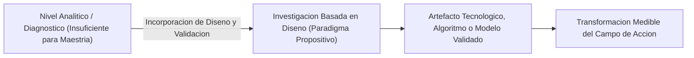
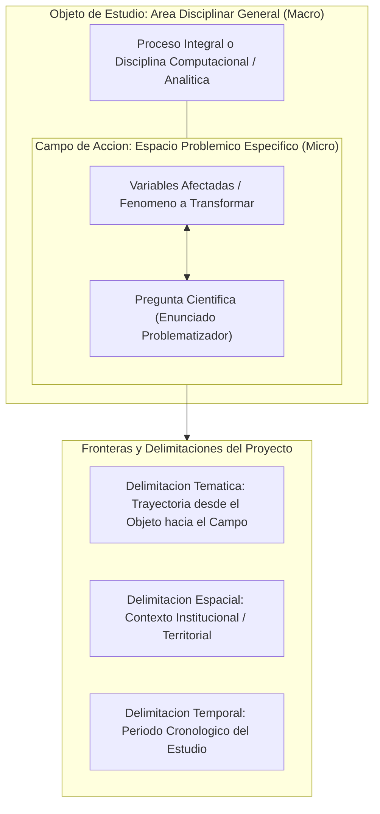

# Clase 4: Diseño Teórico del Perfil de Tesis: Problema Científico, Delimitación de Objeto de Estudio y Campo de Acción, Justificaciones Multidimensionales y Alcance Metodológico

> **Objetivo de la sesion:** Formalizar con rigor metodologico el diseno teorico del perfil de tesis de maestria en Ciencias de Datos e Inteligencia Artificial; formular con precision la pregunta cientifica evitando la anticipacion de la solucion; dominar la distincion conceptual entre Objeto de Estudio (marco disciplinar general) y Campo de Accion (subconjunto especifico transformable); estructurar la justificacion multidimensional de la investigacion (teorica, practica, social/economica y metodologica); y establecer los alcances y delimitaciones tematica, espacial y temporal del proyecto propositivo.

## 1\. Contexto y Marco Conceptual

### El Diseño Teórico como Núcleo Ontológico de la Tesis

El diseno teorico del perfil de tesis constituye la columna vertebral epistemologica de la investigacion cientifica de posgrado. En este apartado se definen de manera inequivoca las fronteras del conocimiento que seran intervenidas, garantizando la consistencia interna y la transitividad entre el problema formulado, el objeto de estudio, el campo de accion, los objetivos y la hipotesis de trabajo.

En un programa de Maestria en Ciencias de Datos e Inteligencia Artificial, el perfil de tesis oficial de la Universidad Autonoma Gabriel Rene Moreno (UAGRM) exige cumplir con un protocolo estricto que destierra la arbitrariedad de formatos libres y la dispersion tematica. Cada seccion del diseno teorico cumple una funcion metodologica precisa e irreductible.

### El Paradigma Propositivo en Ciencias de la Computacion

A diferencia de los estudios monograficos o de nivel licenciatura que pueden circunscribirse a revisiones descriptivas o diagnosticos analiticos, la investigacion de maestria en computacion demanda un **enfoque propositivo fundamentado en el diseno**.

Esto implica que la investigacion no puede limitarse a describir un fenomeno, comparar librerias existentes o evaluar metricas de un proceso sin generar una contribucion original. Se requiere formular, disenar, prototipar y validar un artefacto tecnologico (modelo de aprendizaje automatico, arquitectura RAG, red neuronal, pipeline de autocuracion, plataforma analitica) que resuelva la insuficiencia diagnosticada.

### Delimitacion como Mecanismo de Viabilidad Epistemológica

Un error habitual en investigadores noveles consiste en plantear alcances universales o inabarcables. La delimitacion cientifica opera como un instrumento de control de complejidad: define con nitidez que fenomenos ingresan en el perimetro de analisis y cuales quedan explicitamente excluidos, asegurando la factibilidad computacional, temporal y empirica del proyecto.

---

## 2\. Fundamentos Teoricos y Arquitectura

### Anatomia Rigurosa de la Formulacion del Problema Cientifico

El problema cientifico se expresa canonicamente como una **pregunta de investigacion** rigurosa, orientadora y operacionalizable. Su formulacion debe integrar tres componentes estructurales indispensables:

1. **La Particula de Transformacion y Variables Afectadas:** Expresion precisa del vacio, insuficiencia o contradiccion que afecta al sistema (` ¿Como contribuir a [mejora / optimizacion / prevencion / reduccion de variables dependientes]...? `).

1. **La Delimitacion Espacial / Territorial:** Identificacion de la entidad, empresa, sector u organizacion concreta donde se recolectaran los datos y se evaluara la intervencion.

1. **La Delimitacion Temporal:** Ventana cronologica explicita que acota el periodo historico de observacion o ejecucion experimental (e.g., periodo 2025-2026).

#### La Regla de Oro de Exclusion de la Propuesta

Queda estrictamente prohibido anticipar la propuesta de solucion dentro de la formulacion de la pregunta de investigacion:

- **Error Metodologico (Pregunta Tautologica):** ` ¿Como contribuir con un modelo predictivo basado en algoritmos de ensamble a reducir la desercion de clientes...? ` (Incorrecto: se adelanta la respuesta y se vicia el caracter cientifico del problema).

- **Formulacion Valida:** ` ¿Como contribuir a reducir la tasa de desercion de clientes y optimizar la retencion en la empresa de telecomunicaciones [Entidad] en el periodo 2025-2026? `

- **Fundamento Epistemologico:** La propuesta de solucion constituye la respuesta tentativa al problema (el objetivo general y la hipotesis de investigacion). Adelantarla en la pregunta es incurrir en una peticion de principio tautologica.

### El Modelo Concentrico: Objeto de Estudio vs. Campo de Accion

La Unidad de Posgrado en Ciencias de la Computacion asume una definicion formal especifica para diferenciar estas dos dimensiones ontologicas fundamentales:

1. **Objeto de Estudio:**

   - Representa la parcela de la realidad objetiva y el area disciplinar amplia en la que se inscribe la investigacion.
   
   - Es el marco tematico abarcador donde coexisten multiples fenomenos y problemas cientificos.
   
   - **Criterio de Redaccion Oficial:** Debe redactarse de manera hiper-concisa, en una o dos oraciones concretas, evitando fundamentaciones teoricas extensas o redacciones en modo de objetivo.
   
   - *Ejemplo:* El proceso de desarrollo y aseguramiento de la calidad de software en empresas de base tecnologica.

1. **Campo de Accion:**

   - Es la subseccion delimitada del objeto de estudio que es aislada mediante abstraccion cientifica para ser investigada, mejorada o transformada.
   
   - Coincide estructuralmente con las variables afectadas declaradas en la pregunta de investigacion, pero expresadas en formato aseverativo.
   
   - No equivale simplemente al lugar geografico u organizacion: representa la arista tecnica y operativa precisa donde impactara la propuesta.
   
   - *Ejemplo:* La gestion y optimizacion de pruebas automatizadas mediante capacidades de autocuracion en la empresa IDT durante la gestion 2026-2027.

### Marco Multidimensional de Justificacion de la Investigacion

En el nivel de maestria, la justificacion exige un tratamiento multidimensional robusto que trasciende el formato elemental de otros grados academicos:

- **Justificacion Teorica:** Argumenta la pertinencia del estudio frente a vacios de conocimiento identificados en la literatura indexada, contrastando las limitaciones de los enfoques existentes con los marcos conceptuales de vanguardia de la inteligencia artificial.

- **Justificacion Practica:** Demuestra la utilidad aplicada y operativa de la propuesta para resolver un dolor real, eliminar ineficiencias o superar cuellos de botella en la organizacion o sector de aplicacion.

- **Justificacion Social o Economica:** Cuantifica o califica los impactos derivados de la solucion: ahorro financiero, reduccion del costo de adquisicion de usuarios (CAC), optimizacion de recursos computacionales o impacto directo en la atencion y calidad de vida ciudadana.

- **Justificacion Metodologica:** Fundamenta la novedad y rigurosidad de los metodos, algoritmos, arquitecturas, protocolos de prueba o tecnicas de validacion que la propuesta aportara a la disciplina. *(Atencion: no debe confundirse con la justificacion del enfoque o diseno metodologico de la tesis; se refiere al aporte instrumental de la solucion tecnologica).*

- **Justificacion Personal:** Refleja la trayectoria academica, solvencia profesional y motivaciones tecnicas que respaldan el compromiso del investigador con la ejecucion del proyecto.

---

## 3\. Implementacion Tecnica y Logica de Negocio

### Protocolo de Derivacion Sintactica del Diseno Teorico

Para asegurar la coherencia epistemologica, el investigador debe seguir un protocolo de transformacion riguroso entre los componentes del diseno teorico:

| Componente Metodologico | Estructura Sintactica Canonica | Nivel de Abstraccion | Regla de Validación |
| --- | --- | --- | --- |
| **Pregunta Cientifica** | ` ¿Como contribuir a [Variable Afectada] en [Contexto Espacial] en el periodo [Temporal]? ` | Especifico / Interrogativo | Prohibido anticipar la tecnologia o modelo de solucion |
| **Campo de Accion** | ` La [Variable Afectada / Proceso a Mejorar] en [Contexto Espacial] en el periodo [Temporal]. ` | Especifico / Aseverativo | Coincidencia biunívoca con las variables del problema |
| **Objeto de Estudio** | ` El proceso integral de [Disciplina o Sistema Mayor] en [Entorno Amplio]. ` | General / Disciplinar | Maximo 1 o 2 lineas; contiene al campo de accion |
| **Delimitacion Tematica** | ` Los limites de la investigacion se enmarcan desde [Objeto de Estudio] hasta [Campo de Accion]. ` | Frontera Epistemologica | Define explicitamente lo incluido y lo excluido |
| **Delimitacion Espacial** | ` El estudio se circunscribe geografica e institucionalmente a [Entidad / Territorio]. ` | Frontera Geografica | Alineada al entorno real de recoleccion de datos |
| **Delimitacion Temporal** | ` El horizonte cronologico de ejecucion y observacion abarca la gestion [Anos / Semestres]. ` | Frontera Cronologica | Horizonte temporal alcanzable y verificable |

### Niveles de Profundidad en Investigaciones de Posgrado

El diseno de la investigacion en maestria exige un analisis de profundidad estratificado:

1. **Nivel 1 (Diagnostico y Evolucion Cronologica):** Realizar unicamente benchmarking de soluciones comerciales o recuentos historicos. *Insuficiente para grado de Maestria.*

1. **Nivel 2 (Comparacion Estructurada de Arquitecturas Existentes):** Evaluacion empirica de diferentes pipelines o modelos en un entorno controlado. Representa una fase intermedia valiosa pero incompleta si no desemboca en un artefacto propio.

1. **Nivel 3 (Investigacion Propositiva Basada en Diseno - Exigencia de Maestria):** Diseno de una arquitectura, algoritmo o procedimiento propio (o ensamble no trivial de modulos especializados) adaptado a las singularidades del problema y validado experimentalmente.

### Protocolo de Validacion Formal del Artefacto

Una propuesta propositiva de maestria no se considera concluida con el mero desarrollo del software o script. Exige un protocolo de validacion compuesto por tres capas:

1. **Validacion Metrica / Algoritmica:** Computo de metricas cuantitativas de rendimiento (Precision, Recall, F1-Score, AUC-ROC, Latencia de inferencia, ROUGE, BLEU, Perplejidad).

1. **Validacion Funcional / Operativa:** Pruebas tecnicas de estres, robustez ante datos ruidosos o fuera de distribucion e integracion en pipelines productivos.

1. **Validacion por Juicio de Expertos:** Evaluacion cualitativa y cuantitativa mediante paneles metodologicos o especialistas del dominio (metodo Delphi, coeficientes de concordancia de Kendall o Kappa de Cohen).

---

## 4\. Analisis Critico de Casos y Auditoria Practica

### Auditoria Critica de Casos Expuestos en Clase

#### Caso 1: Modelo Predictivo de Churn en Telecomunicaciones (Tigo Bolivia 2025-2026)

- **Contexto Problemico:** Creciente desercion de clientes hacia la competencia impulsada por tarifas percibidas como elevadas, deficiencias en cobertura departamental, tiempos prolongados de atencion en call center y facilidad de portabilidad numerica.

- **Impacto de Negocio:** Perdida paulatina de cuota de mercado e incremento desproporcionado del costo de adquisicion de nuevos clientes (CAC) frente al costo de retencion.

- **Auditoria Metodologica de la Formulacion:**

  - Enfoque Inadecuado: ` ¿Como disenar un modelo predictivo con XGBoost para predecir la desercion en Tigo Bolivia? ` (Incurre en el anti-patron de anticipacion de la propuesta).
  
  - Enfoque Riguroso Validado: ` ¿Como contribuir a la reduccion de la tasa de desercion de clientes en la empresa de telecomunicaciones Tigo Bolivia durante el periodo 2025-2026? `
  
  - Articulacion de Variables: Variable dependiente = Tasa de desercion de clientes / fidelizacion; Propuesta metodologica (solucion tentativa) = Modelo predictivo supervisado con algoritmos de ensamble.

#### Caso 2: Sistema de Gestion de Seguridad de la Informacion (Demostracion del Docente)

- **Objeto de Estudio:** El proceso integral de gestion del sistema de seguridad de la informacion en la entidad corporativa.

- **Campo de Accion:** La gestion efectiva de la prevencion de intrusos y acceso no autorizado orientada al fortalecimiento de la red e infraestructura interna en el periodo 2025-2026.

- **Leccion Epistemologica:** El objeto de estudio abarca toda la seguridad de la informacion (gobernanza, politicas, cifrado, respaldos, recursos humanos), mientras que el campo de accion aisla exclusivamente la arista de deteccion y prevencion de intrusiones no autorizadas en red. Esta separacion protege la investigacion de la dispersion.

#### Caso 3: Solucion de IA para la Gestion de Pruebas Automatizadas (IDT Cochabamba)

- **Problematica Expuesta:** Fragilidad de scripts de prueba ante cambios en la interfaz grafica de usuario (UI), demandando mantenimiento manual continuo y generando cuellos de botella en el ciclo de integracion continua.

- **Auditoria y Correccion Docente en Vivo:**

  - *Error en Titulo / Pregunta:* Se formulaba de manera generica "solucion de software de inteligencia artificial". El docente exigio explicitar el tipo de propuesta: "Herramienta de autocuracion (self-healing) de pruebas automatizadas".
  
  - *Error en Objeto de Estudio:* El maestrante confundio el objeto de estudio con su objetivo de desarrollo. El docente rectifico: el objeto de estudio es "El proceso de desarrollo y aseguramiento de la calidad de software", mientras que el campo de accion es "La gestion y autocuracion de pruebas automatizadas en la empresa IDT en el periodo 2026-2027".
  
  - *Omision Temporal:* Se detecto la ausencia de temporalidad en la pregunta y el campo de accion, instruyendo su incorporacion inmediata.

---

## 5\. Principios de Diseno, Buenas Practicas y Anti-patrones

### Reglas de Oro en el Diseno Teorico

1. **Regla de Sintesis del Objeto de Estudio:** Redactar el objeto de estudio en maximo dos lineas. No debe contener justificaciones, antecedentes ni verbos en infinitivo propios de objetivos.

1. **Regla de Simetria Estructural:** El campo de accion debe contener exactamente las mismas variables, entorno espacial y periodo temporal que la pregunta cientifica, diferenciandose unicamente en el modo de redaccion (aseverativo vs. interrogativo).

1. **Regla del Rigor Metodologico Propositivo:** En una tesis de maestria en computacion, la propuesta debe resolver una brecha de ingenieria comprobable mediante diseno y validacion formal de artefactos.

1. **Regla de Cumplimiento de Plantilla Oficial:** Respetar la jerarquia estricta de epigrafes, tipografia e interlineado formal de la plantilla oficial de la Unidad de Posgrado UAGRM, sin anadir subtitulos arbitrarios no regulados.

### Anti-patrones Metodologicos Criticos

- **Anti-patron de la Pregunta con Respuesta Incorporada:** Formular el problema incorporando la tecnica de solucion (e.g., ` ¿Como desarrollar un modelo de redes neuronales convolucionales para...? `). Anula el rigor investigativo al presuponer la eficacia del metodo antes de su contrastacion empirica.

- **Anti-patron de Confusion entre Objeto de Estudio y Objetivo General:** Redactar el objeto de estudio iniciando con un verbo de accion (` Desarrollar un sistema... ` o ` Implementar una arquitectura... `). El objeto es un dominio de la realidad, nunca una accion teleologica del tesista.

- **Anti-patron de Reduccion Geografica del Campo de Accion:** Limitar el campo de accion al nombre de la ciudad o empresa (e.g., "El campo de accion es Santa Cruz de la Sierra"). El campo de accion es el subconjunto tematico y operativo del objeto que se interviene.

- **Anti-patron de Dispersion por Ausencia de Delimitacion:** Omitir limites tematicos y temporales explicitos, resultando en perfiles de tesis inabordables computacional o financieramente.

---

## 6\. Sintesis Conceptual y Profundizacion Academica

### Sintesis de la Sesion

El diseno teorico del perfil de tesis articula de forma logica y deductiva el planteamiento del problema en la investigacion de maestria. La formulacion rigurosa de la pregunta cientifica exige excluir cualquier alusion anticipada a la propuesta de solucion, la cual constituye el objetivo general de la investigacion. La distincion categorica entre Objeto de Estudio (disciplina amplia) y Campo de Accion (arista especifica a transformar), complementada con una justificacion multidimensional (teorica, practica, socioeconomica y metodologica) y una clara delimitacion de fronteras, garantiza la viabilidad epistemologica y operativa del proyecto en ciencia de datos e inteligencia artificial.

### Literatura Metodologica de Posgrado

- **Hevner, A. R., &amp; Chatterjee, S. (2010).** *Design Research in Information Systems: Theory and Practice.* Springer. Capitulo 2 (Design Science Research Framework).

- **Wieringa, R. J. (2014).** *Design Science Methodology for Information Systems and Software Engineering.* Springer. Part I (The Design Cycle).

- **Bunge, M. (2014).** *La investigacion cientifica: su estrategia y su filosofia.* Siglo XXI Editores. Capitulo 4 (El problema cientifico).

- **Peffers, K., Tuunanen, T., Rothenberger, M. A., &amp; Chatterjee, S. (2007).** *A Design Science Research Methodology for Information Systems Research.* Journal of Management Information Systems, 24(3), 45-77.

- **Bernal, C. A. (2016).** *Metodologia de la investigacion (4ta ed.).* Pearson Educacion. Capitulo 8 (Objetivos, justificacion y delimitacion de la investigacion).
