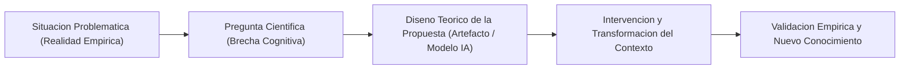
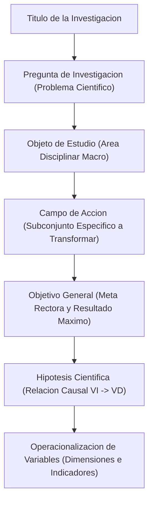
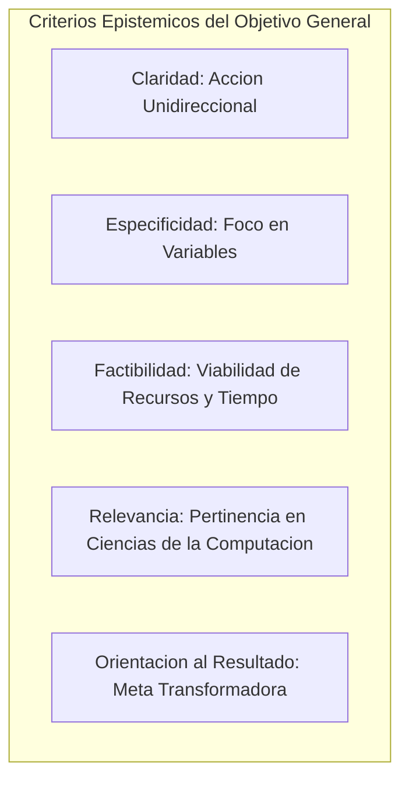
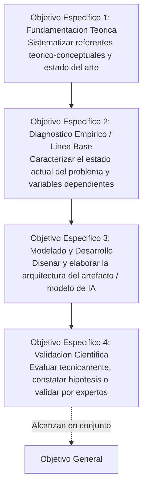
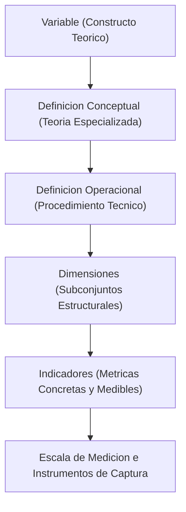

# Clase 5: Diseno Teorico de la Investigacion Propositiva: Formulacion de Objetivos, Hipotesis Cientifica y Operacionalizacion de Variables

> **Objetivo de la sesion:** Comprender y estructurar los componentes del diseno teorico en la investigacion de maestria con caracter propositivo; dominar la formulacion rigurosa del objetivo general y los objetivos especificos articulados a las etapas logicas del metodo cientifico; establecer la formulacion asertiva de la hipotesis de investigacion y su variante cualitativa (idea cientifica a defender); diferenciar epistemologicamente la matriz de congruencia y la matriz de consistencia; e implementar la matriz de operacionalizacion de variables y categorias analiticas para garantizar la trazabilidad lineal desde el problema hasta los instrumentos de recoleccion y medicion de datos.

## 1\. Contexto y Marco Conceptual

### La Naturaleza Propositiva en la Investigacion Tecnologica de Posgrado

En el marco de la investigacion cientifica aplicada en ingenieria y ciencias de la computacion (particularmente en Inteligencia Artificial y Ciencia de Datos), la formulacion del diseno teorico trasciende la mera observacion o descripcion fenomenologica pasiva. Los programas de posgrado demandan una investigacion de caracter propositivo, fundamentada en el paradigma de la Investigacion Basada en Diseno (Design Science Research).

Bajo este paradigma, la investigacion se articula a partir de una relacion dialectica entre dos polos cardinales:

1. **La Realidad Problematica:** Una disfuncion, ineficiencia operativa, cuello de botella computacional o limitacion diagnostica en un entorno empirico concreto (e.g., procesos de salud publica, rendimiento biomecanico, analitica del aprendizaje o prediccion epidemiologica).

1. **La Propuesta Transformadora:** El artefacto tecnologico, arquitectura algoritmica, modelo matematico o sistema inteligente concebido deliberadamente para intervenir, mitigar o transformar dicha realidad.

### El Principio de Invarianza Terminologica y Linealidad Estructural

Uno de los principios metodologicos rectores mas enfatizados es la estricta concordancia y congruencia terminologica a lo largo de todo el encuadre teorico. No se admite el uso de sinonimos, variaciones coloquiales o descripciones aproximadas entre los nucleos axiales del proyecto.

El juego terminologico debe operar como un engranaje rigido y continuo:

- El **Titulo** sintetiza la propuesta y el problema a transformar en un contexto institucional y temporal delimitado.

- La **Pregunta de Investigacion** traduce la esencia del problema delimitado, sin anticipar sesgadamente la solucion tecnologica dentro del propio enunciado interrogativo.

- El **Objeto de Estudio** delimita el area disciplinar amplia de la ciencia de la computacion donde se inscribe el fenomeno (e.g., algoritmos de redes neuronales convolucionales, arquitecturas RAG, analisis computacional de series temporales).

- El **Campo de Accion** circunscribe el subconjunto preciso del objeto de estudio que sera objeto de intervencion y transformacion directa (e.g., el proceso de deteccion y clasificacion automatica de vectores en un entorno institucional especifico).

- El **Objetivo General** concreta la meta rectora orientada al resultado de maximo alcance.

- La **Hipotesis** anticipa asertivamente la relacion causal entre la propuesta (variable independiente) y los efectos esperados (variables dependientes).

### Justificacion Multidimensional del Problema

La justificacion de un proyecto en ciencias de la computacion debe acreditar pertinencia a traves de dimensiones formalmente categorizadas:

1. **Justificacion Teorica:** Explica que vacios epistemologicos o lagunas de conocimiento en la literatura especializada se pretenden clarificar, sistematizar o profundizar con la investigacion.

1. **Justificacion Metodologica:** Detalla como los algoritmos, pipelines de preprocesamiento, metricas de evaluacion o instrumentos de medicion podran ser replicados o utilizados como pauta procedural en investigaciones analogas.

1. **Justificacion Practica:** Demuestra la utilidad instrumental directa de la solucion para resolver la situacion problematica tangible que aqueja a la institucion o poblacion de estudio.

1. **Justificacion Social, Economica o Socioeconomica:** En ingenieria de sistemas e informatica se admite seleccionar una dimension social (e.g., prevencion epidemiologica, soberania tecnologica, inclusion educativa), una dimension economica (e.g., reduccion de costes operativos, eficiencia de computo en dispositivos edge) o una fusion socioeconomica integral segun la orientacion del tema.

---

## 2\. Fundamentos Teoricos y Metodologicos

### El Objetivo General de la Investigacion: Definicion y Criterios Formales

El objetivo general formaliza la meta rectora de mayor jerarquia que se pretende alcanzar. Representa el resultado global final con el cual se compromete el investigador.

**Posiciones teoricas fundacionales:**

- **Kerlinger (2002):** La expresion especifica y concreta de lo que se espera lograr en el estudio sistematico.

- **Hernandez-Sampieri et al. (2014):** El planteamiento concreto de los resultados tangibles que se pretenden obtener, sirviendo como guia orientadora de toda la investigacion.

- **Sabino (2010):** La concrecion del proposito final que delimita el horizonte cognoscitivo del investigador.

- **Bavaresco (2012):** La definicion de un resultado deseado que responde a un problema especifico mediante el metodo cientifico.

**Atributos de calidad epistemica del Objetivo General:**

1. **Claridad:** Redaccion inequivoca y unidireccional. Queda estrictamente vetado plantear objetivos bicefalos o con acciones disyuntas (e.g., "caracterizar y proponer", "determinar y desarrollar").

1. **Especificidad:** Claramente direccionado a las variables identificadas en el titulo y problema, precisando el objeto de transformacion.

1. **Factibilidad y Realismo:** Ajustado a los recursos materiales, computacionales, acceso a fuentes de datos y horizonte temporal disponible para el investigador.

1. **Relevancia Disciplinar:** Aporte sustantivo al campo de las ciencias de la computacion y analitica de datos, evitando abordar topicos triviales o desvinculados de la especialidad.

1. **Brevedad y Orientacion a Resultados:** Formulado de manera concisa, evitando divagaciones metodologicas o justificaciones accesorias en su cuerpo sintactico.

**Estructura canonica de 5 elementos constitutivos:**

1. **Verbo de accion en infinitivo:** Finalizado en ` -ar `, ` -er ` o ` -ir `. En investigaciones propositivas de posgrado se recomienda el verbo ` Proponer ` cuando la solucion integra diseno y validacion integral.

1. **Variables de estudio:** Enunciacion de la variable independiente (la propuesta) y la variable dependiente (el proceso que se transforma).

1. **Unidad de analisis:** Sujetos, especimenes biologicos, sistemas, corredores o instituciones sobre los que recae la medicion.

1. **Ambito espacial:** Delimitacion geografica, territorial o institucional rigurosa.

1. **Ambito temporal:** Periodo o gestion cronologica precisa del estudio.

### Jerarquia de Verbos y el Alcance de la Investigacion Propositiva

En investigaciones aplicadas, el alcance del verbo principal define el nivel de compromiso del maestrante:

- ` Disenar: ` Conlleva la modelacion logica, teorica o computacional del artefacto. Si la investigacion se restringe a este verbo, se corre el riesgo epistemologico de presentar una solucion no comprobada en campo.

- ` Desarrollar: ` Implica la construccion, programacion o despliegue efectivo de la solucion tecnologica.

- ` Proponer: ` Constituye la habilidad de maximo alcance propositivo en posgrado cuando engloba la fundamentacion teorica, el modelado, el desarrollo del prototipo y su subsiguiente validacion tecnica o empirica.

### Objetivos Especificos como Etapas Logicas del Metodo Cientifico

Los objetivos especificos no deben confundirse bajo ninguna circunstancia con actividades operativas o tareas de rutina (tales como "revisar literatura", "aplicar encuestas" o "instalar librerias"). Representan metas intermedias que responden al avance progresivo por las fases del proceso de investigacion de maestria:

1. **Fase Teorica-Referencial:** Sistematizar los fundamentos teorico-conceptuales y antecedentes que sustentan las variables del objeto de estudio y del campo de accion.

1. **Fase Diagnostica-Empirica:** Diagnosticar o caracterizar el estado actual del campo de accion y las variables afectadas en el contexto real de aplicacion.

1. **Fase de Diseno y Modelado:** Disenar o elaborar la arquitectura, algoritmo, modelo de datos o sistema tecnologico que materializa la variable independiente.

1. **Fase de Validacion:** Validar o evaluar la efectividad, desempeno, precision o factibilidad del artefacto propuesto a traves de pruebas tecnicas de laboratorio, evaluacion fuera de muestra, simulaciones o criterio de expertos.

### La Hipotesis de Investigacion y la Idea Cientifica a Defender

La hipotesis es una respuesta tentativa y conjetural formulada ante el problema cientifico, estructurada a partir de la informacion acumulada en el marco referencial. Constituye el puente dialectico que une la teoria con la contrastacion empirica.

**Tipologia formal de hipotesis:**

- **Hipotesis Nula (**$H_0$**):** Postula la ausencia de diferencias o relaciones estadisticamente significativas entre las variables evaluadas ($H_0: \mu_1 = \mu_2$).

- **Hipotesis Alternativa (**$H_1$**):** Afirma la existencia de una relacion o diferencia significativa entre variables ($H_1: \mu_1 \neq \mu_2$).

- **Hipotesis Causal:** Establece una relacion directa de causa y efecto donde la presencia o manipulacion de la variable independiente genera un cambio predecible en la variable dependiente.

- **Hipotesis Correlacional:** Expresa covariacion o asociacion entre variables sin atribuir causalidad estricta.

- **Hipotesis Direccional vs. No Direccional:** La primera anticipa el sentido de la variacion (e.g., mayor exactitud, menor latencia), mientras la segunda constata cambios sin prefijar direccion.

**La Idea Cientifica a Defender (Enfoque Cualitativo):**

En investigaciones netamente cualitativas, el concepto de hipotesis deductiva probabilistica se sustituye por la *Idea Cientifica a Defender*. No busca la generalizacion probabilistica inferencial mediante pruebas de hipotesis parametricas, sino la comprension inductiva y holistica de un fenomeno a traves de categorias analiticas y triangulacion metodologica.

---

## 3\. Implementacion Metodologica y Formulacion Tecnica

### Matriz de Congruencia vs. Matriz de Consistencia

En la metodologia cientifica se emplean matrices auxiliares para verificar la coherencia interna de los proyectos, cumpliendo propositos diferenciados:

| Criterio Comparativo | Matriz de Congruencia | Matriz de Consistencia |
| --- | --- | --- |
| **Enfoque Epistemologico** | Predominantemente cuantitativo o mixto analitico. | Estructural, cualitativo y logico-conceptual. |
| **Proposito Fundamental** | Evaluar el grado de ajuste matematico y correlacional entre las variables empiricas y el modelo teorico propuesto. | Asegurar la trazabilidad y conexion logica interna entre todos los componentes de la investigacion. |
| **Componentes Evaluados** | Variables, dimensiones, indicadores, escalas de medicion y coeficientes estadisticos de ajuste. | Problema, Objetivo General, Objetivos Especificos, Hipotesis, Variables, Metodologia, Resultados y Conclusiones. |
| **Metrica y Analisis** | Modelacion de ecuaciones estructurales, analisis factorial confirmatorio o analisis de sendero (Path Analysis). | Analisis de congruencia sintactica, semantica y metodologica entre capitulos del informe. |
| **Resultado Operativo** | Coeficientes de bondad de ajuste, valores p, indices de fiabilidad ($\alpha$ de Cronbach, $\omega$ de McDonald). | Informe cualitativo de consistencia argumentativa y ausencia de contradicciones epistemicas. |

### Matriz de Operacionalizacion de Variables

La matriz de operacionalizacion constituye el instrumento metodologico que traduce constructos teoricos abstractos en parametros observables, cuantificables y verificables en la realidad empirica.

**Niveles de concrecion metodologica:**

1. **Definicion Conceptual:** Abstraccion formal que delimita el significado teorico atribuido a la variable segun autores de referencia disciplinar.

1. **Definicion Operacional:** Especificacion detallada de los procedimientos, algoritmos, sensores, metricas o pruebas mediante los cuales la variable es capturada y procesada computacionalmente.

1. **Dimensiones:** Subcomponentes o facetas intermedias que integran la variable conceptual.

1. **Indicadores:** Parametros concretos, formulas de calculo o metricas empiricas directas que evidencian el estado o variacion de cada dimension.

1. **Escalas e Instrumentos:** Tipo de escala (nominal, ordinal, intervalo, razon), unidades de medida (porcentaje, milisegundos, F1-score) e instrumentos de recoleccion (datasets, camaras, encuestas, scripts de registro).

### Correspondencia Paradigmatica Cuantitativa vs. Cualitativa

| Nivel Estructural | Paradigma Cuantitativo | Paradigma Cualitativo |
| --- | --- | --- |
| **Nivel Macro** | Variables (Independientes, Dependientes, Intervinientes) | Categorias Analiticas de Estudio |
| **Nivel Intermedio** | Dimensiones | Temas Emergentes o Estructurales |
| **Nivel Micro** | Indicadores / Metricas Cuantitativas | Subtemas / Unidades de Registro / Codigos |
| **Proposito de la Medicion** | Calcular, medir magnitudes, estimar distribuciones y contrastar hipotesis | Profundizar en significados, codificar discursos y comprender fenomenos |
| **Procesamiento** | Software estadistico (R, SPSS, Python scikit-learn) | Software de analisis cualitativo (ATLAS.ti, NVivo) |

---

## 4\. Analisis Critico de Casos y Evaluacion Metodologica

Durante el desarrollo del taller se auditaron y refactorizaron metodologicamente diversos perfiles de tesis, exponiendo decisiones tecnicas y criterios de depuracion:

### Caso 1: Sistema de Vision Artificial para Clasificacion de Flebotomineos (Salud Publica e IA)

- **Contexto:** Deteccion y clasificacion automatica de vectores de leishmaniasis mediante trampas de luz en PROVETSU-UAGRM (gestion 2026).

- **Diagnostico de Congruencia:**

  - *Objeto de Estudio:* Algoritmos de redes neuronales convolucionales aplicados a vision por computador (area disciplinar general).
  
  - *Campo de Accion:* Proceso de deteccion y clasificacion automatica de flebotomineos en especimenes entomologicos (subconjunto a transformar).
  
  - *Variable Independiente:* Sistema de vision artificial basado en redes neuronales convolucionales.
  
  - *Variable Dependiente:* Eficiencia y exactitud del proceso de deteccion y clasificacion taxonomica.

- **Aporte Metodologico:** Se destaco la evolucion desde un modelo unimodal de clasificacion hacia un sistema integral con alertas epidemiologicas y analitica automatizada, fundamentando una justificacion con predominio social ante el impacto de salud publica.

### Caso 2: Procesamiento Autonomo Edge AI para Simetria de Zancada (Biomecanica Computacional)

- **Problema Detectado:** Anti-patron de la *Pregunta Hibrida o Multicefala*. El postulante formulaba: *"Que arquitectura y que grado de optimizacion del modelo mediante cuantizacion hacen viable su ejecucion embebida..."*.

- **Critica Epistemologica:** Se fusionaban dos investigaciones independientes en una sola: una propositiva (seleccion arquitectonica) y una analitico-experimental (evaluacion de cuantizacion).

- **Refactorizacion:** El problema real radicaba en *como contribuir a la prevencion de lesiones biomecanicas mediante la estimacion en tiempo real de la simetria de zancada en contextos de baja conectividad*. El procesamiento embebido y la cuantizacion actuan como la alternativa tecnica o variable independiente para transformar dicha problematica.

### Caso 3: Asistente Tutorial Inteligente con RAG y Metodo Socratico (Tecnologia Educativa)

- **Problema Detectado:** Anti-patron de *Anticipacion de la Solucion*. La formulacion original interrogaba *"como contribuir en el uso de herramientas tecnologicas para fortalecer el pensamiento critico..."*, convirtiendo a la propia tecnologia en el problema y redundando en su justificacion.

- **Refactorizacion:** La brecha cognitiva es el fortalecimiento del pensamiento critico historico en estudiantes. El asistente inteligente con recuperacion aumentada (RAG) y preguntas socraticas es la propuesta de intervencion.

- **Ajuste de Jerarquia Temporal:** En los objetivos especificos, la sistematizacion de la teoria de RAG y pedagogia socratica debe preceder obligatoriamente al diagnostico empirico del pensamiento critico en las aulas, pues los instrumentos de evaluacion dependen de la teoria adoptada.

### Caso 4: Modelos Predictivos para Brotes de Dengue (Epidemiologia Espaciotemporal)

- **Problema Detectado:** Confusion epistemica en la asignacion de variables. El estudiante catalogaba los registros climaticos y epidemiologicos como variable independiente y al machine learning como un mero procedimiento accesorio.

- **Critica Metodologica:** En una investigacion propositiva orientada al diseno, la Variable Independiente es el *Modelo Predictivo Integrador*. Las variables climaticas rezagadas y los registros historicos constituyen *Variables Intervinientes* o atributos estructurantes del modelo. La Variable Dependiente es la *Capacidad de Anticipacion Temporal y Apoyo a la Priorizacion Preventiva*.

---

## 5\. Principios de Diseno, Buenas Practicas y Anti-patrones

### Principios Fundamentales de Diseno Metodologico

1. **Regla de la Linealidad Biunivoca:** Todo concepto o variable enunciado en el titulo debe figurar con la misma morfologia lexica en la pregunta de investigacion, el campo de accion, el objetivo general y la hipotesis.

1. **Prioridad del Marco Teorico sobre el Diagnostico Empirico:** Jamas se debe iniciar el diagnostico de campo o la recoleccion de datos sin haber formulado previamente los fundamentos conceptuales de las variables y sus indicadores medibles.

1. **Acotamiento del Alcance y Contexto:** Delimitar exhaustivamente la unidad de analisis y el ambito espacial (e.g., centro educativo especifico, laboratorio o municipio) para evitar la ingestion inmanejable de datos o la dispersion logistica del investigador.

### Catalogo de Anti-patrones Metodologicos

- **Anti-patron de la Pregunta Multicefala:** Redactar preguntas compuestas que articulan dos problemas disjuntos. Obliga a contrastar dos tesis distintas simultaneamente.

- **Anti-patron de la Solucion Prematura:** Formular el problema científico preguntando como utilizar una herramienta de software particular en vez de interrogar sobre como resolver la necesidad sustantiva del contexto.

- **Anti-patron del Verbo Bivalente:** Declarar verbos dobles en un mismo objetivo ("determinar y proponer", "medir o evaluar"). Impide precisar cual es el verdadero techo de alcance de la etapa.

- **Anti-patron de la Tarea Operativa:** Confundir tareas procedimentales de agenda (revisar papers, transcribir audios) con objetivos especificos que generan conocimiento o productos tangibles.

- **Anti-patron de la Inflacion de Indicadores:** Generar decenas de indicadores innecesarios en la matriz de operacionalizacion que sobrecargan la captura de datos y complejizan el analisis estadistico posterior sin aportar valor analitico.

---

## 6\. Sintesis Conceptual y Profundizacion Academica

### Sintesis de la Sesion

El diseno teorico constituye la arquitectura fundacional de la tesis de maestria. En investigaciones propositivas de ciencias de la computacion e inteligencia artificial, la rigurosidad epistemologica descansa en la linealidad terminologica entre problema, propuesta e hipotesis. La formulacion del objetivo general debe garantizar unidireccionalidad y factibilidad, mientras que los objetivos especificos estructuran la trayectoria secuencial desde la fundamentacion teorica y el diagnostico empirico hasta el modelado tecnologico y la validacion cientifica. La operacionalizacion de variables erige el puente indispensable que transforma constructos abstractos en metricas e indicadores objetivamente computables.

### Literatura de Referencia y Marcos Epistemologicos

- **Bavaresco, A. (2012).** *Proceso metodologico en la investigacion: Como hacer un diseno de investigacion*. Editorial de la Universidad del Zulia.

- **Bunge, M. (2014).** *La ciencia. Su metodo y su filosofia*. Editorial Sudamericana.

- **Hevner, A. R., March, S. T., Park, J., &amp; Ram, S. (2004).** *Design Science in Information Systems Research*. MIS Quarterly, 28(1), 75-105.

- **Hernandez-Sampieri, R., Fernandez-Collado, C., &amp; Baptista-Lucio, P. (2014).** *Metodologia de la investigacion* (6ta ed.). McGraw-Hill Education.

- **Kerlinger, F. N., &amp; Lee, H. B. (2002).** *Investigacion del comportamiento: Metodos de investigacion en ciencias sociales* (4ta ed.). McGraw-Hill.

- **Sabino, C. (2010).** *El proceso de investigacion*. Editorial Panapo.

---
