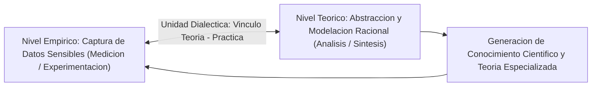
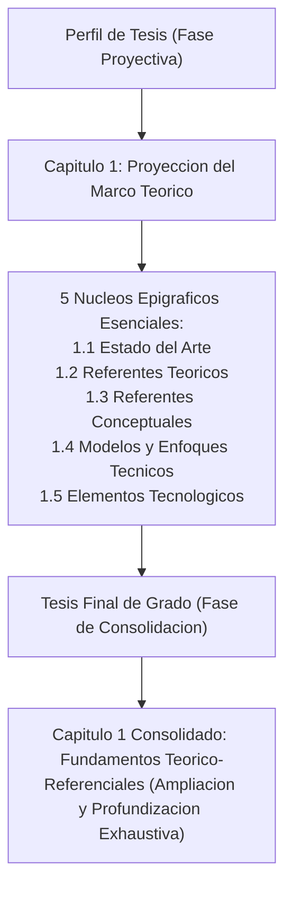
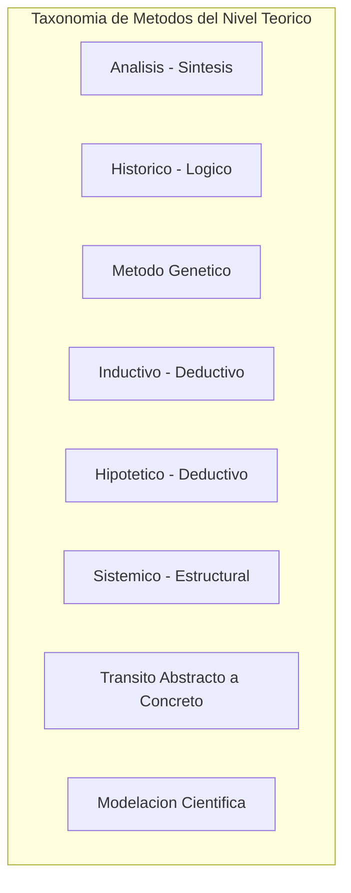
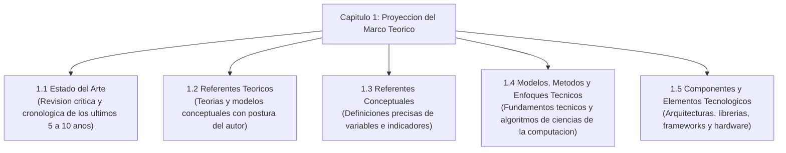
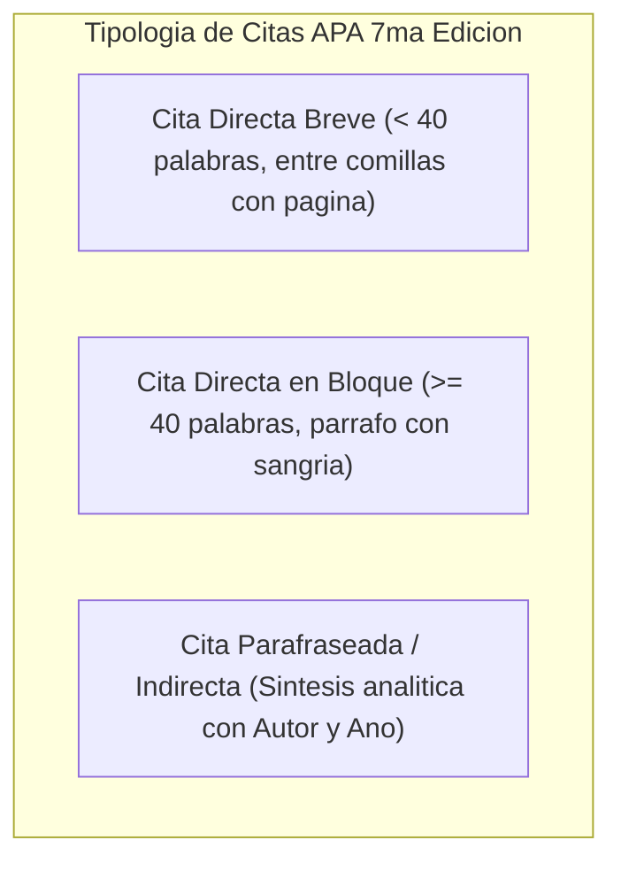

# Clase 6: Metodos del Nivel Teorico, Proyeccion del Marco Teorico en Ciencias de la Computacion y Normas APA 7ma Edicion

> **Objetivo de la sesion:** Dominar los metodos del nivel teorico del conocimiento cientifico y su relacion dialectica con los metodos empiricos en el marco del principio de vinculo entre teoria y practica; estructurar formalmente el capitulo de Proyeccion del Marco Teorico en el perfil de tesis de maestria segun la nueva guia de posgrado (estado del arte, referentes teoricos, referentes conceptuales, modelos/enfoques tecnicos y elementos tecnologicos); analizar el papel regulador del marco normativo y legal en soluciones de datos e IA; y aplicar con rigor academico las directrices de citacion, parafraseo y gestion de referencias bibliograficas segun la norma APA 7ma edicion, garantizando la integridad academica y la prevencion de similitud textual excesiva.

## 1\. Contexto y Marco Conceptual

### La Unidad Dialectica entre Nivel Teorico y Nivel Empirico

En la metodologia de la investigacion cientifica contemporanea, la produccion de nuevo conocimiento descansa en el principio fundamental del vinculo indisoluble entre la teoria y la practica.

No es posible concebir una practica empirica ciega carente de orientacion conceptual, ni una teorizacion abstracta desvinculada de su contrastacion material:

- **Metodos del Nivel Empirico:** Permiten capturar datos directos de la realidad mediante la observacion sensible, la medicion experimental, la telemetria y la recoleccion de datasets en entornos reales.

- **Metodos del Nivel Teorico:** Actuan sobre los datos empiricos brutos para modelarlos, descomponerlos racionalmente, abstraer regularidades esenciales, establecer relaciones causales y sintetizar el nuevo conocimiento cientifico.

### La Seccion de Proyeccion Teorica en el Perfil de Proyecto

En las directrices metodologicas actualizadas de la unidad de posgrado, se ha reformulado la seccion preliminar del marco teorico. Anteriormente, los perfiles incorporaban un simple "indice tentativo de marco teorico", el cual resultaba una proyeccion estatica y superficial.

El perfil de tesis exige ahora el **Capitulo 1: Proyeccion del Marco Teorico**, concebido como un encuadre proyectivo conciso que cimenta los nucleos conceptuales y tecnologicos esenciales que el maestrante profundizara posteriormente en su trabajo final de grado:

- En el perfil de proyecto se realiza un esbozo sistematico, compacto y referenciado de los nucleos teoricos fundamentales.

- En la tesis consolidada de grado se despliega el capitulo completo de fundamentacion teorico-referencial con exhaustividad argumentativa y division epigrafica profunda.

### Rigor Terminologico y Estilo Funcional de la Lengua Cientifica

El informe de investigacion y el perfil de tesis adoptan formalmente el estilo cientifico de la lengua. Este estilo funcional se distingue por:

- Precision denotativa y exactitud en el uso de terminos tecnicos.

- Objetividad impersonal y rigor logico deductivo.

- Ausencia total de retorica emocional, metaforas ambiguas o lenguaje coloquial.

- Postura critica fundamentada: el maestrante debe explicitar su criterio razonado al confrontar teorias, metodos y modelos previos, superando la mera reproduccion pasiva de citas.

---

## 2\. Fundamentos Teoricos y Metodologicos

### Metodos del Nivel Teorico del Conocimiento Cientifico

Los metodos teoricos son los instrumentos cognitivos mediante los cuales el investigador elabora y sintetiza la informacion documental y empirica.

En investigaciones de ingenieria, ciencia de datos e IA, destacan prioritariamente ocho metodos fundamentales:

1. **Analisis - Sintesis:** 

   - *Analisis:* Descomposicion del sistema tecnologico o fenomeno complejo en sus subsistemas, algoritmos o modulos unitarios para su comprension aislada.
   
   - *Sintesis:* Integracion racional de las partes analizadas para reconstruir el sistema en su totalidad interactiva y funcional.

1. **Historico - Logico:** 

   - El analisis *historico* rastrea la cronologia, hitos y desarrollo diacronico de las tecnicas computacionales a lo largo del tiempo.
   
   - El analisis *logico* extrae las leyes esenciales, regularidades estructurales y relaciones causales internas que rigen el estado actual del arte.

1. **Metodo Genetico:** 

   - Enfocado en desentranar la genesis, las causas matrices y los factores condicionantes que originaron un problema tecnico o fenomeno cientifico especifico, siguiendo sus mutaciones evolutivas.

1. **Inductivo - Deductivo:** 

   - *Induccion:* Inferencia de principios y modelos generales a partir del analisis de multiples observaciones empiricas de datos.
   
   - *Deduccion:* Derivacion logica de consecuencias particulares o predicciones operativas a partir de axiomas y teorias formalizadas.

1. **Hipotetico - Deductivo:** 

   - Metodo insustituible en estudios cuantitativos y experimentales. Consiste en formular hipotesis explicativas a partir de premisas teoricas y deducir proposiciones observables que son sometidas a rigurosa contrastacion experimental o estadistica.

1. **Sistemico - Estructural / Enfoque de Sistemas:** 

   - Aborda el objeto de estudio como una totalidad estructurada compuesta por elementos interdependientes organizados jerarquicamente, analizando sus flujos de entrada, procesamiento, salida y adaptacion con el entorno.

1. **Transito de lo Abstracto a lo Concreto Pensado:** 

   - Movimiento epistemico del pensamiento que inicia con determinaciones conceptuales abstractas iniciales y progresa dialecticamente hacia una representacion rica, articulada y concreta de la realidad compleja en el intelecto.

1. **Modelacion Cientifica:** 

   - Construccion deliberada de modelos matematicos, computacionales, diagramas de arquitectura o simulaciones algoritmicas para reproducir y estudiar el comportamiento de sistemas complejos bajo condiciones estrictamente controladas.

### Distincion Epistemologica entre Concepto, Definicion y Marco Conceptual

En la redaccion academica es imprescindible discernir con claridad tres entidades conceptuales comunmente confundidas:

- **Concepto:** Representacion mental abstracta e inteligible de una clase general de objetos, fenomenos, algoritmos o propiedades (e.g., *Aprendizaje Profundo*, *Convergencia*, *Sobreajuste*).

- **Definicion:** Proposicion o enunciado linguistico explicito que delimita de manera univoca y exacta los limites, atributos esenciales y significado operativo de un concepto particular.

- **Marco Conceptual:** Estructura teorico-logica coordinada que interconecta sistemicamente los conceptos y definiciones clave, ofreciendo la base explicativa para interpretar el comportamiento de las variables de investigacion.

---

## 3\. Implementacion Metodologica y Formulacion Tecnica

### Arquitectura de los 5 Epigrafes de la Proyeccion Teorica

El Capitulo 1 del perfil de proyecto debe estructurarse obligatoriamente bajo los siguientes cinco nucleos tematicos:

#### Epigrafe 1.1: Estado del Arte

- **Proposito Cientifico:** Justificar la novedad, necesidad y pertinencia del estudio mediante el analisis critico y cronologico de la evolucion del conocimiento especializado.

- **Fuentes Arbitradas:** Articulos indexados en bases de alto impacto (Scopus, Web of Science, IEEE Xplore, ACM Digital Library), tesis de posgrado y actas de congresos internacionales de los ultimos 5 a 10 anos.

- **Estructura Argumentativa:** Se redacta en prosa fluida y compacta, explicitando la postura critica del investigador sobre:

  1. Revision de estudios previos y soluciones tecnologicas precedentes.
  
  1. Comparativa de modelos, algoritmos o arquitecturas existentes.
  
  1. Identificacion explicita de limitaciones tecnicas, sesgos algoritmicos, vacios metodologicos o brechas de conocimiento donde se posiciona la propuesta.

#### Epigrafe 1.2: Referentes Teoricos

- Sintesis de las principales teorias cientificas, modelos formales o paradigmas que fundamentan el estudio (e.g., Teoria de la Complejidad, Teoria del Aprendizaje Estadistico de Vapnik-Chervonenkis, Teoria de la Informacion de Shannon).

- Expresion obligatoria del criterio y postura del maestrante: que teoria se asume, por que se selecciona y como respalda la hipotesis de investigacion.

#### Epigrafe 1.3: Referentes Conceptuales

- Listado y conceptualizacion rigurosa de cada variable y categoria de estudio desprendida de la matriz de operacionalizacion.

- Integracion de conceptos accesorios esenciales derivados del objeto de estudio y del campo de accion.

#### Epigrafe 1.4: Modelos, Metodos y Enfoques Tecnicos

- Fundamentos matematicos, tecnicos y procedurales propios de la disciplina de computacion e IA:

  - Metodos de optimizacion (Adam, SGD, descenso de gradiente).
  
  - Paradigmas de aprendizaje (supervisado, no supervisado, por refuerzo, auto-supervisado).
  
  - Pipelines de procesamiento tensorial, tecnicas de aumento de datos (*data augmentation*) y estrategias de regularizacion (*dropout*, decaimiento de pesos).

#### Epigrafe 1.5: Componentes y Elementos Tecnologicos

- Desglose de tecnologias, herramientas de software y componentes de hardware:

  - Frameworks y entornos (PyTorch, TensorFlow, CUDA, ONNX, TensorRT).
  
  - Arquitecturas de microcontroladores o computacion en el borde (Raspberry Pi, NVIDIA Jetson).
  
  - Motores de bases de datos vectoriales y librerias de indexacion semantica (FAISS, Milvus, Chroma).

### El Marco Normativo y Legal en Proyectos de Computacion e IA

Todo proyecto tecnologico aplicado que procese informacion, despliegue algoritmos inteligentes o interactue con datos sensibles debe justificar su viabilidad en un marco legal e institucional:

1. **Regulacion y Privacidad de Datos:** Cumplimiento de leyes de proteccion de datos personales, habeas data y normativas institucionales de confidencialidad.

1. **Etica y Gobernanza en Inteligencia Artificial:** Adherencia a directrices internacionales de transparencia, equidad, no discriminacion y explicabilidad en decisiones automatizadas.

1. **Bioseguridad y Salud Publica:** En sistemas de diagnostico entomologico o analisis epidemiologico, observancia de reglamentos de control de vectores y bioetica en manipulacion de patogenos.

1. **Propiedad Intelectual y Soberania Tecnologica:** Cumplimiento de politicas de licenciamiento de software abierto, custodia de codigo fuente y garantias de soberania de datos.

### Gestion de Citas y Referencias segun Norma APA 7ma Edicion

La unidad de posgrado estipula el estandar de la American Psychological Association (APA) 7ma edicion para citas y referencias bibliograficas.

**Taxonomia de Citas en el Texto:**

- **Cita Directa / Textual Breve (&lt; 40 palabras):** Se incorpora dentro del parrafo entre comillas, precisando autor, ano y pagina especifica ` (Kerlinger, 2002, p. 45) `.

- **Cita Directa en Bloque (&gt;= 40 palabras):** Se coloca en parrafo independiente con sangria izquierda de 1.27 cm, sin comillas e interlineado reglamentario.

- **Cita Indirecta / Parafraseada:** Se expresa la idea del autor con las propias palabras del investigador, atribuyendo autor y fecha ` (Vaswani et al., 2017) `. Es la tipologia preferida en posgrado.

**Diferencia Fundamental entre Referencias Bibliograficas y Bibliografia:**

| Criterio | Lista de Referencias Bibliograficas (APA) | Bibliografia General |
| --- | --- | --- |
| **Relacion con el Texto** | Estrictamente biunivoca: cada fuente de la lista debe estar citada en el cuerpo del documento, y toda cita debe figurar en la lista. | Incluye material de lectura de apoyo o contexto que no necesariamente fue citado de forma expresa en el texto. |
| **Exigencia en Tesis** | Mandatoria por normativa de posgrado institucional. | No admitida como sustituto del listado de referencias en perfiles de posgrado. |

**Los 4 Elementos Fundamentales de una Referencia APA:**

1. **Autor:** ¿Quien es el responsable de la obra? (persona individual, colectivo de autores o autor institucional corporativo).

1. **Fecha:** ¿Cuando se publico la obra? (ano entre parentesis, o ` s.f. ` para sin fecha).

1. **Titulo:** ¿Como se titula el documento? (en cursiva segun corresponda a libros o informes, o texto normal para articulos de revista).

1. **Fuente:** ¿Donde se recupera la obra? (nombre de la revista en cursiva, volumen, numero, rango de paginas, DOI o enlace URL persistente).

---

## 4\. Analisis Critico de Casos y Evaluacion Metodologica

Durante las sesiones de adiestramiento practico, se evaluaron observaciones recurrentes en los avances de investigacion:

### Caso A: Dificultades en la Justificacion Metodologica del Diseno

- **Deficiencia Observada:** Omitir la declaracion expresa del caracter aplicado y propositivo de la investigacion, confundiendolo con un diseno puramente descriptivo o documental.

- **Enfoque Correctivo:** En ciencias de la computacion, la investigacion aplicada propositiva debe explicitar que se construye un artefacto para resolver un problema practico, evaluando su impacto mediante experimentacion controlada.

### Caso B: Disenos Mixtos Incompletos y Asimetricos

- **Deficiencia Observada:** Declarar un "enfoque mixto" pero describir unicamente el diseno experimental de la fase cuantitativa, omitiendo el diseno, tecnicas y criterios de rigor de la fase cualitativa (o viceversa).

- **Enfoque Correctivo:** Se debe declarar formalmente la organizacion metodologica mixta:

  - Diseno Concurrente (fases cuantitativa y cualitativa simultaneas con triangulacion de datos).
  
  - Diseno Secuencial (fase exploratoria cualitativa seguida de contrastacion cuantitativa, o fase experimental cuantitativa profundizada cualitativamente).
  
  - Cada fase exige declarar explicitamente su diseno particular, instrumentos de recoleccion y procedimientos de muestreo.

### Caso C: Evaluacion del Tipo de Validacion en la Tesis

- **Discusion en Sala:** En el proyecto de clasificacion de flebotomineos, se observo que el termino generico "validar" resulta ambiguo.

- **Pauta Metodologica:** Se debe precisar el tipo de validacion que se ejecutara:

  - *Validacion Tecnica:* Metricas de exactitud, precision, recall, latencia y consumo energetico en banco de pruebas.
  
  - *Validacion por Criterio de Expertos:* Metodo Delphi o coeficiente de competencia experta ($K$) evaluando pertinencia y ergonomia funcional.
  
  - *Validacion Integral:* Enfoque robusto que triangula la evaluacion tecnica con la valoracion de impacto institucional y juicio experto.

---

## 5\. Principios Epistemologicos, Buenas Practicas y Anti-patrones

### Principios Fundamentales

1. **Integridad Biunivoca de Citas y Referencias:** Auditar minuciosamente que cada llamada en el texto tenga correspondencia exacta en la seccion final de referencias, verificando la ortografia de los apellidos y la coincidencia de fechas.

1. **Jerarquizacion de Fuentes Primarias:** Priorizar articulos cientificos arbitrados provenientes de revistas indexadas (Q1/Q2/Q3 en Scimago/JCR) y actas de congresos internacionales reconocidos.

1. **Filtro de Fiabilidad Temporal:** Emplear literatura de frontera del conocimiento publicada en los ultimos 5 a 10 anos, reservando fuentes clasicas unicamente para la fundamentacion historica o epistemologica de fondo.

### Catalogo de Anti-patrones Comunes

- **Anti-patron de Subcitacion (Riesgo de Plagio):** Parafrasear argumentos tecnicos o teoricos ajenos sin atribuir la fuente bibliografica correspondiente, exponiendo el trabajo a altos indices de similitud en software antiplagio (Turnitin/iThenticate).

- **Anti-patron de Sobrecitacion Innecesaria:** Saturar los parrafos con encadenamientos densos de citas bibliograficas sin emitir ningun juicio reflexivo o analisis critico propio del maestrante.

- **Anti-patron de Fuentes Volatiles No Academicas:** Citar articulos informales de blogs tecnologicos, foros de discusion o tutoriales comerciales que carecen de arbitraje y estabilidad documental permanente.

- **Anti-patron del Indice Tentativo Desconectado:** Sustituir la proyeccion analitica de los 5 nucleos teoricos por un listado pasivo de temas, perdiendo la oportunidad de justificar la pertinencia del estudio frente a las lagunas del conocimiento.

---

## 6\. Sintesis Conceptual y Profundizacion Academica

### Sintesis de la Sesion

El transito desde la concepcion del problema hacia la ejecucion de la investigacion exige el dominio sistematico de los metodos del nivel teorico, los cuales transforman la evidencia empirica en constructos cientificos rigurosos. En la estructura del perfil de tesis, la Proyeccion del Marco Teorico se consolida a traves de 5 nucleos estrategicos: estado del arte cronologico y critico, referentes teoricos sustantivos, referentes conceptuales rigurosamente definidos, modelos tecnicos computacionales y componentes tecnologicos de implementacion. Este andamiaje debe estar respaldado por la consideracion del marco normativo legal e institucional y por una estricta aplicacion del estilo cientifico y las normas APA 7ma edicion, garantizando la solvencia epistemica y la probidad academica del investigador.

### Literatura de Referencia y Marcos Epistemologicos

- **American Psychological Association. (2020).** *Publication Manual of the American Psychological Association* (7th ed.). American Psychological Association.

- **Bunge, M. (2000).** *La investigacion cientifica: Su estrategia y su filosofia*. Siglo XXI Editores.

- **Creswell, J. W., &amp; Creswell, J. D. (2018).** *Research Design: Qualitative, Quantitative, and Mixed Methods Approaches* (5th ed.). SAGE Publications.

- **Hernandez-Sampieri, R., Fernandez-Collado, C., &amp; Baptista-Lucio, P. (2014).** *Metodologia de la investigacion* (6ta ed.). McGraw-Hill Education.

- **Hevner, A. R., March, S. T., Park, J., &amp; Ram, S. (2004).** *Design Science in Information Systems Research*. MIS Quarterly, 28(1), 75-105.

- **Vapnik, V. (1998).** *Statistical Learning Theory*. Wiley-Interscience.
