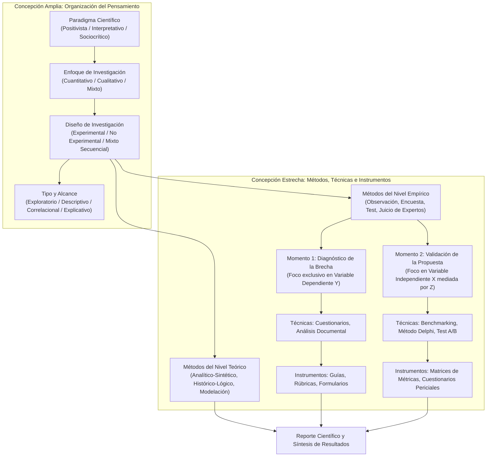
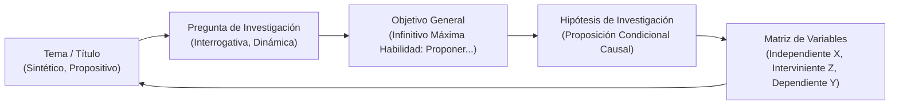

# Clase 7: Métodos del Nivel Teórico y Empírico, Técnicas e Instrumentos y Operacionalización de Variables en la Investigación Propositiva

> **Objetivo Pedagogico y Competencias Analiticas:**
> 
> Fundamentar la articulación dialéctica entre métodos del nivel teórico y métodos del nivel empírico en proyectos de posgrado en Ciencias de la Computación e Inteligencia Artificial. Estructurar la taxonomía de métodos, técnicas e instrumentos de recolección de datos, diferenciando los momentos de diagnóstico contextual y validación experimental del artefacto. Dominar la formulación rigurosa de hipótesis y la operacionalización formal de variables (independiente, interviniente y dependiente), asegurando la coherencia epistemológica del perfil de tesis conforme al protocolo institucional 2026.

## 1\. Contexto y Marco Conceptual: La Integración Teórico-Empírica y la Proyección Metodológica

### 1.1 Naturaleza Dialéctica de los Métodos del Nivel Teórico y Empírico

La investigación científica a nivel de maestría en Ciencias de la Computación e Inteligencia Artificial requiere superar la fragmentación entre la especulación conceptual y el desarrollo instrumental. La relación entre los métodos del nivel teórico y los métodos del nivel empírico es de carácter dialéctico y complementario:

- **El Nivel Empírico:** Constituye el ámbito gnoseológico en el cual el investigador entra en contacto directo y sensible con el fenómeno u objeto de estudio. Permite constatar hechos observables, medir variaciones cuantitativas, registrar comportamientos y recolectar evidencia empírica en un contexto organizacional o productivo determinado.

- **El Nivel Teórico:** Suministra las estructuras racionales y lógicas indispensables para conceptualizar el problema, diseñar la estrategia empírica, interpretar los datos brutos recolectados y elevar los hallazgos empíricos al nivel de regularidades científicas y leyes abstractas.

- **Aplicación de Métodos Teóricos en el Reporte y Modelación:** Los métodos teóricos no concluyen en la fase de fundamentación preliminar; intervienen de forma activa en la modelación de los instrumentos, en la descomposición analítica de los datos obtenidos (método analítico-sintético), en la representación estructural de flujos algorítmicos (método de modelación) y en la reconstrucción del comportamiento histórico de los indicadores (método histórico-lógico).

### 1.2 El Rol Estructural del Capítulo 2 (Proyección Metodológica) en el Perfil de Tesis

Dentro de la estructura formal del perfil de tesis de maestría (protocolo 2026), el documento se organiza de manera compacta en dos secciones capitales:

- **Capítulo 1 - Proyección Teórica:** Comprende la justificación de la relevancia del estudio, el estado del arte cronológico y crítico, y el encuadre de las bases teóricas, conceptuales y tecnológicas del tema.

- **Capítulo 2 - Proyección Metodológica:** Comprende la planificación prospectiva del "cómo hacer" para capturar y procesar los datos en el entorno empírico. Se inicia con la postura del investigador frente al paradigma, perspectiva, enfoque, diseño y tipo de investigación (concepción amplia del método científico), y prosigue con la selección justificada de métodos teóricos y empíricos, técnicas, instrumentos, población y muestra, y plan de análisis de datos (concepción estrecha del método científico).

- **Invarianza Prospectiva:** El perfil de tesis no incluye conclusiones ni recomendaciones, dado que corresponde exclusivamente a la etapa de planificación y delimitación de la investigación.

### 1.3 Los Dos Momentos del Diseño Instrumental en la Investigación Basada en Diseño (DSR)

Una de las precisiones metodológicas más críticas en la investigación propositiva en ingeniería de software y ciencias de la computación radica en la diferenciación temporal del desarrollo instrumental:

1. **Momento 1 - Fase de Diagnóstico de la Situación Problemática:** Se formulan instrumentos destinados a medir exclusivamente la **variable dependiente (**$Y$**)** y sus indicadores de estado en el contexto real. Permiten evidenciar la magnitud de la brecha, las limitaciones operativas y las causas raíz del problema.

1. **Momento 2 - Fase de Evaluación y Validación de la Propuesta Tecnológica:** Tras la concepción y desarrollo del artefacto, se construyen instrumentos dirigidos a la **variable independiente (**$X$**)** mediada por la tecnología o algoritmo ($Z$). Su propósito es contrastar experimentalmente la efectividad, precisión, latencia y viabilidad del artefacto frente al estado basal previo.

- **Exigencia en el Perfil de Proyecto:** En el perfil institucional no se desarrollan los instrumentos de recolección de manera terminada; el investigador debe seleccionar, listar y justificar la pertinencia de cada método, técnica e instrumento, postergando la construcción y calibración psicométrica o computacional de los mismos para la fase de trabajo final de grado.

### 1.4 Variables vs. Categorías Analíticas en la Taxonomía Metodológica

- **Enfoques Cuantitativos y Mixtos:** Operan de manera estricta mediante variables de estudio (independientes, intervinientes, dependientes), las cuales se descomponen formalmente en dimensiones e indicadores empíricamente medibles a través de una matriz de operacionalización.

- **Enfoques Cualitativos:** Operan a través de categorías analíticas de partida, temas y subtemas emergentes, explorados en profundidad sin someterse a esquemas paramétricos rígidos.

- **Regla Metodológica Institucional:** En investigaciones con enfoque mixto no se declaran categorías analíticas previas en la sección general de variables del perfil; se mantiene la disciplina conceptual de la operacionalización de variables y se reservan los núcleos cualitativos específicos para el desglose metodológico capitular del trabajo final de grado.

---

## 2\. Fundamentos Teóricos y Arquitectura: Taxonomía de Métodos, Técnicas e Instrumentos

### 2.1 Taxonomía de Métodos del Nivel Teórico

Los métodos teóricos posibilitan la asimilación conceptual y la estructuración del pensamiento científico:

- **Analítico-Sintético:** Desarticula la realidad investigada en sus componentes esenciales para analizar propiedades, relaciones y dinámicas internas, recomponiendo posteriormente el fenómeno en una síntesis holística explicativa.

- **Histórico-Lógico:** Reconstruye la génesis, evolución histórica y tendencias contemporáneas de los paradigmas algorítmicos, marcos computacionales y problemáticas socio-técnicas.

- **Hipotético-Deductivo:** Formula premisas teóricas contrastables a partir del conocimiento acumulado y deduce derivaciones operacionales observables empíricamente.

- **Modelación:** Representa de manera simplificada e idealizada sistemas complejos, diagramando arquitecturas de software, flujos de datos multidimensionales y relaciones inter-entidades mediante abstracciones formales.

- **Sistémico-Estructural-Funcional:** Concibe el problema y la solución propuesta como un sistema integrado de subsistemas interdependientes, donde cada elemento cumple una función orientada al objetivo global.

### 2.2 Taxonomía y Jerarquía de Métodos Empíricos, Técnicas e Instrumentos

Existe una subordinación lógica estricta entre método, técnica e instrumento:

- **Método Empírico:** Vía epistemológica general para obtener evidencia fáctica de la realidad.

- **Técnica de Investigación:** Procedimiento operativo y específico mediante el cual se instrumentaliza el método para recolectar datos.

- **Instrumento de Recolección:** Dispositivo material, formulario estructurado, plantilla o software utilizado para capturar, cuantificar y registrar la información empírica.

| **Método Empírico (Nivel Práctico)** | **Técnica de Recolección** | **Instrumento Específico de Registro** | **Propósito en la Investigación** |
| --- | --- | --- | --- |
| Observación | Observación directa no participante | Guía de observación, lista de cotejo, rúbrica analítica | Registro directo de eventos operativos en el entorno natural. |
| Observación | Observación participante | Portafolio de evidencias, diario de campo estructurado | Inmersión del investigador en dinámicas de equipos técnicos. |
| Encuesta | Cuestionario estructurado (Escala Likert) | Formulario de cuestionario analítico | Medición cuantitativa de percepciones, competencias y usabilidad. |
| Entrevista | Entrevista semiestructurada en profundidad | Guía de entrevista con preguntas abiertas | Indagación cualitativa sobre criterios de adopción y barreras. |
| Entrevista | Grupo focal (Focus Group) | Protocolo de moderación y guía temática grupal | Exploración colectiva y generación de consenso profesional. |
| Test / Prueba Experimental | Prueba de rendimiento pretest-postest | Batería de pruebas algorítmicas, matriz de métricas | Contraste empírico del desempeño antes y después del artefacto. |
| Análisis de Productos de la Actividad | Auditoría documental e inspección de código | Matriz de análisis documental, checklist de calidad | Evaluación objetiva de especificaciones técnicas, logs y registros. |
| Criterio de Expertos | Método Delphi en rondas iterativas sucesivas | Cuestionario de consulta pericial y matriz de competencia K | Validación metodológica de pertinencia, factibilidad y coherencia. |

### 2.3 Factores Condicionantes de la Selección Empírica

La elección de los métodos y técnicas no es arbitraria ni responde a preferencias personales; está condicionada por:

1. **Naturaleza del Problema y Enfoque:** La causalidad cuantitativa exige experimentación y medición paramétrica, mientras que la comprensión fenomenológica exige abordajes cualitativos dialógicos.

1. **Objetivos Científicos:** Cada objetivo específico del perfil tributa a una fase particular (diagnóstico, fundamentación, desarrollo, validación), demandando métodos adaptados.

1. **Disponibilidad de Recursos e Infraestructura:** Limitaciones de capacidad de cómputo, tiempo de procesamiento, licencias y acceso a repositorios masivos de datos.

1. **Consideraciones Éticas y Gobernanza:** Anonimización de datos sensibles, acuerdos de confidencialidad en instituciones públicas o empresas privadas y salvaguarda de privacidad.

1. **Tradición Disciplinaria:** Los estándares de reproducibilidad de las ciencias de la computación (benchmarks abiertos, matrices de confusión, validación cruzada).

### 2.4 Modelado Visual de la Articulación Metodológica e Instrumental

---

## 3\. Implementación Metodológica: Formulación de Hipótesis y Operacionalización de Variables

### 3.1 Modelo Canónico de la Hipótesis en Investigación Cuantitativa y Mixta

En las investigaciones con enfoque cuantitativo o mixto, la hipótesis representa la proposición tentativa que anticipa una relación funcional, correlacional o causal entre las variables del estudio.

La formulación canónica adopta una estructura condicional estricta:

$$
Si \\; [Propuesta \\; (X) \\; mediada \\; por \\; Algoritmo/Tecnología \\; (Z)], \\; entonces \\; se \\; [Optimizará/Transformará \\; la \\; Variable \\; Dependiente \\; (Y)] \\; en \\; [Contexto \\; Espacial \\; S] \\; durante \\; [Horizonte \\; Temporal \\; T]
$$

Reglas de congruencia y simetría entre variantes de hipótesis:

- **Hipótesis de Investigación (**$H_1$**):** Proposición afirmativa directa que postula el impacto significativo del artefacto tecnológico en la transformación del problema.

- **Hipótesis Nula (**$H_0$**):** Negación formal simétrica de la hipótesis de investigación. Establece que la propuesta tecnológica no producirá mejoras o cambios significativos en la variable dependiente.

- **Hipótesis Alternativa (**$H_a$**):** Postula un desenlace o mecanismo funcional alternativo respecto a la transformación observada (por ejemplo, optimización del aprovechamiento analítico de registros en lugar de automatización preventiva pura).

### 3.2 Invarianza y Coherencia Biunívoca de Constructos

El perfil de tesis exige una alineación léxica y conceptual rigurosa entre sus componentes vertebrales:

- **Principio de Invarianza Sintáctica:** Si en el título se establece *optimizar la eficiencia*, dicho constructo debe figurar de manera idéntica en la pregunta de investigación, en el objetivo general y en la hipótesis. Cualquier desliz semántico (introducir *medición*, *seguimiento* o *efectividad* sin correspondencia previa) genera inconsistencia epistemológica.

- **Límite de la Hipótesis:** La hipótesis debe formularse de manera directa, concisa y verificable. Constituye un anti-patrón incorporar justificaciones explicativas dentro del cuerpo de la hipótesis (ej. "debido a que permitirá..."). Dichas argumentaciones pertenecen a párrafos analíticos complementarios o al marco teórico.

### 3.3 Desglose Dimensional de las Variables

1. **Variable Independiente (**$X$**):** El artefacto tecnológico propuesto concebido para intervenir en la realidad problemática (ej. Sistema de monitoreo, Modelo predictivo de demanda, Arquitectura multiagente).

1. **Variable Interviniente (**$Z$**):** La disciplina, paradigma computacional o técnica algorítmica mediadora que dota de capacidad analítica al artefacto (ej. Analítica avanzada y machine learning, Redes neuronales convolucionales, RAG, Grafos multirrelacionales).

1. **Variable Dependiente (**$Y$**):** La variable de transformación; el proceso, fenómeno socio-técnico o métrica que se modifica o mejora como consecuencia de la intervención.

1. **Criterios de Calidad Socio-Técnica:** En ciencias de la computación es imperativo distinguir con precisión tres conceptos frecuentemente confundidos:

   - **Eficiencia:** Razón entre los resultados logrados y los recursos computacionales, temporales o económicos invertidos (latencia, consumo de memoria, coste operacional, reducción de mermas).
   
   - **Eficacia:** Grado en que se alcanza el objetivo previsto de manera puntual, sin considerar el coste de los recursos (precisión de clasificación, recall, tasa de detección).
   
   - **Efectividad:** Impacto transformador integral que combina eficiencia y eficacia en el contexto operacional real (fortalecimiento de la gestión, resiliencia institucional).

### 3.4 Estructura del Capítulo 1 (Proyección del Marco Teórico)

Conforme a las directrices vigentes, el Capítulo 1 del perfil se redacta en forma de párrafos compactos continuos (aproximadamente una página por sección, totalizando unas 5 páginas):

- **Párrafo Introductorio:** Presentación breve de la temática y alcance del capítulo.

- **1.1 Estado del Arte:** Análisis cronológico y crítico de aportes, modelos y tecnologías precedentes a nivel internacional, regional y nacional, explicitando vacíos epistemológicos no resueltos.

- **1.2 Referentes Teóricos:** Teorías, paradigmas y modelos conceptuales base que sustentan la investigación.

- **1.3 Referentes Conceptuales:** Definiciones formales rigurosas de cada variable del estudio citando autores arbitrados e indexados.

- **1.4 Modelos, Métodos y Enfoques Técnicos:** Fundamentos algorítmicos, matemáticos y metodológicos específicos del área computacional asumida.

- **1.5 Componentes y Elementos Tecnológicos:** Estándares, frameworks, protocolos, normativas de privacidad y arquitecturas tecnológicas reguladoras del contexto.

---

## 4\. Análisis Crítico de Casos y Auditoría Práctica de Propuestas

### 4.1 Deconstrucción de Propuestas Metodológicas Presentadas en Sesión

Durante la sesión se sometieron a auditoría metodológica diversos proyectos de tesis presentados por los maestrandos:

#### Caso 1: Sistema de monitoreo para medición de brecha digital (César Augusto)

- *Título Inicial:* Diseño del sistema de monitoreo basado en analítica avanzada y modelos predictivos para la medición de brecha digital en unidades educativas periurbanas del municipio de Sucre.

- *Auditoría Metodológica:* El maestrando desglosó en la hipótesis y variables una entidad compuesta denominada *medición y seguimiento multidimensional*, mientras que en el título y objetivo general únicamente figuraba *medición*. Se dictaminó unificar la denominación en todos los apartados para evitar divergencias terminológicas. Asimismo, se corrigió la inclusión prematura de "categorías analíticas previas", precisando que en enfoques mixtos a nivel de perfil debe mantenerse la disciplina de operacionalización de variables cuantitativas, reservando los constructos cualitativos para el trabajo de campo.

#### Caso 2: Modelo predictivo de demanda en retail (Marcelo Jiménez)

- *Título Inicial:* Modelo predictivo de demanda basado en aprendizaje automático para optimizar el reabastecimiento en una cadena de supermercados en Santa Cruz, 2025.

- *Auditoría Metodológica:* Se detectó el anti-patrón de formulación en la hipótesis al iniciar con "La implementación de...". El docente aclaró que el alcance no es la mera implementación operativa de un algoritmo de terceros, sino la concepción, modelado y validación de un modelo predictivo propio. Además, se observó que la pregunta planteaba una correlación ("cómo la medición de precisión se relaciona con la eficiencia..."), excediendo la síntesis del título; se corrigió hacia la optimización de la eficiencia del reabastecimiento como núcleo rector de la variable dependiente.

#### Caso 3: Modelo predictivo con grafos multirrelacionales en educación (Cristian Calizaya)

- *Título Propuesto:* Modelo predictivo basado en grafos multirrelacionales para priorizar territorialmente unidades educativas según su riesgo agregado de resultados escolares adversos en el subsistema de educación regular boliviano, 2026.

- *Auditoría Metodológica:* Se realizó un análisis lingüístico sobre la preposición adecuada ("basado en" vs. "con"). "Basado en" denota que el artefacto se cimienta y fundamenta en el paradigma de grafos, mientras que "con" alude a su mera composición arquitectónica. La matriz de operacionalización evidenció excelente madurez técnica, incorporando dimensiones rigurosas (representación multirrelacional, procesamiento temporal, generación predictiva) y métricas avanzadas (AUC-PR, NDCG@K, Macro F1 y Brier Score).

#### Caso 4: Modelo no supervisado para detección de anomalías SIEM (Ignacio Arispe)

- *Propuesta Inicial:* Modelo de ciencia de datos basado en aprendizaje automático no supervisado para detección temprana de anomalías de ciberseguridad en registros SIEM de Tecnova SRL.

- *Auditoría Metodológica:* Se observó una hipótesis hipertrófica de más de 15 líneas que incluía descripciones operativas ("debido a que permitirá procesar grandes volúmenes..."). Se instruyó recortar la hipótesis a la formulación condicional canónica y redactar las hipótesis nula y alternativa con simetría sintáctica perfecta. Asimismo, se eliminaron argumentaciones redundantes en la definición conceptual de variables para ceñirse a definiciones formales sustentadas en literatura.

#### Caso 5: Debate Epistemológico sobre el Diseño Instrumental (Paul Grimaldo)

- *Intervención:* Consulta analítica respecto a por qué no diseñar instrumentos exclusivamente para la variable dependiente en la fase diagnóstica, evitando diseñar prematuramente instrumentos para la propuesta.

- *Resolución Doctrinal:* En la investigación propositiva existen dos momentos instrumentales netamente diferenciados. En el diagnóstico se diseñan instrumentos para evaluar el estado del problema en la variable dependiente. En la fase de validación de la propuesta (en el trabajo final de grado) se diseñan instrumentos específicos dirigidos a evaluar la efectividad y factibilidad de la variable independiente y mediadora. En el perfil de proyecto, no se desarrollan instrumentos completos; únicamente se justifican las decisiones metodológicas de selección.

### 4.2 Tabla de Auditoría Metodológica Comparativa

| **Proyecto Auditado** | **Variable Independiente (X) y Mediadora (Z)** | **Variable Dependiente (Y)** | **Desajuste Metodológico Detectado** | **Dictamen y Corrección Epistemológica** |
| --- | --- | --- | --- | --- |
| Monitoreo Brecha Digital | Sistema de monitoreo con analítica avanzada y ML predictivo | Medición y seguimiento multidimensional de brecha digital | Divergencia entre título ('medición') e hipótesis ('medición y seguimiento'). Inclusión de categorías previas. | Unificación terminológica estricta en título, objetivo e hipótesis. Eliminación de categorías analíticas en perfil. |
| Predictivo Demanda Retail | Modelo predictivo con aprendizaje automático | Eficiencia del reabastecimiento de inventario | Hipótesis iniciada con 'Implementación'. Pregunta orientada a correlación compleja no alineada. | Supresión del sesgo de implementación operativa. Definición explícita del criterio de calidad 'eficiencia'. |
| Grafos Multirrelacionales | Modelo predictivo basado en grafos multirrelacionales | Priorización territorial de riesgo escolar adverso | Duda sobre preposiciones ('basado en' vs. 'con') para respetar límite de 25 palabras. | Validación de 'basado en' por connotar fundamentación epistemológica. Matriz de operacionalización aprobada. |
| Anomalías SIEM Ciberseguridad | Modelo de ciencia de datos con ML no supervisado | Detección temprana de incidentes de ciberseguridad | Hipótesis hipertrófica con justificación empírica. Definiciones conceptuales contaminadas con juicio operativo. | Segmentación de la hipótesis a estructura canónica condicional. Delimitación de hipótesis nula y alternativa simétricas. |

---

## 5\. Principios de Diseño Metodológico, Buenas Prácticas y Anti-patrones

### 5.1 Reglas de Oro en la Selección Instrumental y Operacionalización

1. **Invarianza y Cadena Léxica Estricta:** Todo término técnico que defina una variable debe escribirse exactamente igual en el título, pregunta problema, objetivo general, hipótesis y matriz de operacionalización.

1. **Delimitación de los Dos Momentos del Diseño Instrumental:** Reconocer que los instrumentos del diagnóstico miden la variable dependiente $Y$, mientras que los instrumentos de validación experimental evalúan la propuesta $X$ mediada por $Z$.

1. **Definiciones Conceptuales Basadas en Literatura Arbitrada:** Cada variable debe definirse formalmente mediante autores reconocidos de bases indexadas (Scopus, IEEE, ACM) para dotar de objetividad epistemológica a la investigación.

1. **Distinción Doctrinal de Criterios de Calidad:** Especificar con claridad si el estudio persigue eficiencia (recursos/tiempo), eficacia (logro del resultado técnico) o efectividad (impacto transformador global).

### 5.2 Catálogo de Anti-patrones Metodológicos

- **Anti-patrón de la Hipótesis Hipertrófica:** Redactar la hipótesis añadiendo argumentos causales secundarios o párrafos de justificación ("debido a que permitirá..."). La hipótesis debe ser una afirmación condicional directa y compacta.

- **Anti-patrón del Título-Objetivo Asimétrico:** Emplear variables en el objetivo general que no fueron declaradas en el título o añadir adjetivos que alteran el objeto de estudio.

- **Anti-patrón de la Falsa Identidad Terminológica:** Tratar como sinónimos conceptos técnicos distintos (ej. *medición* vs. *medición y seguimiento multidimensional*; *eficiencia* vs. *efectividad*).

- **Anti-patrón del Desarrollo Prematuro de Instrumentos:** Incluir cuestionarios o baterías de pruebas completas en el perfil de tesis. En el perfil solo se proyecta y fundamenta la selección; la construcción pertenece al informe final de grado.

- **Anti-patrón de la Confusión Método-Técnica:** Denominar "método" a lo que constituye una "técnica" (ej. llamar método al cuestionario estructurado o a la escala Likert, siendo el método la encuesta).

---

## 6\. Síntesis Conceptual y Profundización Académica

### 6.1 El Perfil como Contrato de Rigor Metodológico

El Capítulo 2 (Proyección Metodológica) actúa como el contrato de validez interna y externa de la investigación de posgrado. En la investigación basada en diseño, la formulación de hipótesis no responde a una verificación pasiva de la naturaleza, sino a la evaluación empírica de artefactos inteligentes concebidos para transformar realidades complejas.

### 6.2 Literatura Fundamental y Epistemología Avanzada

Para consolidar la formulación metodológica e instrumental se recomienda la revisión de:

- Hevner, A. R., March, S. T., Park, J., &amp; Ram, S. *Design Science in Information Systems Research*. MIS Quarterly, 28(1), 75-105.

- Bunge, M. *La ciencia, su método y su filosofía*. Buenos Aires: Siglo Veinte.

- Hernández-Sampieri, R., &amp; Mendoza, C. *Metodología de la investigación: Las rutas cuantitativa, cualitativa y mixta*. Ciudad de México: McGraw-Hill.

- Creswell, J. W., &amp; Creswell, J. D. *Research Design: Qualitative, Quantitative, and Mixed Methods Approaches*. SAGE Publications.

---
