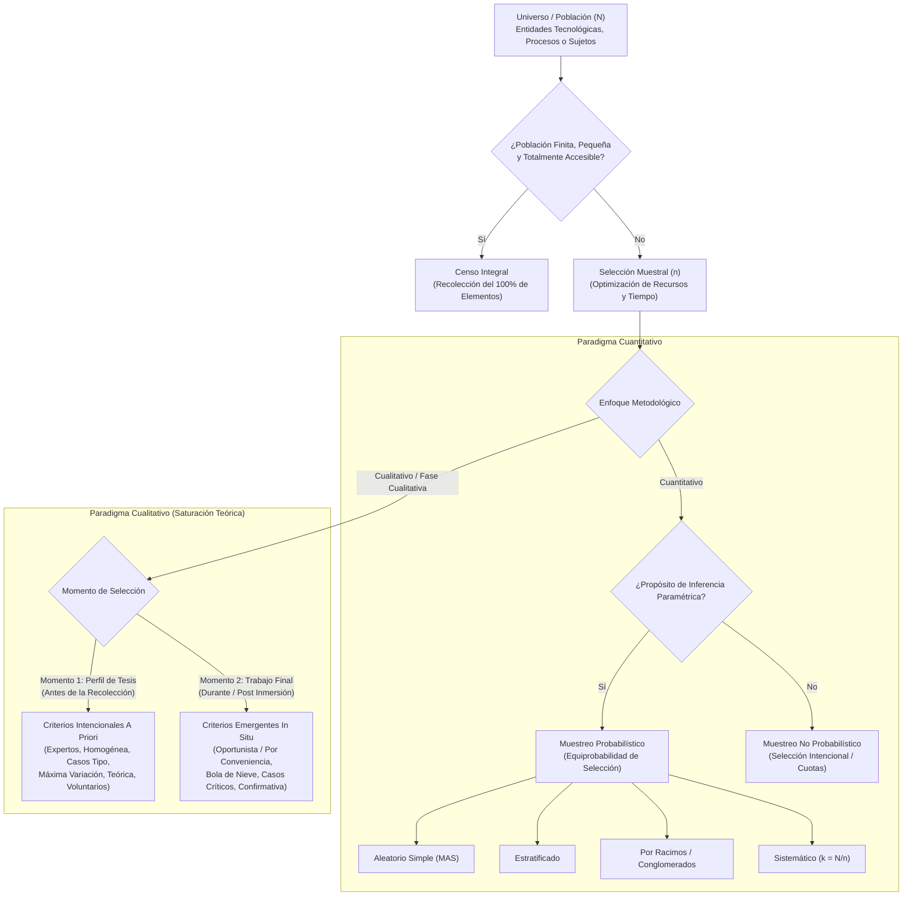
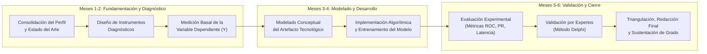

# Clase 8: Unidades de Observación, Estrategias de Muestreo Cuantitativo y Cualitativo, Plan de Análisis de Datos y Planificación Temporal

> **Objetivo Pedagogico y Competencias Analiticas:**
> 
> Comprender y delimitar las unidades de observación en investigaciones avanzadas de Ciencia de Datos e Inteligencia Artificial, distinguiendo formalmente entre población, censo y muestra. Dominar los criterios probabilísticos y no probabilísticos en el paradigma cuantitativo, así como la lógica bifásica del muestreo cualitativo orientada a la saturación teórica. Estructurar el procedimiento de análisis de datos para enfoques cuantitativos, cualitativos y mixtos secuenciales, y formalizar el cronograma de investigación mediante diagramas de flujo y matrices temporales conforme a los estándares de rigor de posgrado institucional 2026.

## 1\. Contexto y Marco Conceptual: Unidades de Observación, Población y Censo

### 1.1 Ontología de las Unidades de Observación en Ciencias de la Computación

En el ámbito de las ciencias de la computación, la ingeniería de software y la inteligencia artificial, las unidades de observación o análisis trascienden la noción tradicional restringida a personas:

- **Naturaleza Multidimensional de las Unidades de Observación:** Constituyen aquellas entidades materiales, inmateriales, individuales, institucionales o tecnológicas donde el investigador percibe, mide y recopila datos empíricos de manera directa.

- **Tipología de Entidades Tecnológicas:** Comprenden consultas jurisprudenciales, registros y logs de seguridad informática (SIEM), transacciones financieras, eventos de red, imágenes radiológicas, historias clínicas electrónicas, clusters de cómputo, líneas de manufactura industrial o instancias algorítmicas bajo experimentación.

- **Rol en el Proceso Investigativo:** La unidad de observación representa el anclaje concreto donde se operacionalizan los indicadores de las variables dependientes o intervinientes del estudio.

### 1.2 Universo / Población vs. Muestra vs. Censo

La delimitación cuantitativa y cualitativa de las entidades bajo estudio obedece a criterios de rigor y economía científica:

- **Universo o Población (**$N$**):** Conjunto integral y completo de elementos, individuos o artefactos que comparten un conjunto homogéneo de características o cualidades delimitadas en contenido, espacio geográfico y tiempo histórico.

- **Muestra (**$n$**):** Subconjunto estadísticamente representativo o intencionalmente seleccionado de la población, cuyo análisis permite inferir o generalizar resultados válidos hacia el universo en su totalidad. Se justifica por tres pilares:

  - *Eficiencia Operativa:* Reduce costos de procesamiento, recursos de cómputo y esfuerzo de recolección en poblaciones geográficamente dispersas o masivas.
  
  - *Generalización e Inferencia:* Permite derivar conclusiones amplias sustentadas en márgenes de error y niveles de confianza estadística controlados.
  
  - *Viabilidad Temporal:* Posibilita la ejecución de la investigación en horizontes cronológicos factibles sin comprometer la validez interna del estudio.

- **Censo:** Recopilación exhaustiva de información de cada uno de los elementos de la población sin recurrir a muestreo. Es aplicable y mandatorio cuando la población es finita, pequeña, accesible y presenta una heterogeneidad interna que desaconseja el fraccionamiento muestral.

### 1.3 El Imperativo de la Delimitación Poblacional

En el perfil de proyecto de tesis de posgrado está estrictamente prohibido declarar una población como "indeterminada" o "infinita". Aunque en la etapa preliminar de planificación no se disponga del conteo exacto de registros o sujetos, el investigador está obligado a establecer una estimación cuantitativa fundamentada (marco muestral preliminar), acotando los criterios temporales, institucionales y tecnológicos que definen el límite del universo analítico.

---

## 2\. Fundamentos Teóricos y Arquitectura: Taxonomía Integral del Muestreo Cuantitativo y Cualitativo

### 2.1 Estrategias de Muestreo en el Paradigma Cuantitativo

En la investigación cuantitativa, la selección muestral se clasifica de acuerdo con la aplicación del cálculo probabilístico:

#### Muestras Probabilísticas (Mandatorias en Diseños Experimentales e Inferenciales)

Garantizan que todos los elementos de la población tengan la misma probabilidad conocida y no nula de ser seleccionados, minimizando el error de muestreo y permitiendo la generalización paramétrica:

- **Muestreo Aleatorio Simple (MAS):** Selección equiprobable individual mediante generadores de números pseudoaleatorios o tablas de aleatoriedad.

- **Muestreo Estratificado:** División de la población en subgrupos homogéneos y disjuntos (estratos) definidos por variables críticas (ej. categorías de empresas, tipologías de unidades educativas, tipos de transacciones). Se extrae una muestra proporcional o con afijación óptima en cada estrato para garantizar su representatividad.

- **Muestreo por Racimos / Conglomerados (Cluster Sampling):** La población se divide en unidades complejas preexistentes (conglomerados como distritos escolares, plantas industriales o sedes bancarias). Se seleccionan aleatoriamente conglomerados completos y se censan o submuestrean sus elementos internos.

- **Muestreo Sistemático:** Los elementos se extraen a intervalos regulares $k = N/n$ a partir de un listado ordenado, iniciando en un punto de arranque aleatorio dentro del primer intervalo.

#### Muestras No Probabilísticas en Enfoques Cuantitativos

Procedimientos donde la elección de casos no responde al azar estadístico sino a criterios teóricos, intencionales o prácticos fijados por el investigador. Se utilizan en estudios descriptivos, no experimentales o fases exploratorias donde no se busca la generalización estadística paramétrica inmediata, sino la caracterización controlada de casos específicos.

### 2.2 Estrategias de Muestreo en el Paradigma Cualitativo y Lógica de Saturación

En la investigación cualitativa (y en las fases cualitativas de diseños mixtos), el muestreo persigue la profundidad hermenéutica y la comprensión holística del significado, no la representatividad matemática:

- **Principio de Saturación Teórica / Categorial:** El tamaño muestral cualitativo no se fija de manera dogmática a priori; la recolección concluye cuando la inclusión de nuevas unidades o participantes ya no aporta propiedades o relaciones novedosas a las categorías analizadas.

- **Estructura Bifásica de Criterios Cualitativos (Miles, Huberman &amp; Saldaña / Hernández-Sampieri):**

| **Momento Investigativo** | **Intención Epistemológica** | **Tipología de Muestra Cualitativa** | **Ámbito de Aplicación en Posgrado** |
| --- | --- | --- | --- |
| Momento 1: Antes de la recolección de datos | Explorar casos atípicos o problemáticos | Muestra de casos extremos o desviantes | Perfil de Tesis y Planificación Inicial |
| Momento 1: Antes de la recolección de datos | Desarrollar perspectivas diversas del fenómeno | Muestra de máxima variación / variada | Perfil de Tesis y Planificación Inicial |
| Momento 1: Antes de la recolección de datos | Alcanzar una composición predeterminada | Muestra por cuotas | Perfil de Tesis y Planificación Inicial |
| Momento 1: Antes de la recolección de datos | Generar teoría o clarificar conceptos clave | Muestra teórica o conceptual | Perfil de Tesis y Planificación Inicial |
| Momento 1: Antes de la recolección de datos | Describir la norma a audiencias no familiarizadas | Muestra de casos tipo | Perfil de Tesis y Planificación Inicial |
| Momento 1: Antes de la recolección de datos | Describir un subgrupo con profundidad exhaustiva | Muestra homogénea | Perfil de Tesis y Planificación Inicial |
| Momento 1: Antes de la recolección de datos | Recoger criterios de especialistas de alto nivel | Muestra de expertos | Perfil de Tesis y Planificación Inicial |
| Momento 1: Antes de la recolección de datos | Dificultad intrínseca para reclutar casos afines | Muestra de voluntarios calificados | Perfil de Tesis y Planificación Inicial |
| Momento 2: Después de la primera inmersión | Aprovechar coyunturas emergentes de los datos | Muestra oportunista o por conveniencia | Informe Final de Tesis (Trabajo de Campo) |
| Momento 2: Después de la primera inmersión | Localizar casos indispensables descubiertos | Muestra de casos importantes o críticos | Informe Final de Tesis (Trabajo de Campo) |
| Momento 2: Después de la primera inmersión | Rastrear redes de contactos a partir de informantes | Muestra en cadena (bola de nieve) | Informe Final de Tesis (Trabajo de Campo) |
| Momento 2: Después de la primera inmersión | Corroborar o desaprobar hallazgos preliminares | Muestra confirmativa | Informe Final de Tesis (Trabajo de Campo) |

- **Regla Doctrinal del Muestreo por Conveniencia:** Es un error metodológico declarar en el perfil de tesis una "muestra por conveniencia". La conveniencia solo emerge durante o después del trabajo de campo como decisión reactiva u oportunista. En el perfil de proyecto, la muestra cualitativa debe justificarse formalmente a través de uno de los criterios del primer momento (expertos, casos tipo, homogénea, teórica o voluntarios calificados).

### 2.3 Modelado Visual de la Taxonomía Bifásica de Muestreo

---

## 3\. Implementación Metodológica: Plan de Análisis de Datos y Planificación Temporal

### 3.1 Procedimiento de Análisis de Datos según Enfoque Metodológico

El plan de análisis de datos proyecta la secuencia operativa formal para procesar la información obtenida a través de los instrumentos:

#### 1\. Procedimiento en Investigaciones Cuantitativas

- **Ingesta y Validación Primaria:** Control de integridad, depuración de registros nulos, imputación estadística o descarte controlado de anomalías.

- **Análisis Estadístico Descriptivo:** Distribuciones de frecuencias, medidas de tendencia central (media, mediana) y de dispersión (desviación estándar, rango intercuartílico).

- **Análisis Inferencial y Contraste de Hipótesis:** Aplicación de pruebas paramétricas (t de Student, ANOVA) o no paramétricas (Wilcoxon, Mann-Whitney, Chi-cuadrado) en función del test de normalidad (Shapiro-Wilk o Kolmogorov-Smirnov).

- **Evaluación Experimental de Artefactos Computacionales:** En modelos de Machine Learning y visión por computadora, cálculo riguroso de matrices de confusión, curvas ROC ($AUC-ROC$), curvas Precisión-Recall ($AUC-PR$), Macro $F_1$-Score, métricas de ranking normalizado ($NDCG@K$) y métricas de latencia computacional.

- **Representación y Discusión:** Tabulación analítica y visualización gráfica para la discusión contrastada con la literatura del estado del arte.

#### 2\. Procedimiento en Investigaciones Cualitativas

- **Recolección, Análisis y Registro Concurrente:** Enfoque espiral donde el análisis se ejecuta simultáneamente con la captura de información, permitiendo ajustar los instrumentos en tiempo real.

- **Codificación Abierta y Axial:** Fragmentación del corpus textual o discursivo en unidades semánticas mínimas (códigos de primer nivel) y posterior articulación en categorías y subcategorías teóricas.

- **Mapeo Relacional y Triangulación:** Diagramación de mapas conceptuales y contraste de datos entre distintas fuentes (docentes, estudiantes, expertos) para corroborar consistencia analítica.

- **Interpretación Hermenéutica:** Construcción de meta-categorías y redacción del reporte narrativo denso que responde a las preguntas cualitativas del estudio.

#### 3\. Procedimiento en Investigaciones con Enfoque Mixto

- **Diseño Secuencial Explicativo (DEXPLIS):** Recolección y análisis riguroso de la fase cuantitativa basal $\rightarrow$ Selección intencional de casos críticos basada en resultados cuantitativos $\rightarrow$ Ejecución de la fase cualitativa en profundidad $\rightarrow$ Punto de integración metodológica: triangulación concurrente para elaborar **meta-inferencias integradas**.

- **Diseño Secuencial Exploratorio (DEXPLOS):** Fase cualitativa inicial de inmersión y descubrimiento $\rightarrow$ Formalización de constructos o diseño de artefacto $\rightarrow$ Fase cuantitativa experimental de validación empírica.

### 3.2 Planificación Temporal: Cronograma y Ruta Crítica Metodológica

La planificación temporal del proyecto se formaliza mediante una matriz operativa y un flujo metodológico secuencial que desglosa las actividades del ciclo investigativo alineadas biunívocamente con los objetivos específicos:

- **Horizonte Temporal Estándar:** Proyección de 6 meses de desarrollo intensivo tras la culminación del ciclo académico curricular, con posibilidad de ampliación institucional hasta 2 años para la defensa final de grado.

| **Fase del Cronograma** | **Mes 1** | **Mes 2** | **Mes 3** | **Mes 4** | **Mes 5** | **Mes 6** | **Actividades Clave y Entregables Metodológicos** |
| --- | --- | --- | --- | --- | --- | --- | --- |
| Fase 1: Fundamentación | X | X | - | - | - | - | Consolidación del perfil, estado del arte y marco teórico referencial. |
| Fase 2: Diagnóstico Basal | - | X | X | - | - | - | Diseño de instrumentos diagnósticos y medición de la variable dependiente Y. |
| Fase 3: Desarrollo Algorítmico | - | - | X | X | - | - | Modelado conceptual, codificación del artefacto (X) y entrenamiento técnico. |
| Fase 4: Validación Experimental | - | - | - | X | X | - | Benchmarking cuantitativo (métricas ROC/PR) y juicio de expertos (Delphi). |
| Fase 5: Cierre y Defensa | - | - | - | - | X | X | Triangulación de datos, redacción del informe final de tesis y pre-defensa. |

### 3.3 Directrices de Redacción y Rigor Editorial en el Perfil Institucional

- **Redacción en Párrafos Compactos Continuos:** En la redacción del perfil oficial no se admiten listas mecánicas con pseudotítulos repetitivos (ej. "Paso 1: ...", "Instrumento: ...", "Justificación: ..."). La prosa debe fluir en párrafos densos, estructurados y continuos.

- **Objetividad Epistemológica mediante Citas Arbitradas:** La experiencia empírica del investigador debe articularse con la literatura científica. Toda definición conceptual de variables o componentes tecnológicos debe sustentarse con referencias a autores reconocidos de fuentes indexadas (JCR, Scopus, IEEE), garantizando que los conceptos no sean concepciones subjetivas del autor.

---

## 4\. Análisis Crítico de Casos y Auditoría de Proyectos en Sesión

### 4.1 Evaluación Crítica de Proyectos de Investigación

Durante la sesión final se auditaron avances metodológicos de diversos maestrantes:

#### Caso 1: Asistente tutorial con IA para pensamiento crítico histórico (Wilmer Arturo)

- *Propuesta Instrumental:* Empleo de encuesta con cuestionario estructurado en escala Likert a estudiantes, entrevista semiestructurada a docentes y pedagogos, test de desempeño pretest-postest para evaluar competencias de pensamiento crítico histórico, y juicio de expertos para validar la pertinencia pedagógica del asistente.

- *Auditoría Metodológica:* El postulante presentó una mezcla estructural entre métodos y técnicas, utilizando pseudotítulos repetitivos ("Instrumento:", "Fundamentación:"). El docente instruyó jerarquizar correctamente: la *encuesta* es el método, el *cuestionario estructurado* es la técnica y la *guía de preguntas* es el instrumento; el *test* es el método, el *diseño pretest-postest* es la técnica y la *matriz de registro de respuestas* es el instrumento. Asimismo, se exigió unificar el texto en párrafos compactos según la plantilla institucional.

#### Caso 2: Coincidencia semántica con RAG para jurisprudencia jurídica boliviana (Adrián Humberto Fernández)

- *Enfoque y Muestreo:* Enfoque mixto secuencial explicativo. Fase cuantitativa con consultas jurídicas objetivas; fase cualitativa con abogados y jueces.

- *Auditoría Metodológica:* Se identificó una falla grave al redactar que la población cuantitativa era "indeterminada o infinita". El docente precisó que en un perfil de posgrado es obligatorio cuantificar o estimar un marco muestral concreto (ej. un repositorio de $N = 5.000$ consultas o expedientes delimitados por materia). En la fase cualitativa, el maestrante catalogó erróneamente la muestra como "no probabilística intencional"; se aclaró que todas las muestras cualitativas son no probabilísticas por definición, por lo que el criterio específico a declarar en el perfil es una *muestra de expertos* (bajo el primer momento de selección a priori).

#### Caso 3: Sistema multiagente de visión computacional para control de calidad en MADEPA (Omar Terceros)

- *Propuesta Metodológica:* Detección robusta de defectos y análisis de causa raíz en líneas de manufactura industrial.

- *Auditoría Metodológica:* Se evidenció una discrepancia entre la exposición oral (declarada como puramente experimental) y el texto escrito (que planteaba un diseño no experimental transversal para el diagnóstico basal y un diseño cuasi-experimental para la fase de validación de los defectos). El docente alertó sobre la necesidad de apropiación del discurso conceptual para evitar contradicciones ante los tribunales de grado. En el plan de análisis, se validó la incorporación de curvas ROC, curvas PR y matrices de confusión para medir la robustez de detección.

#### Caso 4: Debate Metodológico sobre Definición Conceptual y Operacional (Paul Grimaldo)

- *Consulta:* Si en la sección de definición operacional es necesario volver a redactar las variables en prosa o si se pasa directamente a la matriz de operacionalización; y si los componentes tecnológicos (1.4 y 1.5) deben ser citados con literatura externa cuando provienen de la práctica profesional.

- *Resolución Doctrinal:* En la sección de definición operacional se pasa directamente a la matriz dimensional sin redactar textos explicativos redundantes. Respecto a los componentes tecnológicos, si se desprenden de los modelos teóricos previamente fundamentados en el marco conceptual, pueden listarse directamente; sin embargo, cualquier tecnología o arquitectura novedosa debe respaldarse con citas de literatura arbitrada para dotar de objetividad y validez científica al estudio.

### 4.2 Tabla de Auditoría Metodológica de Proyectos

| **Proyecto Auditado** | **Población / Unidades de Observación** | **Estrategia de Muestreo Adoptada** | **Desajuste Metodológico Identificado** | **Dictamen y Corrección Epistemológica** |
| --- | --- | --- | --- | --- |
| Tutor RAG Pensamiento Crítico | Estudiantes de secundaria y docentes de historia | Muestra estratificada de estudiantes y muestra de expertos docentes | Confusión jerárquica entre métodos y técnicas. Uso de pseudotítulos no permitidos en el formato. | Reclasificación estricta de métodos, técnicas e instrumentos. Redacción en párrafos compactos continuos. |
| RAG Jurisprudencia Semántica | Consultas jurídicas (quanti) y profesionales del derecho (quali) | Muestreo cuantitativo por materias y muestra de expertos en derecho | Declaración de población 'indeterminada'. Catalogación errónea de muestra cualitativa como 'intencional'. | Estimación cuantitativa obligatoria del universo de consultas. Declaración de muestra cualitativa 'de expertos'. |
| Visión Multiagente MADEPA | Piezas manufacturadas en planta y operarios de línea | Censo de operarios y muestreo sistemático de piezas defectuosas | Contradicción entre el discurso oral (experimental) y el texto (transversal + cuasi-experimental). | Armonización del diseño múltiple cuantitativo. Validación de métricas de curvas ROC/PR y matriz de confusión. |

---

## 5\. Principios de Diseño, Buenas Prácticas y Anti-patrones

### 5.1 Reglas de Oro en Muestreo y Planificación

1. **Determinación Obligatoria del Universo Poblacional:** Toda población en el perfil debe estimarse cuantitativamente en contenido, espacio y horizonte temporal.

1. **Justificación Intencional A Priori de Muestras Cualitativas:** En el perfil institucional, las muestras cualitativas deben clasificarse rigurosamente bajo los criterios del primer momento (expertos, homogénea, casos tipo, teórica, cuotas o voluntarios).

1. **Sobriedad Editorial y Prosa Continua:** Estructurar el texto en párrafos compactos sin viñetas fragmentadas ni pseudotítulos inventados.

1. **Respaldo Bibliográfico Arbitrado para la Objetividad Científica:** Vincular los componentes tecnológicos con autores y literatura indexada reconocida para erradicar la percepción de subjetividad.

### 5.2 Catálogo de Anti-patrones Metodológicos

- **Anti-patrón de la Población Infinita o Indeterminada:** Afirmar que el universo no puede cuantificarse por ser masivo. Todo estudio de posgrado debe delimitar formalmente su marco muestral.

- **Anti-patrón de la Muestra por Conveniencia en el Perfil:** Declarar en el perfil que la muestra cualitativa será "por conveniencia". Dicha tipología solo es legítima de forma emergente durante el informe final de grado.

- **Anti-patrón del Muestreo Cualitativo Huérfano de Intención:** Etiquetar una muestra cualitativa como "no probabilística intencional" sin explicitar el criterio rector (ej. juicio de expertos, casos tipo, máxima variación).

- **Anti-patrón de la Inconsistencia Discurso-Texto:** Exponer un diseño metodológico ante tribunales o comités que contradice las especificaciones escritas del documento oficial.

- **Anti-patrón de la Definición Tecnológica Subjetiva:** Presentar herramientas, frameworks o algoritmos computacionales sin asociarlos a fuentes doctrinales reconocidas en ciencias de la computación.

---

## 6\. Síntesis Conceptual y Profundización Académica

### 6.1 El Perfil como Arquitectura Integradora del Conocimiento

El perfil de tesis de maestría se consolida como una unidad sistémica donde la epistemología (por qué), el diseño teórico (qué) y la proyección metodológica (cómo) se ensamblan armónicamente. El rigor en la selección del muestreo y en la formulación del plan de análisis de datos constituye la salvaguarda metodológica para garantizar que el artefacto tecnológico desarrollado en el trabajo final de grado sea científica y empíricamente verificable.

### 6.2 Literatura Fundamental y Epistemología Avanzada

Para profundizar en los marcos metodológicos de muestreo y análisis de datos se recomienda consultar:

- Miles, M. B., Huberman, A. M., &amp; Saldaña, J. *Qualitative Data Analysis: A Methods Sourcebook*. SAGE Publications.

- Hernández-Sampieri, R., &amp; Mendoza, C. *Metodología de la investigación: Las rutas cuantitativa, cualitativa y mixta*. Ciudad de México: McGraw-Hill.

- Kerlinger, F. N., &amp; Lee, H. B. *Investigación del comportamiento: Métodos de investigación en ciencias sociales*. McGraw-Hill.

- Bunge, M. *La investigación científica: su estrategia y su filosofía*. Barcelona: Ariel.
