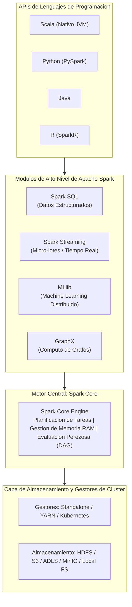
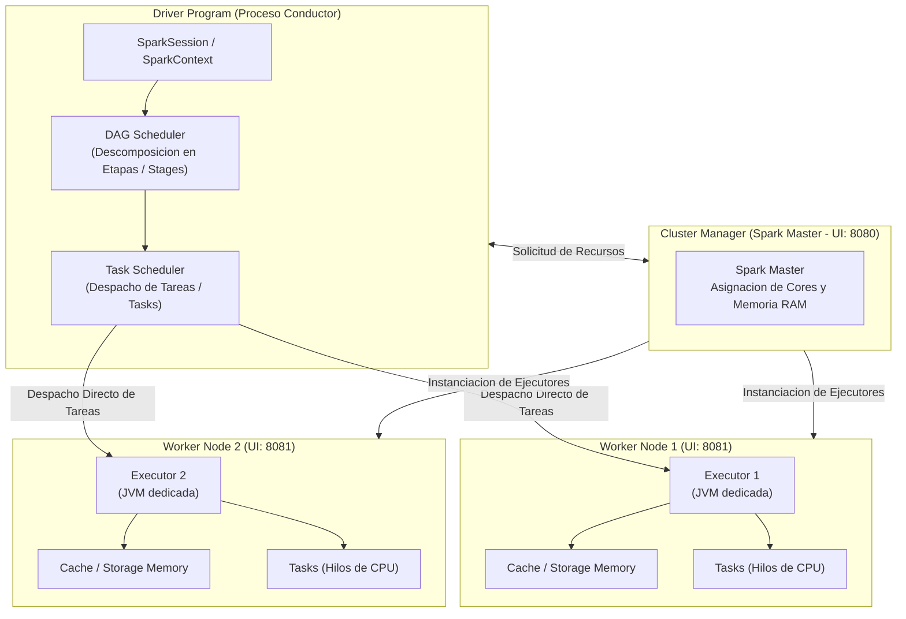

# Clase 4: Motor de Computacion en Memoria Apache Spark, Abstracciones Distribuidas y Arquitectura Medallion en Lakehouse

> Proposito pedagogico: Comprender la evolucion arquitectonica desde el procesamiento masivo basado en disco hacia el computo distribuido en memoria RAM con Apache Spark, dominar las abstracciones de datos fundamentales (RDDs, DataFrames y Datasets), implementar pipelines analiticos con el lenguaje funcional Scala bajo la arquitectura de datos Medallion (capas Bronze, Silver y Gold), y analizar las ventajas de rendimiento de formatos columnares optimizados (Apache Parquet) y motores analiticos vectorizados modernos (Polars/Rust).

## 1\. Contexto y Marco Conceptual

### Transicion Paradigmatica: De MapReduce en Disco a Spark en Memoria RAM

Durante la primera decada del Big Data, el modelo de programacion MapReduce sobre Apache Hadoop represento el estandar dominante para procesar volumenes masivos de informacion. No obstante, MapReduce imponia una severa penalizacion de latencia: **cada operacion intermedia de mapeo o reduccion requeria escribir forzosamente los resultados en disco local o en HDFS**, involucrando costosos ciclos de entrada/salida (I/O) y serializacion en red.

Para superar este cuello de botella, el laboratorio AMPLab de la Universidad de California en Berkeley desarrollo **Apache Spark**. La innovacion arquitectonica fundamental de Spark reside en retener los conjuntos de datos intermedios en la **memoria RAM distribuida del cluster**, evitando lecturas y escrituras ciclicas en almacenamiento fisico. Este diseno permite que las cargas de trabajo analiticas, iterativas y de aprendizaje automatico alcancen aceleraciones de **10 a 100 veces superiores** a las de MapReduce tradicional.

### Multiplicidad de Interfaces y Clientes Poliglotas

A diferencia de sistemas rigidos atados a un unico lenguaje o entorno de ejecucion, Apache Spark provee un ecosistema unificado y poliglota estructurado en capas:

1. **Spark Core:** Motor de ejecucion distribuida de proposito general que gestiona la planificacion de tareas, la administracion de memoria, la recuperacion ante fallos y la comunicacion con sistemas de almacenamiento.

1. **Spark SQL:** Modulo para el procesamiento de datos estructurados y semiestructurados mediante sintaxis ANSI SQL declarativa y el motor de optimizacion relacional Catalyst.

1. **Spark Streaming / Structured Streaming:** Motor para ingesta y procesamiento de flujos continuos en tiempo real mediante micro-lotes (Micro-batches) de ultra baja latencia.

1. **MLlib (Machine Learning Library):** Biblioteca de algoritmos supervisados, no supervisados, reduccion dimensional y evaluacion estadistica, reescritos desde su base matematica para operar sobre memoria RAM distribuida.

1. **GraphX:** API para computacion de grafos paralelos y analisis de redes complejas.

1. **APIs Poliglotas:** Capas de abstraccion que permiten a desarrolladores interactuar con el motor en **Scala** (lenguaje nativo de Spark en la JVM), **Python (PySpark)**, **Java** y **R (SparkR)**.



### La Convergencia Hacia el Lakehouse: Data Warehouse vs Data Lake vs Lakehouse

La gestion de datos analiticos ha experimentado una progresion en tres etapas estructurales:

1. **Data Warehouse Tradicional (Decadas 1990 - 2000):**

   - Enfoque exclusivo en datos estructurados y esquemas dimensionales rigidos (estrella / copo de nieve).
   
   - Proceso ETL (*Extract, Transform, Load*) costoso y rigido antes de la carga.
   
   - Excelentes prestaciones para consultas analiticas (OLAP) e informes directivos de Business Intelligence, pero prohibitivamente costoso para almacenar volumenes masivos no estructurados (imagenes, audio, logs).

1. **Data Lake (Decada 2010):**

   - Enfoque ELT (*Extract, Load, Transform*), almacenando todos los datos crudos (estructurados, semiestructurados y no estructurados) en almacenamiento masivo de bajo costo (HDFS o almacenamiento de objetos en la nube).
   
   - Vulnerabilidad estructural: Sin una capa de gobernanza formal, los Data Lakes degeneran frecuentemente en **"Data Swamps" (pantanos de datos)**, caracterizados por falta de integridad transaccional, corrupcion de lecturas concurrentes y degradacion del rendimiento.

1. **Data Lakehouse (Era Contemporanea):**

   - Arquitectura hibrida que implementa las garantias de confiabilidad, consistencia **ACID**, versionado historico (*Time Travel*) y optimizacion de consultas de un Data Warehouse directamente sobre el almacenamiento elastico y de bajo costo de un Data Lake.
   
   - Estandarizado tecnologicamente mediante formatos de tabla abiertos como **Delta Lake**, Apache Iceberg y Apache Hudi, operados comunmente a traves de plataformas como Databricks.

---

## 2\. Fundamentos Teoricos y Arquitectura

### Arquitectura Master-Worker y Ciclo de Vida del Cluster Spark

El cluster de Apache Spark opera bajo un patron distribuido coordinado:

1. **Driver Program (Programa Conductor):**

   - Proceso donde reside el metodo ` main() ` de la aplicacion y donde se instancia el objeto ` SparkSession ` (punto de entrada unificado que encapsula ` SparkContext `, ` SQLContext ` y ` HiveContext `).
   
   - Traduce el codigo del usuario en operaciones logicas, construye el **Grafo Aciclico Dirigido (Directed Acyclic Graph - DAG)** y lo remite al planificador de tareas (*DAGScheduler* y *TaskScheduler*).

1. **Cluster Manager (Spark Master / Standalone / YARN / K8s):**

   - Asigna y gestiona los recursos de hardware (cores de CPU y memoria RAM) en los nodos trabajadores del cluster.
   
   - En el modo Standalone nativo, el Spark Master supervisa la salud de los nodos y expone la interfaz de administracion web (puerto 8080).

1. **Workers y Ejecutores (Executors):**

   - Procesos distribuidos en cada nodo trabajador encargados de ejecutar las tareas asignadas por el Driver.
   
   - Cada ejecutor reserva un bloque exclusivo de memoria RAM para dos fines fundamentales:
   
     - **Execution Memory:** Memoria volatil para calculos en curso (shuffles, uniones, ordenamientos).
     
     - **Storage Memory:** Memoria para almacenamiento en cache y persistencia de particiones de datos reutilizables.
   
   - El Worker expone su propia interfaz de telemetria (puerto 8081).

#### Evaluacion Perezosa (Lazy Evaluation) y Optimizacion con Catalyst y Tungsten

Spark opera bajo el principio de **evaluacion perezosa (Lazy Evaluation)**:

- Las **Transformaciones** (como ` map `, ` filter `, ` select `, ` groupBy `) no se ejecutan de inmediato; unicamente registran una nueva operacion en el grafo de linaje (DAG).

- La computacion real se dispara unicamente cuando el usuario invoca una **Accion** (como ` show `, ` count `, ` collect `, ` write.save `), lo que materializa el DAG.

- Antes de la ejecucion, el motor **Catalyst Optimizer** aplica optimizaciones algebraicas avanzadas (empuje de predicados *Predicate Pushdown*, poda de columnas *Column Pruning* y reordenamiento de uniones). Posteriormente, el proyecto **Tungsten** genera bytecode optimizado en tiempo de ejecucion sobre la JVM, gestionando la memoria fuera del monticulo (Off-Heap Memory) para eliminar la sobrecarga de pausas del recolector de basura (*Garbage Collector*).



### Taxonomia Formal de las Abstracciones de Datos en Spark

Spark estructura los datos en tres modelos de abstraccion complementarios:

| **Abstraccion** | **Naturaleza y Representacion** | **Seguridad de Tipos (Type Safety)** | **Optimizacion de Consultas** | **Lenguajes Principales** |
| --- | --- | --- | --- | --- |
| **RDD (Resilient Distributed Dataset)** | Coleccion inmutable y particionada de objetos JVM. Opera a bajo nivel mediante funciones lambda funcionales. | Fuerte en tiempo de compilacion (Java/Scala); dinamica y debil en Python. | Nula. Spark no comprende la estructura interna de los objetos JVM; no aplica Catalyst Optimizer. | Scala, Java, Python. Reservado para logica de muy bajo nivel o flujos no estructurados puros. |
| **DataFrame** | Coleccion distribuida de datos estructurada en columnas con nombres y tipos (equivalente semantico a una tabla relacional o un DataFrame de Pandas). | Debil en tiempo de compilacion; evaluada en tiempo de ejecucion (*Runtime Analysis*). | Maxima. El motor Catalyst optimiza el plan logico y fisico; Tungsten comprime en formato columnar binario. | Scala, Python (PySpark), Java, R, SQL. Es la abstraccion universal mas adoptada en la industria. |
| **Dataset** | Extension fuertemente tipada de DataFrames que mapea registros a clases de caso (Case Classes) u objetos POJO. | Maxima y estricta en tiempo de compilacion (*Compile-Time Type Safety*). | Maxima. Aprovecha Catalyst Optimizer y utiliza Encoders binarios eficientes para serializacion JVM. | Exclusivo de Scala y Java (no existe en Python debido a su naturaleza de tipado dinamico). |

### La Arquitectura Medallion (Patron Multi-Capa en Lakehouse)

En el diseno de pipelines analiticos de alta fidelidad, la Arquitectura Medallion estructura la evolucion cualitativa del dato en tres capas secuenciales:

1. **Capa Bronze (Datos Crudos / Ingestion Inmutable):**

   - Almacena los datos en su estado de origen integro, sin transformaciones que alteren la fidelidad del evento (Append-Only).
   
   - Preserva metadatos de auditoria (marca temporal de ingestion, archivo fuente).

1. **Capa Silver (Datos Filtrados, Limpios y Enriquecidos):**

   - Aplica depuracion de registros corruptos, saneamiento ortografico y validacion de estados transaccionales (por ejemplo, descartar operaciones con error y retener transacciones ` OK `).
   
   - Normaliza esquemas, tipifica columnas y calcula atributos derivados (montos netos, cargos/abonos).

1. **Capa Gold (Agregacion Empresarial y Consumo):**

   - Condensa la informacion en matrices analiticas multidimensionales de alta densidad semantica.
   
   - Aplica agregaciones de negocio (` groupBy `, sumas de exposicion, saldos finales por cuenta o por pais, recuento de transacciones).
   
   - Sirve como fuente de verdad directa para dashboards de Business Intelligence, modelos de Machine Learning y reporteria ejecutiva.

```mermaid
flowchart LR
    subgraph Fuentes["Fuentes de Datos"]
        F1["Archivos CSV / JSON"]
        F2["Logs Transaccionales"]
        F3["Eventos Streaming (Kafka)"]
    end
    subgraph Bronze["Capa Bronze: Crudo"]
        B1["Ingestion Inmutable<br>(Append-Only)<br>Formato: CSV / Delta Crudo"]
    end
    subgraph Silver["Capa Silver: Limpio"]
        S1["Filtrado de Errores<br>Reglas de Negocio<br>Tipado de Columnas"]
    end
    subgraph Gold["Capa Gold: Agregado"]
        G1["Tablas de Hechos Agregadas<br>Metricas Financieras<br>KPIs por Cuenta / Region"]
    end
    subgraph Consumo["Capa de Consumo Final"]
        C1["Dashboards PowerBI / Tableau"]
        C2["Modelos de Machine Learning (MLlib)"]
        C3["Persistencia Columnar (Parquet / Delta)"]
    end
    Fuentes --> Bronze
    Bronze --> Silver
    Silver --> Gold
    Gold --> Consumo
```



---

## 3\. Implementacion Tecnica y Logica de Negocio

### Despliegue de Cluster Spark Contenerizado con Docker Compose

La infraestructura de Spark se parametriza mediante contenedores enlazados a traves de una red interna bridge y volumenes montados para compartir codigo y datos:

- ` spark-master `: Contenedor coordinador que ejecuta ` org.apache.spark.deploy.master.Master `.

- ` spark-worker `: Contenedor ejecutor que ejecuta ` org.apache.spark.deploy.worker.Worker `, vinculado a la URL ` spark://spark-master:7077 `.

- **Mapeo de Volumenes:** El directorio local ` ./code ` se monta en ` /opt/spark/code ` y ` ./data ` se monta en ` /opt/spark/data `.

Comando de despliegue:

```bash
docker compose up -d
docker ps --format "table {{.Names}}\t{{.Status}}\t{{.Ports}}"
```

### Telemetria e Inspeccion de las Interfaces Web

- **Spark Master UI (**` http://localhost:8080 `**):**

  - Muestra el estado del cluster (*ALIVE*), la URL del Master (` spark://spark-master:7077 `), los Workers registrados con su memoria RAM asignada (ej. 14 GB) y cores activos, asi como las aplicaciones en ejecucion (*Running Applications*) y finalizadas (*Completed Applications*).

- **Spark Worker UI (**` http://localhost:8081 `**):**

  - Detalla la asignacion de recursos por ejecutor, el consumo de memoria cache y los logs de ejecucion (` stdout ` / ` stderr `).

### Operaciones Fundamentales en Scala Shell (` spark-shell `)

El acceso al entorno interactivo de Spark se realiza ejecutando el shell nativo dentro del contenedor maestro:

```bash
docker exec -it spark-master /opt/spark/bin/spark-shell
```

#### 1\. Definicion y Manipulacion de RDDs en Scala

```scala
// Definicion de coleccion local en Scala
val numeros = List(1, 2, 3, 4, 5, 6, 7, 8, 9)

// Paralelizacion hacia un RDD distribuido a traves del SparkContext (sc)
val numerosRDD = sc.parallelize(numeros)

// Accion: Recoleccion de datos hacia el Driver Program
val resultadoColeccion = numerosRDD.collect()
println(resultadoColeccion.mkString(", "))
```

#### 2\. Construccion y Consulta Relacional sobre DataFrames en Scala

```scala
// Creacion de un DataFrame relacional a partir de secuencias de tuplas
val transaccionesDF = Seq(
  (1, "vigente", 1500.0),
  (2, "prorrogado", 2500.0),
  (3, "castigado", 3200.0)
).toDF("id", "estado", "monto")

// Consulta relacional con proyeccion y filtrado tipo SQL
val resultadoFiltrado = transaccionesDF
  .select("id", "monto")
  .filter($"monto" > 2000.0)

// Accion: Visualizacion tabular formateada en consola
resultadoFiltrado.show()
```

### Implementacion del Pipeline ETL Completo en Scala (` procesamiento_df.scala `)

El siguiente script funcional implementa de manera estricta el paradigma Medallion, procesando transacciones financieras y persistiendolas en formato columnar Parquet:

```scala
package com.analytics.spark

import org.apache.spark.sql.SparkSession
import org.apache.spark.sql.functions._

object PipelineMedallionTransacciones {

  def main(args: Array[String]): Unit = {
    // 1. Inicializacion de la SparkSession
    val spark = SparkSession.builder()
      .appName("PipelineMedallionTransacciones")
      .getOrCreate()

    import spark.implicits._

    val rutaDatosCrudos = "/opt/spark/data/transacciones.csv"
    val rutaSalidaGold = "/opt/spark/data/gold_cuentas_parquet"

    println("Iniciando procesamiento de pipeline Medallion...")

    // 2. CAPA BRONZE: Ingestion Cruda con inferencia de esquema
    val bronzeDF = spark.read
      .option("header", "true")
      .option("inferSchema", "true")
      .option("delimiter", ",")
      .csv(rutaDatosCrudos)

    println("Esquema Capa Bronze:")
    bronzeDF.printSchema()

    // 3. CAPA SILVER: Saneamiento, filtrado de integridad y logica de montos
    // Regla de Negocio: 
    // - Descartar transacciones con estado diferente de 'OK'
    // - Si el tipo es 'retiro', el monto neto es negativo (-monto); caso contrario positivo (+monto)
    val silverDF = bronzeDF
      .filter($"estado" === "OK")
      .withColumn("monto_neto",
        when($"tipo" === "retiro", -$"monto")
        .otherwise($"monto")
      )

    println("Muestra Capa Silver (Transacciones Validadas):")
    silverDF.show(5)

    // 4. CAPA GOLD: Agregacion Multidimensional de Negocio
    // Agrupamiento por cuenta para calcular saldo final y total de operaciones
    val goldDF = silverDF
      .groupBy("cuenta")
      .agg(
        round(sum("monto_neto"), 2).as("saldo_final"),
        count("transaccion_id").as("cantidad_operaciones")
      )
      .orderBy($"saldo_final".desc)

    println("Resultados Consolidados Capa Gold:")
    goldDF.show()

    // 5. PERSISTENCIA EN FORMATO COLUMNAR APACHE PARQUET
    goldDF.write
      .mode("overwrite")
      .parquet(rutaSalidaGold)

    println(s"Persistencia completada exitosamente en formato Parquet: $rutaSalidaGold")

    spark.stop()
  }
}
```

#### Ejecucion del Script en Modo Batch en el Cluster

```bash
# Ejecucion interactiva mediante carga directa en el Spark Shell
docker exec -it spark-master /opt/spark/bin/spark-shell -i /opt/spark/code/procesamiento_df.scala
```

### Analisis de Serializacion y Formatos: Apache Parquet vs CSV

El almacenamiento en texto delimitado plano (CSV, TSV) presenta graves ineficiencias en escenarios de Big Data:

1. **Ineficiencia de Espacio:** El formato CSV almacena valores numericos y fechas como cadenas de texto ASCII/UTF-8, consumiendo volumen innecesario.

1. **Escaneo Exhaustivo de Filas (Row-oriented):** Para resolver una consulta como ` SELECT AVG(saldo_final) FROM tabla `, un motor que lee CSV debe escanear todas las columnas de cada fila del archivo desde el disco, desperdiciando ancho de banda I/O.

1. **Ausencia de Esquema Tipado:** Requiere inferir o parsear los tipos en cada lectura.

**Ventajas Estructurales de Apache Parquet:**

- **Almacenamiento Orientado a Columnas (Columnar Storage):** Los valores de una misma columna se almacenan contiguos fisicamente en disco, permitiendo que la consulta anterior lea unicamente los bloques de bytes correspondientes a ` saldo_final `.

- **Compresion y Codificacion Optima:** Al agrupar valores del mismo tipo de datos, se aplican algoritmos de compresion altamente eficientes (Snappy, GZIP) y tecnicas de codificacion por diccionario (*Dictionary Encoding*) y longitud de ejecucion (*Run-Length Encoding - RLE*).

- **Poda Estadistica de Bloques (Pushdown Predicates):** Cada archivo Parquet almacena metadatos con los valores minimos y maximos de cada bloque de columnas (*Row Groups*). Si una consulta filtra por ` WHERE monto > 10000 `, Spark puede descartar bloques enteros sin leerlos de disco.

#### Lectura de Parquet en Python (Pandas)

```python
import pandas as pd

# Lectura directa de la particion binaria generada por Spark
df_parquet = pd.read_parquet("gold_cuentas.parquet")
print(df_parquet.info())
print(df_parquet.head())
```

### Motores Vectorizados de Nueva Generacion: Polars (Rust) frente a Pandas

En entornos locales o nodos unarios donde Spark resulta sobredimensionado pero Pandas colapsa por limitaciones de memoria RAM, surge **Polars**:

- **Desarrollo en Rust:** Escrito enteramente en Rust con gestion de memoria Apache Arrow nativa.

- **Multihilo Real y Libre del GIL:** A diferencia de Pandas (restringido por el *Global Interpreter Lock* de Python), Polars paraleliza de forma automatica y optima sobre todos los nucleos de CPU disponibles.

- **Evaluacion Perezosa y Optimizacion de Consultas:** Dispone de un API perezoso (` pl.LazyFrame `) analogo al Catalyst de Spark, optimizando el plan de ejecucion antes de materializar la computacion.

- **Tipado Estricto:** Prohibe columnas heterogeneas ambiguas (` object ` en Pandas), erradicando errores silentes de conversion.

```python
import polars as pl

# Lectura perezosa y agregacion vectorizada en Rust
q = (
    pl.scan_parquet("gold_cuentas.parquet")
    .filter(pl.col("saldo_final") > 0)
    .select(["cuenta", "saldo_final", "cantidad_operaciones"])
)

df_resultado = q.collect()
print(df_resultado)
```

---

## 4\. Analisis Critico de Casos y Auditoria Practica

### Evaluacion Comparativa de Motores Analiticos y Procesamiento Masivo

| **Criterio** | **Hadoop MapReduce** | **Apache Spark** | **Polars (Rust Engine)** | **Pandas (Python Legacy)** |
| --- | --- | --- | --- | --- |
| **Ubicacion de Computo** | Cluster distribuido basado en disco (HDFS). | Cluster distribuido basado en memoria RAM (DAG). | Nodo unico vectorizado multihilo en RAM. | Nodo unico monohilo en memoria RAM. |
| **Mecanismo de Optimizacion** | Nulo. Control manual de Mapper y Reducer en codigo Java. | Catalyst Optimizer (algebra relacional) + Tungsten (off-heap). | Optimizador logico perezoso y vectorizacion SIMD en Rust. | Nulo. Ejecucion imperativa e inmediata paso a paso. |
| **Rendimiento y Latencia** | Lenta (alta latencia por I/O ciclico en disco). | Ultra rapida (de 10x a 100x superior a MapReduce). | Extremadamente rapida (supera a Pandas por 10x a 50x en local). | Moderada en datasets pequenos; saturacion y colapso en medianos. |
| **Escalabilidad Horizontal** | Petabytes en miles de nodos. | Petabytes en cientos/miles de nodos. | Limitada a los recursos de una sola maquina fisica. | Limitada a una fraccion de la RAM de una sola maquina. |
| **Soporte de Streaming** | No soportado de manera nativa (solo batch). | Nativo y robusto (Structured Streaming). | Limitado (orientado primordialmente a batch local). | No soportado. |

### Evaluacion Comparativa de las Capas en la Arquitectura Medallion

| **Dimension** | **Capa Bronze (Cruda)** | **Capa Silver (Depurada)** | **Capa Gold (Empresarial)** |
| --- | --- | --- | --- |
| **Proposito Fundamental** | Almacenamiento historico e inmutable de eventos fuente. | Integridad estructural, enriquecimiento y reglas de validacion. | Modelado dimensional agregado y metricas de consumo directo. |
| **Formato Optimo** | CSV / JSON crudo o tablas Delta en modo Append. | Apache Parquet / Delta Lake optimizado. | Apache Parquet / Delta Lake indexado con particionado logico. |
| **Nivel de Agregacion** | Cero agregacion (grano atomico de transaccion o evento). | Grano atomico limpio; descarte de duplicados y transacciones invalidas. | Alta densidad agregada (por entidad, fecha, cliente o territorio). |
| **Usuarios Destinatarios** | Ingenieros de datos y procesos de re-ingesta forense. | Cientificos de datos y analistas para mineria exploratoria. | Analistas de BI, directivos empresariales y modelos productivos. |
| **Frecuencia de Actualizacion** | Continua / Ingestion batch en crudo. | Micro-lotes o pipelines programados de saneamiento. | Actualizaciones programadas de publicacion de KPIs. |

### Auditoria de Rendimiento I/O: Formatos de Archivo en Analitica de Datos

| **Formato de Archivo** | **Disposicion de Almacenamiento** | **Compresion y Eficiencia** | **Soporte de Esquema** | **Riesgo de Cuello de Botella I/O** |
| --- | --- | --- | --- | --- |
| **CSV / TSV** | Orientado a filas (Texto plano secuencial). | Muy baja. Sin compresion nativa estructurada. | Ausente. Requiere inferencia o casting en tiempo de lectura. | Critico. Sobrecarga severa de ancho de banda y parseo de strings. |
| **JSON** | Semi-estructurado orientado a registros jerarquicos. | Baja. Redundancia extrema de nombres de llaves en cada objeto. | Flexible pero no estricto. | Alto. Costoso computacionalmente al parsear estructuras anidadas. |
| **Apache Parquet** | Orientado a columnas (Binario tipado con metadatos de bloque). | Maxima. Compresion Snappy/ZSTD y codificacion por diccionario. | Estricto y embebido en el archivo (*Self-Describing*). | Minimo. Habilita lectura selectiva de columnas y empuje de predicados. |
| **Delta Lake** | Capa transaccional ACID sobre archivos Parquet con log JSON. | Maxima, integrando compactacion y aislamiento serializable. | Estricto con soporte de evolucion y forzado de esquemas. | Optimo para entornos concurrentes con lecturas y escrituras simultaneas. |

---

## 5\. Principios de Diseno, Buenas Practicas y Anti-patrones

### Reglas de Oro en Computacion Distribuida con Spark

1. **Evitar la Invocacion Indiscriminada de** ` collect() `**:** El comando ` collect() ` fuerza la transferencia de la totalidad de las particiones distribuidas desde los ejecutores hacia el Driver Program. Si el conjunto supera la memoria RAM del Driver, provocara inmediatamente un colapso por ` OutOfMemoryError `. En su lugar, utilice ` take(n) `, ` limit(n) ` o guarde los resultados directamente a almacenamiento distribuido mediante ` write `.

1. **Priorizar DataFrames sobre RDDs:** En la programacion cotidiana de Spark, evite el uso directo de RDDs salvo que requiera transformaciones de muy bajo nivel no expresables relacionalmente. Los DataFrames y Datasets permiten al optimizador Catalyst reordenar operaciones y al motor Tungsten operar directamente sobre memoria binaria fuera del Garbage Collector.

1. **Estandarizacion de Formatos en Lakehouse:** Proscribir el uso de archivos CSV o JSON para persistir capas intermedias o finales en lagos de datos; adoptar exclusivamente formatos columnares autodescriptivos (Apache Parquet o tablas Delta Lake).

### Anti-patrones Metodologicos y de Rendimiento

| **Anti-patron** | **Mecanismo del Error** | **Impacto Tecnico / Consecuencia** | **Estrategia de Mitigacion** |
| --- | --- | --- | --- |
| **Sindrome de "Collect Mania"** | Invocar ` .collect() ` sobre un DataFrame masivo para iterarlo con bucles ` for ` convencionales en el lenguaje cliente. | Colapso del nodo Driver por saturacion de memoria heap (OOM) y destruccion de la paralelizacion del cluster. | Aplicar transformaciones nativas distribuidas (` select `, ` withColumn `, funciones vectorizadas ` org.apache.spark.sql.functions `). |
| **Sesgo de Particion (Data Skew)** | Distribuir particiones con llaves altamente desbalanceadas al ejecutar ` groupBy ` o ` join `. | Un unico ejecutor procesa el 90% de los datos mientras el resto permanece ocioso, creando un cuello de botella critico (*Straggler Task*). | Aplicar tecnicas de salado de llaves (*Salting*) o habilitar la optimizacion adaptativa de consultas (*Adaptive Query Execution - AQE*). |
| **Mutacion Destructiva en Capa Bronze** | Sobrescribir los archivos de origen crudos durante las fases de limpieza o normalizacion. | Perdida irreversible de la trazabilidad y linaje historico de auditoria ante cambios en las reglas de negocio. | Mantener la capa Bronze con politica estricta de solo insercion (*Append-Only*) e inmutabilidad absoluta. |
| **Uso de Funciones Definidas por el Usuario (UDF) No Vectorizadas en Python** | Implementar funciones Python estandar sobre PySpark que requieren serializar cada fila entre la JVM y el interprete de Python. | Penalizacion de rendimiento de un orden de magnitud por costo de serializacion I/O interproceso. | Utilizar funciones nativas de Spark SQL o emplear Pandas UDFs (vectorizadas con Apache Arrow). |

---

## 6\. Sintesis Conceptual y Profundizacion Academica

### Sintesis Integradora

Apache Spark redefine la computacion distribuida al desplazar el eje de procesamiento desde el disco rigido hacia la memoria RAM compartida, respaldada por optimizadores algebraicos declarativos (Catalyst) y gestion binaria de memoria (Tungsten). Sus tres abstracciones cardinales (RDDs, DataFrames y Datasets) proveen el equilibrio optimo entre flexibilidad funcional y eficiencia relacional. Al converger con la Arquitectura Medallion en entornos Lakehouse, Spark posibilita pipelines de datos disciplinados que transitan desde la ingestion cruda inmutable (Bronze), avanzan por la validacion estructurada (Silver), y culminan en agregaciones de alta densidad estrategica (Gold) serializadas en formatos columnares comprimidos como Apache Parquet.

### Preguntas Guia para la Investigacion de Posgrado

1. ¿Como cuantificar la sobrecarga computacional y el impacto en la latencia de serializacion al operar pipelines analiticos con PySpark frente a implementaciones nativas en Scala compiladas directamente sobre el bytecode de la JVM?

1. ¿Bajo que metricas de cardinalidad y dispersion de datos el algoritmo de ejecucion adaptativa de consultas (AQE - Adaptive Query Execution) mitiga de manera autonoma el sesgo de particionamiento (*Data Skew*) en uniones distribuidas (*Shuffle Hash Joins*)?

### Referencias Bibliograficas Fundamentales

- Zaharia, M., Chowdhury, M., Franklin, M. J., Shenker, S., &amp; Stoica, I. (2010). *Spark: Cluster Computing with Working Sets*. USENIX Workshop on Hot Topics in Cloud Computing (HotCloud).

- Armbrust, M., Xin, R. X., Lian, C., Huai, Y., Liu, D., Bradley, J. K., Meng, X., Kaftan, T., Franklin, M. J., Ghodsi, A., &amp; Zaharia, M. (2015). *Spark SQL: Relational Data Processing in Spark*. Proceedings of the 2015 ACM SIGMOD International Conference on Management of Data, 1383-1394.

- Chambers, B., &amp; Zaharia, M. (2018). *Spark: The Definitive Guide: Big Data Processing Made Simple*. O'Reilly Media.

- Karau, H., &amp; Warren, R. (2017). *High Performance Spark: Best Practices for Scaling and Optimizing Apache Spark*. O'Reilly Media.

- Armbrust, M., Ghodsi, A., Xin, R., &amp; Zaharia, M. (2020). *Lakehouse: A New Generation of Open Platforms that Unify Data Warehousing and Advanced Analytics*. Proceedings of CIDR 2021.
