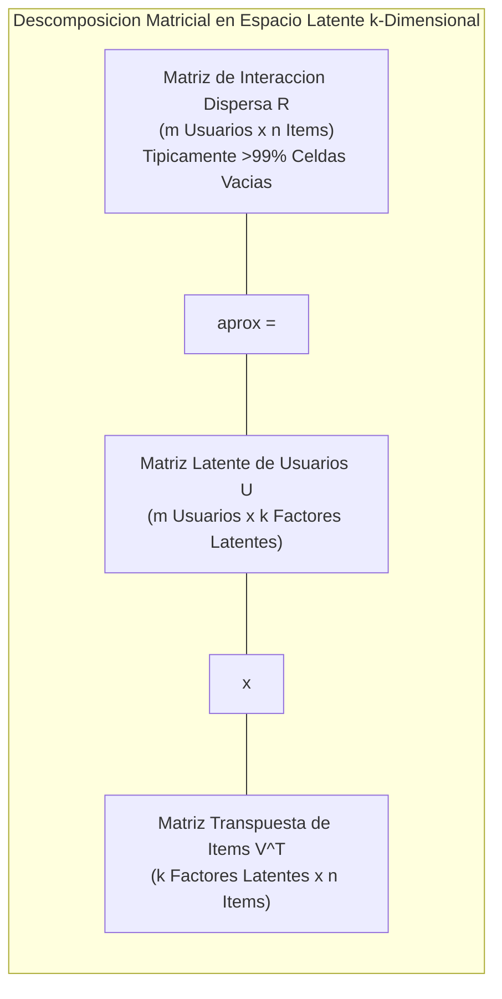
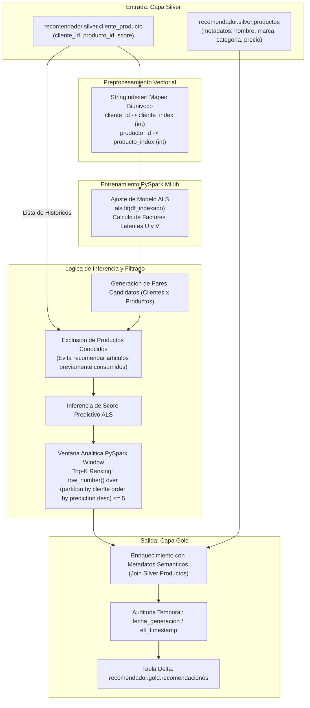
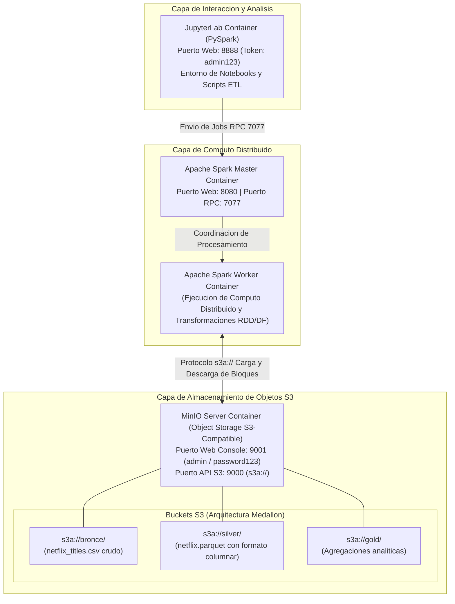

# Clase 8: Filtrado Colaborativo con ALS, Dashboards Nativos en Databricks y Lakehouse Open Source con MinIO y Spark

> **Objetivo de la Sesion:** Implementar un sistema de recomendacion de filtrado colaborativo basado en factorizacion matricial con Minimos Cuadrados Alternados (ALS) en PySpark MLlib; materializar la capa Gold incorporando ventanas analiticas para Top-K recomendaciones, enriquecimiento contextual y versionado temporal; construir un dashboard analitico interactivo nativo en Databricks; y desplegar una arquitectura Lakehouse local y abierta basada en Docker, contenedores de almacenamiento compatible con S3 (MinIO) y Apache Spark con formato columnar Apache Parquet.

## Seccion 1: Contexto y Marco Conceptual

### La Especializacion de los Sistemas de Recomendacion

En el ecosistema de Machine Learning contemporaneo, los sistemas de recomendacion constituyen una familia algoritmica singular, diferenciada sustancialmente de los modelos convencionales de clasificacion y regresion supervisada:

- En clasificacion o regresion supervisada tradicional, el modelo aprende una funcion de correspondencia $f(X) \rightarrow Y$ sobre vectores densos de caracteristicas explicitas para predecir una etiqueta o magnitud continua.

- En sistemas de recomendacion a escala, nos enfrentamos al desafio de **Filtrado Colaborativo (Collaborative Filtering)**, donde el objetivo es predecir la preferencia o afinidad de un usuario sobre un catalogo masivo de articulos basandose casi exclusivamente en el patron historico de interacciones compartidas entre multiples usuarios e items, prescindiendo inicialmente de descriptores sociodemograficos o taxonomias rigidas.

### El Dilema del Espacio Disperso y el Problema de Arranque en Frio

La formalizacion de problemas de interaccion cliente-producto deriva naturalmente en una matriz $R_{m \times n}$ donde las filas corresponden a los $m$ usuarios y las columnas a los $n$ productos. En la practica real de plataformas de comercio electronico o streaming (Amazon, Netflix), esta matriz se encuentra extraordinariamente dispersa (*sparse*): tipicamente mas del 99% de las celdas se hallan vacias, dado que un cliente individual interactua unicamente con una fraccion infinitesimal del catalogo disponible.

Esta dinamica impone restricciones criticas:

1. **El Problema del Arranque en Frio (Cold Start):**

   - **Nuevos Usuarios:** Un usuario sin historial carece de vectores de interaccion para calcular afinidad en el espacio latente. La estrategia obligatoria de fallback consiste en recomendar los articulos de mayor popularidad agregada o explorar con modelos basados en contenido.
   
   - **Nuevos Items:** Un articulo recien incorporado al catalogo no ha recibido interacciones y permanecera invisible ante algoritmos colaborativos puros a menos que se fuerce su exploracion.

1. **Feedback Explicito vs. Implicito:** Mientras el feedback explicito (puntuaciones o valoraciones numericas de 1 a 5 estrellas) es escaso y propenso a sesgos de respuesta, el feedback implicito (clics, tiempo de permanencia, adiciones al carrito, compras completadas) abunda pero requiere formular matrices de confianza probabilistica y ponderaciones continuas de comportamiento.

---

## Seccion 2: Fundamentos Teoricos y Arquitectura

### Formulacion Matematica de la Factorizacion Matricial via Minimos Cuadrados Alternados (ALS)

El algoritmo **Alternating Least Squares (ALS)**, propuesto formalmente por Yifan Hu, Yehuda Koren y Chris Volinsky (2008) para datasets de feedback implicito y consolidado en el premio Netflix, descompone la matriz dispersa de puntuaciones o pesos observados $R \in \mathbb{R}^{m \times n}$ en el producto de dos matrices de factores latentes de rango bajo $k \ll \min(m, n)$:

$R \approx U \cdot V^T$

Donde:

- $U \in \mathbb{R}^{m \times k}$: Matriz de factores latentes de los usuarios. Cada vector fila $u_u \in \mathbb{R}^k$ condensa las afinidades no observadas del cliente $u$.

- $V \in \mathbb{R}^{n \times k}$: Matriz de factores latentes de los items. Cada vector fila $v_i \in \mathbb{R}^k$ condensa los atributos subyacentes del producto $i$.



#### Funcion de Optimizacion con Regularizacion Tikhonov (L2)

La optimizacion simultanea de $U$ y $V$ constituye un problema no convexo multivariado. El metodo ALS transforma esta no convexidad en una sucesion de subproblemas cuadraticos convexos resolubles de manera exacta y eficiente en paralelo:

1. **Fijar** $V$ **constante:** La funcion de costo se vuelve estrictamente cuadratica respecto a $U$, resolviendose mediante minimos cuadrados lineales para cada fila de usuario independientemente:

   $u_u = \left( \sum_{i} v_i v_i^T + \lambda I \right)^{-1} \sum_{i} r_{ui} v_i$

1. **Fijar** $U$ **constante:** De manera simetrica, se optimiza cada vector de item $v_i$:

   $v_i = \left( \sum_{u} u_u u_u^T + \lambda I \right)^{-1} \sum_{u} r_{ui} u_u$

1. El algoritmo **alterna** secuencialmente entre ambos pasos hasta alcanzar la convergencia o agotar el numero de iteraciones estipuladas.

### Pipeline de Enriquecimiento y Materializacion en Capa Gold

Para trasladar la inferencia matricial a un activo corporativo util, los indices enteros de factores latentes deben revertirse y asociarse con las dimensiones semanticas de negocio, incorporando filtrado de exclusiones y clasificaciones Top-K:



### Arquitectura Lakehouse Open Source Local (Docker, MinIO y Apache Spark)

Para validar la viabilidad de la arquitectura Lakehouse con independencia de proveedores comerciales de nube (Databricks o Azure Synapse), se despliega una topologia equivalente utilizando componentes open source contenerizados mediante Docker Compose:



---

## Seccion 3: Implementacion Tecnica y Operaciones en Databricks y MinIO

### Fase A: Pipeline de Filtrado Colaborativo ALS en Databricks (` recomendador_gold `)

#### 1\. Ingestion de la Capa Silver e Indexacion Numerica

PySpark MLlib exige que los identificadores de usuarios e items se representen como valores enteros continuos:

```python
from pyspark.sql.functions import col, row_number, current_timestamp
from pyspark.sql.window import Window
from pyspark.ml.recommendation import ALS
from pyspark.ml.feature import StringIndexer

# Carga de la matriz de interacciones de la capa Silver
df_interacciones = spark.table("recomendador.silver.cliente_producto")

# Mapeo biunivoco de identificadores alfanumericos a indices enteros
indexer_cliente = StringIndexer(inputCol="cliente_id", outputCol="cliente_index")
indexer_producto = StringIndexer(inputCol="producto_id", outputCol="producto_index")

df_indexado = indexer_cliente.fit(df_interacciones).transform(df_interacciones)
df_indexado = indexer_producto.fit(df_indexado).transform(df_indexado)

# Cast explicito a tipos numericos compatibles con el estimador ALS
df_entrenamiento = df_indexado.select(
    col("cliente_index").cast("integer"),
    col("producto_index").cast("integer"),
    col("score").cast("float")
)
```

#### 2\. Configuracion y Ajuste del Modelo ALS

```python
# Parametrizacion del estimador ALS para feedback implicito
als = ALS(
    maxIter=10,
    regParam=0.1,
    userCol="cliente_index",
    itemCol="producto_index",
    ratingCol="score",
    coldStartStrategy="drop",
    nonnegative=True
)

# Ajuste matricial del modelo
modelo_als = als.fit(df_entrenamiento)
```

#### 3\. Exclusion de Articulos Consumidos y Generacion de Predicciones Top-K

```python
# Extraccion de universos unicos de usuarios y productos
clientes_unicos = df_entrenamiento.select("cliente_index").distinct()
productos_unicos = df_entrenamiento.select("producto_index").distinct()

# Producto cartesiano de todos los pares posibles (cliente, producto)
todos_los_pares = clientes_unicos.crossJoin(productos_unicos)

# Identificacion y sustraccion de los productos ya conocidos por el cliente
pares_conocidos = df_entrenamiento.select("cliente_index", "producto_index").distinct()
pares_a_predecir = todos_los_pares.join(
    pares_conocidos,
    on=["cliente_index", "producto_index"],
    how="left_anti"
)

# Generacion de inferencias predictivas de afinidad
predicciones_raw = modelo_als.transform(pares_a_predecir) \
    .filter(col("prediction").isNotNull())

# Aplicacion de funcion de ventana para aislar las 5 mejores recomendaciones por usuario
ventana_ranking = Window.partitionBy("cliente_index").orderBy(col("prediction").desc())

top5_recomendaciones = predicciones_raw.withColumn("ranking", row_number().over(ventana_ranking)) \
    .filter(col("ranking") <= 5)
```

#### 4\. Des-indexacion, Enriquecimiento Semantico y Persistencia en Capa Gold

```python
# Tablas de correspondencia para revertir indices a llaves de negocio originales
mapa_clientes = df_indexado.select("cliente_index", "cliente_id").distinct()
mapa_productos = df_indexado.select("producto_index", "producto_id").distinct()

# Reversion de identificadores
top5_identificados = top5_recomendaciones \
    .join(mapa_clientes, on="cliente_index", how="inner") \
    .join(mapa_productos, on="producto_index", how="inner")

# Enriquecimiento semantico con metadatos descriptivos de productos
df_productos_silver = spark.table("recomendador.silver.productos")

df_gold_final = top5_identificados.join(
    df_productos_silver,
    on="producto_id",
    how="inner"
).select(
    col("cliente_id"),
    col("ranking"),
    col("producto_id"),
    col("nombre").alias("nombre_producto"),
    col("marca"),
    col("categoria"),
    col("precio"),
    col("prediction").alias("score_predicho"),
    current_timestamp().alias("fecha_generacion")
)

# Persistencia idempotente en la capa Gold administrada
df_gold_final.write.format("delta").mode("overwrite") \
    .saveAsTable("recomendador.gold.recomendaciones")
```

### Fase B: Diseno Operativo de Dashboards Nativos en Databricks

Databricks provee un subsistema de *Lakehouse Dashboards* que permite articular tableros de control directamente sobre tablas Gold sin requerir licenciamiento externo de Power BI:

1. **Definicion del Conjunto de Datos (Dataset SQL):**

   ```sql
   SELECT 
       cliente_id,
       ranking,
       producto_id,
       nombre_producto,
       marca,
       categoria,
       precio,
       score_predicho,
       fecha_generacion
   FROM recomendador.gold.recomendaciones
   ORDER BY cliente_id, ranking;
   ```

1. **Componentes Visuales en el Lienzo:**

   - **Control de Filtro (Dropdown Parameter):** Asociado al campo ` cliente_id ` para permitir la exploracion individualizada de recomendaciones por usuario.
   
   - **Elemento Tabular (Table Widget):** Muestra las 5 filas recomendadas (` ranking `, ` nombre_producto `, ` marca `, ` categoria `, ` precio `, ` score_predicho `).
   
   - **Visualizacion Analitica Complementaria (Bar Chart):** Distribucion de afinidad de score predictivo por producto recomendado.
   
   - **Visualizacion de Distribucion (Donut / Pie Chart):** Proporcion del gasto proyectado segun marca o categoria de articulos recomendados.

### Fase C: Despliegue de Lakehouse Local con MinIO y PySpark en Docker

#### 1\. Estructura de Servicios en Docker Compose (` docker-compose.yml `)

El cluster local articula cuatro contenedores interconectados:

- ` spark-master `: Coordinador distribuido expuesto en el puerto RPC ` 7077 ` e interfaz HTTP ` 8080 `.

- ` spark-worker `: Nodo de ejecucion computacional subordinado al master.

- ` minio `: Servidor de almacenamiento compatible con S3 expuesto en el puerto API ` 9000 ` y consola administrativa ` 9001 ` (Credenciales: ` admin ` / ` password123 `).

- ` jupyterlab `: Entorno interactivo expuesto en el puerto ` 8888 ` (Token: ` admin123 `).

#### 2\. Configuracion de la Sesion Spark con Soporte para Protocolo S3A

En el notebook de JupyterLab, se inicializa la sesion vinculando las librerias Hadoop AWS para interactuar con MinIO como si fuese un bucket nativo de Amazon S3:

```python
from pyspark.sql import SparkSession
from pyspark.sql.functions import col, when, lit, current_timestamp

# Construccion de la SparkSession con inyeccion de paquetes S3A
spark = SparkSession.builder \
    .appName("ETL_Lakehouse_Local_Netflix") \
    .master("spark://spark-master:7077") \
    .config("spark.hadoop.fs.s3a.endpoint", "http://minio:9000") \
    .config("spark.hadoop.fs.s3a.access.key", "admin") \
    .config("spark.hadoop.fs.s3a.secret.key", "password123") \
    .config("spark.hadoop.fs.s3a.path.style.access", "true") \
    .config("spark.hadoop.fs.s3a.impl", "org.apache.hadoop.fs.s3a.S3AFileSystem") \
    .getOrCreate()

print(f"Sesion Spark establecida exitosamente. Version: {spark.version}")
```

#### 3\. Pipeline de Saneamiento y Transformacion a Formato Parquet en Silver

```python
# Ingesta cruda desde el bucket Bronze en MinIO
df_bronze = spark.read \
    .option("header", "true") \
    .option("inferSchema", "true") \
    .csv("s3a://bronce/netflix_titles.csv")

# Saneamiento y enriquecimiento:
# Imputacion de valores ausentes en campos categoricos
df_silver = df_bronze.fillna({
    "director": "Desconocido",
    "country": "Desconocido"
})

# Creacion de atributo derivado para clasificacion de contenido adulto y estampa temporal
df_silver = df_silver.withColumn(
    "es_adulto",
    when(col("rating").isin("TV-MA", "NC-17", "R"), lit(True)).otherwise(lit(False))
).withColumn("etl_timestamp", current_timestamp())

# Persistencia columnar optimizada en formato Apache Parquet en el bucket Silver
df_silver.write \
    .mode("overwrite") \
    .parquet("s3a://silver/netflix.parquet")

print("Capa Silver generada exitosamente en formato Apache Parquet.")
```

#### 4\. Metricas de Rendimiento: Compresion CSV vs. Parquet

La transformacion fisica evidencio una reduccion de tamano desde **2.8 MB (archivo CSV delimitado no comprimido)** hasta **1.6 MB (Apache Parquet con compresion Snappy)**:

- Representa una reduccion de volumen de almacenamiento de aproximadamente el **43%**.

- Al adoptar el formato columnar Parquet, las consultas analiticas subsecuentes ejecutan tecnicas de *column pruning* (lectura exclusiva de las columnas requeridas por el query) y *predicate pushdown* (filtrado a nivel de metadatos de bloque), reduciendo radicalmente el consumo de I/O de red entre MinIO y los ejecutores de Spark.

---

## Seccion 4: Analisis Critico de Casos y Auditoria de Sistemas Distribuidos

### Matriz Comparativa: Paradigmas de Recomendacion

| Criterio de Evaluacion | Filtrado Basado en Contenido | Filtrado Colaborativo (ALS) | Modelos Basados en Grafos / Deep Learning |
| --- | --- | --- | --- |
| **Naturaleza del Insumo** | Descriptores y atributos del item (texto, genero, precio) | Matriz de co-ocurrencia y pesos de interaccion cliente-item | Secuencias temporales, embeddings multimodales y grafos |
| **Capacidad de Serendipia** | Baja (recomienda unicamente articulos muy similares al historial) | Alta (descubre afinidades transversales no evidentes) | Maxima (captura relaciones semanticas de orden superior) |
| **Dependencia de Metadatos** | Critica (exige catalogos exhaustivamente etiquetados) | Nula en la fase de entrenamiento matricial | Moderada a alta segun la arquitectura de red neuronal |
| **Sensibilidad a Cold Start** | Baja para nuevos productos si poseen descripcion | Alta (incapaz de proyectar vectores sin interacciones previas) | Mitigada mediante representaciones hibridas (Two-Tower) |
| **Costo Computacional** | Bajo a moderado (similitud del coseno / KNN) | Moderado (paralelizacion matricial exacta en Spark MLlib) | Muy elevado (requiere aceleracion por hardware GPU) |

### Matriz Comparativa: Formatos de Archivo en Arquitecturas Lakehouse

| Propiedad Tecnica | CSV / TSV Tradicional | Apache Parquet | Delta Lake (Lakehouse ACID) |
| --- | --- | --- | --- |
| **Organizacion de Datos** | Orientada a filas (Row-oriented) | Orientada a columnas (Columnar) | Orientada a columnas con log transaccional JSON |
| **Compresion y Encoding** | Inexistente de forma nativa | Snappy, GZIP, Dictionary &amp; Run-Length Encoding | Optimizada en Parquet con indexacion Z-Order |
| **Garantias ACID** | Nulas (propenso a corrupcion por escritura parcial) | Nulas a nivel de archivo individual | Completas (Atomicidad, Consistencia, Aislamiento, Durabilidad) |
| **Capacidad de Time-Travel** | Imposible sin copias manuales completas | Imposible | Nativa (auditoria y recuperacion historica de snapshots) |
| **Eficiencia de Lectura Analitica** | Pesima (requiere escanear el 100% de bytes del archivo) | Excelente (Pushdown Predicates y Column Pruning) | Optima (Data Skipping avanzado y estadisticas de bloque) |

---

## Seccion 5: Principios de Diseno, Buenas Practicas y Anti-patrones

### Principios Fundamentales

1. **Versionado Temporal y Auditoria de Modelos:** Todo lote de inferencia guardado en la capa Gold debe incorporar estampas de tiempo (` fecha_generacion `). Los modelos de Machine Learning sufren degradacion estocastica y deriva conceptual (*concept drift*); conservar el registro historico de recomendaciones permite contrastar predicciones pasadas con decisiones de compra reales ulteriores.

1. **Exclusion Obligatoria de Interacciones Previas:** Un sistema de recomendacion de catalogo debe eliminar de la lista de candidatos aquellos productos con los que el cliente ya tiene una relacion consolidada de compra o satisfaccion, maximizando el descubrimiento de nuevo inventario.

1. **Estandarizacion Columnar para Capas Curadas:** Los archivos de texto delimitado (CSV) pertenecen exclusivamente a las zonas de aterrizaje crudas de la capa Bronze. Toda persistencia a partir de Silver debe materializarse en formatos optimizados (Apache Parquet o Delta Lake).

### Anti-patrones de Computo y Modelado

- **Destruccion del Historial de Recomendaciones (In-Place Overwrite):** Sobrescribir diariamente la tabla de salida del recomendador sin preservar el snapshot previo. Esto elimina la trazabilidad e impide calcular metricas de conversion (Hit Rate, NDCG, Precision@K).

- **Proyeccion Cartesiana Ingenua en Memoria:** Intentar calcular el producto cruz de millones de usuarios por cientos de miles de articulos en una unica maquina servidora en lugar de utilizar transformaciones distribuidas desacopladas y tecnicas de filtrado previo.

- **Falta de Manejo del Arranque en Frio (Unmanaged Cold Start):** Desplegar el recomendador sin una logica de bifurcacion que atienda a usuarios noveles, provocando excepciones nulas en APIs o tableros de presentacion.

---

## Seccion 6: Sintesis Conceptual y Profundizacion Academica

### Conclusiones Metodologicas del Modulo

1. La Ciencia de Datos en la practica moderna trasciende la formulacion matematica de algoritmos en notebooks aislados; exige la comprension holistica de la infraestructura de almacenamiento distribuido, la gobernanza de datos y la automatizacion del ciclo de entrega MLOps.

1. La factorizacion matricial mediante ALS en PySpark representa el estandar industrial de computo distribuido para sistemas de recomendacion sobre feedback implicito, balanceando capacidad de serendipia con eficiencia computacional en clusters masivos.

1. La paridad arquitectonica demostrada entre Databricks en la nube y el stack contenerizado local con MinIO, Apache Spark y JupyterLab evidencia que los principios del Lakehouse (desacoplamiento de computo y almacenamiento de objetos con formatos columnares) son patrones arquitectonicos universales, implementables tanto en nubes comerciales como en infraestructuras on-premises sin atadura a proveedores especificos.

### Referencias Seminales

- Hu, Y., Koren, Y., &amp; Volinsky, C. (2008). *Collaborative Filtering for Implicit Feedback Datasets*. 2008 Eighth IEEE International Conference on Data Mining (ICDM '08), 263-272.

- Koren, Y., Bell, R., &amp; Volinsky, C. (2009). *Matrix Factorization Techniques for Recommender Systems*. IEEE Computer, 42(8), 30-37.

- Zaharia, M., Xin, R. S., Wendell, P., Das, T., Armbrust, M., Dave, A., Meng, X., Rosen, J., Venkataraman, S., Franklin, M. J., Ghodsi, A., Gonzalez, J., Shenker, S., &amp; Stoica, I. (2016). *Apache Spark: A Unified Engine for Big Data Processing*. Communications of the ACM, 59(11), 56-65.

- Armbrust, M., Das, T., Sun, L., Shen, B., Zhu, Q., Murthy, A., ... &amp; Zaharia, M. (2020). *Delta Lake: High-Performance ACID Table Storage over Cloud Object Stores*. Proceedings of the VLDB Endowment, 13(12), 3411-3424.
