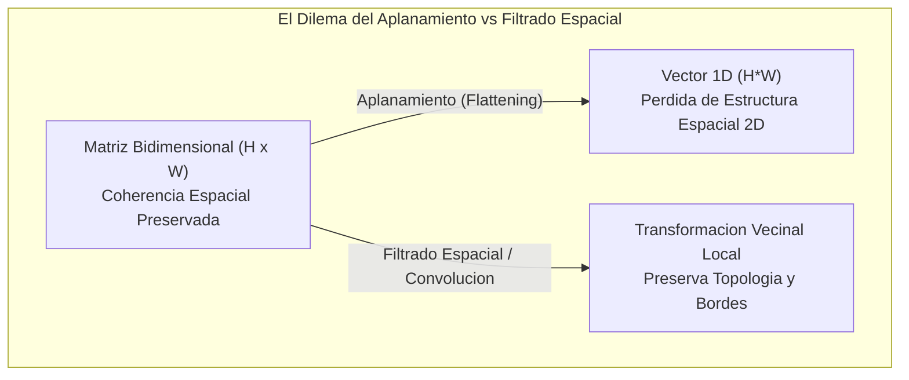
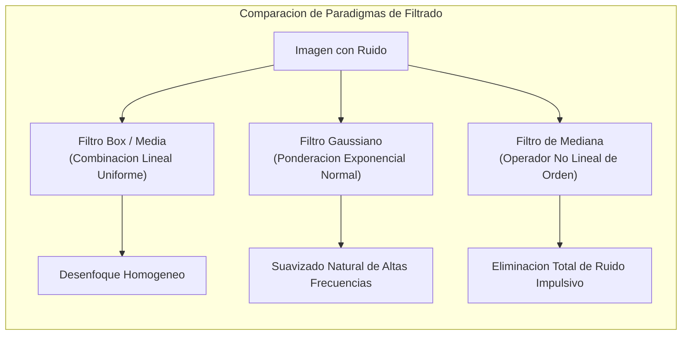
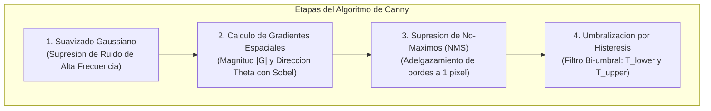
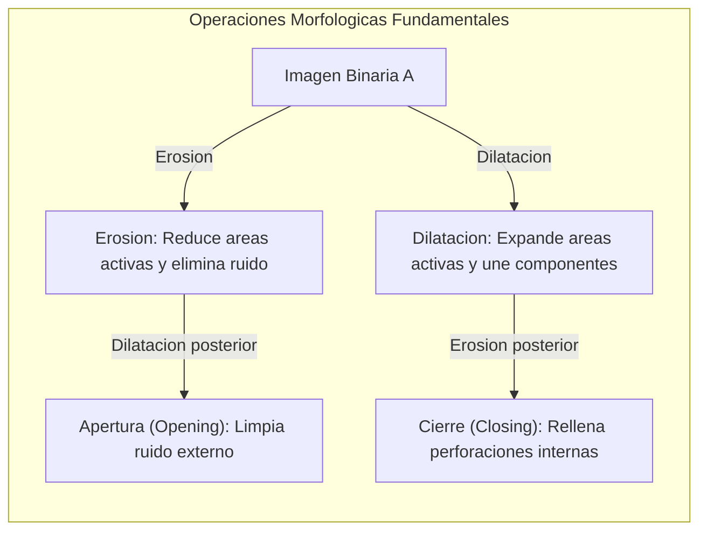

# Clase 2: Filtrado Espacial, Operaciones Morfologicas, Deteccion de Bordes y Analisis de Contornos en OpenCV

> Proposito pedagogico: Dominar los algoritmos clasicos de procesamiento espacial de imagenes en OpenCV, formalizar la aplicacion de filtros lineales y no lineales (Box blur, Gaussian, Median), implementar tecnicas de binarizacion adaptativa y Otsu, dominar el operador de Canny para extraccion de bordes, ejecutar morfologia matematica (erosion, dilatacion, apertura, cierre) y extraer descriptores geometricos mediante momentos y contornos vectoriales.

## 1\. Contexto y Marco Conceptual

### Del Tratamiento Matricial al Procesamiento Espacial

En el procesamiento digital de imagenes, la transicion desde operaciones puntuales (donde el nuevo valor de un pixel depende exclusivamente de si mismo) hacia operaciones espaciales (donde el nuevo valor depende de su entorno local) marca el inicio de la extraccion de caracteristicas estructurales. 

Un dilema fundamental explorado en la disciplina es el **dilema del aplanamiento (flattening)**:

- En los modelos clasicos de aprendizaje supervisado tabular, una imagen de dimensiones $H \times W$ suele aplanarse en un vector unidimensional $\mathbf{x} \in \mathbb{R}^{H \cdot W}$.

- Sin embargo, este proceso destruye irreversiblemente la **topologia bidimensional y la correlacion de vecindad local**. Dos pixeles verticalmente contiguos pasan a estar separados por cientos de posiciones en el vector aplanado.

- El filtrado espacial preserva la coherencia bidimensional, operando directamente sobre la vecindad local para suprimir perturbaciones estocasticas de alta frecuencia (ruido) o resaltar discontinuidades de primer orden (bordes).



### Objetivos Fundacionales del Filtrado y la Morfologia

El procesamiento clasico persigue tres finalidades tecnicas fundamentales:

1. **Reduccion de Ruido Estocastico:** Suavizar fluctuaciones termicas de los sensores opticos sin destruir las fronteras geometricas criticas.

1. **Segmentacion y Binarizacion Binaria:** Separar el primer plano (*foreground*) del fondo (*background*) mediante umbrales estocasticos optimizados.

1. **Caracterizacion Topologica y Morfologica:** Cuantificar la forma, area, perimetro, momentos de inercia y convexidad de los cuerpos delimitados en la imagen para su clasificacion posterior.

---

## 2\. Fundamentos Teoricos y Arquitectura

### Taxonomia Formal de los Filtros Espaciales

#### 1\. Filtro de Media o Caja (Normalized Box Filter)

Sustituye la intensidad de cada pixel por la media aritmetica uniforme de su vecindad de tamano $k \times k$ (donde $k$ debe ser estrictamente impar para garantizar un centroide simetrico):

$$
K_{\text{box}} = \frac{1}{k^2} \begin{bmatrix} 1 & \dots & 1 \\ \vdots & \ddots & \vdots \\ 1 & \dots & 1 \end{bmatrix}_{k \times k}
$$

Propiedad: Suprime eficazmente el ruido uniforme, pero difumina drásticamente los bordes de alta frecuencia espacial.

#### 2\. Filtro Gaussiano (Gaussian Blur)

Pondera la vecindad espacial mediante una funcion de densidad de probabilidad normal bivariada isotropica con desviacion estandar $\sigma$:

$$
G(x, y) = \frac{1}{2\pi\sigma^2} \exp\left(-\frac{x^2 + y^2}{2\sigma^2}\right)
$$

Los coeficientes decaen exponencialmente a medida que aumenta la distancia euclidiana respecto al pixel central. Provee una atenuacion espectral optima en el dominio de las frecuencias, minimizando artefactos de difraccion.

#### 3\. Filtro de Mediana (Median Blur)

Constituye un operador no lineal de orden estadistico. No calcula una combinacion lineal, sino que ordena los valores de los pixeles contenidos en la ventana $k \times k$ y selecciona el elemento mediano:

$$
S(x, y) = \text{mediana}\left(\{I(x+m, y+n) \mid -a \le m, n \le a\}\right)
$$

Propiedad critica: Resulta insuperable para eliminar **ruido impulsivo o "sal y pimienta"** (valores extremos espurios de 0 o 255 generados por defectos de celdas del sensor), preservando con alta fidelidad la agudeza de los bordes estructurales.



---

### Binarizacion y Umbralizacion (Thresholding)

La binarizacion transforma una imagen en escala de grises $I(x, y)$ en una representacion booleana $B(x, y) \in \{0, 1\}$ o $\{0, 255\}$ para aislar las regiones de interes.

#### 1\. Umbralizacion Global Fija

Se establece un valor escalar de corte $T \in [0, 255]$:

$$
B(x, y) = \begin{cases} 255 & \text{si } I(x, y) > T \\ 0 & \text{en caso contrario} \end{cases}
$$

Limitacion: Fracasa catastroficamente en escenas del mundo real sujetas a iluminacion heterogenea o gradientes de sombra.

#### 2\. Umbralizacion Adaptativa (Adaptive Thresholding)

Calcula dinamicamente un umbral local individualizado $T(x, y)$ para cada pixel a partir de la media o suma ponderada gaussiana de una vecindad $B \times B$, restando una constante de penalizacion $C$:

$$
T(x, y) = \text{MediaLocal}(I, B) - C
$$

Permite aislar caracteres o bordes en documentos con iluminacion desigual o sombras proyectadas.

#### 3\. Metodo de Binarizacion Optima de Otsu

El algoritmo de Otsu es una tecnica de agrupamiento no supervisado que determina automaticamente el umbral optimo $T^*$ analizando el histograma global de la imagen. Maximiza la **varianza entre clases** $\sigma_B^2(T)$, lo que equivale formalmente a minimizar la varianza intra-clase ponderada:

$$
\sigma_B^2(T) = \omega_0(T) \omega_1(T) \left[\mu_0(T) - \mu_1(T)\right]^2
$$

donde $\omega_0(T)$ y $\omega_1(T)$ son las probabilidades de ocurrencia de las dos clases separadas por el umbral $T$, y $\mu_0, \mu_1$ sus respectivas medias de intensidad.

---

### Deteccion de Bordes: Gradientes Espaciales y Operador de Canny

Un borde corresponde a una discontinuidad pronunciada en la funcion de intensidad luminosa.

#### Operadores de Gradiente de Sobel

Aproximan las derivadas espaciales parciales de primer orden en las direcciones horizontal y vertical mediante convolucion:

$$
G_x = \begin{bmatrix} -1 & 0 & 1 \\ -2 & 0 & 2 \\ -1 & 0 & 1 \end{bmatrix} * I, \quad G_y = \begin{bmatrix} -1 & -2 & -1 \\ 0 & 0 & 0 \\ 1 & 2 & 1 \end{bmatrix} * I
$$

La magnitud del gradiente y su orientacion angular se formalizan como:

$$
|G| = \sqrt{G_x^2 + G_y^2}, \quad \theta = \arctan\left(\frac{G_y}{G_x}\right)
$$

#### Algoritmo de Deteccion de Bordes de Canny

El algoritmo formulado por John Canny (1986) constituye el estandar optimo multi-etapa:

1. **Filtrado Gaussiano:** Suprime el ruido para evitar falsos positivos de gradiente.

1. **Calculo del Gradiente:** Determina la magnitud y el angulo del gradiente mediante operadores de Sobel.

1. **Supresion de No-Maximos (Non-Maximum Suppression - NMS):** Adelgaza los bordes gruesos a un solo pixel de espesor; retiene el pixel unicamente si su magnitud de gradiente es el maximo local a lo largo de la linea perpendicular a la direccion del borde.

1. **Umbralizacion por Histeresis con Doble Umbral (**$T_{\text{lower}}, T_{\text{upper}}$**):**

   - Si $|G| \ge T_{\text{upper}}$, el pixel se clasifica como **borde fuerte (seguro)**.
   
   - Si $|G| < T_{\text{lower}}$, se descarta de forma inapelable.
   
   - Si $T_{\text{lower}} \le |G| < T_{\text{upper}}$, se retiene como **borde debil** si y solo si esta conectado topologicamente a un borde fuerte.



---

### Morfologia Matematica sobre Imagenes Binarias

La morfologia matematica modela las formas geometricas a partir de la teoria de conjuntos, empleando un **elemento estructurante** $B$ (matriz binaria que define una vecindad: cruz, rectangulo o elipse).

- **Erosion (**$A \ominus B$**):** Desplaza el elemento estructurante $B$ sobre la imagen binaria $A$. El pixel resultante se conserva en 1 si y solo si $B$ esta completamente contenido dentro de $A$:

  $$
  A \ominus B = \{z \in \mathbb{Z}^2 \mid (B)_z \subseteq A\}
  $$
  
  Efecto: Contrae las regiones blancas, elimina filamentos y suprime pequenas islas de ruido.

- **Dilatacion (**$A \oplus B$**):** El pixel resultante toma el valor 1 si al menos un elemento de $B$ coincide con un pixel activo de $A$:

  $$
  A \oplus B = \{z \in \mathbb{Z}^2 \mid (\hat{B})_z \cap A \ne \emptyset\}
  $$
  
  Efecto: Expande las fronteras de los objetos, une regiones fracturadas y rellena pequenas perforaciones.

- **Apertura (**$A \circ B = (A \ominus B) \oplus B$**):** Erosion seguida de dilatacion. Suprime protuberancias y elimina pequenos artefactos externos preservando la escala de los cuerpos mayores.

- **Cierre (**$A \bullet B = (A \oplus B) \ominus B$**):** Dilatacion seguida de erosion. Fusiona grietas estrechas y rellena agujeros internos sin alterar la configuracion geometrica general.



---

### Teoria de Momentos y Analisis de Contornos

Un **contorno** es una curva continua que une todos los puntos limítrofes a lo largo de una frontera de igual tonalidad o intensidad.

#### Momentos Estadisticos Espaciales

Para una region bidimensional discreta delimitada por una funcion de intensidad $I(x, y)$, el momento espacial de orden $(p + q)$ se define como:

$$
M_{pq} = \sum_x \sum_y x^p y^q I(x, y)
$$

Propiedades fundamentales:

- **Area:** Corresponde al momento de orden cero: $A = M_{00}$.

- **Centroide o Centro de Masa:** Coordenadas $(\bar{x}, \bar{y})$ que equilibran los momentos estaticos de primer orden:

  $$
  \bar{x} = \frac{M_{10}}{M_{00}}, \quad \bar{y} = \frac{M_{01}}{M_{00}}
  $$

- **Envolvente Convexa (Convex Hull):** El poligono convexo de menor extension que encierra completamente a la totalidad del contorno.

---

## 3\. Implementacion Tecnica y Logica de Negocio

### Pipeline Integrado de Filtrado, Binarizacion y Canny

```python
import cv2
import numpy as np

def pipeline_procesamiento_espacial(ruta_imagen: str):
    """
    Aplica filtrado espacial, binarizacion mediante Otsu y extraccion de bordes Canny.
    """
    img_bgr = cv2.imread(ruta_imagen)
    if img_bgr is None:
        raise ValueError("Error al cargar la imagen fuente")

    img_gray = cv2.cvtColor(img_bgr, cv2.COLOR_BGR2GRAY)

    # 1. Comparacion de tecnicas de filtrado espacial
    # A. Box filter uniforme (kernel 5x5)
    blur_box = cv2.blur(img_gray, (5, 5))

    # B. Filtro Gaussiano (kernel 5x5, sigma derivado del tamano del kernel)
    blur_gauss = cv2.GaussianBlur(img_gray, (5, 5), sigmaX=1.5)

    # C. Filtro de Mediana (tamano de ventana 5)
    blur_mediana = cv2.medianBlur(img_gray, 5)

    # 2. Umbralizacion y Binarizacion
    # A. Umbral global simple (T = 127)
    _, thresh_global = cv2.threshold(blur_gauss, 127, 255, cv2.THRESH_BINARY)

    # B. Umbralizacion automatica de Otsu
    valor_otsu, thresh_otsu = cv2.threshold(blur_gauss, 0, 255, cv2.THRESH_BINARY + cv2.THRESH_OTSU)
    print(f"Umbral optimo estimado por Otsu: {valor_otsu:.2f}")

    # C. Umbralizacion Adaptativa Gaussiana
    thresh_adapt = cv2.adaptiveThreshold(
        blur_gauss, 255, cv2.ADAPTIVE_THRESH_GAUSSIAN_C, cv2.THRESH_BINARY, blockSize=11, C=2
    )

    # 3. Deteccion de bordes con el operador de Canny
    # Umbrales optimos con histeresis
    bordes_canny = cv2.Canny(blur_gauss, threshold1=50, threshold2=150)

    return {
        "blur_box": blur_box,
        "blur_gauss": blur_gauss,
        "blur_mediana": blur_mediana,
        "thresh_otsu": thresh_otsu,
        "thresh_adapt": thresh_adapt,
        "canny": bordes_canny
    }
```

### Operaciones Morfologicas y Analisis de Contornos

```python
def analizar_morfologia_y_contornos(imagen_binaria: np.ndarray, imagen_original: np.ndarray):
    """
    Ejecuta morfologia matematica y extrae parametros geometricos de los contornos.
    """
    # 1. Definicion del Elemento Estructurante (Kernel morfologico eliptico 5x5)
    kernel = cv2.getStructuringElement(cv2.MORPH_ELLIPSE, (5, 5))

    # 2. Operaciones morfologicas
    img_erosion = cv2.erode(imagen_binaria, kernel, iterations=1)
    img_dilatacion = cv2.dilate(imagen_binaria, kernel, iterations=1)
    img_apertura = cv2.morphologyEx(imagen_binaria, cv2.MORPH_OPEN, kernel)
    img_cierre = cv2.morphologyEx(imagen_binaria, cv2.MORPH_CLOSE, kernel)

    # 3. Extraccion topologica de contornos externos
    contornos, jerarquia = cv2.findContours(
        img_cierre, cv2.RETR_EXTERNAL, cv2.CHAIN_APPROX_SIMPLE
    )
    print(f"Total de contornos estructurales detectados: {len(contornos)}")

    lienzo_anotado = imagen_original.copy()
    descriptores_objetos = []

    for i, c in enumerate(contornos):
        # Filtro de area para descartar artefactos menores
        area = cv2.contourArea(c)
        if area < 100.0:
            continue

        perimetro = cv2.arcLength(c, closed=True)

        # Calculo de momentos y centroide de masa
        M = cv2.moments(c)
        if M["m00"] != 0:
            cx = int(M["m10"] / M["m00"])
            cy = int(M["m01"] / M["m00"])
        else:
            cx, cy = 0, 0

        # Bounding box ortogonal
        x, y, w, h = cv2.boundingRect(c)

        # Envolvente convexa
        hull = cv2.convexHull(c)

        # Renderizado de contorno y centroide
        cv2.drawContours(lienzo_anotado, [c], -1, (0, 255, 0), 2)
        cv2.drawContours(lienzo_anotado, [hull], -1, (255, 0, 0), 1)
        cv2.circle(lienzo_anotado, (cx, cy), 4, (0, 0, 255), -1)

        descriptores_objetos.append({
            "id": i,
            "area": area,
            "perimetro": perimetro,
            "centroide": (cx, cy),
            "bbox": (x, y, w, h)
        })

    return lienzo_anotado, descriptores_objetos
```

### Ingestion y Analisis de Secuencias de Video Cuadro a Cuadro

```python
def procesar_flujo_video(origen_video: str = 0, limite_frames: int = 100):
    """
    Decodifica y procesa iterativamente un flujo de video calculando latencia temporal.
    """
    cap = cv2.VideoCapture(origen_video)
    if not cap.isOpened():
        raise RuntimeError("No fue posible inicializar la captura de video.")

    ancho = int(cap.get(cv2.CAP_PROP_FRAME_WIDTH))
    alto = int(cap.get(cv2.CAP_PROP_FRAME_HEIGHT))
    fps = cap.get(cv2.CAP_PROP_FPS)
    print(f"Propiedades de la secuencia: {ancho}x{alto} a {fps:.2f} FPS")

    frame_idx = 0
    try:
        while frame_idx < limite_frames:
            ret, frame = cap.read()
            if not ret:
                break

            # Procesamiento espacial en tiempo real sobre el cuadro
            gray = cv2.cvtColor(frame, cv2.COLOR_BGR2GRAY)
            bordes = cv2.Canny(gray, 50, 150)

            frame_idx += 1
    finally:
        # Liberacion obligatoria de recursos del sistema operativo
        cap.release()
        cv2.destroyAllWindows()
```

---

## 4\. Analisis Critico de Casos y Auditoria Practica

### Evaluacion Comparativa de Filtros de Suavizado Espacial

| **Filtro Espacial** | **Tipo de Operador** | **Preservacion de Bordes** | **Efectividad frente a Ruido Gaussiano** | **Efectividad frente a Ruido Sal y Pimienta** |
| --- | --- | --- | --- | --- |
| **Box Blur (Media)** | Lineal / Convolucional | Pobre (induce desenfoque uniforme severo). | Moderada. | Pobre (arrastra los valores extremos a la media local). |
| **Gaussian Blur** | Lineal / Convolucional | Moderada (decae exponencialmente con la distancia). | Excelente (optimo teorico para perturbaciones gaussianas). | Pobre (diluye el valor impulsivo en la campana). |
| **Median Blur** | No Lineal / Estadistico | Alta (no genera combinaciones lineales que interpolen bordes). | Aceptable. | Insuperable (elimina de raiz los valores extremos atipicos). |
| **Bilateral Filter** | No Lineal Ponderado | Maxima (combina proximidad espacial y similitud radiometrica). | Alta. | Moderada (alto consumo de ciclos de reloj). |

### Matriz de Decision Metodologica para Algoritmos de Binarizacion

| **Metodo de Umbralizacion** | **Condicion Optima de Iluminacion** | **Mecanismo de Calibracion** | **Sensibilidad a Gradientes de Luz** |
| --- | --- | --- | --- |
| **Thresholding Global Fijo** | Estrictamente controlada y homogenea en todo el sensor. | Manual / Heuristica fija. | Extrema (inviable en entornos no industriales). |
| **Metodo de Otsu** | Distribucion bimodal pronunciada en el histograma. | Optimizacion analitica de varianza entre clases. | Alta si el fondo exhibe sombras no bimodales. |
| **Adaptive Thresholding (Media)** | Variable, con iluminacion irregular o sombras proyectadas. | Calculo de estadisticos locales en ventana deslizante. | Muy baja (altamente robusto a gradientes continuos). |
| **Adaptive Thresholding (Gaussian)** | Variable y con texturas finas en el plano de fondo. | Ponderacion local por decaimiento gaussiano. | Minima (estandar de oro para digitalizacion de documentos). |

---

## 5\. Principios de Diseno, Buenas Practicas y Anti-patrones

### Reglas de Oro en Procesamiento Espacial

1. **Dimension Impar Mandatoria en Kernels Convolucionales:** Al invocar filtros espaciales (` cv2.blur `, ` cv2.GaussianBlur `, ` cv2.medianBlur `), los tamanos de ventana deben ser forzosamente enteros impares ($3, 5, 7, \dots$) para que exista un pixel central geometrico unico sobre el cual depositar el resultado del calculo.

1. **Suavizado Previo a la Extraccion de Gradientes:** Jamas aplicar detectores de bordes (Sobel, Laplaciano, Canny) sobre imagenes crudas sin una etapa previa de filtrado gaussiano; de lo contrario, el operador derivativo amplificara cuadraticamente el ruido de alta frecuencia del sensor.

1. **Liberacion Explicita de Contextos de Video:** En procesos de captura continua mediante ` cv2.VideoCapture `, encapsular siempre el ciclo de lectura en bloques ` try...finally ` garantizando la invocacion de ` .release() ` para prevenir el bloqueo de recursos del kernel del sistema operativo.

### Anti-patrones Metodologicos Identificados

| **Anti-patron** | **Mecanismo del Error** | **Impacto Tecnico / Consecuencia** | **Estrategia de Mitigacion** |
| --- | --- | --- | --- |
| **Canny sin Histeresis Calibrada** | Asignar valores arbitrarios e identicos a ` threshold1 ` y ` threshold2 ` en ` cv2.Canny `. | Fragmentacion masiva de bordes o perdida completa de contornos estructurales debiles. | Mantener una relacion sistematica $T_{\text{upper}} \approx 2 \cdot T_{\text{lower}}$ o $3 \cdot T_{\text{lower}}$ calibrada segun la desviacion estandar del histograma. |
| **Confusion entre Apertura y Cierre** | Aplicar dilatacion inicial en mascaras que presentan ruido de fondo disperso (*foreground noise*). | Amplificacion de los artefactos de ruido fusionandolos con el objeto principal de interes. | Aplicar apertura (` cv2.MORPH_OPEN `) para eliminar ruido externo y cierre (` cv2.MORPH_CLOSE `) para sellar perforaciones internas. |
| **Contornos sobre Imagenes no Binarias** | Ejecutar ` cv2.findContours ` directamente sobre imagenes en escala de grises sin binarizacion previa. | Deteccion erratica de miles de falsos contornos correspondientes a gradientes suaves de textura. | Alimentar unicamente matrices estrictamente binarizadas o mapas booleanos de bordes de Canny. |

---

## 6\. Sintesis Conceptual y Profundizacion Academica

### Sintesis Integradora

El procesamiento espacial clasico constituye la piedra angular de la vision por computadora deterministica. A traves de la convolucion discreta, el filtrado lineal y no lineal, la histeresis de Canny y la morfologia matematica de conjuntos, es posible aislar estructuras topologicas complejas sin recurrir a parametros aprendidos. Sin embargo, su diseno heuristico y manual ("Hand-crafted Features") limita severamente su generalizacion ante escenas visualmente no restringidas, sentando las bases conceptuales para la emergencia del aprendizaje profundo (Deep Learning) y las redes neuronales convolucionales.

### Preguntas Guia para la Investigacion de Posgrado

1. ¿Cual es la cota matematica formal que vincula la escala $\sigma$ del filtro gaussiano con el radio de deteccion y la precision de localizacion espacial de bordes en el criterio de optimizacion de Canny?

1. ¿Bajo que condiciones de degradacion optica la binarizacion no lineal mediante tecnicas de conectividad difusa o cortes de grafo (*Graph Cuts*) supera asintoticamente al agrupamiento bimodal de Otsu?

### Referencias Bibliograficas Fundamentales

- Canny, J. (1986). *A Computational Approach to Edge Detection*. IEEE Transactions on Pattern Analysis and Machine Intelligence, PAMI-8(6), 679-698.

- Otsu, N. (1979). *A Threshold Selection Method from Gray-Level Histograms*. IEEE Transactions on Systems, Man, and Cybernetics, 9(1), 62-66.

- Serra, J. (1983). *Image Analysis and Mathematical Morphology*. Academic Press.

- Viola, P., &amp; Jones, M. (2001). *Rapid Object Detection using a Boosted Cascade of Simple Features*. Proceedings of the 2001 IEEE Computer Society Conference on Computer Vision and Pattern Recognition (CVPR).
