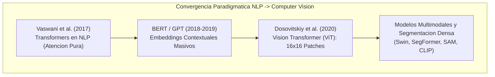
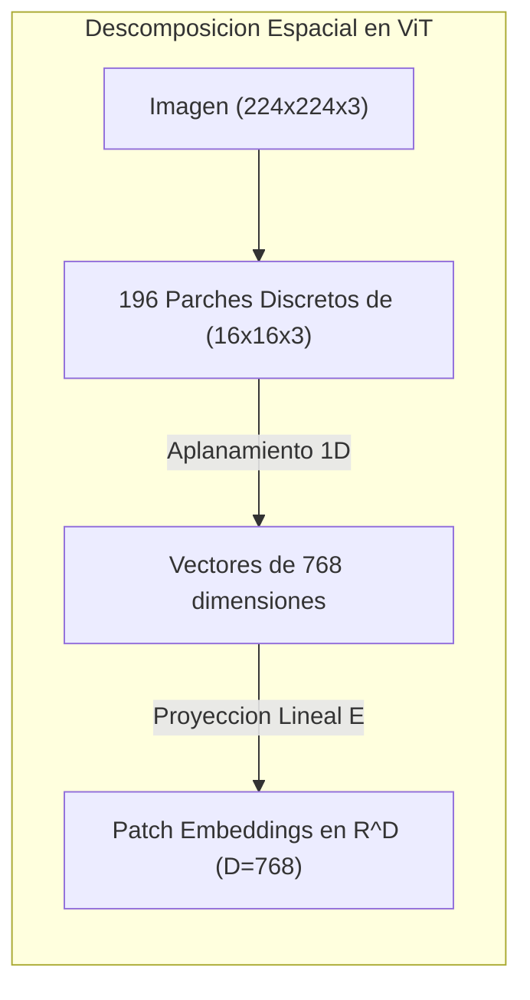
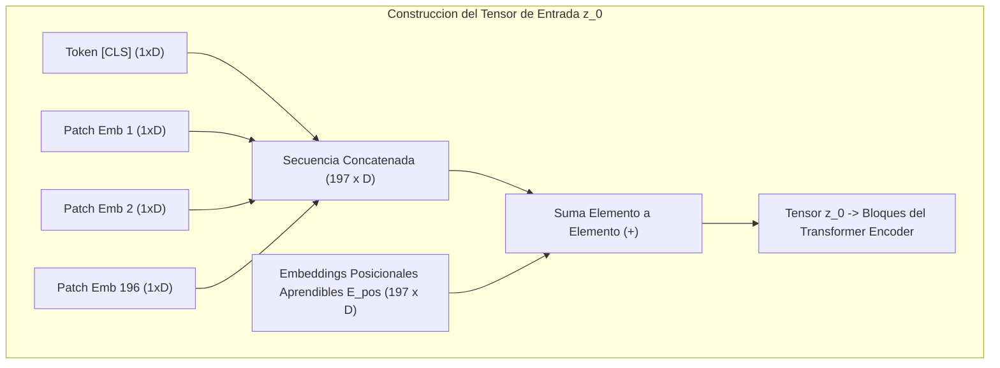
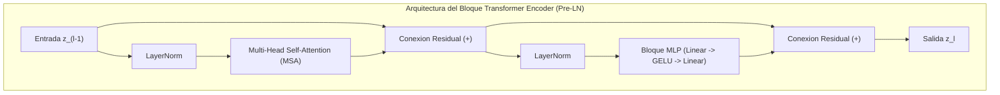

# Clase 5: Arquitecturas Vision Transformers (ViT), Mecanismos de Auto-Atencion Global y Segmentacion Semantica

> Proposito pedagogico: Comprender la adaptacion del paradigma Transformer desde el procesamiento del lenguaje natural (NLP) hacia la vision por computadora (Vision Transformers - ViT), analizar la particion en parches (patches) y proyecciones lineales, formalizar matematicamente el mecanismo de auto-atencion multicabezal (MSA), contrastar la ausencia de sesgos inductivos frente a las CNNs y evaluar modelos avanzados de segmentacion visual en Hugging Face.

## 1\. Contexto y Marco Conceptual

### La Transicion de la Atencion Secuencial a las Senales Visuales

Durante decadas, el paradigma dominante en la vision por computadora estuvo monopolizado por operadores convolucionales discretos. Sin embargo, en el procesamiento del lenguaje natural (NLP), la arquitectura **Transformer** (Vaswani et al., 2017: *"Attention Is All You Need"*) habia desmantelado las redes recurrentes tradicionales mediante la supresion de la recurrencia en favor del mecanismo puro de **auto-atencion (Self-Attention)**.

En 2020, Alexey Dosovitskiy y el equipo de Google Research presentaron **Vision Transformer (ViT)** bajo el lema cardinal *"An Image is Worth 16x16 Words"*, demostrando que la arquitectura estandar de Transformer podia aplicarse directamente a datos visuales con minimas modificaciones estructurales.



### Limitaciones Estructurales de las Convoluciones vs Auto-Atencion Global

- **El Cuello de Botella del Campo Receptivo Convolucional:** Las redes neuronales convolucionales (CNNs) operan sujetas a una restriccion fisica severa: sus filtros extraen informacion unicamente de vecindades espaciales hiperlocales ($3 \times 3$ o $5 \times 5$). Para que dos regiones espacialmente distantes de una imagen interactuen semanticamente, la senal debe propagarse a traves de decenas de capas sucesivas de convolucion y submuestreo por pooling.

- **Auto-Atencion Global desde la Capa Inicial:** En un Vision Transformer, cada parche de la imagen atiende directamente a todos los demas parches en la primera capa de la red mediante una operacion con complejidad de ruta $O(1)$. La distancia de propagacion de la informacion entre cualquier par de entidades visuales es constante e inmediata.

### El Dilema del Sesgo Inductivo (Inductive Bias Trade-off)

Una diferencia epistemologica fundamental entre CNNs y Vision Transformers radica en sus **sesgos inductivos**:

- **CNNs (Alto Sesgo Inductivo):** Integran supuestos previos rigidos sobre la naturaleza del mundo fisico: localidad espacial (los pixeles cercanos estan correlacionados) y equivarianza a la traslacion (un objeto es el mismo si se desplaza en el plano).

- **Vision Transformers (Minimo Sesgo Inductivo):** No asumen localidad espacial ni orden topologico intrinseco; tratan a los parches visuales como un conjunto desordenado de fichas o palabras (*tokens*).

  - **Consecuencia en Datos Pequenos:** En conjuntos de entrenamiento reducidos (como CIFAR-10 o ImageNet-1k entrenado desde cero), ViT rinde sensiblemente por debajo de una CNN clasica (ResNet), pues debe "aprender desde cero" que los pixeles vecinos estan relacionados.
  
  - **Consecuencia a Escala Masiva:** Al ser preentrenado sobre grandes corpus de imagenes (ImageNet-21k con 14 millones de imagenes o JFT-300M con 300 millones), el minimo sesgo inductivo se convierte en una ventaja colosal: ViT no satura su capacidad de aprendizaje, supera holgadamente a las CNNs y exhibe un escalado asintotico superior en funcion del computo disponible.

---

## 2\. Fundamentos Teoricos y Arquitectura

### Descomposicion en Parches y Proyeccion Lineal

Sea una imagen bidimensional convencional $\mathbf{x} \in \mathbb{R}^{H \times W \times C}$. Dado que el mecanismo de auto-atencion estandar exhibe una complejidad computacional cuadratica $O(M^2)$ respecto al numero de elementos $M$ de la secuencia, aplicar atencion a nivel de pixeles individuales ($M = H \cdot W$) resultaria computacionalmente intratable (para una imagen modesta de $224 \times 224$, $M \approx 50,000$ pixeles, exigiendo matrices de atencion de $2.5 \times 10^9$ elementos por capa).

Para soslayar esta barrera, ViT introduce la **particion en parches (*****Patch Partitioning*****)**:

1. La imagen se divide en una grilla de $N$ parches no solapados de dimension fija $P \times P$ (donde tipicamente $P = 16$):

   $$
   N = \frac{H \cdot W}{P^2}
   $$
   
   Para $H = W = 224$ y $P = 16$, la secuencia resultante cuenta con:
   
   $$
   N = \frac{224 \times 224}{16 \times 16} = 14 \times 14 = 196 \text{ parches}
   $$

1. Cada parche espacial $\mathbf{x}_p^i \in \mathbb{R}^{P \times P \times C}$ se aplana en un vector 1D:

   $$
   \mathbf{x}_p^i \in \mathbb{R}^{P^2 \cdot C} = \mathbb{R}^{16 \times 16 \times 3} = \mathbb{R}^{768}
   $$

1. Se proyecta linealmente cada parche aplanado hacia una dimension latente constante $D$ mediante una matriz de pesos aprendible $\mathbf{E} \in \mathbb{R}^{(P^2 \cdot C) \times D}$:

   $$
   \mathbf{e}_i = \mathbf{x}_p^i \mathbf{E} \in \mathbb{R}^D
   $$



---

### Token de Clasificacion ` [CLS] ` y Embeddings Posicionales

#### El Token ` [CLS] ` (Class Token)

Para condensar la informacion semantica de la secuencia completa en una unica representacion util para clasificacion sin privilegiar arbitrariamente a ningun parche especifico, se antepone un vector aprendible especial: el **token de clasificacion** $\mathbf{x}_{\text{class}} \in \mathbb{R}^D$ (herencia directa de la arquitectura BERT). Su estado final a la salida del Transformer servira como representacion consolidada de la imagen completa.

#### Embeddings Posicionales (Positional Embeddings)

Debido a que el operador de auto-atencion es matematicamente invariante ante permutaciones de los elementos de entrada (trata la secuencia como un conjunto desordenado), es indispensable inyectar informacion sobre la geometria espacial de la cual proviene cada parche. Se suma un vector de posicion aprendible 1D $\mathbf{E}_{\text{pos}} \in \mathbb{R}^{(N + 1) \times D}$:

$$
\mathbf{z}_0 = [\mathbf{x}_{\text{class}}; \mathbf{x}_p^1 \mathbf{E}; \mathbf{x}_p^2 \mathbf{E}; \dots; \mathbf{x}_p^N \mathbf{E}] + \mathbf{E}_{\text{pos}}
$$



---

### Mecanismo de Auto-Atencion Multicabezal (Multi-Head Self-Attention - MSA)

Para una matriz de secuencia normalizada $\mathbf{z} \in \mathbb{R}^{(N+1) \times D}$, se computan tres proyecciones lineales mediante matrices de pesos aprendibles $W_Q, W_K, W_V \in \mathbb{R}^{D \times d_k}$:

- **Queries (Consultas):** $Q = \mathbf{z} W_Q$

- **Keys (Claves):** $K = \mathbf{z} W_K$

- **Values (Valores):** $V = \mathbf{z} W_V$

El calculo de la **Auto-Atencion Escalada por Producto Punto (Scaled Dot-Product Attention)** se formaliza como:

$$
\text{Attention}(Q, K, V) = \text{softmax}\left(\frac{Q K^T}{\sqrt{d_k}}\right) V
$$

donde:

- $Q K^T \in \mathbb{R}^{(N+1) \times (N+1)}$: Matriz de afinidad de atencion que cuantifica la correlacion mutua entre cada par de parches.

- $\sqrt{d_k}$: Factor de escala que neutraliza el crecimiento de la varianza del producto punto en dimensiones elevadas, evitando que la funcion softmax caiga en zonas de gradiente infinitesimalmente nulo.

En el esquema **Multi-Head (MSA)** con $h$ cabezas independientes ($d_k = D / h$):

$$
\text{MSA}(\mathbf{z}) = [\text{head}_1; \text{head}_2; \dots; \text{head}_h] W_O
$$

donde cada cabeza atiende simultaneamente a relaciones espaciales y contextuales diferenciadas (por ejemplo, cabezas especializadas en bordes locales contiguos y otras en dependencias semanticas de largo alcance).

---

### Bloque Encoder del Vision Transformer

El codificador consiste en $L$ capas identicas apiladas, donde cada bloque incorpora:

1. **Pre-Layer Normalization (Pre-LN):** Normalizacion de activaciones aplicada inmediatamente antes de cada subcapa, garantizando estabilidad en la propagacion hacia adelante y hacia atras:

   $$
   \mathbf{z}'_l = \text{MSA}(\text{LN}(\mathbf{z}_{l-1})) + \mathbf{z}_{l-1}
   $$

1. **Conexiones Residuales (Skip Connections):** Mitigan la degradacion del gradiente sumando la entrada original a la salida de cada subbloque.

1. **Bloque Multicapa Perceptron (MLP):** Dos capas densas con expansion dimensional (factor 4, de $D$ a $4D$) y funcion de activacion **GELU (Gaussian Error Linear Unit)**:

   $$
   \mathbf{z}_l = \text{MLP}(\text{LN}(\mathbf{z}'_l)) + \mathbf{z}'_l
   $$

1. **Cabezal de Clasificacion:** A la salida de la capa final $L$, se extrae exclusivamente el primer elemento $\mathbf{z}_L^0$ (correspondiente al token ` [CLS] `), se normaliza y se procesa mediante una capa lineal para emitir las probabilidades de clase:

   $$
   \mathbf{y} = \text{Softmax}(\text{Linear}(\text{LN}(\mathbf{z}_L^0)))
   $$



---

## 3\. Implementacion Tecnica y Logica de Negocio

### Implementacion de la Proyeccion de Parches en PyTorch

Un descubrimiento tecnico cardinal en la implementacion eficiente de Vision Transformers consiste en modelar la proyeccion lineal de parches no como un bucle explícito de recortes, sino como una **convolucion 2D con tamano de kernel y stride identicos al tamano del parche (**$P$**)**:

```python
import torch
import torch.nn as nn

class PatchEmbedding(nn.Module):
    """
    Proyecta una imagen 2D hacia una secuencia de embeddings lineales empleando Conv2D vectorizado.
    """
    def __init__(self, img_size=224, patch_size=16, in_channels=3, embed_dim=768):
        super(PatchEmbedding, self).__init__()
        self.img_size = img_size
        self.patch_size = patch_size
        self.num_patches = (img_size // patch_size) ** 2  # (224/16)^2 = 196
        
        # Convolucion equivalente a la particion y proyeccion lineal
        self.proyeccion = nn.Conv2d(
            in_channels=in_channels,
            out_channels=embed_dim,
            kernel_size=patch_size,
            stride=patch_size
        )

    def forward(self, x: torch.Tensor) -> torch.Tensor:
        # Entrada: (Batch, 3, 224, 224)
        x = self.proyeccion(x)  # -> (Batch, 768, 14, 14)
        x = x.flatten(2)        # -> (Batch, 768, 196)
        x = x.transpose(1, 2)   # -> (Batch, 196, 768) secuencia de tokens
        return x
```

### Inferencia y Analisis con Modelos Preentrenados de Hugging Face

```python
from transformers import AutoImageProcessor, ViTForImageClassification
from PIL import Image
import torch
import requests

def clasificar_con_vit(ruta_o_url_imagen: str):
    """
    Ejecuta inferencia zero-effort con Vision Transformer preentrenado en ImageNet-21k/1k.
    """
    # 1. Carga de procesador de imagen y pesos oficiales de ViT-Base (16x16)
    nombre_modelo = "google/vit-base-patch16-224"
    procesador = AutoImageProcessor.from_pretrained(nombre_modelo)
    modelo = ViTForImageClassification.from_pretrained(nombre_modelo)
    modelo.eval()

    # 2. Carga y preprocesamiento de la imagen
    if ruta_o_url_imagen.startswith("http"):
        imagen = Image.open(requests.get(ruta_o_url_imagen, stream=True).raw)
    else:
        imagen = Image.open(ruta_o_url_imagen)
        
    entradas = procesador(images=imagen, return_tensors="pt")

    # 3. Paso hacia adelante y extraccion de logits
    with torch.no_grad():
        salidas = modelo(**entradas)
        logits = salidas.logits
        probabilidades = torch.nn.functional.softmax(logits, dim=-1)

    # 4. Extraccion de las 5 clases mas probables
    top5_prob, top5_indices = torch.topk(probabilidades, 5)
    
    resultados = []
    for i in range(5):
        indice = top5_indices[0][i].item()
        etiqueta = modelo.config.id2label[indice]
        prob = top5_prob[0][i].item()
        resultados.append((etiqueta, prob))
        print(f"Top {i+1}: {etiqueta:<30} | Confianza: {prob:.4f}")

    return resultados
```

---

## 4\. Analisis Critico de Casos y Auditoria Practica

### Evaluacion Comparativa: Convoluciones clasicas vs Vision Transformers

| **Dimension Analitica** | **ResNet-50 (CNN Clasica)** | **ViT-B/16 (Vision Transformer)** | **Swin Transformer (Jerarquico)** |
| --- | --- | --- | --- |
| **Sesgo Inductivo** | Maximo (Localidad espacial estricta y equivarianza a traslacion). | Minimo (No asume relacion espacial; aprende topologia de datos). | Moderado (Auto-atencion en ventanas locales desplazadas). |
| **Complejidad Computacional** | Lineal respecto al area: $O(H \cdot W \cdot K^2)$ | Cuadratica en parches: $O(N^2 \cdot D)$ con $N = HW/P^2$ | Lineal respecto a la resolucion mediante ventanas: $O(M \cdot HW)$ |
| **Dependencia de Datos Masivos** | Baja/Moderada; converge con garantias en ImageNet-1k. | Critica; requiere ImageNet-21k o JFT-300M para superar a CNNs. | Moderada; altamente eficiente en clasificacion y deteccion densa. |
| **Campo Receptivo Inicial** | Hiperlocal ($3 \times 3$ pixeles). | Global inmediato (todos los 196 parches en la capa 1). | Local en ventana $7 \times 7$; crece jerarquicamente por etapas. |
| **Aplicabilidad a Segmentacion** | Directa mediante arquitecturas tipo U-Net o FCN. | Inconveniente por resolucion fija; requiere cabezales tipo SETR. | Optima; estandar de vanguardia en segmentacion (Mask2Former). |

### Auditoria Metodologica: Dinamica de las Cabezas de Atencion

Al auditar los mapas de atencion generados por las distintas capas de ViT se revelan comportamientos cualitativos determinantes:

- **Capas 1 a 4:** Una fraccion significativa de las cabezas de atencion atiende a distancias medias y cortas (emulando dinamicamente filtros convolucionales locales sin que se les haya programado dicho sesgo).

- **Capas 5 a 12:** La distancia media de atencion se dispara; las cabezas se concentran en dependencias de largo alcance, correlacionando partes opuestas de los objetos para resolver la coherencia global de la escena.

---

## 5\. Principios de Diseno, Buenas Practicas y Anti-patrones

### Reglas de Oro en Vision Transformers

1. **Jamás Entrenar ViT desde Cero sobre Datasets Pequenos:** Debido a la carencia de sesgos inductivos de localidad, entrenar un modelo ViT desde pesos aleatorios en colecciones de menos de 100,000 imagenes derivara invariablemente en un sobreajuste catastrofico. Utilizar invariablemente pesos preentrenados en ImageNet-21k o modelos base validados.

1. **Aumentos de Datos Fuertes (Strong Augmentation):** Al realizar fine-tuning en ViT, es imperativo activar tecnicas de aumento agresivas como **MixUp, CutMix y RandAugment**. Dado que ViT tiene alta capacidad parametrica, los aumentos evitan la memorizacion de configuraciones fijas de parches.

1. **Interpolacion Bicubica de Embeddings Posicionales:** Si un modelo entrenado a resolucion $224 \times 224$ debe ejecutarse sobre imagenes de resolucion superior (ej. $384 \times 384$), la secuencia de parches aumentara de 196 a 576. Es matematicamente obligatorio aplicar **interpolacion bicubica 2D** sobre la grilla original de los embeddings posicionales para preservar la coherencia espacial aprendida.

### Anti-patrones Metodologicos Identificados

| **Anti-patron** | **Mecanismo del Error** | **Impacto Tecnico / Consecuencia** | **Estrategia de Mitigacion** |
| --- | --- | --- | --- |
| **Reduccion Ingenua del Tamano de Parche** | Reducir el tamano del parche de $P=16$ a $P=4$ para "capturar mas detalle fino". | Incremento de 16 veces en el numero de tokens ($N$), disparando el consumo de memoria de atencion en 256 veces ($O(N^2)$), induciendo OOM inmediato en GPU. | Mantener $P=16$ o migrar a arquitecturas de atencion local/lineal como Swin Transformer. |
| **Omision de Normalizacion Pre-LN** | Implementar arquitecturas Transformer con Post-LayerNorm en capas profundas de vision. | Gradientes inestables en el token ` [CLS] ` e imposibilidad de convergencia sin un calentamiento (*warmup*) extremo de la tasa de aprendizaje. | Adoptar estrictamente el estandar Pre-LN utilizado en las implementaciones oficiales de ViT. |
| **Uso de Optimizador SGD Simple sin Warmup** | Entrenar modelos basados en atencion utilizando descenso de gradiente estocastico tradicional (SGD) con tasa fija. | Divergencia inmediata de loss en las primeras iteraciones por ausencia de inicializacion adecuada en la atencion. | Utilizar AdamW con programadores de tasa de aprendizaje de decaimiento cosenoidal con calentamiento lineal (*Cosine Annealing with Warmup*). |

---

## 6\. Sintesis Conceptual y Profundizacion Academica

### Sintesis Integradora

Vision Transformer marco un hito epistemologico al demostrar que los principios de auto-atencion y procesamiento de secuencias pueden generalizarse al dominio visual, desacoplando la disciplina de los sesgos inductivos rigidos de las convoluciones. Al interpretar la imagen como una sucesion de parches planos contextualizados globalmente desde el primer instante, ViT unifico las herramientas algoritmicas del procesamiento de lenguaje natural y la vision artificial, allanando el camino hacia las arquitecturas multimodales modernas.

### Preguntas Guia para la Investigacion de Posgrado

1. ¿Como influye la entropia de la distribucion de atencion en las capas finales de ViT en la robustez adversarial del modelo frente a perturbaciones espaciales sutiles de alta frecuencia?

1. ¿Cuales son los compromisos asintoticos formales entre modelos puramente basados en parches (ViT) y arquitecturas hibridas Convolucion-Atencion (como CoAtNet) en terminos de eficiencia de muestra y consumo de energia por epoca de entrenamiento?

### Referencias Bibliograficas Fundamentales

- Dosovitskiy, A., Beyer, L., Kolesnikov, A., Weissenborn, D., Zhai, X., Unterthiner, T., ... &amp; Houlsby, N. (2020). *An image is worth 16x16 words: Transformers for image recognition at scale*. International Conference on Learning Representations (ICLR).

- Vaswani, A., Shazeer, N., Parmar, N., Uszkoreit, J., Jones, L., Gomez, A. N., ... &amp; Polosukhin, I. (2017). *Attention is all you need*. Advances in Neural Information Processing Systems (NeurIPS), 30, 5998-6008.

- Liu, Z., Lin, Y., Cao, Y., Hu, H., Wei, Y., Zhang, Z., ... &amp; Guo, B. (2021). *Swin transformer: Hierarchical vision transformer using shifted windows*. Proceedings of the IEEE/CVF International Conference on Computer Vision (ICCV), 10012-10022.

- Kirillov, A., Mintun, E., Ravi, N., Mao, H., Rolland, C., Gustafson, L., ... &amp; Dollar, P. (2023). *Segment anything*. Proceedings of the IEEE/CVF International Conference on Computer Vision (ICCV), 4015-4026.

---
