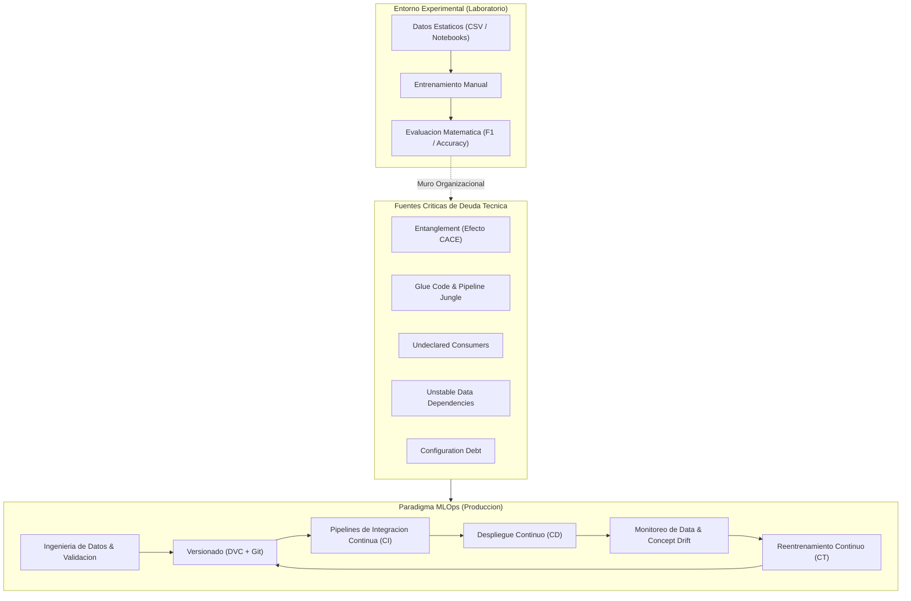
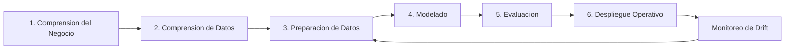

# Clase 1: Fundamentos de MLOps, Deuda Tecnica y Adaptacion del Ciclo de Vida CRISP-DM

> **Objetivo Pedagogico:** Comprender la necesidad critica del paradigma MLOps frente a las limitaciones del software tradicional, analizar la anatomia de la deuda tecnica oculta en sistemas de machine learning segun los estandares de ingenieria de Google, y estructurar las fases del ciclo de vida CRISP-DM adaptadas a entornos de produccion industrial.

---

## 1\. Contexto y Marco Conceptual

### 1.1 La Brecha de Produccion en la Ciencia de Datos

En la practica profesional e investigativa de la ciencia de datos, existe una marcada asimetria entre el exito experimental y la viabilidad operativa. Estudios de la industria de software reportan que aproximadamente el 87% de los proyectos de machine learning nunca superan la fase de exploracion en notebooks ni llegan a desplegarse en servidores productivos. Este fenomeno obedece a que el entrenamiento algoritmico y la obtencion de metricas de laboratorio constituyen apenas una fraccion menor (estimada en un 5%) del esfuerzo global requerido para sostener un sistema inteligente en operacion continua.

### 1.2 Dicotomia Operativa: Entorno Experimental vs. Entorno de Produccion

El paso desde un notebook local hacia un servidor de produccion exige una redefinicion total de criterios tecnicos:

- **Naturaleza de los Datos:**

  - *Laboratorio:* Colecciones estaticas, limpias, acotadas y estructuradas, con esquemas estables e imputaciones controladas.
  
  - *Produccion:* Flujos continuos, ruidosos, incompletos e imperfectos, sujetos a cambios inesperados de tipos de datos, valores nulos y formatos heterogeneos.

- **Criterios de Evaluacion y Metricas:**

  - *Laboratorio:* Metricas puramente matematicas (Accuracy, F1-Score, ROC-AUC, RMSE, MAE).
  
  - *Produccion:* Metricas de ingenieria y valor economico (Latencia p95/p99, resiliencia ante fallos, disponibilidad de infraestructura, costo computacional y Retorno de Inversion). Un modelo con 99% de exactitud carece de valor practico si introduce latencias inaceptables para el usuario final.

- **Modalidad de Ejecucion:**

  - *Laboratorio:* Ejecucion interactiva celda por celda en Jupyter o Google Colab bajo supervision humana constante.
  
  - *Produccion:* Pipelines totalmente automatizados, idempotentes, reproducibles y orquestados sin intervencion manual.

- **Dinamica Temporal y Degradacion:**

  - *Software Tradicional:* Codigo determinista que no se oxida ni se degrada si el entorno computacional permanece constante.
  
  - *Modelos de Machine Learning:* Artefactos probabilisticos que comienzan a degradarse inmediatamente tras su puesta en marcha debido a la volatilidad del mundo real.

### 1.3 El Fenomeno del Drift y la Perdida de Fidelidad

La degradacion del rendimiento de un modelo en produccion se manifiesta principalmente a traves de dos fenomenos:

1. **Data Drift (Deriva de Datos):** Ocurre cuando la distribucion estadistica de las variables de entrada $P(X)$ cambia a lo largo del tiempo, aun si la relacion condicional entre las caracteristicas y la variable objetivo permanece inalterada.

1. **Concept Drift (Deriva de Concepto):** Se presenta cuando la relacion estadistica entre las variables de entrada y la variable objetivo $P(Y|X)$ se modifica debido a transformaciones estructurales en el entorno, patrones macroeconomicos o cambios de comportamiento del usuario.

---

## 2\. Fundamentos Teoricos y Arquitectura



### 2.1 Anatomia de la Deuda Tecnica en Machine Learning (Google)

Segun el marco de referencia formalizado por Sculley et al. (Google), los sistemas de machine learning acumulan una deuda tecnica significativamente mas onerosa y silenciosa que el software tradicional. Mientras que los defectos de codigo son detectables mediante linters, analizadores estaticos y pruebas unitarias, la deuda tecnica en ML es invisible para las herramientas tradicionales de debugging.

1. **Entanglement (Principio CACE - Changing Anything Changes Everything):**

   En un modelo predictivo, las variables no son componentes aislados con interfaces encapsuladas; estan interconectadas probabilisticamente. Modificar, agregar o eliminar un feature o ajustar una distribucion altera los hiperplanos, pesos y covarianzas globales del sistema, haciendo imposible aislar efectos de manera determinista.

1. **Glue Code y Pipeline Jungle:**

   El uso excesivo de codigo de soporte, envoltorios y scripts artesanales encadenados manualmente para transformar datos entre sistemas dispares genera fragilidad extrema y elevados costos de mantenimiento.

1. **Undeclared Consumers (Consumidores No Declarados):**

   Sistemas, procesos o equipos secundarios que consumen las predicciones emitidas por el modelo sin un contrato formal de interfaz o versionado de API. Cualquier alteracion en el formato de salida o en la calibracion de probabilidades rompe los flujos dependientes de manera silenciosa.

1. **Unstable Data Dependencies (Dependencias Inestables de Datos):**

   Variables alimentadas desde sistemas externos cuya semantica, escala, zona horaria o rango de valores pueden modificarse sin coordinacion previa, contaminando el entrenamiento y la inferencia.

1. **Configuration Debt (Deuda de Configuracion):**

   Umbrales de corte, hiperparametros, rutas de almacenamiento y configuraciones de hardware dispersas o codificadas en duro (hardcoded) a traves de multiples archivos, lo que genera inconsistencias graves entre ambientes.

### 2.2 Mapa de Roles y Responsabilidades

El soporte integral de un sistema inteligente demanda una articulacion rigurosa de responsabilidades:

- **Data Analyst:** Analiza datos historicos, descubre tendencias descriptivas y formaliza indicadores clave de rendimiento (KPIs) de negocio.

- **Data Engineer:** Construye, asegura y optimiza los pipelines de ingestion, extraccion, transformacion y disponibilidad de datos, garantizando esquemas limpios y alta disponibilidad.

- **Data Scientist:** Explora datos, formula hipotesis, selecciona arquitecturas matematicas, prueba hiperparametros y genera los primeros modelos prototipo.

- **ML Engineer:** Transforma el modelo experimental en un artefacto de software robusto, escalable y reusable; empaqueta APIs de inferencia y optimiza tiempos de respuesta y rendimiento computacional.

- **MLOps Engineer:** Automatiza el ciclo de vida completo de los modelos, orquesta los pipelines de CI/CD/CT, gestiona el registro de modelos, supervisa el monitoreo continuo de drift y garantiza la resiliencia en infraestructura distribuida.

---

## 3\. Implementacion Tecnica y Logica de Ingenieria

### 3.1 Adaptacion del Marco Metodologico CRISP-DM a MLOps

La metodologia estandar CRISP-DM (Cross-Industry Standard Process for Data Mining) provee una base iterativa que debe extenderse para converger con las demandas operativas de MLOps:



#### Fase 1: Comprension del Negocio

- *Objetivo Tecnico:* Traducir una necesidad estrategica a un problema concreto de aprendizaje automatico.

- *Definicion de Metricas de Exito:* Establecer la linea base de rendimiento y el umbral economico justificable (por ejemplo, reducir la tasa de churn en 15% o mitigar fraudes financieros por un valor equivalente a \$500,000 USD anuales).

- *Analisis de Factibilidad:* Validar si el problema demanda aprendizaje supervisado, no supervisado o reglas deterministicas de negocio.

#### Fase 2: Comprension de los Datos

- *Objetivo Tecnico:* Auditar la procedencia, volumen, balance y calidad de las fuentes de informacion.

- *Identificacion de Riesgos:* Evaluacion de sesgos historicos, consistencia de claves primarias, presencia de valores faltantes no aleatorios (MNAR) y volumen de transacciones representativo.

#### Fase 3: Preparacion de los Datos

- *Objetivo Tecnico:* Limpieza, normalizacion, encoding y creacion sistematica de caracteristicas (Feature Engineering).

- *Control Critico de Fuga de Informacion (Data Leakage):* Aislar estrictamente la particion de entrenamiento de la particion de prueba antes de cualquier transformacion o calculo de estadisticos (medias, desviaciones estandar, modas).

```python
# Ejemplo arquitectonico de aislamiento estricto para evitar Data Leakage
import pandas as pd
from sklearn.model_selection import train_test_split
from sklearn.preprocessing import StandardScaler
from sklearn.pipeline import Pipeline
from sklearn.ensemble import RandomForestClassifier

# 1. Carga de datos crudos
df = pd.read_parquet("transacciones_crudo.parquet")
X = df.drop(columns=["es_fraude"])
y = df["es_fraude"]

# 2. Particion previa a cualquier transformacion de datos
X_train, X_test, y_train, y_test = train_test_split(
    X, y, test_size=0.20, random_state=42, stratify=y
)

# 3. Pipeline encapsulado: el escalador aprende exclusivamente de X_train
pipeline = Pipeline([
    ("scaler", StandardScaler()),
    ("classifier", RandomForestClassifier(n_estimators=100, random_state=42))
])

pipeline.fit(X_train, y_train)
```

#### Fase 4: Modelado

- *Criterio de Seleccion:* La eleccion del algoritmo debe sustentarse en la naturaleza del negocio:

  - *Interpretabilidad y Regulacion:* Modelos lineales, regresion logistica o arboles de decision simples cuando la trazabilidad de decisiones es un mandato normativo.
  
  - *Optimizacion de Exactitud:* Ensembles de gradiente como XGBoost o LightGBM para problemas tabulares complejos con relaciones no lineales.
  
  - *Latencia y Eficiencia:* LightGBM frente a XGBoost cuando la velocidad de entrenamiento e inferencia es restrictiva.

#### Fase 5: Evaluacion

- *Contraste Dual:* Validacion cruzada estratificada frente a las metricas tecnicas (Precision, Recall, ROC-AUC) en conjunto con matrices de costo de negocio (costo de un Falso Positivo vs. costo de un Falso Negativo).

- *Pruebas de Esfuerzo:* Evaluacion de rendimiento bajo distribuciones extremas y particionamiento temporal (Backtesting).

#### Fase 6: Despliegue y Extension MLOps

- *Integracion en Produccion:* Empaquetamiento del pipeline completo dentro de contenedores reproducibles y exposicion mediante microservicios API de baja latencia.

- *Bucle de Retroalimentacion:* Monitoreo en tiempo real de distribuciones para activar reentrenamientos automatizados.

---

## 4\. Analisis Critico de Casos y Auditoria Practica

| **Organizacion / Caso** | **Problema Tecnico / Arquitectonico** | **Causa Raiz en ML / MLOps** | **Impacto Economico u Operativo** | **Mitigacion y Solucion Estandar** |
| --- | --- | --- | --- | --- |
| **Zillow (Zillow Offers)** | Falla masiva en la valoracion algoritmica de bienes inmuebles para compra directa. | Data Drift y Concept Drift abruptos provocados por el impacto macroeconomico de la pandemia de COVID-19. Ausencia de monitoreo continuo de distribuciones. | Perdida de mas de \$300 millones de USD en un solo trimestre, cancelacion del modelo de negocio y despido del 25% del personal. | Implementacion de monitoreo en tiempo real de deriva de datos, alertas tempranas de degradacion y mecanismos de intervencion con revision humana. |
| **Knight Capital** | Despliegue defectuoso en sistemas de negociacion automatizada de alta frecuencia. | Proceso de despliegue manual en servidores distribuidos; reactivacion de codigo obsoleto de prueba no auditado en un nodo. | Perdida de \$440 millones de USD en 45 minutos y quiebra forzosa de la entidad. | Automatizacion total del pipeline de CI/CD, despliegues inmutables atomicos, auditoria de configuracion y verificacion de integridad de versiones. |
| **Amazon** | Penalizacion por latencia en plataformas de comercio electronico de alta concurrencia. | Degradacion del rendimiento en capas de inferencia y recomendacion en tiempo real. | Una degradacion de 100 milisegundos en el tiempo de respuesta genera una contraccion del 1% en el volumen total de ventas. | Optimizacion de endpoints, cache distribuida, seleccion de modelos livianos de baja latencia y serving desacoplado mediante contenedores optimizados. |
| **Uber (Michelangelo)** | Proliferacion de scripts artesanales y pipelines fragmentados sin estandarizacion (Glue Code). | Carencia de un ciclo de vida unificado entre cientificos de datos e ingenieros de infraestructura antes de 2015. | Modelos bloqueados durante meses en etapa experimental con fallos frecuentes de integracion. | Creacion de Michelangelo: plataforma corporativa interna de MLOps con Feature Store centralizado, registro formal y despliegue estandarizado. |

---

## 5\. Principios de Diseno, Buenas Practicas y Anti-patrones

### 5.1 El Principio de Parsimonia contra la Sobreingenieria

Uno de los anti-patrones mas destructivos en proyectos de ciencia de datos es la tendencia a introducir arquitecturas excesivamente complejas (redes neuronales profundas, modelos Transformer, ensembles masivos) sin haber validado previamente si un modelo simple, interpretable y de bajo costo computacional resuelve el problema con suficiencia. La regla de oro metodologica exige:

1. Comenzar siempre con modelos lineales o estadisticos basicos como linea base inmutable (Baseline).

1. Incrementar la complejidad arquitectonica unicamente si la ganancia marginal en rendimiento de negocio justifica el incremento proporcional en costo computacional, latencia y deuda tecnica.

### 5.2 Superacion del "Muro Organizacional"

El clasico reclamo "en mi notebook funcionaba" constituye un sintoma directo de inmadurez en ingenieria de software. Para erradicar este cuello de botella:

- El cientifico de datos debe formular modelos empaquetados en scripts modulares desacoplados del entorno interactivo.

- Toda variable, hiperparametro y dependencia debe gestionarse mediante archivos de configuracion centralizados y versionados, evitando valores quemados en el codigo.

- Los ambientes de ejecucion deben estandarizarse desde el dia cero mediante contenedores y aislamiento de dependencias.

---

## 6\. Sintesis Conceptual y Profundizacion Academica

- **La centralidad de MLOps:** Un modelo de machine learning no es un entregable final, sino un componente de software vivo, dependiente del tiempo y altamente vulnerable a la dinamica del mundo real.

- **Vigilancia de la Deuda Tecnica:** La supervision constante de dependencias inestables, consumidores no declarados y efectos CACE previene la obsolescencia y fallos criticos no detectables por herramientas clasicas de depuracion.

- **Rigor en CRISP-DM:** La alineacion temprana de metricas analiticas con indicadores financieros y de experiencia de usuario es el unico mecanismo que garantiza que un proyecto de ciencia de datos aporte valor tangible y sostenible.
