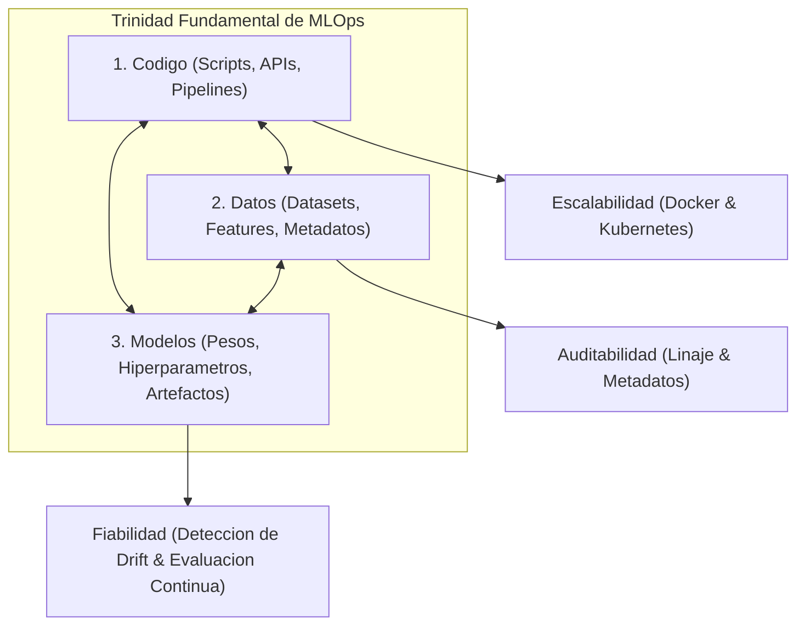
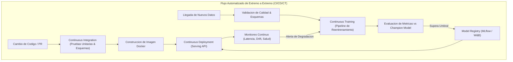
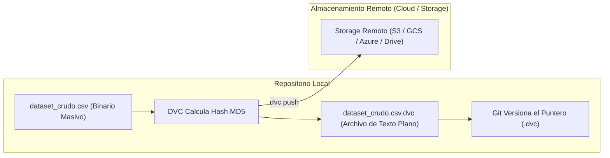
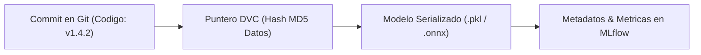

# Clase 2: Trinidad de MLOps, Niveles de Madurez de Google y Versionamiento con Git y DVC

> **Objetivo Pedagogico:** Dominar los tres pilares de MLOps (codigo, datos y modelos), evaluar los niveles de madurez organizacional segun la arquitectura de referencia de Google, y aplicar estrategias de versionamiento desacoplado mediante Git y Data Version Control (DVC) para garantizar reproducibilidad inmutable y linaje de datos de extremo a extremo.

---

## 1\. Contexto y Marco Conceptual

### 1.1 La Trinidad de Artefactos en MLOps

A diferencia del paradigma DevOps tradicional, cuya responsabilidad se circunscribe exclusivamente al control y despliegue del codigo fuente estatico, MLOps opera sobre una trinidad indisoluble de artefactos:



Cada uno de estos tres pilares evoluciona con ritmos y mecanismos propios:

- **Codigo:** Versionado semantico mediante control de versiones distribuido tradicional (Git).

- **Datos:** Colecciones binarias masivas y dinámicas que no admiten control de versiones convencional linea a linea.

- **Modelos:** Binarios serializados (.pkl, .onnx, pesos tensores) generados a partir de la convergencia de una version especifica de codigo sobre una version identica de datos.

### 1.2 La Extension Evolutiva: De CI/CD a CI/CD/CT

En el desarrollo de software convencional, el ciclo DevOps estandar se apoya en dos componentes:

- **CI (Continuous Integration):** Compilacion, ejecucion de pruebas unitarias, linting y validacion de compatibilidad del codigo ante cada modificacion o pull request.

- **CD (Continuous Delivery / Deployment):** Generacion de artefactos ejecutables, construccion de paquetes y despliegue automatizado hacia servidores de prueba o produccion.

En los sistemas de aprendizaje automatico, este ciclo resulta incompleto y da origen a un tercer componente exclusivo:

- **CT (Continuous Training - Entrenamiento Continuo):** Proceso automatizado que supervisa el rendimiento en produccion y, ante la deteccion de Data Drift, Concept Drift o la ingestion programada de nuevos lotes de datos, desencadena de forma autonoma la extraccion, validacion de esquemas, reentrenamiento y evaluacion del modelo, promoviendolo al registro de modelos si supera el umbral de calidad requerido.

---

## 2\. Fundamentos Teoricos y Arquitectura



### 2.1 Niveles de Madurez de MLOps (Estandar Arquitectonico de Google)

Google formalizo una escala de tres niveles para evaluar la madurez tecnica y organizativa de la implementacion de MLOps en una entidad:

#### Nivel 0: Proceso Manual Artesanal

- **Caracteristicas:** Cada fase del ciclo de vida (preparacion, entrenamiento, evaluacion y entrega de pesos) se ejecuta de forma manual e interactiva en laptops o servidores locales.

- **Separacion Disfuncional:** Existe una barrera radical entre los cientificos de datos que desarrollan y los ingenieros de operaciones que intentan desplegar los artefactos.

- **Ausencia de CI/CD:** No hay pruebas automatizadas ni despliegues continuos. Los despliegues se realizan mediante scripts improvisados o copia manual de archivos serializados.

- **Trazabilidad Nula:** No es posible determinar con precision matematica que version de datos y que hiperparametros originaron el modelo activo en produccion.

#### Nivel 1: Pipeline de Entrenamiento Continuo (CT Automatizado)

- **Caracteristicas:** El pipeline de preparacion, entrenamiento y validacion del modelo se encuentra automatizado y parametrizado.

- **Disparadores de Reentrenamiento:** El pipeline se ejecuta de forma autonoma impulsado por eventos programados (cron jobs) o por alertas tempranas de degradacion estadistica (Drift Detection).

- **Componentes Avanzados:** Incorpora un **Feature Store** para el almacenamiento estandarizado de caracteristicas y un **Metadata Store** para la trazabilidad exhaustiva de parametros, metricas y linaje de cada ejecucion.

- **Limitacion:** El codigo del pipeline se gestiona y despliega de forma manual; los cambios estructurales en la logica exigen intervencion humana directa.

#### Nivel 2: Automatizacion Integral de CI/CD/CT

- **Caracteristicas:** Sistema completamente automatizado de extremo a extremo. Los cambios en el codigo fuente de los pipelines activan disparadores de CI/CD que construyen, prueban y despliegan los pipelines mismos.

- **Ciclo Completo:** La infraestructura permite iterar sobre nuevas arquitecturas algoritmicas y desplegarlas en produccion en cuestion de minutos de forma segura y auditable.

- **Monitoreo y Rollback:** Deteccion automatica de anomalias y capacidad de revertir instantaneamente a la version previa ("Champion-Challenger setup").

---

## 3\. Implementacion Tecnica y Logica de Ingenieria

### 3.1 Limitaciones Criticas de Git con Datos Binarios y Big Data

El sistema de control de versiones distribuido Git fue disenado primordialmente para seguir lineas de texto plano en codigo fuente. Su aplicacion directa a conjuntos de datos presenta restricciones severas:

1. **Incompatibilidad con Diferencias Linea a Linea:** Los archivos binarios (.parquet, .h5, .pkl, .onnx) o archivos tabulares masivos no admiten comparaciones de diff textual eficientes.

1. **Explosion del Espacio en Disco:** Cada modificacion en un archivo binario obliga a Git a almacenar una copia completa del objeto en el directorio interno ` .git/objects `. Crear y clonar ramas multiplica exponencialmente el tamano del repositorio local.

1. **Restricciones de Plataformas Cloud:** Plataformas como GitHub imponen un limite estricto de 100 MB por archivo y desaconsejan repositorios superiores a 2 GB.

### 3.2 Arquitectura y Funcionamiento de DVC (Data Version Control)

DVC resuelve de raiz el desacoplamiento entre codigo y datos operando como un puente entre Git y el almacenamiento masivo distribuido:



#### Mecanismo Operativo de DVC

- DVC toma el archivo o directorio de datos masivo (` dataset.csv `).

- Computa un hash criptografico MD5 unico basado en el contenido del archivo.

- Genera un archivo puntero liviano de metadatos en texto plano (` dataset.csv.dvc `) que contiene el hash, el tamano y la ruta relativa.

- Anade automaticamente el archivo de datos masivo al ` .gitignore ` para evitar que Git lo rastree.

- El usuario versiona el archivo puntero ` .dvc ` en Git, mientras el payload real se transfiere mediante ` dvc push ` a un almacenamiento remoto seguro.

### 3.3 Flujo Practico de Comandos Git y DVC

```bash
# 1. Inicializacion del repositorio de codigo y datos
git init
dvc init

# 2. Configuracion de almacenamiento remoto para DVC (ejemplo: bucket S3 o carpeta remota)
dvc remote add -d myremote s3://mi-bucket-mlops-datos/storage
git add .dvc/config
git commit -m "chore: inicializar DVC y configurar almacenamiento remoto"

# 3. Incorporacion y seguimiento de un dataset masivo
dvc add data/transacciones_2026.parquet

# DVC genera data/transacciones_2026.parquet.dvc y actualiza data/.gitignore
git add data/transacciones_2026.parquet.dvc data/.gitignore
git commit -m "feat(data): incorporar dataset de transacciones version 1.0"

# 4. Sincronizacion del artefacto binario hacia el almacenamiento remoto
dvc push

# 5. Reproducibilidad en otro servidor o entorno de produccion
git checkout main
dvc pull
```

---

## 4\. Analisis Critico de Casos y Auditoria Practica

| **Nivel de Madurez (Google)** | **Disparador de Ejecucion (Triggers)** | **Artefactos Automatizados** | **Costo Tecnico y Complejidad** | **Escenario Organizacional Recomendado** |
| --- | --- | --- | --- | --- |
| **Nivel 0: Manual** | Solicitud explicita ad-hoc de negocio o ejecucion interactiva humana. | Ninguno. Los modelos y scripts se transfieren por correo, carpetas compartidas o repositorios sin pipeline. | Bajo costo inicial de infraestructura; costo operativo y riesgo de error humano extremadamente altos. | Equipos en etapa de exploracion temprana, prototipado rapido o proyectos academicos sin requerimientos de produccion continua. |
| **Nivel 1: CT Automatizado** | Llegada programada de nuevos lotes de datos, calendario (cron) o deteccion de Data/Concept Drift. | Pipeline de ingestion, validacion de datos, entrenamiento del modelo y registro en Model Registry. | Complejidad media. Requiere orquestadores de datos (Airflow, Prefect), Feature Store y validacion de esquemas. | Empresas con modelos en produccion cuyos datos cambian periodicamente pero cuya arquitectura algoritmica permanece estable meses. |
| **Nivel 2: CI/CD/CT Completo** | Commits en ramas de desarrollo, Pull Requests aprobados o cambios en codigo de transformacion. | Todo el ciclo de vida: construccion de contenedores Docker, pruebas de regresion, despliegue de pipelines y serving automatizado. | Alta complejidad e inversion considerable en infraestructura distribuida, plataformas de orquestacion y cultura DevOps solida. | Gigantes tecnologicos o empresas con alta escala donde cientos de modelos deben reentrenarse y desplegarse diariamente sin friccion. |

---

## 5\. Principios de Diseno, Buenas Practicas y Anti-patrones

### 5.1 Evaluacion Economica del Nivel de Madurez

No todas las organizaciones requieren ni deben perseguir el Nivel 2 de MLOps. La implementacion de Nivel 2 involucra costos significativos en licencias, servidores en la nube, capacidad de computo GPU/CPU y contratacion de ingenieros especializados. Adoptar Nivel 2 en una pequena o mediana empresa con un unico modelo que se reentrena trimestralmente constituye un claro anti-patron de sobreingenieria que drena recursos sin anadir valor proporcional. La regla cardinal radica en responder:

*¿Cuanto tiempo tarda la organizacion en poner un modelo actualizado en produccion tras un cambio en los datos?* Si la respuesta actual cubre la necesidad de negocio con Nivel 1 o Nivel 0 controlado, ese es el nivel optimo.

### 5.2 Trazabilidad y Linaje Inmutable (Data Lineage)

La verdadera reproducibilidad cientifica y tecnica en inteligencia artificial exige que, ante cualquier auditoria o fallo en produccion, el equipo pueda reconstruir exactamente las condiciones originales:



Si el modelo activo en produccion presenta anomalias, la vinculacion del commit de Git con el archivo ` .dvc ` permite descargar con precision absoluta el dataset exacto con el que fue concebido, permitiendo depurar y reproducir el comportamiento en cuestion de minutos.

---

## 6\. Sintesis Conceptual y Profundizacion Academica

- **La Trinidad Inseparable:** MLOps trasciende la administracion del codigo estatico para operar simultaneamente sobre codigo, datos y modelos serializados.

- **Desacoplamiento Inteligente:** La integracion de Git para codigo fuente y punteros livianos, complementada con DVC para el versionado de grandes volumenes de datos y pesos, resuelve el cuello de botella de escalabilidad del control de versiones.

- **Preparacion para Contenedores y Orquestacion:** La estabilidad lograda mediante el versionado inmutable de codigo y datos sienta las bases tecnicas necesarias para encapsular los modelos en imagenes de Docker y orquestar su escalamiento horizontal mediante Kubernetes en las siguientes sesiones del modulo.
