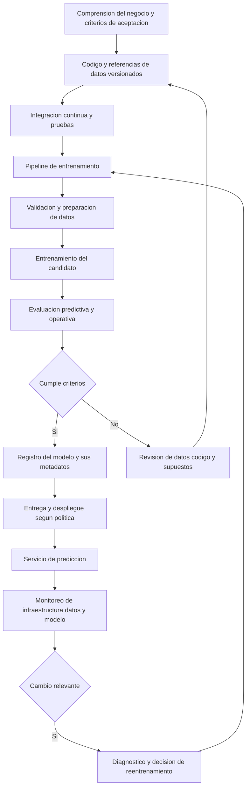
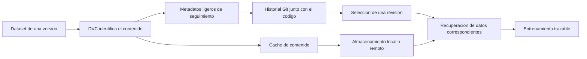

# Clase 3: MLOps: madurez operativa, reproducibilidad y versionamiento de código y datos

> **Objetivo académico:** Analizar la transición del prototipo de aprendizaje automático al servicio de producción, relacionando CI/CD/CT, niveles de madurez, responsabilidades profesionales y versionamiento de código, datos y modelos para construir trazabilidad y reproducibilidad.

## 1. Contexto y marco conceptual

### Del resultado experimental al sistema de producción

La sesión parte de una diferencia central: un modelo que funciona en un notebook todavía no constituye un servicio de producción. El laboratorio privilegia la experimentación y las métricas predictivas; la operación incorpora además latencia, concurrencia, infraestructura, compatibilidad de entornos, auditoría y consecuencias económicas de las decisiones.

La calidad del sistema debe interpretarse desde dos perspectivas complementarias:

| Perspectiva | Pregunta central | Criterios relevantes |
|---|---|---|
| Científica y experimental | ¿El modelo aprende una relación útil y generaliza? | Métricas predictivas, evaluación y comparación con una línea base |
| Empresarial y operativa | ¿El servicio produce valor de forma sostenible? | KPI del negocio, latencia, disponibilidad, escalabilidad y riesgo |

Comprender el negocio precede a escoger el algoritmo. Una mejora estadística no demuestra por sí sola mayor retención de clientes, incremento de ventas o reducción de pérdidas. La evaluación debe conectar el desempeño del modelo con los objetivos definidos para el sistema.

### CRISP-DM y su relación con MLOps

Se recuperan las seis fases de CRISP-DM: comprensión del negocio, comprensión de los datos, preparación de los datos, modelado, evaluación y despliegue. Su carácter es iterativo: los resultados pueden exigir revisar datos, supuestos o decisiones anteriores.

MLOps aporta mecanismos para operar ese ciclo mediante automatización, estandarización y control de versiones. No sustituye la comprensión del problema ni la validación científica; permite que sus resultados circulen de forma controlada entre experimentación y producción.

El despliegue concentra riesgos porque conecta ambientes distintos. Un notebook puede depender de bibliotecas, archivos, rutas o configuraciones presentes únicamente en la computadora del científico de datos. El traspaso manual a operaciones introduce un cuello de botella y dificulta detectar qué cambió cuando el servicio falla.

### Degradación y deuda técnica

Un modelo depende de relaciones aprendidas a partir de datos históricos. Aunque sus archivos permanezcan intactos, su utilidad puede disminuir si cambia el entorno. La sesión utiliza un caso inmobiliario afectado por una alteración profunda del mercado para ilustrar ese riesgo, sin proporcionar evidencia suficiente para reconstruir sus causas concretas.

También se retoman fuentes de deuda técnica: código de conexión o *glue code*, consumidores no declarados, dependencias de datos, acoplamiento entre componentes y configuración compleja. La transcripción alude al principio CACE de manera imprecisa.

**Enriquecimiento conceptual:** CACE expresa que cambiar un componente puede modificar el comportamiento de otros componentes del sistema. En aprendizaje automático, una característica, una transformación o una fuente de datos aparentemente local puede afectar múltiples predicciones y consumidores.

**Enriquecimiento conceptual:** La afirmación de que el código tradicional «no envejece» debe entenderse bajo condiciones estables de ejecución y requisitos. El software también puede fallar por cambios de dependencias o interfaces. La particularidad del modelo es que puede perder validez predictiva sin cambios en su código ni en su entorno de ejecución.

## 2. Fundamentos teóricos y arquitectura

### MLOps como práctica integrada

La sesión presenta MLOps como la intersección entre aprendizaje automático, ingeniería de datos y DevOps. Su implementación requiere una cultura de colaboración y responsabilidades compartidas, además de herramientas.

Se destacan tres objetivos:

- **Escalabilidad:** responder a variaciones de carga mediante capacidad de servicio adecuada.
- **Auditabilidad:** reconstruir qué código, datos y configuración produjeron un modelo y sus resultados.
- **Fiabilidad:** sostener un comportamiento aceptable mediante pruebas, evaluación y monitoreo continuo.

Docker y Kubernetes se mencionan como herramientas relacionadas con la portabilidad y la operación escalable; su funcionamiento no se desarrolla técnicamente en esta clase.

**Enriquecimiento conceptual:** La presencia de Kubernetes no garantiza escalabilidad automática. Es necesario configurar recursos, réplicas, señales de escalado y capacidad disponible. Asimismo, aumentar réplicas del servicio de inferencia no equivale a distribuir el entrenamiento.

### La tríada de artefactos

MLOps amplía el objeto del control de cambios: además del código, deben identificarse los datos y el modelo resultante.

| Artefacto | Contenido relevante | Mecanismo tratado |
|---|---|---|
| Código | Scripts, transformaciones y lógica del servicio | Git |
| Datos | Versiones de entrenamiento y prueba | DVC y almacenamiento separado |
| Modelo | Artefacto entrenado y relación con su ejecución de origen | Registro y seguimiento de modelos; se menciona MLflow |

La unidad auditable es la relación entre estos elementos. Conservar muchos CSV y muchos modelos sin registrar sus correspondencias no permite responder con seguridad qué conjunto de entrenamiento produjo una versión determinada.

### CI, entrega, despliegue y entrenamiento continuo

La integración continua, CI, incorpora y verifica cambios de forma frecuente. La sesión menciona como disparadores los commits, las solicitudes de incorporación y la integración de ramas. Las comprobaciones pueden detener la promoción cuando aparece un fallo.

En la explicación oral se mezclan los términos construcción, entrega y despliegue. Para evitar trasladar esa ambigüedad al diseño:

**Enriquecimiento conceptual:** La construcción genera un artefacto ejecutable o distribuible. La entrega continua mantiene los cambios preparados para su publicación mediante un proceso verificado, que puede conservar una aprobación final. El despliegue continuo publica automáticamente en producción los cambios que superan los controles. Generar un artefacto no constituye por sí mismo un despliegue.

El entrenamiento continuo, CT, automatiza el proceso que obtiene datos, los valida, los prepara, entrena un candidato y evalúa sus resultados. Puede activarse por nuevas observaciones, programación temporal o señales de monitoreo. El modelo candidato debe superar controles antes de sustituir al modelo operativo.



### Monitoreo y drift

La salud de la infraestructura no basta para establecer la salud del modelo. Un servicio puede responder rápidamente y producir predicciones inadecuadas.

**Enriquecimiento conceptual:** El *data drift* describe cambios en la distribución de las entradas, mientras que el *concept drift* describe cambios en la relación entre entradas y objetivo. En notación probabilística, pueden expresarse como cambios en \(P(X)\) y \(P(Y\mid X)\), respectivamente. Un cambio en \(P(X)\) no demuestra automáticamente deterioro predictivo.

**Enriquecimiento conceptual:** Monitorear, diagnosticar, reentrenar y promover un modelo son operaciones distintas. Una alerta puede deberse a un error de captura, un cambio legítimo del negocio o una transformación defectuosa. El reentrenamiento automático indiscriminado puede incorporar el problema en lugar de resolverlo. Además, medir desempeño real requiere disponer de etiquetas o resultados observados, que pueden llegar con retraso.

## 3. Implementación técnica y lógica de negocio

### Responsabilidades y ámbitos de control

El científico de datos realiza exploración, preparación y experimentación; el ingeniero de ML transforma el prototipo en un componente consumible, por ejemplo mediante una API; operaciones gestiona infraestructura, despliegue y funcionamiento del servicio. La sesión presenta esta distribución como un flujo de colaboración.

**Enriquecimiento conceptual:** Estas fronteras no son universales ni deben convertirse en nuevos silos. La evaluación, la observabilidad y la respuesta a incidentes requieren acuerdos entre los roles.

| Práctica | Foco presentado | Disparadores habituales | Verificaciones y monitoreo |
|---|---|---|---|
| DevOps | Código y operación del software | Cambios en el repositorio | Pruebas unitarias, regresión, CPU, memoria y latencia |
| DataOps | Obtención y transformación de datos | Cambios de esquema o lógica de procesamiento | Esquema, integridad, volumen y actualidad de los datos |
| MLOps | Código, datos y modelos vinculados | Nuevos datos, cambios del pipeline o deterioro detectado | Evaluación predictiva, drift y trazabilidad del entrenamiento |

Esta separación identifica énfasis; no implica que cada práctica tenga exclusividad sobre sus controles.

### Git: identidad, repositorio e historial

La demostración práctica se concentra en Git. Se distingue el sistema de control de versiones de plataformas de alojamiento como GitHub, GitLab y Bitbucket. Un commit es local; enviar cambios a un servicio remoto requiere una operación adicional.

Los valores de autor configurados en Git identifican los commits, pero no constituyen credenciales de autenticación ante la plataforma remota.

**Enriquecimiento conceptual:** El siguiente bloque normaliza la sintaxis fragmentaria del reconocimiento de voz y utiliza identidad ilustrativa. No representa una ejecución adicional ni resultados verificados.

```bash
git --version
git config --global user.name "Nombre Apellido"
git config --global user.email "nombre@example.com"
git config --get user.name
git config --get user.email

mkdir mi-primer-repo
cd mi-primer-repo
git init
git branch -M main
git status
```

`git init` crea el repositorio; `git branch -M main` establece el nombre de la rama actual; `git status` informa el estado del directorio de trabajo y del área de preparación. La configuración global se aplica por defecto al usuario del sistema y puede sobrescribirse para un repositorio concreto.

### Directorio de trabajo, preparación y commit

Git distingue el contenido que se está editando, el contenido seleccionado para el próximo commit y el historial confirmado.


Después de crear o editar `README.md`, la secuencia tratada puede expresarse así:

```bash
git status
git diff
git add README.md
git diff --staged
git commit -m "docs: crea el README inicial"
git log --oneline
```

`git diff` permite inspeccionar cambios de archivos rastreados que todavía no están preparados. `git diff --staged` compara el contenido preparado con el último commit. `git commit` registra el contenido seleccionado, no necesariamente todas las modificaciones existentes.

**Enriquecimiento conceptual:** Un archivo nuevo no rastreado aparece en `git status`, pero su contenido no se muestra normalmente con `git diff`. Un commit representa una instantánea lógica del proyecto enlazada con su historia; no es solo un comentario sobre cambios.

### Exclusión de archivos

Se introduce `.gitignore` para evitar incorporar archivos como variables de entorno y registros:

```gitignore
.env
*.log
```

Este archivo debe encontrarse dentro del árbol del repositorio para actuar sobre las rutas correspondientes. Puede versionarse para compartir las reglas de exclusión.

```bash
git add .gitignore
git commit -m "chore: define archivos excluidos"
```

`git add .` prepara cambios bajo el directorio actual y facilita trabajar con múltiples archivos; conviene inspeccionar previamente lo seleccionado.

**Enriquecimiento conceptual:** `.gitignore` no elimina archivos ya rastreados ni borra información del historial. Si un secreto fue publicado, agregarlo a este archivo no corrige la exposición: se requiere revocar o rotar la credencial y gestionar su presencia histórica.

### Ramas e integración

Las ramas permiten desarrollar cambios en líneas de trabajo diferentes y luego integrarlos:

```bash
git switch -c mejora-presentacion
git add README.md
git commit -m "docs: mejora la presentacion"
git branch
git switch main
git merge mejora-presentacion
git log --oneline --graph --all
git branch -d mejora-presentacion
```

La creación de la rama debe preceder a la edición específica que se desea aislar. `git switch -c` crea y selecciona una rama; `git switch` selecciona una existente. `git merge` incorpora la historia de la rama indicada en la rama actual. `git branch -d` elimina una referencia de rama bajo condiciones de seguridad.

**Enriquecimiento conceptual:** Cambiar de rama actualiza los archivos para reflejar la versión seleccionada, sujeto a la compatibilidad con modificaciones locales pendientes. Una integración puede resolverse mediante avance rápido o requerir combinar historias; también puede producir conflictos. Crear una rama no duplica automáticamente todo el repositorio ni todo el dataset.

La sesión recomienda mensajes descriptivos con prefijos que distingan nuevas funcionalidades, correcciones, mantenimiento o documentación. Son convenciones de comunicación, no requisitos intrínsecos de Git. Las interfaces gráficas ofrecen operaciones equivalentes, pero comprender el flujo evita confundir preparación, confirmación y publicación remota.

### DVC: separación entre metadatos y contenido pesado

La fuente denomina repetidamente «DBC» a Data Version Control; en estos apuntes se normaliza como **DVC**.

Git puede almacenar archivos de diversos tipos, pero un historial con datasets y modelos grandes puede aumentar sustancialmente el almacenamiento y el costo de transferencia. Los límites de tamaño mencionados en la sesión pertenecen a políticas de plataformas de alojamiento, no a una restricción universal del sistema Git.

**Enriquecimiento conceptual:** CSV es un formato textual, aunque un CSV grande también puede resultar costoso de gestionar con Git. Parquet y muchos artefactos serializados de modelos son binarios. La dificultad práctica depende del tamaño, la frecuencia de cambio y la representación, además del tipo de archivo.

La arquitectura explicada separa:

1. **Metadatos ligeros**, versionados con Git, que identifican el contenido de datos.
2. **Contenido de datos**, conservado en caché y almacenamiento separado, local o remoto.
3. **Correspondencia entre versiones**, que permite recuperar los datos asociados a una revisión del proyecto.



La sesión menciona hashes MD5 para explicar la identificación del contenido y destinos como S3, Google Cloud Storage, Google Drive o un servidor local. La idea central es que el repositorio de código conserva una referencia ligera en lugar del dataset completo.

**Enriquecimiento conceptual:** Esa referencia no debe interpretarse simplemente como una URL. La recuperación combina metadatos de seguimiento, identificación del contenido y configuración del almacenamiento. Un hash permite comprobar identidad de contenido, pero no garantiza autenticidad ni conservación permanente.

Se mencionan operaciones de DVC semejantes a las de Git, como `add`, `push` y `pull`, pero no se desarrolla una demostración ejecutada de DVC. Por ello, no se atribuyen a la clase comandos completos, configuraciones ni resultados de sincronización. La confirmación de los metadatos en Git y la transferencia del contenido mediante DVC son pasos diferentes.

## 4. Análisis crítico de casos y auditoría práctica

### Madurez operativa: niveles 0, 1 y 2

La sesión presenta un esquema de tres niveles atribuido a una guía de arquitectura de Google. La clasificación evalúa la automatización del proceso, no el prestigio de las herramientas instaladas.

| Nivel | Caracterización | Limitación o alcance |
|---|---|---|
| 0 | Entrenamiento, validación y traspaso principalmente manuales | Iteraciones lentas, divergencias de entorno y mayor exposición a errores de operación |
| 1 | Pipeline de entrenamiento automatizado con validaciones y evaluación | El cambio y despliegue del propio pipeline pueden requerir intervención manual |
| 2 | CI/CD del pipeline y entrenamiento automatizado integrados | Mayor capacidad de respuesta, con mayor costo de plataforma y mantenimiento |

La pregunta operativa propuesta es cuánto tiempo transcurre entre un cambio relevante en los datos y la disponibilidad de un modelo actualizado en producción.

**Enriquecimiento conceptual:** Ese tiempo es un indicador útil, pero no determina por sí solo el nivel de madurez: también depende de la duración intrínseca del entrenamiento, la evaluación y las políticas de aprobación.

### Casos técnicos discutidos

Los escenarios permiten identificar errores frecuentes de clasificación:

- Un entrenamiento solicitado y transferido manualmente a operaciones corresponde al nivel 0.
- Disponer de MLflow, Docker y Kubernetes no eleva el nivel si entrenamiento y despliegue siguen dependiendo de intervenciones manuales.
- Automatizar el entrenamiento con datos nuevos, mientras los cambios del pipeline se revisan y despliegan manualmente, caracteriza el nivel 1.
- Programar un entrenamiento periódico sin validación automática de datos ni evaluación del candidato no demuestra un pipeline de nivel 1.
- Automatizar pruebas, construcción y promoción del pipeline, junto con el flujo de entrenamiento, caracteriza el nivel 2 dentro del esquema presentado.

La programación temporal es solo un disparador. El valor operativo proviene del proceso completo que controla qué se acepta y qué se rechaza.

### Feature store y metadata store

Al describir el nivel 1 se introducen dos componentes:

- **Feature store:** almacén de características reutilizables para los procesos de entrenamiento y predicción.
- **Metadata store:** registro de ejecuciones, configuraciones, hiperparámetros, métricas y relaciones entre artefactos.

**Enriquecimiento conceptual:** Un feature store busca, entre otros objetivos, coherencia en las características usadas para entrenar y servir el modelo. No equivale a un repositorio genérico de datos. Un metadata store facilita el linaje, pero no sustituye el almacenamiento del dataset ni el registro del modelo. La presencia de estos componentes no debe tratarse como una condición universal para cualquier implementación de nivel 1.

### Auditoría de un modelo con resultados inesperados

La pregunta «¿con qué datos se entrenó este modelo?» exige enlazar evidencia de distintos sistemas:

| Evidencia | Pregunta que permite responder |
|---|---|
| Revisión de Git | ¿Qué código y transformaciones se utilizaron? |
| Versión de datos identificada con DVC | ¿Qué contenido exacto participó en el entrenamiento? |
| Registro de la ejecución | ¿Con qué configuración y métricas se produjo el candidato? |
| Identificador del modelo | ¿Qué artefacto se publicó? |
| Registro de despliegue | ¿Qué versión estuvo operativa? |

**Enriquecimiento conceptual:** Para reproducir una ejecución también pueden requerirse versiones de dependencias, semillas aleatorias, información del entorno y control del hardware. Versionar código y datos es necesario para muchas auditorías, pero no garantiza resultados numéricamente idénticos.

La transcripción vincula de forma ambigua el linaje con Parquet. **Enriquecimiento conceptual:** Parquet es un formato de almacenamiento; el linaje procede del registro explícito de dependencias y ejecuciones, no del formato por sí mismo.

### Riesgo de despliegue y límites de los ejemplos

Se menciona Knight Capital como ilustración de las consecuencias de un despliegue defectuoso y de la reactivación de código antiguo. El principio técnico rescatable es que una promoción inconsistente puede producir pérdidas graves incluso en software convencional.

La sesión también menciona plataformas de gran escala y organizaciones que desarrollan modelos grandes para motivar la necesidad de auditoría. No se aportan detalles suficientes para afirmar sus frecuencias de entrenamiento, niveles exactos de madurez o políticas internas de publicación.

## 5. Principios de diseño, buenas prácticas y anti-patrones

### Diseñar controles proporcionales al negocio

El nivel máximo de automatización no es una obligación universal. Su conveniencia depende de frecuencia de actualización, escala, impacto del error, costo de operación y capacidad del equipo.

Una organización pequeña puede justificar controles avanzados cuando su riesgo o necesidad de respuesta son elevados. Una organización grande puede conservar aprobaciones humanas deliberadas. El tamaño empresarial es una referencia contextual, no una regla de arquitectura.

**Enriquecimiento conceptual:** La automatización también puede servir para ejecutar controles y recopilar evidencia antes de una decisión humana. Conservar una aprobación explícita no implica necesariamente falta de madurez.

### Buenas prácticas

- Vincular métricas predictivas y KPI del negocio desde la definición del problema.
- Mantener una línea base para interpretar si un nuevo modelo aporta valor.
- Versionar conjuntamente código y referencias de datos, y asociarlos con el artefacto entrenado.
- Registrar cada ejecución con su configuración, métricas e identificadores.
- Validar esquema, integridad y calidad de los datos antes de entrenar.
- Evaluar candidatos antes de promoverlos; una ejecución terminada no demuestra calidad suficiente.
- Revisar diferencias y contenido preparado antes de confirmar cambios en Git.
- Excluir credenciales y archivos transitorios antes de incorporarlos al historial.
- Monitorear infraestructura, datos y desempeño del modelo como dimensiones complementarias.

### Anti-patrones

| Anti-patrón | Consecuencia |
|---|---|
| «Funciona en mi máquina» como criterio de aceptación | Dependencias implícitas y fallos al cambiar de entorno |
| Confundir herramientas instaladas con madurez | Automatización aparente sin proceso verificable |
| Conservar CSV y modelos sin correspondencias | Imposibilidad de reconstruir el entrenamiento |
| Introducir todos los datos pesados en Git sin evaluar el costo | Historial y transferencias difíciles de gestionar |
| Reentrenar ante cualquier alerta | Incorporación automática de datos defectuosos o cambios irrelevantes |
| Publicar el resultado de un entrenamiento programado sin evaluación | Promoción de candidatos potencialmente peores |
| Usar una métrica sin especificar su dirección y contexto | Aceptación incorrecta del modelo |
| Automatizar por imitación de grandes plataformas | Sobreingeniería y costos sin beneficio proporcional |

La sesión menciona un umbral numérico de evaluación sin identificar claramente la métrica ni mantener consistente el sentido de mejora. No puede utilizarse como regla técnica.

**Enriquecimiento conceptual:** Una regla de aceptación debe declarar la métrica, si se maximiza o minimiza, el conjunto de evaluación y el criterio de comparación. Por ejemplo, la interpretación de una puntuación de clasificación y la de un error de regresión no son intercambiables.

## 6. Síntesis conceptual y profundización académica

La contribución central de MLOps es convertir una secuencia de experimentos y traspasos manuales en un ciclo operativo controlado. La unidad gestionada deja de ser únicamente el archivo de código y pasa a ser la relación entre código, datos, configuración, ejecución y modelo publicado.

La reproducibilidad permite reconstruir condiciones; la trazabilidad permite seguir relaciones; la auditabilidad utiliza esos registros para examinar decisiones y resultados. Estas capacidades se refuerzan mutuamente, pero no son equivalentes.

**Enriquecimiento conceptual:** Una representación útil de una ejecución es

\[
M = \mathcal{T}(C, D, H, E, S),
\]

donde \(M\) es el modelo resultante, \(C\) el código, \(D\) los datos versionados, \(H\) la configuración de entrenamiento, \(E\) el entorno y \(S\) las fuentes controladas de aleatoriedad. Esta expresión resume dependencias; no garantiza determinismo en todos los sistemas.

Git resuelve el historial del código y de los metadatos ligeros. DVC permite gestionar versiones de contenido pesado mediante almacenamiento separado. Los registros de experimentos y modelos completan el vínculo entre entradas, evaluación y artefactos. La disponibilidad futura de los datos depende también de conservar el almacenamiento al que apuntan las referencias.

La madurez debe evaluarse según la capacidad real de responder a cambios con controles adecuados. Un pipeline automatizado puede reducir tiempos y errores repetitivos, pero también propagar errores con mayor rapidez si carece de validación y observabilidad. Por ello, MLOps permite gestionar y reducir deuda técnica; no garantiza eliminarla.

Las líneas de profundización que se desprenden de la sesión son la consistencia entre entrenamiento e inferencia, el linaje de extremo a extremo, la diferenciación entre drift y deterioro real, y el equilibrio entre automatización, costo y supervisión humana. Todas convergen en una misma exigencia: poder explicar qué se publicó, cómo se obtuvo y por qué sigue siendo adecuado para el negocio.
