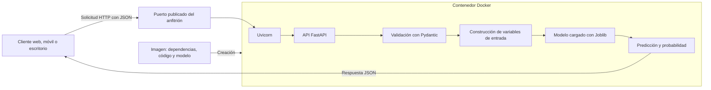
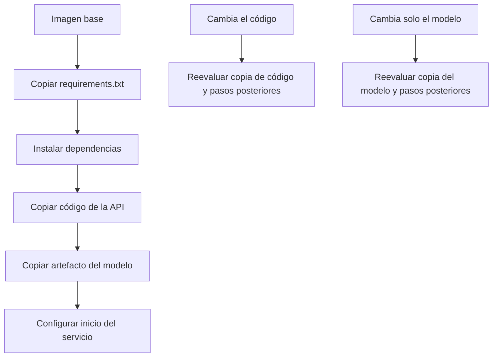

# Clase 4: Despliegue reproducible de modelos mediante Docker y APIs de inferencia

> **Objetivo académico:** Comprender y aplicar el empaquetado de aplicaciones y modelos mediante Docker, distinguir imágenes y contenedores, construir una API de inferencia y analizar las condiciones de reproducibilidad, eficiencia y mantenimiento de un servicio de aprendizaje automático.

## 1. Contexto y marco conceptual

### Del modelo entrenado al servicio consumible

El despliegue conecta un modelo entrenado con los sistemas que necesitan utilizar sus predicciones. Un archivo de modelo y un script local permiten inferencia en un entorno de desarrollo, pero todavía no constituyen un servicio accesible desde una aplicación web, móvil o de escritorio. La sesión desarrolla esta transición mediante dos componentes complementarios:

- **Una API HTTP**, que establece cómo enviar datos y recibir predicciones.
- **Un contenedor**, que ejecuta la aplicación con su entorno de software empaquetado.

Docker se presenta como una herramienta de contenedorización útil para MLOps y también para software convencional: servidores web, bases de datos y aplicaciones de distintos lenguajes. Su aporte principal en esta clase es reducir las diferencias de instalación entre equipos y facilitar la distribución del servicio.

La reproducibilidad exige superar la situación en que el modelo funciona únicamente en la computadora de quien lo desarrolló. Empaquetar el entorno permite distribuir una unidad ejecutable que contiene código, dependencias y, en el caso trabajado, el artefacto del modelo.

**Enriquecimiento conceptual:** Conviene distinguir la reproducibilidad del entorno de inferencia de la reproducibilidad del entrenamiento. Docker contribuye a la primera; reproducir el entrenamiento requiere además identificar datos, transformaciones, parámetros, semillas y condiciones de cómputo. Una imagen tampoco garantiza por sí sola compatibilidad con cualquier arquitectura de procesador o acelerador.

### Imágenes, contenedores y registros

| Concepto | Definición operativa | Consecuencia práctica |
| --- | --- | --- |
| Imagen | Plantilla empaquetada con un sistema de archivos y configuración de ejecución | Puede almacenarse y distribuirse sin que exista un proceso activo |
| Contenedor | Instancia de una imagen, con estado y configuración propios | Puede estar creado, ejecutándose o detenido |
| Dockerfile | Archivo de instrucciones para construir una imagen | Describe la imagen base, archivos, configuración y comando de inicio |
| Registro de imágenes | Servicio que almacena y distribuye imágenes | Docker Hub es el registro utilizado como referencia |
| Etiqueta o tag | Nombre asociado a una versión o variante de imagen | Permite referencias como `nginx:alpine` o `credito-api:1.0` |

La analogía de la imagen con un instalador ayuda a diferenciar almacenamiento de ejecución, pero tiene límites: una imagen es un artefacto directamente utilizable por el motor de contenedores, no un instalador convencional. Descargarla ocupa disco; ejecutar un contenedor añade consumo de CPU, memoria y otros recursos según la carga.

Docker popularizó el uso de contenedores, pero no originó el concepto. La sesión también menciona Podman como alternativa.

## 2. Fundamentos teóricos y arquitectura

### Aislamiento y diferencia respecto de las máquinas virtuales

Un contenedor ofrece una vista aislada de procesos, red y sistema de archivos. Por ello puede disponer de directorios como `/etc`, `/usr` y `/home` sin equivaler a una máquina virtual completa.

**Enriquecimiento conceptual:** Los contenedores Linux comparten el kernel del entorno Linux que los ejecuta. Una máquina virtual, en cambio, incorpora un sistema operativo invitado con su propio kernel. En equipos macOS o Windows, Docker Desktop suele proporcionar una máquina virtual Linux para ejecutar contenedores Linux. Por tanto, Docker no elimina toda necesidad de sistema operativo: evita instalar un sistema operativo invitado independiente para cada contenedor.

Tampoco basta siempre con incluir únicamente el intérprete de Python. Una aplicación puede necesitar bibliotecas de Python, bibliotecas nativas, certificados y otros archivos del espacio de usuario. Las imágenes `slim` y las basadas en Alpine reducen componentes, con posibles diferencias de compatibilidad. Alpine identifica una base de distribución Linux; no es simplemente una versión funcional de Nginx.

### Arquitectura del servicio de inferencia

El caso central utiliza un modelo de regresión logística relacionado con morosidad crediticia. El servicio recibe variables de una persona solicitante, construye la entrada del modelo y devuelve una predicción junto con una probabilidad y una identificación de versión.



En esta arquitectura, FastAPI define las rutas y la lógica HTTP; Pydantic valida la estructura de entrada; Uvicorn ejecuta la aplicación ASGI; NumPy permite construir la matriz de características; Joblib recupera el objeto serializado del modelo.

**Enriquecimiento conceptual:** Un servidor web, un servidor de aplicaciones y un entorno de ejecución son conceptos relacionados, pero distintos. Nginx puede servir archivos y actuar como proxy inverso delante de aplicaciones Node.js o Python; no sustituye al entorno Node.js ni ejecuta por sí mismo el código Python. En el caso desarrollado, Uvicorn es el proceso que sirve la aplicación FastAPI.

### Publicación de puertos

La sintaxis `-p 8080:80` relaciona el puerto `8080` del anfitrión con el puerto `80` del contenedor. El orden es siempre `anfitrión:contenedor`. Así, una petición a `http://localhost:8080` puede llegar al Nginx que escucha internamente en el puerto `80`.

**Enriquecimiento conceptual:** La aplicación debe escuchar en una interfaz accesible dentro del contenedor, normalmente `0.0.0.0`. Esta dirección significa todas las interfaces IPv4 del entorno y no equivale a `localhost`, que designa la interfaz de bucle local. Además, `EXPOSE` documenta un puerto de la imagen: no lo publica automáticamente en el anfitrión.

### Recursos de inferencia y modelos de lenguaje

La sesión distingue entre poder ejecutar un modelo y hacerlo con rendimiento adecuado. Empaquetar un LLM con Docker no aumenta la memoria disponible ni la capacidad del acelerador. Siguen siendo determinantes el tamaño del modelo, la memoria y el hardware utilizado.

Se comenta la memoria unificada, presente en equipos como los Apple Silicon y determinadas plataformas especializadas, como una forma de compartir memoria entre CPU y GPU.

**Enriquecimiento conceptual:** La memoria unificada puede reducir copias y ampliar la memoria accesible para ciertas cargas, pero no elimina todos los cuellos de botella. El rendimiento depende también del ancho de banda, los operadores compatibles, la cuantización y el motor de inferencia. Una GPU dedicada no utiliza automáticamente la RAM como una extensión de igual velocidad de su memoria de video. Asimismo, empaquetar un modelo no elimina su motor de inferencia: este debe estar incluido o integrado en la solución de ejecución.

## 3. Implementación técnica y lógica de negocio

### 3.1. Operaciones sobre imágenes

Los nombres de comandos distorsionados por el reconocimiento de voz se normalizan a la sintaxis de Docker. Los siguientes ejemplos expresan las operaciones abordadas, sin constituir un registro literal de resultados:

```bash
docker pull hello-world
docker pull nginx:alpine
docker images
docker image inspect nginx:alpine
docker history nginx:alpine
docker run hello-world
docker rmi hello-world
```

`pull` descarga una imagen; `images` enumera las imágenes locales; `inspect` muestra metadatos; `history` permite revisar su historial de construcción; `run` crea y ejecuta un contenedor. `rmi` elimina una referencia de imagen, sujeto a las dependencias existentes.

El programa `hello-world` imprime su mensaje y termina. Su contenedor puede seguir apareciendo en el inventario aunque ya no esté ejecutándose.

Para distribuir una imagen propia se introducen las operaciones de autenticación, etiquetado y publicación:

```bash
docker login
docker tag credito-api:1.0 usuario/credito-api:1.0
docker push usuario/credito-api:1.0
```

`usuario` representa el espacio de nombres de una cuenta con permisos en el registro. Estos comandos describen el procedimiento; no implican que se haya verificado una publicación.

### 3.2. Ejecución y observación de contenedores

```bash
docker run -d --name web -p 8080:80 nginx:alpine
docker ps
docker ps -a
docker logs web
docker logs -f web
docker stats web
docker exec -it web sh
```

La opción `-d` desacopla la terminal del proceso del contenedor. Sin ella, la salida permanece asociada a la sesión. `docker ps` muestra los contenedores activos y `docker ps -a` incluye los detenidos. El nombre asignado con `--name` facilita las operaciones posteriores; si se omite, Docker genera uno.

`docker logs -f` sigue la salida de registros. Interrumpir este seguimiento no equivale a detener el contenedor. `docker stats` permite observar consumo de CPU, memoria y actividad de entrada y salida. Docker Desktop ofrece vistas gráficas de estas operaciones.

`docker exec -it web sh` inicia una shell dentro de un contenedor activo. Desde ella pueden inspeccionarse archivos y modificarse, como se demuestra con el HTML servido por Nginx:

```sh
ls /usr/share/nginx/html
printf '%s\n' '<h1>Modificando desde dentro</h1>' > /usr/share/nginx/html/index.html
exit
```

Esta modificación afecta al sistema de archivos del contenedor utilizado. No reconstruye la imagen original.

| Operación | Comando | Alcance |
| --- | --- | --- |
| Detener | `docker stop web` | Detiene el proceso conservando el contenedor |
| Iniciar | `docker start web` | Arranca un contenedor existente |
| Reiniciar | `docker restart web` | Detiene e inicia el mismo contenedor |
| Eliminar | `docker rm web` | Elimina un contenedor detenido |
| Forzar eliminación | `docker rm -f web` | Elimina también un contenedor activo |
| Revisar cambios de archivos | `docker diff web` | Lista diferencias respecto de la imagen |
| Copiar hacia el contenedor | `docker cp index.html web:/usr/share/nginx/html/index.html` | Transfiere un archivo desde el anfitrión |
| Copiar desde el contenedor | `docker cp web:/usr/share/nginx/html/index.html ./index.html` | Extrae un archivo al anfitrión |
| Limpiar detenidos | `docker container prune` | Elimina contenedores detenidos, previa confirmación |

Un contenedor detenido conserva su nombre. Por ello, repetir `docker run --name web ...` puede fallar aunque no exista un proceso activo con ese nombre. Debe iniciarse el contenedor existente o eliminarse antes de crear otro.

### 3.3. API mínima con la biblioteca estándar de Python

El primer caso utiliza `http.server`, una variable de entorno para el mensaje y otra para el puerto. La respuesta incluye el nombre del equipo visto desde el contenedor.

**Enriquecimiento conceptual:** El código siguiente reconstruye de manera coherente la lógica descrita; no es una transcripción literal ni una implementación ejecutada y verificada.

```python
import os
import socket
from http.server import BaseHTTPRequestHandler, HTTPServer

MENSAJE = os.getenv("MENSAJE", "Hola desde Docker")
PUERTO = int(os.getenv("PUERTO", "8000"))

class Manejador(BaseHTTPRequestHandler):
    def do_GET(self):
        cuerpo = (
            f"{MENSAJE}\n"
            f"Contenedor: {socket.gethostname()}\n"
        ).encode("utf-8")
        self.send_response(200)
        self.send_header("Content-Type", "text/plain; charset=utf-8")
        self.send_header("Content-Length", str(len(cuerpo)))
        self.end_headers()
        self.wfile.write(cuerpo)

if __name__ == "__main__":
    print(f"Escuchando en el puerto {PUERTO}", flush=True)
    HTTPServer(("0.0.0.0", PUERTO), Manejador).serve_forever()
```

Las variables de entorno se leen como texto; por ello el puerto debe convertirse a entero. La dirección `0.0.0.0` permite que el servicio reciba tráfico desde las interfaces del contenedor. Este servidor ilustra el mecanismo HTTP y no representa por sí solo una solución de servicio de alta concurrencia.

Su empaquetado puede expresarse así:

```dockerfile
FROM python:3.12-slim
WORKDIR /app
ENV MENSAJE="Hola desde Docker" \
    PUERTO=8000 \
    PYTHONUNBUFFERED=1
COPY app.py .
EXPOSE 8000
CMD ["python", "app.py"]
```

`FROM` selecciona la imagen base; `WORKDIR` establece el directorio de trabajo y lo crea si es necesario; `ENV` define valores predeterminados; `COPY` incorpora el archivo; `CMD` establece el comando de inicio. `PYTHONUNBUFFERED=1` evita el almacenamiento intermedio de la salida estándar de Python, lo que facilita observar los mensajes en los registros.

```bash
docker build -t mi-app:1.0 .
docker run -d --name app1 -p 8000:8000 -e MENSAJE="Mensaje configurado al iniciar" mi-app:1.0
curl http://localhost:8000
```

El punto final de `docker build` selecciona el **contexto de construcción**. En este ejemplo coincide con el directorio que contiene el Dockerfile y los archivos que se copiarán. La variable `MENSAJE` proporcionada con `-e` sustituye el valor predeterminado de la imagen sin modificarla.

### 3.4. Control del contexto mediante `.dockerignore`

La sesión insiste en excluir archivos que no pertenecen al entorno de ejecución. Un entorno virtual local no debe copiarse como sustituto de la instalación de dependencias dentro de la imagen.

```text
.venv/
venv/
__pycache__/
*.pyc
.git/
.env
```

Estas reglas reducen archivos enviados al contexto y evitan inclusiones accidentales. En el caso de inferencia también puede excluirse `predecir_local.py` si el servicio no depende de él.

**Enriquecimiento conceptual:** `.dockerignore` afecta al contexto de construcción; no constituye una política de exclusión de archivos durante toda la vida del contenedor. Excluir `.env` ayuda a evitar filtraciones, pero también deben revisarse las instrucciones `COPY` y cualquier mecanismo adicional de incorporación de archivos.

### 3.5. Servicio de predicción crediticia

El segundo caso separa entrenamiento e inferencia. El entrenamiento genera un archivo serializado; el servicio carga ese archivo y atiende solicitudes sin reentrenar para cada petición.

Las variables mencionadas son ingreso mensual, deuda actual, antigüedad laboral, monto solicitado y plazo en meses. Se describe una regresión logística que produce una clasificación binaria asociada a morosidad. La fuente no establece la moneda, la unidad de antigüedad laboral ni la codificación exacta de las clases.

La secuencia técnica es:

1. Cargar el artefacto con `joblib.load`.
2. Crear la aplicación FastAPI.
3. Definir con Pydantic los nombres, tipos y restricciones de entrada.
4. Exponer una ruta de salud y una ruta `POST` de predicción.
5. Construir una matriz de una fila con las variables en el orden esperado.
6. Ejecutar la predicción y, cuando el estimador lo permita, obtener probabilidades.
7. Convertir las salidas a tipos serializables en JSON y añadir la identificación del modelo.

**Enriquecimiento conceptual:** Los fragmentos siguientes ilustran las operaciones centrales con sintaxis normalizada. No reconstruyen campos o restricciones que no resultan legibles en la fuente:

```python
import joblib
import numpy as np

modelo = joblib.load("modelo_credito.job")

# Los valores deben haber sido validados antes de construir la matriz.
x = np.array([[
    ingreso_mensual,
    deuda_actual,
    antiguedad_laboral,
    monto_solicitado,
    plazo_meses,
]], dtype=float)

prediccion = modelo.predict(x)[0]
probabilidades = modelo.predict_proba(x)[0]
clases = modelo.classes_
```

`x` tiene una observación y cinco características. Su orden debe coincidir con el del entrenamiento; el fragmento solo es válido si el modelo acepta esa representación y recibe el mismo preprocesamiento utilizado al entrenar. `predict_proba` está disponible en estimadores compatibles, incluida la regresión logística de scikit-learn. Cada posición de `probabilidades` corresponde a la misma posición de `clases`.

No debe interpretarse automáticamente la segunda columna como probabilidad de morosidad sin verificar la etiqueta correspondiente. Tampoco debe confundirse la probabilidad de una clase concreta con la probabilidad de la clase finalmente predicha.

El Dockerfile del servicio separa dependencias, código y modelo:

```dockerfile
FROM python:3.12-slim
WORKDIR /app
ENV PYTHONUNBUFFERED=1
COPY requirements.txt .
RUN pip install --no-cache-dir -r requirements.txt
COPY api.py .
COPY modelo_credito.job .
EXPOSE 8000
CMD ["uvicorn", "api:app", "--host", "0.0.0.0", "--port", "8000"]
```

Este ejemplo presupone que `api.py` exporta un objeto FastAPI llamado `app`. El archivo de dependencias debe contener las bibliotecas utilizadas y las necesarias para deserializar el modelo, con versiones compatibles.

```bash
docker build -t credito-api:1.0 .
docker run -d --name credito -p 8000:8000 credito-api:1.0
```

Una ruta `GET /health` permite comprobar que el servicio responde. Para la predicción se necesita una solicitud `POST` con cuerpo JSON, enviada mediante un cliente como Postman o `curl`. Abrir una dirección en la barra del navegador produce normalmente una solicitud GET y no sustituye esa operación.

La demostración utiliza valores de entrada de 3500 para ingreso mensual, 500 para deuda, 10 para antigüedad laboral, 4000 para monto solicitado y 10 meses de plazo. La fuente indica que el servicio respondió, pero no permite recuperar una predicción ni una probabilidad numérica concretas; no se atribuyen resultados a esos valores.

## 4. Análisis crítico de casos y auditoría práctica

### Errores de aplicación frente a errores de contenedorización

La demostración muestra fallos de lectura de variables de entorno, conversiones de tipos y escritura de `float`. Estos casos permiten distinguir tres niveles:

| Nivel | Problema representativo | Evidencia útil |
| --- | --- | --- |
| Aplicación | Nombre de tipo incorrecto o excepción al iniciar | Traza en `docker logs` y terminación del proceso |
| Configuración | Puerto leído con tipo incorrecto o variable ausente | Valores efectivos de configuración y registros de inicio |
| Publicación | Puerto ocupado o mapeo inconsistente | Configuración de `docker run` y puertos mostrados en el inventario |

Que la construcción termine correctamente no demuestra que el servicio pueda iniciarse. El Dockerfile puede copiar un programa con errores que solo aparecen cuando se ejecuta `CMD`. De igual forma, obtener un identificador tras `docker run -d` no garantiza que el proceso permanezca activo.

Un diagnóstico básico consiste en comprobar el estado con `docker ps -a`, revisar los registros, confirmar el puerto interno, verificar el puerto publicado y probar una ruta conocida.

**Enriquecimiento conceptual:** Una advertencia de importación en el editor puede deberse a que este seleccionó un intérprete distinto del entorno donde están instaladas las dependencias. Docker permite construir otro entorno, pero no corrige automáticamente errores de código ni dependencias omitidas. Debe diferenciarse la configuración del editor de un fallo real durante la ejecución.

### Reconstruir una imagen no actualiza contenedores existentes

Cuando el código se incorpora mediante `COPY`, editar el archivo local no modifica la imagen ya construida. Es necesario reconstruirla y crear un contenedor con el nuevo artefacto.

Una etiqueta puede reasignarse a una imagen nueva, pero los contenedores creados anteriormente continúan asociados a la imagen con la que nacieron. Reiniciar el mismo contenedor no lo migra automáticamente a la nueva imagen.

**Enriquecimiento conceptual:** La identidad del contenido y su etiqueta cumplen funciones diferentes. Para trazabilidad conviene conservar versiones y registrar el digest de la imagen; sobrescribir continuamente `1.0` dificulta relacionar una predicción con el código y el modelo efectivos.

### Capas y caché de construcción

La clase compara dos órdenes de instrucciones. Copiar todo el proyecto antes de instalar dependencias provoca que un cambio de código pueda invalidar también la instalación posterior. Copiar primero `requirements.txt` permite reutilizar esa instalación cuando sus entradas no cambian.



La separación entre código y modelo permite aprovechar la caché según qué componente cambie. Si el modelo se reemplaza con frecuencia y el código permanece estable, copiar el modelo después del código puede reducir reconstrucciones innecesarias.

**Enriquecimiento conceptual:** Separar archivos no vuelve independientes todos los pasos. La caché depende también del estado de las instrucciones anteriores. El criterio general es colocar primero las operaciones costosas y estables, y después los elementos más variables. Una caché caliente explica la aceleración observada tras corregir el código; no demuestra una mejora cuantificada del rendimiento del servicio.

### Artefacto serializado y parámetros del modelo

La conversación distingue el archivo del modelo de los llamados pesos. Esa distinción requiere precisión: una extensión como `.job` es una convención de nombre y no describe por sí misma qué contiene el archivo.

**Enriquecimiento conceptual:** Joblib permite guardar y cargar objetos Python. Un estimador entrenado serializado puede contener parámetros aprendidos, configuración y otros atributos; un pipeline puede incluir también transformaciones. En regresión logística, los coeficientes y el intercepto son parámetros aprendidos. Por tanto, archivo serializado y parámetros no son equivalentes, aunque el primero puede contener los segundos. La serialización tampoco define un formato universal intercambiable entre todos los frameworks.

### Contenerización y suficiencia para producción

El caso demuestra que una API puede consumir un modelo dentro de un contenedor y responder desde el anfitrión. Esto establece el mecanismo de servicio, pero no documenta un despliegue público con garantías operativas.

**Enriquecimiento conceptual:** Una ruta de salud que devuelve una constante comprueba respuesta HTTP, pero no necesariamente la disponibilidad del modelo ni de sus dependencias. Conviene distinguir vivacidad del proceso y preparación para inferencia. Asimismo, las probabilidades de un clasificador no son automáticamente probabilidades calibradas de riesgo real; su interpretación exige conocer validación, población y definición de la variable objetivo.

## 5. Principios de diseño, buenas prácticas y anti-patrones

### Empaquetar lo necesario

Las imágenes pequeñas reducen almacenamiento y transferencia. Sin embargo, la selección de una base mínima debe respetar las dependencias nativas y el entorno requerido por el modelo.

**Enriquecimiento conceptual:** Menor tamaño no garantiza menor latencia de inferencia. El tamaño afecta principalmente a distribución y preparación del entorno; la latencia depende del modelo, el hardware, la concurrencia y la implementación del servicio.

Son prácticas coherentes con el caso:

- Excluir entornos virtuales locales, cachés, metadatos de Git y archivos sensibles.
- Copiar únicamente el código y los artefactos necesarios para inferencia.
- Instalar dependencias antes de copiar archivos que cambian con frecuencia.
- Separar código y modelo cuando tienen ritmos de actualización diferentes.
- Definir un comando de inicio explícito y comprobar los registros del proceso.

### Separar configuración y secretos

Las variables de entorno permiten modificar parámetros sin reconstruir una imagen. El mensaje y el puerto del primer servicio son ejemplos de configuración no sensible.

**Enriquecimiento conceptual:** Incluir contraseñas mediante `ENV` en un Dockerfile las incorpora a un artefacto distribuible y no constituye protección. Un archivo `.env` tampoco cifra su contenido. Para secretos, debe evitarse su inclusión en la imagen y utilizar mecanismos adecuados al entorno de ejecución; incluso los valores proporcionados como variables durante el arranque pueden ser visibles para actores con acceso suficiente al motor de contenedores.

### Mantener la imagen como fuente de verdad

Editar el HTML dentro de un contenedor es útil para entender el aislamiento y diagnosticar problemas. Convertir ese procedimiento en el mecanismo habitual de mantenimiento debilita la reproducibilidad: otro contenedor creado desde la misma imagen no tendrá esa modificación.

**Enriquecimiento conceptual:** Los cambios persistentes deben tener una procedencia explícita. El código pertenece al proceso de construcción; los datos que deban sobrevivir a la eliminación del contenedor requieren una estrategia de persistencia, como volúmenes o almacenamiento externo. La sesión menciona volúmenes y redes, pero no desarrolla su configuración.

### Limpiar con conocimiento del alcance

Las imágenes y los contenedores detenidos pueden acumular consumo de disco. `docker container prune` elimina contenedores detenidos, incluidos aquellos que se pretendía reutilizar; no significa limpiar indiscriminadamente todos los recursos de Docker.

**Enriquecimiento conceptual:** Crear un contenedor no implica reinstalar todas las dependencias. Estas suelen haber quedado incorporadas durante la construcción de la imagen y sus capas pueden compartirse entre contenedores. Cada contenedor añade, entre otros elementos, su capa escribible y sus registros. Distinguir imágenes, contenedores y volúmenes evita atribuir el espacio ocupado al recurso equivocado.

### Declaración, composición y orquestación

El Dockerfile expresa una receta ordenada de construcción. Docker Compose se introduce como una forma de describir varios servicios relacionados —por ejemplo, aplicación, base de datos y caché— y gestionarlos mediante un comando. No se proporciona una configuración Compose completa.

**Enriquecimiento conceptual:** La oposición entre «declarativo» y «código estático» es imprecisa. Un Dockerfile combina instrucciones de construcción ordenadas con comandos potencialmente imperativos; Compose describe la configuración de servicios. Kubernetes añade mecanismos de reconciliación del estado deseado y orquestación. Son niveles distintos de abstracción.

Los anti-patrones centrales son copiar todo el directorio sin revisar su contenido, tratar un contenedor como una máquina que se modifica manualmente de forma permanente, confundir una etiqueta con una identidad inmutable y asumir que iniciar en segundo plano garantiza recuperación o escalado.

## 6. Síntesis conceptual y profundización académica

El núcleo de la clase es la composición de tres contratos: el **contrato del modelo**, que fija variables, transformaciones y significado de las salidas; el **contrato HTTP**, que permite solicitar inferencia; y el **contrato de ejecución**, que establece el entorno empaquetado en una imagen.

Docker distribuye el entorno; FastAPI proporciona la interfaz; el artefacto serializado aporta el estado aprendido. Mantener estas responsabilidades separadas facilita detectar fallos y actualizar el servicio sin repetir innecesariamente el entrenamiento.

### Interpretación de la regresión logística

**Enriquecimiento conceptual:** Para conectar el servicio descrito con el modelo estadístico, una regresión logística binaria puede expresarse como:

$$
z = \beta_0 + \sum_{j=1}^{d} \beta_j x_j,
\qquad
p = \frac{1}{1+e^{-z}}.
$$

Aquí, $d$ es el número de características; $x_j \in \mathbb{R}$ es la característica numérica transformada en la posición $j$; $\beta_j \in \mathbb{R}$ es su coeficiente; y $\beta_0 \in \mathbb{R}$ es el intercepto. El valor $p \in (0,1)$ representa la probabilidad estimada de la clase codificada como positiva. Las unidades y transformaciones de cada característica deben ser las utilizadas al entrenar; el predictor $z$ es adimensional.

La formulación presupone que el logaritmo de las razones de probabilidades es lineal en las características representadas. La probabilidad puede convertirse en decisión mediante un umbral $\tau \in (0,1)$:

$$
\hat{y} = \mathbf{1}[p \geq \tau].
$$

La salida $\hat{y} \in \{0,1\}$ depende tanto de $p$ como de la política de decisión. Esta expresión ilustra una regla binaria; no establece el umbral del artefacto de la clase ni demuestra que la clase positiva corresponda a morosidad. En decisiones crediticias, elegir el umbral requiere considerar los costos de los errores y la validación del modelo.

### Actualización del modelo y continuidad del servicio

Los datos del mundo real cambian y pueden degradar el comportamiento de un modelo desplegado. La sesión conecta esa situación con reentrenamiento, gestión de versiones y un nuevo empaquetado del artefacto. MLflow aparece como herramienta asociada al ciclo de gestión de modelos, sin una implementación detallada.

**Enriquecimiento conceptual:** Un cambio en la distribución de las entradas y un cambio en la relación entre entradas y resultado son fenómenos distintos. Detectar una variación no demuestra automáticamente degradación predictiva. Deben evaluarse los indicadores disponibles y, cuando existan etiquetas, el rendimiento observado. Del mismo modo, un modelo recién entrenado es candidato a sustitución; no adquiere la condición de modelo preferido sin criterios de comparación y validación.

La frecuencia de actualización depende del dominio, la disponibilidad de información y la velocidad de cambio. Los contrastes de la sesión entre organizaciones pequeñas y plataformas de gran actividad son ilustrativos; no fijan periodicidades universales.

Finalmente, el aumento de usuarios introduce un problema distinto del empaquetado. La orquestación de contenedores permite gestionar réplicas, recuperación y distribución de cargas. Kubernetes se menciona como extensión conceptual de esa necesidad, sin desarrollar aquí su configuración. Contenerizar un servicio establece una base reproducible sobre la cual pueden construirse gestión del ciclo del modelo, observabilidad y escalado.
