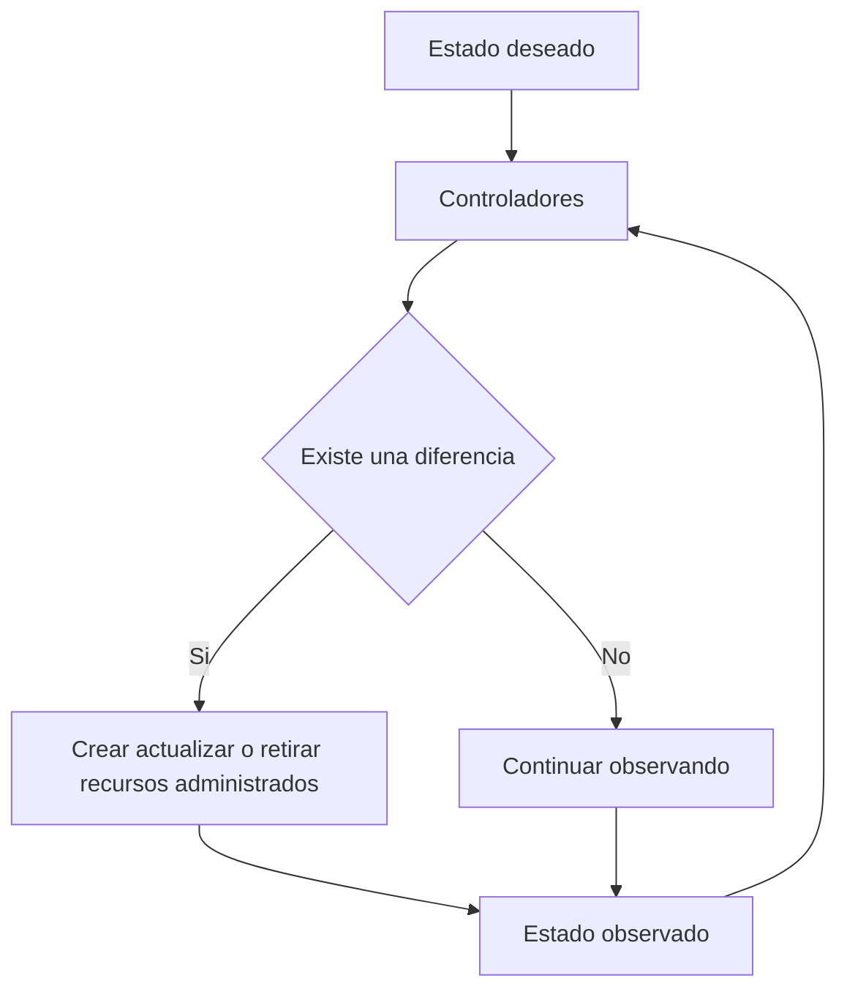
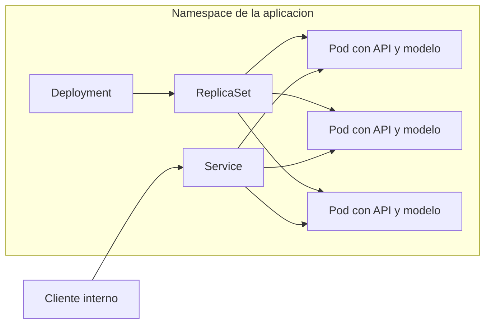
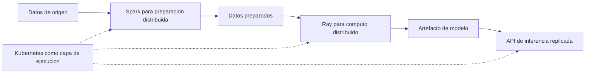

# Clase 5: Orquestación con Kubernetes y cómputo distribuido para MLOps

> **Objetivo académico:** Comprender cómo Kubernetes mantiene servicios de inferencia mediante reconciliación declarativa, réplicas y direccionamiento estable; analizar la gestión de recursos, el escalado y la separación de ambientes, y distinguir la orquestación de infraestructura del procesamiento distribuido con Spark y Ray.

## 1. Contexto y marco conceptual

### Del modelo experimental al servicio operativo

La sesión sitúa Kubernetes dentro del ciclo de MLOps. Un modelo necesita algo más que calidad predictiva: debe poder versionarse, desplegarse, atender solicitudes y mantenerse disponible bajo condiciones cambiantes. La adopción de estas capacidades depende de la madurez organizacional, los riesgos del servicio y el costo de operación; no toda organización necesita implementar de inmediato la misma infraestructura.

El repaso inicial relaciona tres objetos que requieren trazabilidad: código, datos y modelos. Git se presenta como herramienta para código textual, mientras que para datos y artefactos binarios se alude a una herramienta cuya denominación aparece transcrita de forma imprecisa.

**Enriquecimiento conceptual:** La referencia parece corresponder a DVC, pero la transcripción no permite confirmarlo. Lo relevante es distinguir los mecanismos de almacenamiento y versionamiento de cada artefacto y vincularlos para reproducir una versión del sistema.

También se recuerda que los modelos pueden perder desempeño con el tiempo y que el monitoreo de cambios en los datos y en las relaciones predictivas ayuda a decidir cuándo revisar o reentrenar.

**Enriquecimiento conceptual:** El drift de datos describe cambios en la distribución de las entradas; el drift de concepto afecta la relación entre entradas y resultados. Una alerta de distribución requiere diagnóstico: no demuestra por sí sola una pérdida de utilidad ni justifica automáticamente el reentrenamiento.

### Responsabilidades de Docker y Kubernetes

Docker permite empaquetar una aplicación, sus dependencias y el modelo que utiliza en una imagen ejecutable como contenedor. Una API expone las predicciones mediante un endpoint. Esta solución resulta suficiente para una prueba local, pero el paso a producción introduce nuevas necesidades:

- Atender picos de tráfico sin mantener permanentemente capacidad sobredimensionada.
- Recuperarse de procesos fallidos, presión de memoria y fallos de infraestructura.
- Sustituir versiones sin interrumpir innecesariamente el servicio.
- Administrar múltiples réplicas sin depender de vigilancia manual constante.

Kubernetes incorpora una capa de orquestación para gestionar estos procesos de forma declarativa. No reemplaza el empaquetado de la aplicación: utiliza imágenes de contenedor y coordina su ejecución.

**Enriquecimiento conceptual:** En este contexto conviene distinguir integración continua, entrega continua y despliegue continuo. La integración continua valida cambios integrados; la entrega continua mantiene una versión preparada para liberarse; el despliegue continuo automatiza su paso a producción cuando supera los controles definidos. Kubernetes proporciona mecanismos de ejecución y actualización, pero no constituye por sí solo todo ese flujo.

### Alcance de Docker Compose

La sesión compara Docker Compose con Kubernetes para explicar el salto desde la definición de servicios hacia su operación en un clúster. Ambos permiten expresar configuraciones declarativas, pero Kubernetes añade controladores y mecanismos orientados a reconciliar cargas distribuidas entre nodos.

**Enriquecimiento conceptual:** Compose también puede configurar redes, recursos y políticas de reinicio. La diferencia práctica no debe reducirse a que una herramienta permite reiniciar procesos y la otra no: importa el alcance de la planificación entre nodos, la recuperación distribuida y la administración del estado deseado.

## 2. Fundamentos teóricos y arquitectura

### Estado deseado y bucle de reconciliación

El principio central de Kubernetes es declarar qué debe existir y dejar que sus controladores actúen sobre las diferencias respecto de lo observado. El ciclo conceptual consiste en:

1. Consultar el estado deseado.
2. Observar el estado actual.
3. Ejecutar acciones para reducir la diferencia.
4. Repetir la observación.

La analogía utilizada es un termostato: se especifica una temperatura objetivo y el controlador regula el sistema según sus mediciones. En Kubernetes se puede declarar, por ejemplo, que deben existir tres réplicas de una aplicación. Si desaparece una de las réplicas administradas, los controladores intentan restablecer la cantidad solicitada.

**Enriquecimiento conceptual:** Un recurso adicional creado fuera del ámbito de control de un Deployment no se elimina simplemente porque exista una réplica deseada menor. La reconciliación actúa sobre recursos identificados mediante selectores y relaciones de propiedad. Además, converger al estado deseado depende de que existan recursos y condiciones operativas suficientes.



### Componentes del clúster

La arquitectura distingue el plano de control, que coordina el sistema, y los nodos de trabajo, que ejecutan las cargas de aplicación.

| Componente | Función principal | Precisión conceptual |
| --- | --- | --- |
| API server | Recibir solicitudes de administración y exponer la API de Kubernetes | `kubectl` se comunica con esta API. |
| etcd | Persistir el estado del clúster representado por sus objetos | No debe confundirse con un repositorio completo de logs de aplicación. |
| Scheduler | Asignar Pods pendientes a nodos adecuados | Considera solicitudes de recursos y restricciones de planificación. |
| Controller manager | Ejecutar controladores que reconcilian recursos | Coordina cambios para aproximar el estado observado al deseado. |
| kubelet | Gestionar la ejecución de Pods asignados a un nodo y reportar su estado | Interactúa con el runtime local. |
| Runtime de contenedores | Crear y ejecutar los contenedores | Proporciona el entorno de ejecución de las cargas. |
| kube-proxy | Implementar mecanismos de tráfico asociados con Services | Es parte de la solución de conectividad, no toda la red del clúster. |

**Enriquecimiento conceptual:** La tabla normaliza nombres afectados por la transcripción. La selección de nodo no depende solamente de CPU y memoria: también puede considerar afinidad, restricciones y otros recursos. La red entre Pods depende de la implementación de red del clúster; algunas soluciones sustituyen funciones tradicionalmente realizadas por kube-proxy.

La caída del plano de control no implica necesariamente que todos los contenedores dejen de ejecutarse. Los procesos que ya funcionan pueden continuar, aunque se degraden las capacidades de programación y reconciliación global.

**Enriquecimiento conceptual:** El kubelet puede mantener ciertas acciones locales, como reiniciar contenedores según su política. Esto debe distinguirse de programar reemplazos en otros nodos. La alta disponibilidad del plano de control y la persistencia de etcd reducen el riesgo de perder capacidad de coordinación, pero requieren un diseño específico.

### Pod, Deployment, Service y Namespace

Un **Pod** es la unidad mínima desplegable de Kubernetes. Contiene uno o varios contenedores estrechamente relacionados. Los contenedores de un mismo Pod comparten el espacio de red y pueden comunicarse localmente. El caso habitual es un contenedor principal; un contenedor auxiliar puede implementar un patrón **sidecar**, por ejemplo para recolectar información operativa.

Un **Deployment** declara una plantilla de Pods, un número deseado de réplicas y una estrategia de actualización. Un **Service** proporciona una identidad de acceso estable para un conjunto de Pods. Un **Namespace** delimita nombres y organiza recursos dentro del clúster.

**Enriquecimiento conceptual:** Deployment y Service son objetos diferentes del Pod; no son tipos de Pod. El Deployment administra ReplicaSets, y estos mantienen los Pods correspondientes. El Service selecciona Pods mediante etiquetas y permite dirigir tráfico a sus endpoints elegibles. No crea los Pods de reemplazo.



El diagrama separa las relaciones de administración, desde Deployment hacia Pods, de las relaciones de tráfico, desde Service hacia Pods.

## 3. Implementación técnica y lógica de negocio

La práctica utiliza un servidor HTTP sencillo para observar el comportamiento de Kubernetes. No se despliega un modelo de machine learning ni se mide su rendimiento predictivo. El servidor permite aislar los mecanismos de creación, recuperación, escalado y conectividad.

**Enriquecimiento conceptual:** Los siguientes manifiestos y comandos reconstruyen la intención técnica de la demostración con sintaxis normalizada. La transcripción no contiene archivos completos verificables; estos bloques no representan una copia literal ni una ejecución adicional. Se asume un clúster operativo, acceso mediante `kubectl` y disponibilidad de la imagen utilizada.

### Creación y observación de un Pod

Los manifiestos YAML incluyen `apiVersion`, `kind`, `metadata` y `spec`. La indentación determina la jerarquía de campos y puede provocar errores de validación si coloca un atributo en el nivel incorrecto.

```yaml
apiVersion: v1
kind: Pod
metadata:
  name: hola
  labels:
    app: hola
spec:
  containers:
    - name: web
      image: hashicorp/http-echo:1.0
      args:
        - "-text=Hola desde Kubernetes"
      ports:
        - containerPort: 5678
```

`kind: Pod` identifica el recurso; `metadata.name` establece su nombre y `labels` permite clasificarlo. `containers` es una lista, aunque en este caso contenga un único elemento. `containerPort` documenta el puerto utilizado por la aplicación.

**Enriquecimiento conceptual:** Declarar `containerPort` no publica automáticamente la aplicación fuera del clúster ni hace que el proceso escuche en ese puerto: la aplicación también debe configurarse correctamente.

```bash
kubectl apply -f pod.yaml
kubectl get pods
kubectl describe pod hola
kubectl port-forward pod/hola 8080:5678
```

`apply` crea o actualiza el objeto según el manifiesto. `get` permite consultar su estado y `describe` muestra detalles y eventos útiles para diagnóstico. `port-forward` habilita un acceso temporal desde el puerto local 8080 hacia el puerto 5678 del Pod. Mientras ese proceso permanezca activo, la aplicación puede consultarse mediante `http://localhost:8080`.

```bash
kubectl logs hola
kubectl delete pod hola
```

Los logs muestran la salida del contenedor. La eliminación de este Pod independiente no activa la creación de un reemplazo por un Deployment, porque no existe ese controlador para el recurso.

### Deployment: réplicas y recuperación

```yaml
apiVersion: apps/v1
kind: Deployment
metadata:
  name: saludo
spec:
  replicas: 3
  selector:
    matchLabels:
      app: saludo
  template:
    metadata:
      labels:
        app: saludo
    spec:
      containers:
        - name: web
          image: hashicorp/http-echo:1.0
          env:
            - name: POD_NAME
              valueFrom:
                fieldRef:
                  fieldPath: metadata.name
          args:
            - "-text=Hola desde $(POD_NAME)"
          ports:
            - containerPort: 5678
```

`replicas: 3` expresa la cantidad deseada. El selector debe corresponder con las etiquetas de la plantilla. El bloque `template` define cómo crear cada Pod; no es necesario repetir tres veces la especificación del contenedor.

**Enriquecimiento conceptual:** `fieldRef` obtiene el nombre del Pod mediante la Downward API. Su incorporación al mensaje permite identificar qué réplica responde. Este mecanismo completa la configuración de identificación descrita oralmente.

```bash
kubectl apply -f deployment.yaml
kubectl get deployment saludo
kubectl get pods -l app=saludo
kubectl get pods -l app=saludo -w
```

El selector `-l app=saludo` filtra los Pods. La opción `-w` mantiene una observación de los cambios. En otra terminal, eliminar uno de los Pods administrados permite observar la creación de un reemplazo:

```bash
kubectl delete pod NOMBRE_DEL_POD
```

`NOMBRE_DEL_POD` representa el nombre real de uno de los Pods listados. En la demostración, el reemplazo tenía un nombre distinto y una antigüedad menor, mientras el conjunto retornaba a tres réplicas.

```bash
kubectl scale deployment saludo --replicas=6
kubectl scale deployment saludo --replicas=3
```

Estos comandos cambian manualmente el número deseado de réplicas.

**Enriquecimiento conceptual:** Una modificación imperativa puede diferir del valor conservado en el archivo YAML. Si se vuelve a aplicar un manifiesto con otra cantidad, puede alterarse el escalado. Es necesario definir una fuente de configuración coherente, especialmente cuando interviene un HPA.

### Service: identidad estable y selección de destinos

```yaml
apiVersion: v1
kind: Service
metadata:
  name: saludo
spec:
  type: ClusterIP
  selector:
    app: saludo
  ports:
    - port: 80
      targetPort: 5678
```

El Service selecciona los Pods etiquetados con `app: saludo`. Su puerto de acceso es 80 y el puerto de destino de los contenedores es 5678.

**Enriquecimiento conceptual:** En este manifiesto, el puerto 80 pertenece al Service dentro del clúster; no al equipo local. `ClusterIP` proporciona acceso interno. Para acceder desde fuera se requiere un mecanismo adicional, como un acceso temporal con `port-forward` o una configuración de exposición apropiada. La dirección del Service se mantiene mientras exista el objeto; eliminarlo y recrearlo puede cambiarla.

```bash
kubectl apply -f service.yaml
kubectl get service saludo
kubectl describe service saludo
```

La sesión intenta crear un cliente temporal para consultar repetidamente el Service y observar respuestas de distintas réplicas. Ese intento falla, por lo que no queda demostrado el reparto de tráfico en esa prueba. Sí se muestra la creación e inspección del Service.

### Namespaces y cuotas

La práctica crea los ambientes `dev` y `prod` y despliega una aplicación del mismo nombre en ambos:

```yaml
apiVersion: v1
kind: Namespace
metadata:
  name: dev
```

Un manifiesto equivalente con `name: prod` define el otro Namespace. Los comandos normalizados para aplicar y consultar recursos son:

```bash
kubectl apply -f namespace-dev.yaml
kubectl apply -f namespace-prod.yaml
kubectl apply -f deployment.yaml -n dev
kubectl apply -f deployment.yaml -n prod
kubectl get namespaces
kubectl get pods -n dev
kubectl get pods -n prod
kubectl get pods -A
```

`-n` selecciona el Namespace y `-A` consulta todos. Si no se especifica `-n`, se utiliza el Namespace del contexto actual, habitualmente `default` si no se ha modificado.

```bash
kubectl delete deployment saludo -n dev
```

La operación anterior afecta al Deployment de `dev`. Una orden sin Namespace explícito tampoco elimina automáticamente los recursos homónimos de todos los ambientes: actúa sobre el contexto seleccionado.

Para restringir la cantidad de Pods del ambiente de desarrollo se utiliza una cuota:

```yaml
apiVersion: v1
kind: ResourceQuota
metadata:
  name: cuota-dev
  namespace: dev
spec:
  hard:
    pods: "2"
```

Con la cuota aplicada, un Deployment puede seguir declarando tres réplicas, pero no conseguir crear todas si el Namespace ya alcanza el máximo permitido.

```bash
kubectl apply -f quota-dev.yaml
kubectl describe resourcequota cuota-dev -n dev
kubectl describe replicaset -n dev
kubectl get pods -n dev
```

La inspección del ReplicaSet y sus eventos ayuda a distinguir una discrepancia causada por cuota de un fallo de ejecución. En la demostración se observan dos Pods en desarrollo frente a tres en producción.

### Requests, limits y HPA

Estos mecanismos se explican conceptualmente, sin una demostración completa de configuración y operación en la sesión.

Los **requests** indican los recursos solicitados para planificar la carga. Los **limits** establecen restricciones de uso. Se presentan valores ilustrativos como 100 millicores de CPU y 128 unidades de memoria para la solicitud, frente a medio núcleo y un límite de memoria mayor.

**Enriquecimiento conceptual:** La configuración habitual se especifica por contenedor. En CPU, `100m` equivale a 0,1 CPU y `500m` a 0,5 CPU. En memoria, `Mi` expresa mebibytes y `Gi` gibibytes; no deben confundirse con MB y GB. El scheduler compara las solicitudes con los recursos asignables y las solicitudes ya comprometidas, no únicamente con la utilización instantánea.

La distinción operativa destacada es que el límite de CPU suele provocar **throttling**, mientras que superar el límite de memoria puede terminar el contenedor con un estado como **OOMKilled**. Por ello, un servicio de inferencia puede seguir activo pero sufrir mayor latencia por CPU, o perder una solicitud en curso cuando se termina su proceso por memoria.

El **Horizontal Pod Autoscaler**, HPA, ajusta el número deseado de réplicas según métricas y límites configurados. La sesión ilustra una política con un objetivo de CPU cercano al 50 % de lo solicitado y un intervalo de dos a diez réplicas.

**Enriquecimiento conceptual:** Para una política basada en utilización porcentual de CPU, los requests proporcionan la referencia y se requiere una fuente de métricas disponible. Otros modos de HPA pueden usar valores absolutos o métricas externas; la dependencia de requests no se generaliza a todas sus configuraciones.

Una aproximación didáctica al cálculo proporcional es:

$$
n_{\mathrm{nuevo}}=\left\lceil n_{\mathrm{actual}}\frac{u_{\mathrm{observada}}}{u_{\mathrm{objetivo}}}\right\rceil
$$

**Enriquecimiento conceptual:** Aquí $n_{\mathrm{actual}}$ es el número actual de réplicas, un entero positivo; $u_{\mathrm{observada}}$ es su utilización media y $u_{\mathrm{objetivo}}>0$ la utilización objetivo, ambas expresadas en la misma escala. El operador $\lceil\cdot\rceil$ redondea hacia arriba. La expresión supone una carga repartida razonablemente entre réplicas comparables.

Con tres réplicas, utilización observada del 80 % y objetivo del 50 %, la estimación es:

$$
\left\lceil 3\frac{80}{50}\right\rceil=5
$$

El resultado es una recomendación idealizada de cinco réplicas, no una medición de la sesión. El HPA real también considera tolerancias, métricas faltantes, disponibilidad de Pods, ventanas de estabilización y límites de escalado. Crear más Pods no resuelve la ausencia de capacidad en los nodos.

## 4. Análisis crítico de casos y auditoría práctica

### Evidencia observada y límites

| Caso | Evidencia de la sesión | Límite de interpretación |
| --- | --- | --- |
| Pod independiente | Creación, consulta, acceso temporal, logs y eliminación | No acredita recuperación entre nodos ni disponibilidad de producción. |
| Deployment | Tres réplicas y creación de reemplazo al eliminar una | Se reemplaza un Pod; no se demuestra recuperación ante pérdida de una máquina. |
| Escalado manual | Cambio de tres a seis réplicas y retorno a tres | No demuestra un HPA operativo ni escalado de infraestructura. |
| Service | Creación e inspección del objeto | El cliente temporal falla; el reparto de solicitudes no queda verificado. |
| Namespaces | Recursos homónimos separados por ambiente | La separación de nombres no acredita aislamiento de seguridad. |
| ResourceQuota | Restricción a dos Pods en desarrollo | La cuota limita admisión; no redefine el objetivo de tres réplicas. |

### Actualización progresiva y recuperación de versión

La sesión describe el reemplazo gradual de una versión por otra: introducir Pods nuevos, esperar que estén disponibles y retirar los anteriores. También plantea la posibilidad de volver a una versión previa.

**Enriquecimiento conceptual:** Una actualización `RollingUpdate` puede reemplazar varios Pods simultáneamente según sus parámetros. `maxSurge` controla la capacidad adicional y `maxUnavailable` la indisponibilidad permitida. Las readiness probes ayudan a evitar que un Pod reciba tráfico antes de estar preparado, algo especialmente relevante cuando necesita cargar un modelo.

El retorno a una revisión anterior se denomina rollback; rollout designa el proceso de despliegue o actualización. Kubernetes permite revertir revisiones, pero un Deployment no revierte automáticamente cualquier fallo funcional. Deben definirse criterios de detección y procedimientos de recuperación.

Mantener réplicas tampoco garantiza interrupción cero: influyen las sondas, el tiempo de arranque, la capacidad disponible, el cierre ordenado de conexiones y la compatibilidad entre versiones. No se observó una actualización progresiva real en la práctica descrita.

### Fallos, tráfico y memoria

Los picos de demanda, los fallos de hardware y las fugas de memoria ilustran riesgos diferentes. El escalado horizontal puede aliviar una insuficiencia de capacidad, pero no corrige por sí mismo una fuga ni un error sistemático del programa. Reiniciar un contenedor puede restituir temporalmente el servicio mientras permanece la causa del incidente.

**Enriquecimiento conceptual:** Igualar requests y limits puede ayudar a obtener la clase de calidad de servicio Guaranteed cuando se cumplen las condiciones para CPU y memoria de todos los contenedores del Pod. No constituye una garantía absoluta de permanencia ni una regla universal: compromete capacidad y exige dimensionar el consumo real, incluidos los picos de carga del modelo. Un Pod con recursos definidos todavía puede sufrir terminación por memoria o verse afectado por fallos del nodo.

La sesión utiliza Pokémon Go como ejemplo narrativo de una demanda superior a la prevista y de la utilidad de una plataforma escalable. Los multiplicadores mencionados no se acompañan de evidencia verificable, por lo que no se emplean aquí como resultados cuantitativos. La conclusión técnica pertinente es la necesidad de combinar previsión, capacidad y mecanismos de adaptación.

### Auditoría de alcance arquitectónico

**Enriquecimiento conceptual:** Kubernetes programa cargas sobre nodos disponibles. La provisión automática de nodos necesita integración o componentes adicionales; no se deduce del hecho de usar Kubernetes. Un entorno local permite observar sus objetos y controladores, pero no reproduce por sí mismo redundancia de máquinas, tolerancia a fallos de infraestructura o capacidad elástica de producción.

## 5. Principios de diseño, buenas prácticas y anti-patrones

### Principios derivados de la sesión

- **Separar empaquetado, ejecución y coordinación.** La imagen contiene la aplicación; el runtime ejecuta sus contenedores; Kubernetes mantiene los recursos declarados.
- **Usar controladores para servicios replicados.** Un Pod independiente ilustra la unidad de ejecución, pero un Deployment permite administrar réplicas y reemplazos.
- **Desacoplar el acceso de la identidad de los Pods.** Sus direcciones y nombres pueden cambiar. El Service proporciona una referencia estable para los clientes.
- **Mantener selectores y etiquetas coherentes.** Un Service sin correspondencia con los Pods previstos no dirige tráfico hacia ellos.
- **Hacer explícito el ambiente.** Especificar el Namespace reduce el riesgo de aplicar cambios sobre un contexto distinto del esperado.
- **Diagnosticar mediante estado, eventos y logs.** Un recurso no disponible puede deberse a errores del manifiesto, cuotas, falta de capacidad o fallos de aplicación.
- **Dimensionar antes de automatizar.** Requests, limits y métricas de escalado deben reflejar las necesidades de la carga.

**Enriquecimiento conceptual:** Los Namespaces requieren políticas complementarias, como controles de acceso y reglas de red, para proporcionar aislamiento operativo y de seguridad. No equivalen a clústeres físicamente independientes. Eliminar un Namespace afecta a los recursos contenidos en él y debe tratarse como una operación de alcance amplio.

### Anti-patrones y consecuencias

| Anti-patrón | Consecuencia |
| --- | --- |
| Dimensionar permanentemente para el máximo tráfico esperado | Capacidad ociosa y costo elevado cuando cae la demanda. |
| Reiniciar todo el servicio para actualizar una versión | Interrupción evitable y riesgo de pérdida de solicitudes. |
| Suponer que `Running` implica que el modelo está listo | Tráfico prematuro hacia una aplicación que todavía inicializa dependencias. |
| Tratar el Service como responsable de crear reemplazos | Diagnóstico equivocado de los fallos de reconciliación. |
| Confundir un Pod reemplazado con un servidor reparado | Sobreestimación de la tolerancia a fallos demostrada. |
| Aplicar límites de memoria sin observar picos | Terminación del proceso durante carga o inferencia. |
| Crear muchas copias de un entrenamiento sin coordinar datos | Trabajo duplicado en lugar de entrenamiento distribuido. |

## 6. Síntesis conceptual y profundización académica

### Orquestación de infraestructura y distribución del trabajo

El cierre de la sesión distingue atender solicitudes independientes de repartir un cómputo. Varias réplicas de una API pueden procesar peticiones diferentes; varias copias de un script de entrenamiento pueden repetir el mismo trabajo si no existe una lógica de partición y coordinación.

Kubernetes aporta unidades de ejecución y mecanismos para mantenerlas. Spark y Ray incorporan abstracciones para distribuir trabajo computacional. Pueden ejecutarse sobre Kubernetes, aunque no dependen exclusivamente de él.

| Herramienta | Énfasis presentado | Aplicaciones discutidas |
| --- | --- | --- |
| Kubernetes | Mantener y coordinar cargas en contenedores | Réplicas, recuperación, actualización y ejecución de componentes. |
| Apache Spark | Procesamiento particionado de datos | Limpieza, uniones y transformaciones de grandes volúmenes. |
| Ray | Distribución de tareas y funciones de Python | Cómputo paralelo, entrenamiento e inferencia a escala. |

En Spark se destaca la construcción de un plan antes de ejecutar transformaciones, frente al intento de cargar todos los datos en memoria con pandas. Hadoop se menciona como antecedente del procesamiento distribuido, sin desarrollo técnico suficiente para equipararlo a los otros motores.

**Enriquecimiento conceptual:** La evaluación diferida de Spark permite construir y optimizar planes antes de ejecutar acciones. El procesamiento puede operar en paralelo; no debe interpretarse como una ejecución estrictamente secuencial. La conveniencia de Spark depende de memoria disponible, formatos, particiones y costo de comunicación, además del tamaño de los archivos. Un flujo que no cabe directamente en pandas también puede admitir otras estrategias, como lectura por fragmentos, según el problema.

Ray se presenta mediante funciones Python distribuidas y un decorador que permite su ejecución remota.

**Enriquecimiento conceptual:** Declarar una función remota no paraleliza automáticamente su lógica interna ni convierte cualquier algoritmo en entrenamiento distribuido. Hay que definir tareas, dependencias, transferencia de datos y coordinación. La distinción «Spark para datos, Ray para cálculo» es una heurística inicial: sus capacidades se solapan y la selección requiere analizar el cuello de botella concreto.



El diagrama representa una composición posible discutida conceptualmente; no una plataforma integrada ejecutada durante la sesión.

### Disponibilidad del servicio y calidad del modelo

El aprendizaje central es que una solución predictiva necesita dos tipos de control. Uno conserva la utilidad estadística del modelo mediante monitoreo, análisis de drift y revisión de desempeño. El otro sostiene su operación mediante recursos, recuperación, conectividad y actualización. Una API puede mantenerse disponible y devolver predicciones poco útiles; un modelo preciso puede quedar inutilizable por falta de capacidad operativa.

Las líneas de profundización pertinentes son la convergencia de los controladores bajo restricciones, el dimensionamiento de memoria durante la carga del modelo, el efecto del throttling sobre la latencia, la preparación del servicio durante actualizaciones y los costos de comunicación del cómputo distribuido. Estas cuestiones permiten pasar de una demostración funcional a una arquitectura cuyo comportamiento y límites puedan justificarse.
