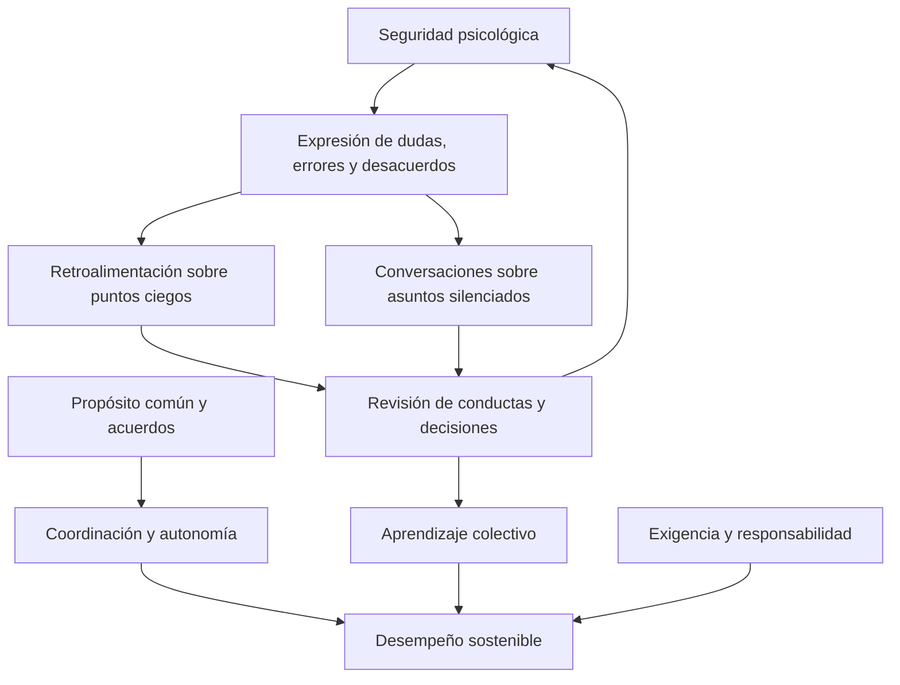

# Clase 3: Equipos de alto rendimiento: seguridad psicológica, puntos ciegos y conversaciones difíciles

> **Objetivo académico:** Analizar cómo la evolución del equipo, la seguridad psicológica, la retroalimentación y la comunicación de asuntos difíciles permiten sostener un desempeño exigente, autónomo y responsable, con especial atención a equipos de datos e inteligencia artificial.

## 1. Contexto y marco conceptual

El alto rendimiento se construye mediante compromisos compartidos, coordinación y aprendizaje. Reunir personas competentes no garantiza que sus aportes se integren: un grupo puede distribuir actividades individuales, mientras que un equipo requiere un propósito común y responsabilidad por el resultado colectivo. Tampoco todo grupo necesita transformarse en equipo; la conveniencia depende de la interdependencia del trabajo.

La sesión retoma tres antecedentes: el compromiso común como rasgo del equipo, la mayor capacidad predictiva atribuida a las entrevistas estructuradas frente a conversaciones libres y la posibilidad de entrenar competencias emocionales. Estos antecedentes sitúan el problema central: además de seleccionar personas, es necesario crear condiciones para que puedan colaborar, discrepar y reconocer límites.

La **seguridad psicológica**, presentada a partir de Amy Edmondson y su trabajo de 1999, es la creencia compartida de que el equipo constituye un espacio seguro para asumir riesgos interpersonales. Incluye admitir desconocimiento, reconocer errores, solicitar ayuda y expresar desacuerdo sin anticipar humillación o represalias por hacerlo. Su unidad conceptual es el equipo: no equivale simplemente a la valentía o confianza individual.

Dos fenómenos muestran por qué esta seguridad resulta necesaria:

- **Punto ciego:** comportamiento o efecto que otras personas perciben y que quien lo produce no reconoce.
- **Elefante en la sala:** asunto relevante que las personas reconocen, pero evitan expresar públicamente.

La diferencia es epistemológica y comunicativa. En el punto ciego falta conciencia sobre uno mismo; en el elefante existe conocimiento, pero se inhibe su comunicación. Ambos pueden reforzarse: si el equipo teme hablar, el líder recibe menos información sobre su impacto y conserva una imagen incompleta de su actuación.

**Enriquecimiento conceptual:** conviene distinguir conocimiento distribuido y conocimiento compartido. Varias personas pueden advertir individualmente un problema sin saber que las demás también lo reconocen. Por ello, no debe suponerse que todo silencio corresponde a un acuerdo colectivo deliberado.

## 2. Fundamentos teóricos y arquitectura

### Desarrollo del equipo y adaptación del liderazgo

La sesión presenta las cuatro etapas de Bruce Tuckman de 1965 y la disolución incorporada posteriormente con Mary Ann Jensen en 1977.

| Etapa | Pregunta o dinámica predominante | Contribución del liderazgo |
| --- | --- | --- |
| Formación | ¿Para qué estamos aquí? | Aclarar propósito, roles, expectativas y reglas de funcionamiento. |
| Conflicto | ¿Quién decide y por qué de esa manera? | Escuchar desacuerdos, hacer explícitos los conflictos y acordar criterios de decisión. |
| Normalización | Así trabajamos nosotros. | Documentar acuerdos y ampliar gradualmente la delegación. |
| Desempeño | Podemos resolverlo con autonomía. | Delegar decisiones, aportar recursos y plantear desafíos de mayor alcance. |
| Disolución | ¿Qué aprendimos y qué debemos conservar? | Reconocer contribuciones, documentar aprendizajes y cerrar relaciones de trabajo. |

El material utiliza las etiquetas autoritario, paternalista, delegador y consultivo para describir cambios de estilo. Su interpretación práctica debe centrarse en las conductas desarrolladas en clase: ofrecer dirección inicial, facilitar el conflicto, consolidar acuerdos y ampliar autonomía. Las etiquetas no constituyen una prescripción de trato coercitivo ni sustituyen el juicio situacional.

La curva también incorpora categorías de Katzenbach y Smith: grupo de trabajo, falso equipo, equipo potencial, equipo y equipo de alto rendimiento. El **falso equipo** consume recursos de coordinación sin lograr una integración que compense ese costo; puede rendir menos que el trabajo individual separado.

**Enriquecimiento conceptual:** estos dos marcos describen dimensiones diferentes. Tuckman organiza dinámicas de desarrollo; las categorías de Katzenbach y Smith distinguen formas de funcionamiento y desempeño. Su representación conjunta puede orientar el diagnóstico, pero no establece equivalencias necesarias entre cada etapa y cada nivel de rendimiento.

El conflicto es una posibilidad normal del desarrollo. Esto no significa que cualquier conflicto sea beneficioso: su contribución depende de cómo se procesa. La sesión advierte, además, que la evolución no siempre es lineal y menciona equipos con plazos definidos que cambian abruptamente su forma de trabajo alrededor del punto medio. El modelo debe emplearse como mapa interpretativo, sin convertirlo en un calendario universal.

La autonomía constituye un criterio de maduración organizativa. Un liderazgo efectivo reduce la dependencia de su intervención cotidiana mediante claridad, capacidades distribuidas y acuerdos de decisión. La analogía con etapas vitales empleada en clase ilustra esa disminución de dependencia.

**Enriquecimiento conceptual:** la analogía no debe trasladarse al trato con profesionales adultos. La madurez del equipo corresponde a su capacidad de coordinación y decisión, no al valor personal de sus integrantes.

### Factores de eficacia: el esquema PERFORM

La sesión organiza siete factores mediante el acrónimo PERFORM:

| Factor | Significado operativo |
| --- | --- |
| Propósito y valores compartidos | Comprensión del resultado común y de los criterios que orientan las decisiones. |
| Potenciación | Autonomía, capacidad de actuación y sinergia entre contribuciones. |
| Relaciones y comunicación | Posibilidad de hablar con claridad y escuchar. |
| Flexibilidad | Adaptación de roles, procedimientos y respuestas al contexto. |
| Resultados y calidad | Orientación a productos o servicios que satisfagan los criterios acordados. |
| Reconocimiento y aprecio | Visibilidad y valoración de las contribuciones individuales y colectivas. |
| Motivación | Disposición a participar, sentido de pertenencia y orgullo por el trabajo. |

La exposición menciona también el optimismo, sin desarrollar una dimensión independiente. La atribución del esquema a Donald Kirkpatrick aparece en la fuente, pero no se acompaña de una referencia que permita establecerla con precisión. Su contenido puede utilizarse como guía descriptiva de conversación, sin asumir una procedencia bibliográfica confirmada ni propiedades de medición demostradas.

### Ventana de Johari y conciencia interpersonal

La ventana de Johari cruza dos dimensiones: lo que una persona conoce de sí misma y lo que conocen los demás.

| Conocimiento propio | Los demás lo conocen | Los demás no lo conocen |
| --- | --- | --- |
| La persona lo conoce | Área abierta | Área oculta |
| La persona no lo conoce | Área ciega | Área desconocida |

El área oculta contiene información que la persona conoce y no comparte. Esta formulación resuelve un desliz de la primera explicación oral, corregido posteriormente en la propia sesión.

La retroalimentación permite trasladar información del área ciega al área abierta. La introspección contribuye a interpretar reacciones y motivos; los comentarios externos aportan información sobre efectos que la persona no había reconocido. La sesión recupera una estimación atribuida a Tasha Eurich según la cual solo entre el 10 % y el 15 % cumpliría determinados criterios de autoconocimiento. Al no especificarse muestra, instrumento ni criterios, esa cifra debe tratarse como referencia contextual de la exposición, sin generalizarla automáticamente.

El diagrama sintetiza relaciones conceptuales desarrolladas en la clase; no representa un modelo causal estimado.

## 3. Implementación técnica y lógica de negocio

La fuente no presenta código, experimentos ni una implementación informática ejecutada. La aplicación consiste en procedimientos de liderazgo y comunicación, ilustrados mediante situaciones de equipos tecnológicos.

### Identificación y trabajo sobre puntos ciegos

Omar Herrera define los puntos ciegos como aspectos de la conducta visibles para otras personas que permanecen inadvertidos para quien los manifiesta. Se mencionan como posibles orígenes los miedos, las inseguridades, las respuestas automáticas y las fortalezas llevadas a un extremo bajo presión.

| Patrón | Manifestación | Riesgo para el equipo |
| --- | --- | --- |
| Certeza excesiva | Dar sistemáticamente más valor a las propias ideas. | Desacuerdo silenciado y menor revisión de decisiones. |
| Impacto inadvertido | Justificar expresiones dañinas mediante una buena intención. | Deterioro de confianza y disposición a colaborar. |
| Evitación del conflicto | Posponer conversaciones sobre incumplimientos o tensiones. | Acumulación de problemas y resolución tardía. |
| Orientación exclusiva a resultados | Desatender la carga y las condiciones de quienes producen el resultado. | Desgaste y deterioro de la cooperación. |
| Excepción personal a las reglas | Exigir conductas que el propio líder incumple. | Pérdida de credibilidad y legitimidad. |
| Microgestión | Supervisar cada detalle con intención de ayudar. | Dependencia y percepción de falta de confianza. |

La distinción entre **intención e impacto** es central: querer mejorar un trabajo no garantiza que la forma de comunicarlo sea respetuosa o efectiva. La evaluación del liderazgo exige observar ambos planos.

El procedimiento propuesto combina reconocimiento de patrones, identificación de situaciones desencadenantes, solicitud de comentarios específicos, escucha inicial sin defensa inmediata y selección de un cambio pequeño y observable. La recurrencia de una dificultad en relaciones diferentes constituye una señal para revisar la propia contribución, aunque no demuestra por sí sola una responsabilidad individual exclusiva.

La mejora requiere contrastar el espejo interno —reacciones, emociones e interpretaciones— con el externo —efectos observados por otras personas—. Aceptar un comentario significa considerarlo seriamente; su validez debe revisarse mediante ejemplos y contexto. La sesión subraya que los tiempos de cambio varían y que no existe un plazo uniforme para modificar comportamientos.

### Seguridad psicológica y exigencia

La seguridad psicológica debe combinarse con estándares claros de desempeño.

| Seguridad psicológica | Exigencia baja | Exigencia alta |
| --- | --- | --- |
| Baja | Apatía: compromiso reducido y cumplimiento mínimo. | Ansiedad: presión elevada y temor a reconocer dificultades. |
| Alta | Comodidad: relaciones agradables con escaso desafío. | Aprendizaje: posibilidad de hablar, revisar y mejorar con estándares elevados. |

La zona de aprendizaje requiere tres prácticas del liderazgo:

1. **Enmarcar el trabajo como aprendizaje:** reconocer incertidumbre e interdependencia y explicar por qué se necesitan perspectivas distintas.
2. **Invitar a participar:** formular preguntas genuinas y admitir límites del propio conocimiento mediante humildad situacional.
3. **Responder productivamente:** agradecer la información, analizar consecuencias y distinguir errores de buena fe de incumplimientos que requieren corrección.

La sesión utiliza cuatro enunciados adaptados de una escala de siete ítems: uso del error en contra de la persona, posibilidad de plantear asuntos difíciles, seguridad para asumir riesgos y dificultad para pedir ayuda. En la adaptación expuesta, una respuesta alta a los enunciados negativos —error usado en contra y dificultad para pedir ayuda— indica una condición desfavorable.

**Enriquecimiento conceptual:** cuatro ítems adaptados sirven para orientar una conversación, pero no deben presentarse como equivalentes a la escala completa validada. Tampoco corresponde construir puntuaciones agregadas, umbrales o comparaciones entre equipos sin especificar un procedimiento de medición y sus límites.

### Comunicación de asuntos difíciles

La sesión presenta cinco niveles de comunicación, atribuidos al material basado en John Powell: clichés, hechos, opiniones, sentimientos y necesidades. A medida que aumenta la exposición personal, se necesita mayor confianza y prudencia. La profundidad adecuada depende del contexto y del consentimiento de las personas.

La estructura operativa para nombrar un asunto silenciado consta de cuatro pasos:

| Paso | Función | Ejemplo ilustrativo de la sesión |
| --- | --- | --- |
| Hecho | Describir lo observado sin etiquetas personales. | En las últimas tres entregas, el modelo pasó a producción sin validación del negocio. |
| Impacto | Explicar consecuencias sobre el trabajo o la experiencia. | Fue necesario rehacer dos tableros y se deterioró la confianza del área. |
| Pregunta genuina | Incorporar información que todavía falta. | ¿Qué está pasando de tu lado? |
| Petición concreta | Proponer una conducta futura verificable. | ¿Acordamos una revisión de quince minutos antes de cada pase? |

Las cantidades pertenecen al ejemplo comunicativo y no representan resultados de una investigación. La fuente vincula esta estructura con situación, comportamiento e impacto, y agrega una petición orientada al futuro.

**Enriquecimiento conceptual:** la relación con el modelo situación–comportamiento–impacto es parcial. La pregunta genuina incorpora indagación y la petición incorpora negociación; por ello, los cuatro pasos deben entenderse como una adaptación práctica presentada en clase, sin atribuir toda la secuencia al modelo citado.

## 4. Análisis crítico de casos y auditoría práctica

### Evidencia sobre interacción, errores y silencio

El Proyecto Aristóteles se presenta como un estudio interno de Google sobre más de 180 equipos. La exposición destaca cinco dinámicas: seguridad psicológica, confiabilidad, estructura y claridad, significado personal e impacto del trabajo. La conclusión práctica es que la forma de interactuar merece tanta atención como la composición del equipo.

La propia sesión diferencia esta investigación interna de la literatura académica revisada por pares. La analogía oral según la cual una variable explicaría más que todas las demás juntas no se acompaña de coeficientes, datos ni especificación estadística; no permite afirmar una magnitud de efecto ni una superioridad predictiva cuantificada.

El caso de equipos hospitalarios asociado a Edmondson ilustra otra distinción: **errores registrados** y **errores efectivamente ocurridos** no son equivalentes. Un entorno que permite informar problemas puede exhibir más registros sin producir más fallos. La enseñanza para equipos de datos es revisar el proceso de detección y comunicación antes de interpretar un tablero con pocos incidentes.

**Enriquecimiento conceptual:** la ausencia de reportes admite varias explicaciones: pocos errores, baja detección, registros incompletos o temor a comunicar. Por tanto, no demuestra por sí sola ni perfección técnica ni inseguridad psicológica. Una evaluación rigurosa contrasta registros, mecanismos de detección y experiencias de los integrantes.

La sesión cita también un estudio exploratorio de 40 entrevistas en el que el 85 % habría callado alguna vez un asunto importante. Las razones expuestas son temor a parecer problemático, dañar relaciones, sufrir represalias o hablar sin producir cambios. La cifra describe lo informado sobre esa muestra; no constituye una estimación representativa de todos los profesionales. La percepción de inutilidad merece atención porque puede reforzar el silencio: la falta de respuesta a comentarios previos reduce la expectativa de que futuras intervenciones sirvan.

### Respuesta del líder ante situaciones de datos

| Situación | Respuesta propuesta | Criterio de análisis |
| --- | --- | --- |
| Un analista comunica que un modelo lleva un mes en producción con un error. | Agradecer el aviso, determinar impacto y necesidades de corrección y revisar después la detección temprana. | Proteger la comunicación del problema y asegurar su resolución. |
| Una persona recién incorporada cuestiona un supuesto. | Preguntar qué le hace dudar y revisar la información antes de continuar. | Evaluar el argumento por su contenido. |
| Nadie interviene en una reunión de planificación. | Solicitar riesgos concretos y comenzar exponiendo una incertidumbre propia; también se propone rotar la conducción. | Crear condiciones de participación y distribuir oportunidades de voz. |

La primera reacción del líder transmite rápidamente qué consecuencias tiene hablar. Una respuesta defensiva puede enseñar que resulta más conveniente ocultar información, incluso cuando posteriormente se declara apertura al diálogo.

**Enriquecimiento conceptual:** ante un error en producción, la respuesta interpersonal debe acompañar la contención técnica. Según el impacto, puede ser necesario limitar el uso del modelo, revisar decisiones afectadas y preservar información para el análisis del incidente. Estas acciones son criterios adicionales de gestión; la transcripción no documenta su ejecución.

### Steve Jobs: ilustración y límites causales

El conversatorio utiliza la salida y el retorno de Steve Jobs a Apple para discutir visión técnica, exigencia y costos relacionales. Se plantea que una fortaleza llevada al extremo puede perjudicar al equipo y que la experiencia puede favorecer cambios de liderazgo.

El intercambio introduce una objeción relevante: la visión estratégica, las capacidades técnicas, la adquisición de NeXT y las circunstancias económicas también forman parte de la explicación del retorno. El relato no permite aislar el cambio interpersonal como causa suficiente del resultado empresarial. Tampoco demuestra que el éxito económico legitime prácticas de trato perjudiciales.

La utilidad del caso reside en separar tres preguntas: qué capacidades aporta una persona, qué efectos produce su conducta y qué condiciones organizacionales explican una decisión empresarial. Las referencias contemporáneas a otros directivos no se documentan de forma suficiente y no se utilizan aquí como evidencia factual.

### Velocidad de desarrollo y comprensión del producto

Un caso expuesto describe avances rápidos durante veinte sprints junto con pérdida de comprensión del código y del negocio, en un contexto de uso de IA. La tensión es que el volumen de cambios puede crecer mientras disminuye la capacidad colectiva de explicar, revisar y mantener el sistema.

Se proponen revisiones breves antes de integrar cambios y comprobaciones de comprensión por parte del equipo. Son alternativas discutidas, sin resultados observados en la fuente.

**Enriquecimiento conceptual:** para formular el problema como hecho, conviene reemplazar expresiones valorativas como reuniones artificiales por observaciones verificables: qué decisiones no pueden explicarse, qué componentes carecen de revisión o qué comportamientos del producto no se comprenden. La velocidad de entrega debe analizarse junto con mantenibilidad, calidad y conocimiento compartido.

### Autenticación multifactor en un sistema legado

Otro caso plantea la tensión entre incorporar autenticación multifactor y preservar la continuidad de una aplicación antigua. La dificultad técnica se convierte en un asunto silenciado cuando el temor a modificar el sistema evita discutir necesidades de seguridad.

**Enriquecimiento conceptual:** afirmar que el sistema podría dejar de funcionar expresa un riesgo anticipado, no un fallo observado. Una formulación rigurosa distingue evidencia disponible, incertidumbre de compatibilidad y consecuencias potenciales. La coordinación entre desarrollo, seguridad y operación debe aclarar requisitos, pruebas y condiciones de aceptación. La sesión no proporciona arquitectura ni resultados para determinar una solución concreta.

## 5. Principios de diseño, buenas prácticas y anti-patrones

### Liderazgo y aprendizaje colectivo

- **Ajustar el apoyo a la situación del equipo:** aportar dirección cuando faltan acuerdos y ampliar autonomía cuando existe capacidad para decidir y responder por los resultados.
- **Cerrar los ciclos de retroalimentación:** escuchar, explicar qué se hará y comunicar avances. Pedir comentarios sin responder a ellos deteriora la confianza.
- **Separar conducta e identidad:** describir acciones e impactos sin convertirlos en etiquetas personales ni interpretar toda discrepancia como un ataque a la autoridad.
- **Conservar estándares y respeto:** la apertura a reconocer errores debe coexistir con responsabilidades claras y corrección de incumplimientos.
- **Documentar el aprendizaje al cerrar un proyecto:** evitar que la disolución del equipo implique perder acuerdos, decisiones y conocimiento relevante.

Los anti-patrones principales son confundir silencio con acuerdo, equiparar seguridad con ausencia de exigencia, tratar todo conflicto como fracaso, justificar un impacto perjudicial mediante buenas intenciones y emplear generalizaciones como siempre haces lo mismo o todos pensamos que. La jerarquía puede agravar estos patrones al reducir la disposición a contradecir al líder.

### Gobernanza y uso responsable de IA

La sesión traslada el concepto de punto ciego al uso de inteligencia artificial. Aunque anuncia cinco puntos, desarrolla cuatro categorías diferenciables:

| Riesgo | Manifestación | Práctica propuesta |
| --- | --- | --- |
| Confianza excesiva | Aceptar una respuesta porque suena convincente o copiarla sin revisión. | Verificar contenido y reconocer la posibilidad de alucinaciones. |
| Delegación del criterio | Permitir que la herramienta sustituya progresivamente el juicio propio. | Mantener revisión humana y cultivar pensamiento crítico. |
| Falta de visibilidad sobre el uso del equipo | Desconocer qué datos se comparten y para qué se utiliza la herramienta. | Definir políticas y formación sobre información admisible y limitaciones. |
| Responsabilidad difusa | Atribuir a la herramienta toda consecuencia de una decisión. | Identificar quién valida, decide y responde dentro de la organización. |

El debate incorpora el riesgo de respuestas complacientes que refuerzan ideas insuficientemente analizadas. La formación propuesta abarca supervisión, límites, confidencialidad y gobernanza, además de la formulación de instrucciones.

**Enriquecimiento conceptual:** conservar responsabilidad humana no elimina la distribución de obligaciones entre usuarios, responsables organizacionales y proveedores. Esa distribución depende del contexto; atribuir automáticamente toda responsabilidad al jefe sería una simplificación.

La IA también se presenta como apoyo para ensayar conversaciones difíciles y revisar expresiones que podrían provocar defensividad. Deben omitirse datos identificables y evitarse diagnósticos o etiquetas de personalidad. La conversación y los acuerdos efectivos siguen requiriendo interacción humana.

**Enriquecimiento conceptual:** la reacción de un interlocutor simulado es una hipótesis de ensayo. No permite predecir de manera fiable cómo responderá una persona concreta ni confirma la existencia de un punto ciego interpersonal.

### Reconocimiento y diversidad de capacidades

La apreciación se presenta mediante cinco modalidades inspiradas en Gary Chapman: palabras de reconocimiento, tiempo de calidad, actos de servicio, detalles y gestos apropiados. Su aplicación laboral exige atención al contexto, preferencias y límites personales. La propia sesión advierte que existe poco respaldo para asignar a cada persona un único lenguaje estable. La práctica defendible consiste en preguntar cómo prefiere recibir reconocimiento y observar si la forma elegida resulta pertinente.

**Enriquecimiento conceptual:** cualquier contacto físico requiere consentimiento y adecuación cultural y organizacional. El reconocimiento puede expresarse plenamente mediante alternativas sin contacto.

La exposición introduce también las inteligencias múltiples de Howard Gardner: lingüística, lógico-matemática, espacial, musical, corporal, interpersonal, intrapersonal y naturalista. En equipos de datos, este marco permite conversar sobre aportes que pueden quedar fuera del énfasis matemático: explicar resultados, diseñar representaciones claras o facilitar relaciones.

La sesión reconoce que la evidencia de inteligencias independientes es débil y que el marco no equivale a estilos de aprendizaje. Debe emplearse como recurso de conversación sobre capacidades e intereses, evitando diagnósticos, asignaciones rígidas de roles o decisiones de selección basadas en etiquetas. La referencia a 1983 corresponde al planteamiento inicial; la transcripción no desarrolla la cronología de incorporación de todas las categorías enumeradas.

## 6. Síntesis conceptual y profundización académica

El desempeño sostenible integra propósito, coordinación, autonomía, exigencia y capacidad de aprender. La curva de desarrollo ayuda a interpretar necesidades del equipo; los factores de eficacia amplían el diagnóstico; la seguridad psicológica permite que circule información sobre errores, desacuerdos y límites.

Los puntos ciegos muestran una limitación del autoconocimiento: la intención propia no basta para conocer el impacto sobre otras personas. La retroalimentación, combinada con reflexión y cambios observables, permite revisar esa distancia. El elefante en la sala revela otra limitación: advertir un problema no garantiza que alguien lo comunique ni que la organización responda.

La secuencia hecho, impacto, pregunta y petición convierte un malestar difuso en una conversación susceptible de producir acuerdos. Su calidad depende de que el hecho sea verificable, el impacto se sustente, la pregunta admita una respuesta inesperada y la petición permita negociar una acción concreta.

**Enriquecimiento conceptual:** la conexión entre liderazgo y equipos de datos puede entenderse como un problema de calidad de información organizacional. Si las personas filtran errores o desacuerdos por temor, las decisiones se apoyan en una representación incompleta del sistema. Mejorar las condiciones para hablar amplía la información disponible; su contribución al desempeño depende también de la capacidad técnica, los recursos y la respuesta efectiva ante los problemas.

La profundización académica puede centrarse en tres distinciones: percepción de seguridad frente a prácticas observables, frecuencia de errores frente a frecuencia de reportes y éxito empresarial frente a calidad del trato interpersonal. Estas distinciones permiten evaluar críticamente los modelos sin reducirlos a recetas universales. En entornos con IA, la misma disciplina exige diferenciar producción rápida de comprensión, respuesta convincente de evidencia y apoyo automatizado de responsabilidad por las decisiones.
