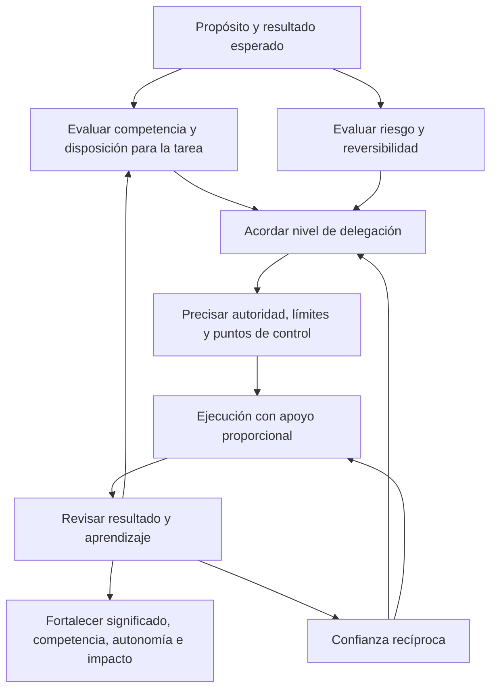

# Clase 4: Delegación, empoderamiento y confianza en la gestión de equipos

> **Objetivo académico:** Analizar cómo asignar autoridad y responsabilidad según la tarea, la competencia de la persona y el riesgo de la decisión, distinguiendo la delegación del empoderamiento psicológico y reconociendo las condiciones que sostienen la confianza recíproca en los equipos.

## 1. Contexto y marco conceptual

La sesión articula el autoconocimiento y la formación de equipos con un problema central del trabajo gerencial: cómo desarrollar la capacidad de otras personas mientras se alcanzan resultados organizacionales. La tesis que organiza el contenido es que **delegar consiste en hacer crecer a otra persona mientras se logra un resultado**. Descargar trabajo sin desarrollo puede generar dependencia de quienes ya dominan la actividad; promover aprendizaje sin cuidar el resultado puede comprometer al equipo.

La referencia al modelo de Tuckman recupera la idea de que el conflicto puede formar parte del desarrollo del equipo. No obstante, un descenso del rendimiento o una dificultad de coordinación requieren interpretación contextual: su sola presencia no demuestra que el equipo esté avanzando hacia un desempeño superior.

La seguridad psicológica y la exigencia se presentan como condiciones complementarias. Hacer visible un problema compartido permite sustituir la tolerancia silenciosa por una conversación orientada a resolverlo. La secuencia comunicativa recuperada en la sesión comprende **hecho, impacto, pregunta y petición**: describir lo observado, explicar sus consecuencias, abrir la comprensión del problema y formular una acción concreta.

### Autoridad formal e influencia

La comparación entre jefe y líder no se plantea como una oposición moral. La gestión requiere integrar ambas funciones.

| Dimensión | Función de jefatura | Función de liderazgo |
| --- | --- | --- |
| Base de actuación | Autoridad del cargo | Influencia reconocida por las personas |
| Aporte principal | Asignar responsabilidades, establecer límites y responder por los resultados | Dar sentido, desarrollar capacidades y generar confianza |
| Riesgo de actuación aislada | Obtener cumplimiento sin compromiso | Carecer de capacidad formal para resolver decisiones difíciles |
| Contribución a la delegación | Definir quién decide y quién responde | Favorecer que la persona asuma el encargo con iniciativa |

El líder espera iniciativa y responsabilidad; las personas esperan confianza, orientación, apoyo y oportunidades de crecimiento. Una delegación bien diseñada conecta ambas expectativas. Esta reciprocidad no significa que la confianza produzca automáticamente un desempeño adecuado: necesita claridad, recursos y seguimiento.

### Del lenguaje técnico al lenguaje gerencial

La gestión exige traducir los detalles técnicos en consecuencias para la cadena de valor. Una explicación sobre bases de datos, API o herramientas puede ser correcta y, aun así, resultar insuficiente para decidir una inversión.

Las preguntas gerenciales se concentran en qué cambia para el negocio: cuánto tiempo se optimiza, qué presupuesto se necesita, qué riesgo se reduce, cómo se protege la continuidad operativa y qué ocurre si se posterga una intervención. La sesión menciona OPEX y CAPEX como categorías de gasto operativo e inversión, respectivamente; su clasificación específica no se desarrolla.

El caso de renovación del parque tecnológico muestra esta diferencia. La antigüedad de los equipos constituye un dato de entrada, pero la priorización también demanda conocer su uso, criticidad, incidencias y participación en el conjunto operativo. Una proporción aplicada a los equipos antiguos no responde por sí sola qué porcentaje del parque total se renovará ni qué beneficio tendrá la decisión.

**Enriquecimiento conceptual:** La calidad de la comunicación gerencial depende de conectar evidencia técnica, alternativas y consecuencias. Esto no elimina el detalle técnico: permite ubicarlo como fundamento verificable de la recomendación y explicitar los supuestos de la decisión.

## 2. Fundamentos teóricos y arquitectura

### Delegación y empoderamiento: objetos diferentes

**Delegar** es asignar una tarea o un ámbito de decisión con autoridad delimitada, resultado esperado y condiciones de seguimiento. En el encuadre de la sesión, quien delega conserva la responsabilidad de rendir cuentas por el resultado ante la instancia superior.

**Empoderar** se refiere a favorecer que la persona experimente capacidad, sentido, autonomía e influencia. La diferencia es fundamental: se delega una tarea o decisión y se empodera a una persona. La repetición de delegaciones bien diseñadas puede contribuir al empoderamiento; asignar más trabajo mientras se retienen todas las decisiones puede aumentar la carga sin desarrollar autonomía.

### Los siete niveles de delegación

La sesión presenta el continuo de autoridad de Management 3.0, atribuido a Jürgen Appelo. Los niveles permiten sustituir la pregunta binaria «¿delego?» por una pregunta más precisa: **¿qué autoridad tendrá esta persona sobre esta decisión?**

| Nivel | Denominación | Distribución de la autoridad |
| --- | --- | --- |
| 1 | Decir | El responsable decide y comunica la decisión. |
| 2 | Vender | El responsable decide y explica sus razones para obtener comprensión y aceptación. |
| 3 | Consultar | El responsable solicita opiniones y conserva la decisión final. |
| 4 | Acordar | Las partes construyen una decisión conjunta mediante consenso. |
| 5 | Aconsejar | El responsable ofrece su opinión y la otra persona decide. |
| 6 | Preguntar | La otra persona decide y posteriormente informa sobre la decisión. |
| 7 | Delegar | La otra persona decide sin requerir una comunicación específica al responsable sobre cada decisión de ese ámbito. |

Ningún nivel es universalmente superior. La pertinencia depende de la competencia demostrada, del riesgo, de la reversibilidad y de las restricciones aplicables. Un formato interno fácilmente modificable puede admitir amplia autonomía; la divulgación de datos personales requiere controles más estrictos.

**Enriquecimiento conceptual:** El nivel 7 no elimina las políticas institucionales, la trazabilidad ni las obligaciones de rendición de cuentas. Su alcance debe entenderse dentro de un dominio autorizado. Asimismo, informar después de decidir —nivel 6— es distinto de solicitar aprobación antes de ejecutar.

### Liderazgo situacional

El modelo de Paul Hersey y Ken Blanchard se presenta como una guía para ajustar dirección y apoyo a la competencia y disposición de la persona **frente a una tarea particular**.

| Estilo | Situación descrita | Intervención del líder |
| --- | --- | --- |
| Dirigir | Poca experiencia en la tarea, aunque pueda existir entusiasmo | Dar instrucciones claras y seguimiento cercano. |
| Entrenar | Aprendizaje parcial acompañado de dificultades o frustración | Explicar el propósito, escuchar y continuar orientando. |
| Apoyar | Capacidad suficiente con dudas o inseguridad | Formular preguntas, respaldar y facilitar que la persona decida. |
| Delegar | Competencia y disposición suficientes | Acordar el resultado y conceder autonomía. |

Una misma persona puede requerir poca dirección para limpiar datos y apoyo intenso para presentar al directorio. El modelo no clasifica de manera permanente a las personas. La sesión advierte que su evidencia empírica es mixta y propone utilizarlo como guía de conversación, sin tratarlo como una receta infalible.

La comparación con Tuckman es una analogía pedagógica sobre desarrollo y acompañamiento. **Enriquecimiento conceptual:** Ambos modelos tienen unidades de análisis diferentes: Tuckman aborda procesos grupales; el liderazgo situacional orienta la relación entre dirección, apoyo y preparación para una tarea.

### Empoderamiento psicológico

La propuesta de Gretchen Spreitzer, situada en 1995 en la sesión, distingue cuatro dimensiones:

| Dimensión | Contenido | Implicación para la gestión |
| --- | --- | --- |
| Significado | El trabajo resulta importante y congruente con los valores de la persona. | Explicar el propósito y su conexión con el negocio. |
| Competencia | La persona confía en su capacidad para desempeñarse adecuadamente. | Acompañar el aprendizaje y ofrecer retroalimentación útil. |
| Autodeterminación | Existe margen de elección sobre cómo realizar el trabajo. | Conceder autoridad efectiva sobre los medios. |
| Impacto | La persona percibe que su trabajo influye en lo que sucede en su área. | Mostrar qué decisiones o cambios se produjeron gracias a su contribución. |

La delegación incide especialmente en la autodeterminación, pero no activa necesariamente las otras dimensiones. Asignar una actividad sin explicar su finalidad puede dejar intacto el significado; conceder autonomía sin preparación ni apoyo puede debilitar la percepción de competencia.

La sesión conecta significado e impacto con el análisis de equipos de Google mencionado previamente, sin desarrollar nuevamente sus resultados. También refiere un metaanálisis de 2018 sobre liderazgo que empodera, asociado en la exposición con Allan Lee, Sara Willis y Amy Tian. Se describe una relación positiva con el desempeño, especialmente con la creatividad y con conductas que exceden las obligaciones del rol, como ayudar a otros o proponer mejoras. No se proporcionan magnitudes de efecto ni detalles metodológicos que permitan cuantificar esas relaciones.

### Arquitectura conceptual integrada

El diagrama integra los componentes desarrollados en la sesión: el nivel de autonomía se acuerda a partir de la tarea y sus condiciones, mientras que el resultado y el aprendizaje permiten revisar futuras delegaciones.

## 3. Implementación técnica y lógica de negocio

La fuente no presenta código, implementación de software ni experimentos controlados. Su implementación es organizacional: conversaciones de delegación, distribución de autoridad, seguimiento y comunicación de resultados.

### Cuatro componentes de un encargo claro

1. **Qué y para qué:** describir la tarea y su contexto. «Construir un tablero» ofrece menos orientación que explicar qué problema de inventario debe resolver y quién utilizará la información.
2. **Cuándo:** acordar un plazo viable, haciendo visibles las restricciones de capacidad y las dependencias.
3. **Resultado:** definir cómo se reconocerá que el trabajo está terminado. En el ejemplo de inventario, el criterio relevante es que el comité pueda decidir qué productos liquidar; la cantidad de gráficos no expresa por sí sola ese resultado.
4. **Puntos de control:** acordar revisiones oportunas para detectar desvíos antes de que resulte demasiado costoso corregirlos.

Estos componentes deben acompañarse de una definición explícita de autoridad. «Quiero tu opinión, pero decido yo» expresa un nivel 3 y evita que la consulta se interprete como transferencia de la decisión.

El seguimiento no equivale a microgestión. Se convierte en microgestión cuando invade innecesariamente decisiones ya concedidas, exige aprobaciones contradictorias con el nivel acordado o sustituye de manera continua el criterio del colaborador.

### Adaptación de la comunicación mediante DISC

DISC se utiliza como un recurso para ajustar la manera de formular encargos, retomando las categorías de dominancia, influencia, estabilidad y cumplimiento.

| Preferencia descrita | Comunicación sugerida | Fricción probable |
| --- | --- | --- |
| Dominancia | Explicitar resultados y conceder autonomía sobre el cómo. | Control minucioso de cada paso. |
| Influencia | Facilitar interacción, visibilidad y reconocimiento del aporte. | Aislamiento sostenido sin contacto. |
| Estabilidad | Proporcionar claridad, previsibilidad y acompañamiento inicial. | Cambios abruptos o de último momento. |
| Cumplimiento | Definir datos, estándares y criterios de calidad. | Encargos ambiguos o criterios imprecisos. |

La propia sesión señala que DISC no posee el respaldo empírico de los cinco grandes rasgos de personalidad. Su uso debe ser exploratorio, evitando etiquetas rígidas. Preguntar directamente «¿cómo prefieres recibir un encargo?» ofrece información contextual y reconoce la participación de la persona.

La afirmación de una mayor presencia de perfiles de cumplimiento en ciencia de datos aparece sin evidencia estadística presentada. Por tanto, no permite inferir el perfil de un integrante por su profesión.

### El costo de no delegar

«Lo hago más rápido yo» puede ser cierto para una ejecución aislada. El problema surge cuando la actividad se repite y el conocimiento permanece concentrado: el responsable mantiene toda la carga y se transforma en un cuello de botella.

**Enriquecimiento conceptual:** Una representación simplificada permite distinguir el costo inicial de enseñar del ahorro acumulado de tiempo del responsable:

$$
T_{\mathrm{directo}}(n)=n\,t_l
$$

$$
T_{\mathrm{delegado}}(n)=t_f+n\,t_s
$$

Aquí, $n\in\mathbb{N}_{>0}$ es el número de ejecuciones de una tarea recurrente; $t_l>0$ es el tiempo del líder por ejecución directa; $t_f\geq 0$ es su tiempo inicial de formación; y $t_s\geq 0$ es su tiempo medio de seguimiento por ejecución delegada. Todos los tiempos deben expresarse en la misma unidad. Las funciones representan únicamente tiempo del líder, no el esfuerzo total del equipo.

Si se supone que $t_l>t_s$, que el resultado mantiene una calidad aceptable y que los tiempos medios son estables, la delegación libera tiempo acumulado cuando:

$$
t_f+n\,t_s<n\,t_l
\quad\Longrightarrow\quad
n>\frac{t_f}{t_l-t_s}
$$

La expresión muestra por qué una inversión inicial puede justificarse con la recurrencia. No calcula el beneficio económico completo: omite el tiempo del colaborador, los errores, el retrabajo y la variación del aprendizaje. Si la supervisión consume tanto tiempo como la ejecución directa, el ahorro no se obtiene bajo estos supuestos, aunque puedan existir beneficios de desarrollo o continuidad.

### IA como apoyo a la preparación de conversaciones

La sesión utiliza simulaciones conversacionales para explorar barreras a la delegación y revisar la calidad de las preguntas. Los relatos describen usos distintos de la herramienta: generación de escenarios, apoyo para formular preguntas y retroalimentación sobre preguntas cerradas.

Se menciona GROW como estructura de orientación, pero no se desarrolla formalmente todo el modelo. **Enriquecimiento conceptual:** Su secuencia habitual organiza la conversación alrededor de objetivo, realidad actual, opciones y compromiso de acción. Explorar opciones requiere abrir alternativas; pasar directamente del problema a los consejos puede reducir la participación reflexiva del interlocutor.

Una pregunta como «¿alguna vez alguien resolvió un problema sin tu intervención?» puede recuperar evidencia, pero admite una respuesta breve. Preguntar qué ocurrió, qué condiciones lo permitieron y qué podría repetirse amplía la comprensión. Las preguntas cerradas siguen siendo útiles para confirmar acuerdos; su límite aparece cuando sustituyen la exploración.

La IA se plantea como apoyo preparatorio. No se presentan resultados que validen su capacidad para juzgar por sí sola una conversación de coaching. Deben evitarse datos que identifiquen a las personas y mantenerse la responsabilidad humana sobre la interacción real.

## 4. Análisis crítico de casos y auditoría práctica

### Problemas normalizados y coordinación entre equipos

**Sincronización en un entorno sandbox de Salesforce.** Se relata una falla que afectaba órdenes y cuentas, compensada mediante trabajo manual. La evitación de conversaciones con otros equipos había contribuido a normalizarla. Al hacer visible el problema y coordinar a las áreas implicadas, se reportó una solución conjunta. El aprendizaje gerencial es que una dificultad técnica puede persistir por una barrera de coordinación. La fuente no contiene detalles suficientes para reconstruir su causa técnica.

**Deuda técnica y componentes no retirados.** Otro relato describe desarrollos encadenados con componentes antiguos, lo que incrementaba la complejidad y la delicadeza de las modificaciones. La conversación con la gestión del proyecto permitió obtener respaldo para intervenir. Se menciona Radical Candor como referencia para hablar de manera directa, respetuosa y responsable. La sesión no desarrolla su modelo completo ni demuestra una reducción posterior de defectos o tiempos.

El caso también amplía la noción de punto ciego: las rutinas compartidas pueden impedir que el equipo reconozca o priorice un problema. La interacción externa puede ayudar a cuestionar esos supuestos.

**Urgencias que interrumpen el desarrollo.** La aparición continua de solicitudes prioritarias alteraba la planificación. Se describe una reorganización con roles, reglas de entrada y evaluación consensuada de las excepciones. El principio transferible es hacer explícito el costo de interrumpir el trabajo, en lugar de aceptar cada urgencia como una instrucción automática.

**Documentación insuficiente en ServiceNow.** El cierre apresurado de correctivos y evolutivos omitía documentación y, en ocasiones, planificación. Se propone documentación ligera y estandarizada, con posible apoyo de IA. El relato identifica una mejora prevista; no aporta evidencia de su implementación ni de sus resultados.

**Enriquecimiento conceptual:** En estos casos conviene distinguir reconocimiento del problema, acuerdo de intervención, ejecución y efecto observado. Obtener apoyo para una mejora no demuestra todavía que haya producido beneficios medibles.

### Decisiones con distintos grados de riesgo

| Caso | Criterios centrales | Lectura de los niveles discutidos |
| --- | --- | --- |
| Elegir un algoritmo de pronóstico | Competencia específica, criterios del negocio y capacidad de validar resultados | Se discutieron acuerdos conjuntos, asesoramiento y decisión autónoma con información posterior. |
| Compartir datos personales con un proveedor | Restricciones legales, confidencialidad e irreversibilidad | Predominaron decisiones centralizadas o consulta con decisión final retenida. |
| Modificar el formato de un reporte | Necesidades del destinatario y facilidad de corregir | Se consideró mayor autonomía cuando el cambio es reversible y conserva la utilidad. |

El debate evidencia que el desacuerdo puede provenir de supuestos diferentes sobre la tarea o la persona. Dos años de experiencia general no equivalen a competencia demostrada para cualquier decisión.

También aparece una inconsistencia útil para la revisión: algunas intervenciones describen el nivel 6 como decisión seguida de aprobación del jefe. Según la escala expuesta, el nivel 6 requiere información posterior, no autorización previa. Si existe una facultad de veto antes de ejecutar, debe aclararse su alcance y ajustarse el acuerdo.

**Enriquecimiento conceptual:** Ante datos personales, la decisión no depende únicamente del criterio de un jefe. Deben identificarse los responsables autorizados y las políticas aplicables, con intervención jurídica o de seguridad cuando corresponda. Transferir trabajo operativo no transfiere automáticamente responsabilidades legales.

### Una analista nueva ante el directorio

La propuesta presentada es un nivel 5: la analista decide cómo presentar sus hallazgos y recibe asesoramiento mediante un ensayo previo. La distinción relevante es entre capacidad técnica y familiaridad con la audiencia. Una persona puede dominar el análisis y necesitar orientación para comunicar costos, riesgos, continuidad operativa y consecuencias económicas.

El ensayo permite acompañar sin apropiarse de la exposición ni de su reconocimiento. Sin embargo, la solución depende de qué decisión se delega: diseñar la presentación, representar al área y asumir compromisos institucionales son ámbitos distintos.

### Incumplimientos de una persona experimentada

La sesión recoge posiciones diversas ante dos plazos incumplidos: indagar qué está ocurriendo, aumentar el seguimiento o condicionar la continuidad a nuevos resultados. No establece una solución final única para el caso.

**Enriquecimiento conceptual:** La experiencia previa no determina la causa del incumplimiento. Una revisión rigurosa debe considerar carga de trabajo, dependencias, claridad de prioridades, viabilidad del plazo y circunstancias relevantes antes de modificar la autonomía. El nivel 7 sería incoherente con una supervisión previa de cada decisión, pues describe autonomía amplia dentro del ámbito acordado.

El aprendizaje comunicativo es combinar claridad y respeto: expresar el problema, su impacto y las expectativas sin sustituir el análisis por amenazas o juicios personales.

## 5. Principios de diseño, buenas prácticas y anti-patrones

### Confianza recíproca

El modelo de Roger Mayer, James Davis y David Schoorman, presentado como una contribución de 1995, distingue tres bases para considerar confiable a otra persona:

- **Capacidad:** conocimientos y habilidades pertinentes para el ámbito de actuación.
- **Benevolencia:** preocupación por los intereses de la otra parte, más allá del beneficio propio.
- **Integridad:** adhesión a principios considerados aceptables y coherencia entre discurso y conducta.

La evaluación funciona en ambas direcciones. El líder considera si puede confiar en el colaborador, y el equipo observa si su líder demuestra competencia, protege sus intereses y mantiene principios consistentes.

La sesión diferencia implícitamente dos objetos: confianza en las propias capacidades y confianza interpersonal. **Enriquecimiento conceptual:** La primera se refiere a la percepción de eficacia personal; la segunda supone aceptar vulnerabilidad frente a la actuación de otra persona. No deben utilizarse como definiciones intercambiables.

### La ecuación de confianza como heurística

La exposición presenta una fórmula divulgativa procedente de un libro situado en el año 2000, sin identificar de manera suficiente su referencia completa:

$$
T=\frac{C+R+I}{S}
$$

$T$ representa la confianza expresada por la heurística; $C$, la credibilidad de lo que se afirma; $R$, la confiabilidad asociada al cumplimiento de compromisos; $I$, la intimidad entendida como seguridad para compartir información delicada; y $S$, la autoorientación o concentración en el interés propio.

Para que el cociente esté definido se requiere $S>0$. Las magnitudes se interpretan como valoraciones conceptuales adimensionales: la sesión no ofrece escalas, unidades ni un procedimiento de medición validado. Por ello, la expresión no permite calcular confianza real, estimar efectos ni comparar personas mediante puntajes.

Su utilidad es recordar que la credibilidad, el cumplimiento y la cercanía pueden perder valor cuando el equipo percibe que el líder busca exclusivamente su propio lucimiento. Apropiarse del crédito de los colaboradores ejemplifica este problema; compartir oportunidades de visibilidad puede ayudar a contrarrestarlo.

**Enriquecimiento conceptual:** La ubicación de la autoorientación en el denominador es una metáfora de su efecto debilitador. No demuestra que sea siempre el factor de mayor influencia ni establece una relación causal cuantificada.

### Principios y anti-patrones

| Principio | Buena práctica | Anti-patrón |
| --- | --- | --- |
| Claridad | Acordar propósito, resultado, plazo, autoridad y revisiones. | Asignar solo una actividad y juzgar después expectativas no comunicadas. |
| Proporcionalidad | Ajustar autonomía a competencia, riesgo y reversibilidad. | Considerar la máxima autonomía como una obligación universal. |
| Desarrollo | Acompañar las primeras ejecuciones y revisar el apoyo necesario. | Retener siempre el trabajo porque inicialmente resulta más rápido. |
| Consistencia | Respetar el ámbito de decisión concedido. | Anunciar autonomía y exigir aprobación para cada paso. |
| Reconocimiento | Compartir crédito y oportunidades de exposición. | Delegar la producción y reservarse toda la visibilidad. |
| Evidencia | Diferenciar percepciones, acuerdos y resultados observados. | Tratar relatos o simulaciones como demostraciones generales. |
| Confianza | Cumplir compromisos y proteger información sensible. | Usar vulnerabilidades compartidas contra la persona. |

La autonomía debe acompañarse de recursos, límites comprensibles y posibilidad de pedir ayuda. Del mismo modo, el control debe responder a un riesgo concreto y revisarse cuando cambian las capacidades o las condiciones.

## 6. Síntesis conceptual y profundización académica

La delegación integra dos resultados: cumplimiento organizacional y desarrollo de capacidad. Requiere autoridad para asignar y responder, e influencia para construir compromiso. El nivel adecuado surge de evaluar una decisión concreta frente a una persona concreta, bajo restricciones de riesgo y reversibilidad.

El empoderamiento amplía esta perspectiva: no basta con conceder decisiones si el trabajo carece de significado, la persona no se siente capaz o desconoce el efecto de su contribución. La autonomía es una dimensión de un fenómeno más amplio. Si el problema es falta de autoridad efectiva, una intervención puramente motivacional resulta insuficiente; si falta competencia, conceder autonomía sin apoyo puede aumentar la exposición al error.

La confianza sostiene este proceso mediante capacidad, benevolencia e integridad. Su carácter recíproco obliga al líder a observar sus propias prácticas: qué promete, cómo responde a las dificultades, qué hace con la información delicada y a quién atribuye los logros.

La profundización conceptual puede orientarse hacia tres relaciones: cómo cambia el seguimiento cuando una decisión es irreversible; cómo distinguir percepción de impacto de evidencia de impacto real; y cómo evaluar el desarrollo de autonomía sin reducirlo a etiquetas de personalidad. En todos los casos, los modelos funcionan mejor como estructuras para razonar y conversar que como clasificaciones definitivas.

**Enriquecimiento conceptual:** Una gestión rigurosa mantiene una tensión productiva entre confianza y verificación. La confianza permite actuar dentro de un ámbito acordado; la verificación aporta evidencia para aprender, corregir y ampliar ese ámbito. Su articulación evita tanto la dependencia permanente del líder como el abandono de la persona bajo una autonomía meramente declarada.
