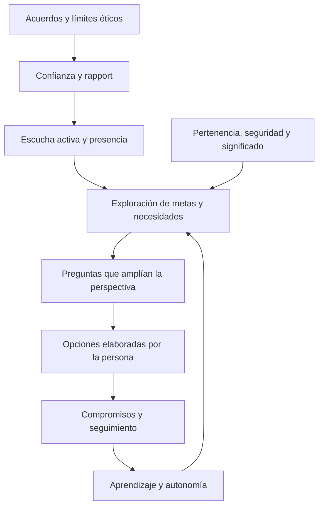

# Clase 5: Coaching y mentoring: preguntas, aprendizaje y liderazgo relacional

> **Objetivo académico:** Distinguir coaching, mentoring y otras formas de acompañamiento; comprender el marco profesional de la ICF y articular preguntas, escucha, GROW, OSAR y retroalimentación para desarrollar autonomía y criterio en los equipos, evaluando sus límites éticos, organizacionales y empíricos.

## 1. Contexto y marco conceptual

### De resolver problemas a desarrollar personas

La sesión sitúa el coaching dentro de la gestión del talento y lo conecta con la delegación. Delegar implica precisar qué se necesita, cuándo, con qué resultado y mediante qué puntos de control. La autonomía concedida depende de la preparación de la persona y del riesgo de la decisión. El coaching aborda una necesidad complementaria: ayudar a pensar cuando proporcionar otra instrucción no basta.

El principio conductor es **preguntar antes de decir**. En perfiles técnicos, la competencia para resolver puede convertirse en una respuesta automática: ante cualquier dificultad, el líder propone inmediatamente una solución. Esta conducta ofrece rapidez, pero puede reducir las oportunidades de aprendizaje y mantener la dependencia del equipo.

La alternativa consiste en elegir conscientemente cómo intervenir. Preguntar no elimina la responsabilidad de orientar, decidir o actuar ante una urgencia. Permite distinguir cuándo se necesita una respuesta experta y cuándo conviene desarrollar el criterio de otra persona.

### Origen y evolución del coaching

La sesión utiliza la imagen del carruaje asociado a Kocs, localidad húngara, como metáfora del coaching: un vehículo que acompaña a alguien desde su situación actual hasta una situación deseada. Esta imagen describe una relación de apoyo; el destino pertenece a quien recibe el acompañamiento.

El recorrido histórico expuesto conecta la mayéutica socrática —ayudar a elaborar ideas mediante preguntas— con el uso universitario inglés de la palabra *coach* para designar tutores. Posteriormente, presenta a Timothy Gallwey y *El juego interior del tenis*, de 1974, como referencia del desplazamiento desde la corrección externa hacia la autoobservación. John Whitmore y *Coaching for Performance*, de 1992, aparecen vinculados a la difusión empresarial del modelo GROW.

La sesión también relaciona a Rafael Echeverría y Julio Olalla con el desarrollo del coaching ontológico, centrado en el lenguaje y las interpretaciones, y menciona la fundación de la ICF en 1995 como hito de profesionalización. Esta secuencia funciona como panorama introductorio, sin demostrar una genealogía única entre todas las corrientes.

### Cuatro formas de ayuda

| Rol | Aporte predominante | Intervención característica | Situación pertinente |
| --- | --- | --- | --- |
| Consultor | Solución basada en conocimiento especializado | Analiza y recomienda qué hacer | Incidentes o problemas que requieren respuesta experta |
| Profesor | Conocimiento y método | Explica y enseña procedimientos | Incorporación de competencias o fundamentos nuevos |
| Mentor | Experiencia contextual y orientación | Comparte aprendizajes, aconseja y revisa alternativas | Desarrollo profesional y decisiones de trayectoria |
| Coach | Reflexión, autodescubrimiento y compromiso | Pregunta, escucha y devuelve observaciones | Clarificación de objetivos y desarrollo de autonomía |

El ejemplo de una operación aritmética sirve para contrastar estas intervenciones: entregar el resultado, enseñar a calcular, acompañar desde la experiencia o explorar cómo la persona aborda el problema. Su utilidad es didáctica; no implica que una pregunta exploratoria sea la mejor respuesta ante cualquier necesidad concreta.

Ningún rol es superior de manera universal. Ante una caída de servicio puede ser imprescindible una intervención experta; una persona sin conocimientos básicos necesita enseñanza. El anti-patrón consiste en utilizar siempre el mismo rol, sin evaluar la necesidad real.

### Coaching y mentoring

En la comparación presentada, el coaching se orienta principalmente a objetivos de corto y mediano plazo; el mentoring privilegia una relación de aprendizaje y desarrollo más prolongada. El coach aporta técnicas conversacionales y no necesita dominar necesariamente la especialidad de la persona acompañada. El mentor obtiene buena parte de su valor de la experiencia relevante en ese ámbito.

Las herramientas se superponen, pero su énfasis difiere: preguntas, silencios y devoluciones en el coaching; preguntas, consejos y respuestas fundamentadas en la experiencia en el mentoring. El silencio permite elaborar ideas y no debe llenarse automáticamente con una solución.

**Enriquecimiento conceptual:** Estas distinciones describen tendencias, no fronteras absolutas. Una relación de mentoring puede incluir preguntas exploratorias, y un proceso de coaching puede abordar decisiones estratégicas. Conviene aclarar qué tipo de ayuda se ofrece y anunciar los cambios de rol para no presentar un consejo como si fuera una conclusión autónoma del interlocutor.

## 2. Fundamentos teóricos y arquitectura

### El marco profesional de la ICF

La definición presentada concibe el coaching como una alianza con el cliente en un proceso creativo y reflexivo orientado a maximizar su potencial personal y profesional. La palabra **alianza** desplaza la relación desde la superioridad del experto hacia la colaboración.

Las responsabilidades del coach se organizan en cuatro funciones:

1. Acompañar a descubrir, aclarar y definir lo que la persona quiere alcanzar.
2. Estimular el autodescubrimiento.
3. Favorecer soluciones y estrategias generadas por la propia persona.
4. Sostener una participación consciente y responsable en las decisiones y compromisos.

La ética incluye confidencialidad, acuerdos claros, atención a conflictos de interés y derivación cuando una necesidad excede el alcance profesional. El coaching no sustituye la atención terapéutica.

La sesión presenta el modelo de ocho competencias de la ICF, actualizado en 2019, agrupado en cuatro dominios:

| Dominio | Competencias |
| --- | --- |
| Fundamentos | Demostrar una práctica ética; encarnar una mentalidad de coaching |
| Cocreación de la relación | Establecer y mantener acuerdos; cultivar confianza y seguridad; mantener presencia |
| Comunicación efectiva | Escuchar activamente; evocar conciencia |
| Aprendizaje y crecimiento | Facilitar el crecimiento del cliente |

Escuchar activamente exige atender sin preparar la respuesta mientras la otra persona habla. Evocar conciencia significa facilitar que identifique algo relevante que antes no advertía. La presencia supone disponibilidad y atención a lo verbal y no verbal.

Las credenciales ACC, PCC y MCC se mencionan como niveles profesionales asociados con formación, práctica y evaluación. Los marcadores PCC se presentan como conductas observables para analizar la calidad de una sesión, por ejemplo, permitir que el cliente diseñe sus acciones. Utilizar habilidades conversacionales en la gestión cotidiana no equivale a obtener una acreditación profesional.

### Pertenencia, seguridad y significado

La sesión propone tres anhelos como marco interpretativo para comprender lo que puede movilizar una conversación. Aunque inicialmente aparece la palabra «pertinencia», el desarrollo corresponde a **pertenencia**.

| Anhelo | Contenido | Pregunta exploratoria |
| --- | --- | --- |
| Pertenencia | Sentirse visto, escuchado, valorado y parte de un colectivo | ¿Dónde te sientes parte? |
| Seguridad | Protección emocional, estabilidad y tranquilidad ante el futuro | ¿Qué te daría tranquilidad para dar este paso? |
| Significado | Percibir propósito, dirección e importancia en la propia contribución | ¿Para qué es importante esto para ti? |

Una meta explícita puede coexistir con una necesidad menos visible. Un ascenso puede representar significado; permanecer en un puesto puede relacionarse con seguridad; guardar silencio puede vincularse con pertenencia. Son posibilidades para explorar, no explicaciones que deban imponerse.

**Enriquecimiento conceptual:** Este esquema debe tratarse como una heurística conversacional. Una conducta admite múltiples causas, incluidas condiciones materiales, cargas de trabajo o desacuerdos legítimos. Inferir automáticamente un anhelo a partir de una conducta produciría una interpretación no validada por la persona.

### Rapport y condiciones de confianza

El *rapport* describe una relación en la que el interlocutor percibe comprensión, respeto y coordinación. Una pregunta pertinente puede sentirse como interrogatorio si falta esa base relacional.

La sesión destaca una introducción adecuada, escucha activa, empatía, atención al lenguaje corporal y reconocimiento de puntos comunes. La coordinación natural importa más que imitar mecánicamente gestos, posturas o respiración. La imitación deliberada y evidente puede producir incomodidad.

El diagrama representa relaciones metodológicas, no una secuencia causal garantizada. Los acuerdos y la confianza sostienen la exploración; las acciones y sus resultados permiten revisar lo aprendido.

## 3. Implementación técnica y lógica de negocio

No se presenta una implementación informática, código ni un experimento computacional. La implementación técnica corresponde al diseño y conducción de conversaciones de desarrollo en equipos, incluidos entornos de datos y software.

### Construcción de preguntas que desarrollan criterio

La sesión distingue preguntas para obtener información y preguntas para desarrollar reflexión. «¿Cuántos tickets quedan?» permite seguimiento operativo; «¿Qué aprendiste de este sprint?» abre una interpretación de la experiencia. Ambas pueden ser útiles, pero cumplen funciones diferentes.

Se propone que una pregunta poderosa sea abierta, orientada al desarrollo y constructiva. Debe ser clara, breve, pertinente y formulada de una en una. Su valor depende de lo que permite descubrir al interlocutor, no de confirmar la interpretación del líder.

Se identifican seis dificultades habituales:

| Dificultad | Efecto posible | Alternativa |
| --- | --- | --- |
| Pregunta cerrada usada para explorar | Restringe la elaboración a una respuesta breve | Preguntar cómo está abordando la situación |
| Consejo encubierto | Dirige hacia la solución preferida del líder | Explorar opciones y criterios |
| Pregunta retórica | Introduce un juicio | Preguntar por ventajas, riesgos o consecuencias |
| Interpretación no expresada por la persona | Impone una emoción o conclusión | Recuperar sus palabras y pedir precisión |
| «Por qué» con tono acusatorio | Puede provocar justificación defensiva | Preguntar qué factores intervinieron |
| Preguntas encadenadas o de formulario | Dispersa la atención y reduce profundidad | Plantear una pregunta y escuchar antes de continuar |

**Enriquecimiento conceptual:** Las preguntas cerradas son apropiadas para confirmar acuerdos o verificar información. «Por qué» tampoco es intrínsecamente inadecuado: su efecto depende del tono, la relación y el propósito. Asimismo, una orientación constructiva no exige omitir fallos, riesgos o conflictos. La evaluación crítica debe poder nombrarlos sin descalificar a la persona.

Las reformulaciones técnicas presentadas pueden organizarse así, separando preguntas para respetar la pauta de una a la vez:

- Ante «¿No sería mejor usar un modelo más simple?»: «¿Qué opciones evaluaste?». Después: «¿Qué te hizo elegir esta?».
- Ante «¿Ya hablaste con ventas?»: «¿Quién más necesita participar?». Después: «¿Cómo lo vas a involucrar?».
- Ante «¿Por qué se atrasó el proyecto?»: «¿Qué ocurrió?». Después: «¿Qué necesitas para recuperar el plazo?».

La diferencia es sustantiva: se pasa de sugerir una respuesta a explorar evidencia, actores y decisiones.

### GROW como estructura conversacional

GROW organiza cuatro focos de conversación. Su función es proporcionar orientación sin convertir la interacción en un cuestionario rígido.

| Etapa | Significado | Propósito | Preguntas características |
| --- | --- | --- | --- |
| G | Goal: meta | Definir el resultado deseado y cómo reconocerlo | ¿Qué quieres lograr? ¿Cómo sabrás que lo lograste? |
| R | Reality: realidad | Comprender la situación y los intentos previos | ¿Qué está pasando hoy? ¿Qué has intentado? |
| O | Options: opciones | Ampliar alternativas antes de decidir | ¿Qué más podrías hacer? ¿Qué posibilidad no has considerado? |
| W | Will: voluntad y compromiso | Concretar la acción elegida | ¿Qué vas a hacer? ¿Cuándo? |

La definición del logro conecta con la claridad de resultados propia de los OKR: una intención general necesita criterios que permitan reconocer avances. No toda meta requiere una métrica numérica, pero sí una descripción comprensible del cambio esperado.

En la etapa de opciones, el coach favorece que las alternativas aparezcan desde la persona. La sesión menciona «¿Y si supieras?» como posible intervención ante «no sé».

**Enriquecimiento conceptual:** Esa intervención requiere sensibilidad. Si la dificultad proviene de falta real de información o experiencia, insistir puede resultar invalidante; corresponde reconocer la brecha y acordar una fuente de aprendizaje o un cambio de rol.

Para explorar el compromiso, se propone una escala del uno al diez. En la sesión, una respuesta menor de siete invita a indagar qué haría falta para elevarla. Esta escala es una apreciación subjetiva del compromiso, no una medición de la probabilidad de éxito; el umbral es una pauta práctica, no un criterio validado presentado con evidencia.

GROW admite retornos. Comprender la realidad puede cambiar la meta y evaluar opciones puede revelar restricciones nuevas. El error más relevante es pasar directamente de la meta a una acción prescrita por el líder, omitiendo realidad y alternativas.

### OSAR: observador, sistema, acción y resultados

El modelo OSAR se introduce desde el coaching ontológico. Relaciona al **observador**, sus interpretaciones y emociones, con el **sistema** en el que participa, las **acciones** disponibles y los **resultados** obtenidos.

La lectura diagnóstica comienza por los resultados: cuando son insatisfactorios, se revisan las acciones y omisiones; si modificarlas no basta, se consideran condiciones del sistema y supuestos del observador. No actuar también tiene consecuencias.

La fuente ofrece dos formulaciones de los órdenes de aprendizaje:

| Nivel | Primera explicación | Ejemplo técnico posterior |
| --- | --- | --- |
| Primer orden | Cambiar acciones | Probar otro algoritmo o ajustar hiperparámetros |
| Segundo orden | Cambiar condiciones del sistema | Cambiar el observador y revisar la pregunta de negocio |
| Transformacional | Cambiar el observador y la forma de verse | Cambiar la identidad profesional y la manera habitual de trabajar |

Esta variación impide presentar una clasificación única como si la sesión hubiera sido consistente. La idea común es que **ajustar procedimientos puede ser insuficiente cuando el problema reside en supuestos, condiciones organizacionales o modos habituales de interpretar**.

En el ejemplo del tablero de ventas, una caída puede interpretarse como error de carga o como cambio del mercado. Las hipótesis conducen a investigaciones diferentes aun cuando los datos iniciales sean los mismos. En el ejemplo predictivo, revisar qué decisión de negocio debe apoyar el modelo puede ser más relevante que seguir ajustando su algoritmo.

**Enriquecimiento conceptual:** Cambiar de perspectiva amplía hipótesis, pero no demuestra cuál es correcta. Las interpretaciones deben contrastarse con evidencia. Del mismo modo, una declaración de identidad —por ejemplo, considerarse lector— puede orientar hábitos y entornos, pero no garantiza por sí sola los resultados.

### Feedback y feedforward

La sesión contrapone el feedback centrado en evaluar lo ocurrido con el feedforward orientado a mejorar actuaciones futuras, término asociado en la exposición con Marshall Goldsmith.

| Dimensión | Feedback evaluativo descrito | Feedforward propuesto |
| --- | --- | --- |
| Referencia temporal | Desempeño pasado | Próxima actuación |
| Foco | Juicio sobre lo realizado | Brecha y alternativas de mejora |
| Dinámica buscada | Cumplimiento de una valoración | Aprendizaje y compromiso |
| Frecuencia | Puede concentrarse en instancias formales | Puede integrarse en conversaciones continuas |

La propia sesión aclara que mirar lo ocurrido no es negativo. El problema es quedarse en el juicio sin generar aprendizaje.

**Enriquecimiento conceptual:** Feedback y feedforward son complementarios. La retroalimentación basada en hechos puede ser respetuosa y formativa; la orientación al futuro puede ser directiva o coercitiva si no existe participación real. Su calidad depende del contenido y de la relación, además de su referencia temporal.

La técnica del sándwich combina reconocimiento, oportunidad de mejora y refuerzo positivo. Su límite aparece cuando el elogio es genérico o instrumental: la persona aprende a esperar la crítica y desconfía del reconocimiento. La sesión exige identificar concretamente qué se hizo bien.

Los ejemplos trasladan el juicio hacia decisiones observables:

- «Tu presentación fue muy técnica» se transforma en explorar qué decisión debe tomar el comité y qué gráfico ayudaría a comprenderla.
- «Siempre entregas tarde» se sustituye por una referencia específica a retrasos recientes y una pregunta sobre qué cambiar en el siguiente sprint.
- «El código está desordenado» conduce a acordar convenciones de nombres y mecanismos de revisión.

**Enriquecimiento conceptual:** Las últimas preguntas ya acotan posibles soluciones. Pueden ser adecuadas para coordinar estándares técnicos, pero conviene reconocer su componente directivo en lugar de presentarlas como exploración completamente abierta.

## 4. Análisis crítico de casos y auditoría práctica

### Mentoría técnica y ampliación de la trayectoria profesional

Un testimonio describe a una persona experimentada que transmitía criterios para leer y analizar consultas complejas durante una migración bancaria. El valor de la mentoría no consistía solamente en explicar sintaxis, sino en compartir pautas de interpretación construidas mediante la experiencia.

Otro caso muestra cómo un referente tecnológico podía ampliar la percepción de carrera de sus colegas: el conocimiento técnico no obliga a permanecer exclusivamente en funciones técnicas. La comunicación, la capacidad de influir y el ejemplo profesional aparecen como competencias que permiten asumir responsabilidades más amplias.

Estos relatos ilustran mecanismos de aprendizaje y modelado. No constituyen evidencia suficiente para atribuir resultados empresariales a una sola persona ni para establecer reglas universales de desarrollo profesional.

### Observaciones de la práctica conversacional

Los testimonios posteriores a la práctica señalan que GROW ayudó a explicitar metas, reconocer la situación actual y discutir el compromiso. También apareció una limitación significativa: formular preguntas sin una introducción relacional puede producir una interacción mecánica. Conducir una conversación requiere acordar el propósito y generar disposición para hablar, además de recordar las etapas.

Las impresiones compartidas describen utilidad percibida, no una medición de eficacia ni una demostración de transformación duradera.

### Presión, cumplimiento y desarrollo

Un debate contrapone el liderazgo relacional con intervenciones basadas en advertencias y presión para asegurar resultados. Se sostiene que distintos colaboradores responden a motivaciones diferentes y que algunas estrategias coercitivas pueden conseguir cumplimiento inmediato. La respuesta docente subraya que el propósito del coaching es desarrollar capacidades y compromiso, no limitarse a obtener obediencia.

**Enriquecimiento conceptual:** La evaluación crítica debe distinguir eficacia inmediata, aprendizaje y sostenibilidad. Cumplir una meta bajo presión no permite inferir confianza, bienestar o autonomía. A la vez, el liderazgo relacional necesita estándares claros, seguimiento y consecuencias proporcionales; escuchar y establecer exigencias son funciones compatibles.

### Escalabilidad del acompañamiento

La propuesta de conversaciones individuales encuentra una objeción práctica: un responsable con treinta personas a cargo debe dedicar un volumen considerable de tiempo para mantener encuentros frecuentes.

**Enriquecimiento conceptual:** Una estimación básica de carga permite precisar la discusión:

$$
T = n\,d\,f
$$

Aquí, $T$ es el tiempo total en minutos por periodo; $n$ es el número entero no negativo de personas; $d$ es la duración en minutos por conversación, con $d \geq 0$; y $f$ es la frecuencia media de conversaciones por persona en ese periodo, con $f \geq 0$. Se supone igual duración y frecuencia para todas las personas y se excluyen preparación, registro y reprogramaciones.

Con treinta personas, encuentros de treinta minutos y una conversación semanal por persona, el cálculo es:

$$
T = 30 \times 30 \times 1 = 900\ \text{minutos por semana} = 15\ \text{horas por semana}
$$

Este resultado describe carga de agenda, no tiempo neto perdido ni beneficio generado. Permite evitar equivalencias imprecisas con días completos y obliga a considerar capacidad disponible y prioridades.

La sesión plantea ajustar frecuencia, duración y cobertura; distribuir el acompañamiento mediante responsables intermedios; y mantener contactos ocasionales entre niveles. También advierte un problema: asignar apoyo informal a personas destacadas no crea automáticamente cargos, autoridad o disponibilidad reales.

Otro enfoque descrito elimina las reuniones recurrentes y deja que cada colaborador solicite espacio, salvo cuando los indicadores disminuyen. Esta modalidad reduce reuniones obligatorias, pero concentra la iniciativa en quien necesita ayuda y puede asociar la convocatoria del líder con un problema de rendimiento.

**Enriquecimiento conceptual:** Que una persona no solicite una reunión no demuestra ausencia de necesidades. Puede influir la confianza, la percepción de disponibilidad o el temor a consecuencias. La efectividad de cualquier modalidad requiere evaluar conjuntamente resultados, accesibilidad y experiencia de los colaboradores.

El caso de equipos organizados por áreas muestra que los responsables intermedios pueden canalizar necesidades operativas. Los contactos entre niveles complementan esa estructura, pero no sustituyen un acompañamiento sostenido del responsable directo. La fuente describe una organización que utilizaba Scrum; no permite concluir que esa distribución jerárquica sea un requisito de dicho marco.

### Evidencia de efectos y retorno

La sesión menciona dos metaanálisis, de 2014 y 2016, con efectos positivos en desempeño, habilidades, bienestar, afrontamiento, actitudes laborales, autorregulación y aprendizaje. También reconoce estudios pequeños y uso de autorreportes. No proporciona tamaños de efecto, intervalos de confianza ni detalles suficientes para comparar modalidades.

El caso de Project Oxygen de Google se presenta como un antecedente organizacional que identifica ser buen coach entre las conductas de gerencia eficaz. Su valor es ilustrativo; no demuestra que cualquier programa de coaching produzca los mismos resultados en otras empresas.

Asimismo, se menciona un estudio de clientes de la ICF realizado por PwC, con más de dos mil participantes en sesenta y cuatro países. La exposición comunica retornos aproximados de siete veces la inversión para organizaciones y 3,4 veces para personas entre quienes pudieron estimarlos. La fuente no aclara aquí la definición exacta del indicador ni permite comprobar su resumen estadístico.

Los límites señalados son sustantivos: encargo de una organización interesada en el sector, autorreporte y selección de quienes estimaron un retorno. Estas cifras no justifican garantizar recuperación de inversión, un plazo específico de rentabilidad o beneficios universales. La afirmación de que una breve conexión necesariamente producirá retorno debe entenderse como una expectativa de gestión, no como un resultado demostrado en el caso discutido.

## 5. Principios de diseño, buenas prácticas y anti-patrones

### Vulnerabilidad con límites

La sesión recurre a Brené Brown para definir la vulnerabilidad mediante incertidumbre, riesgo y exposición emocional. En liderazgo, se expresa en reconocer «no sé», «me equivoqué» o «necesito ayuda», y en solicitar retroalimentación sin fingir certeza.

La vulnerabilidad relevante permite que los problemas se comuniquen antes y que las personas propongan ideas sin exigir infalibilidad. Se relaciona con pertenencia y seguridad porque admitir una limitación puede percibirse como una amenaza a la aceptación o a la autoridad.

No equivale a contar toda la vida privada, descargar emociones sobre el equipo ni eliminar fronteras profesionales. La exposición debe tener un propósito y respetar los límites propios y ajenos.

La sesión propone como posibles beneficios mayor confianza, compromiso, productividad, seguridad psicológica, valentía e inteligencia emocional. Presenta la seguridad psicológica, vinculada con el trabajo de Amy Edmondson, como la conexión con mayor respaldo dentro de la exposición. Los demás beneficios no deben interpretarse como efectos automáticos.

**Enriquecimiento conceptual:** Una conversación constructiva no exige revelar aspectos íntimos ni sentir exposición emocional intensa. El líder puede modelar apertura, pero no imponer confesiones ni condicionar la pertenencia a compartir información personal. La confianza también depende de cómo responde cuando otra persona discrepa o reconoce un error.

Las prácticas descritas incluyen establecer límites de lo compartido, escuchar más, pedir ayuda, reconocer temores y disparadores emocionales, y preguntar antes de juzgar. La comunicación honesta de una incertidumbre puede preservar credibilidad; fingir conocimiento puede deteriorarla cuando sus límites se hacen visibles.

### Uso crítico del mapa de conciencia de Hawkins

El mapa de David Hawkins se presenta como una ordenación de estados emocionales que sitúa el coraje como umbral simbólico. Por debajo ubica estados como vergüenza, culpa, apatía, miedo, ira u orgullo; por encima, estados asociados con neutralidad, voluntad, aceptación, razón, amor, alegría o paz.

Su aplicación propuesta consiste en reflexionar sobre la emoción desde la cual se participa en una conversación: el miedo puede favorecer ocultamiento; la ira, castigo al mensajero; el orgullo, rechazo a pedir ayuda; y el coraje, reconocimiento de incertidumbre. Son ejemplos interpretativos, no reglas diagnósticas.

La sesión advierte que las calibraciones mediante kinesiología aplicada carecen de validez científica para medir niveles de conciencia. Por ello, los números del mapa no deben tratarse como mediciones ni utilizarse para clasificar personas. La transcripción contiene una comparación verbal poco clara sobre estudios controlados; no permite recuperar un resultado empírico específico.

**Enriquecimiento conceptual:** El mapa solo puede conservarse aquí como recurso metafórico de reflexión. No permite equiparar emociones con frecuencias físicas ni inferir superioridad moral, competencia o salud. Reconocer miedo o ira puede aportar información relevante sobre riesgos e injusticias, sin convertir esas emociones en defectos personales.

### Integración del acompañamiento en la gestión

La sesión propone una cadencia orientativa para dar continuidad al desarrollo:

| Cadencia propuesta | Espacio | Función |
| --- | --- | --- |
| Cotidiana | Intervención breve de unos cinco minutos | Preguntar antes de resolver automáticamente |
| Semanal | Conversación individual de unos treinta minutos | Explorar la agenda de la persona mediante GROW |
| Quincenal | Espacio de unos quince minutos | Orientar mejoras futuras |
| Mensual | Mentoring de carrera de aproximadamente una hora | Revisar trayectoria y decisiones fuera de la urgencia |
| Trimestral | Conversación de desarrollo de unos noventa minutos | Integrar metas, necesidades y evolución profesional |

Estas duraciones se presentan como propuesta docente, ajustable al tamaño del equipo y a la capacidad disponible. La preferencia por ciertos días u horarios responde a una apreciación práctica de la sesión; no se aporta evidencia que la convierta en una regla general.

La idea central es proteger un espacio reconocible para el desarrollo. Cancelarlo reiteradamente puede comunicar baja prioridad, aunque el significado depende del contexto y de cómo se reprograma. El mentoring inverso también aparece como posibilidad: personas con menor antigüedad pueden aportar herramientas, conocimientos de IA y otras perspectivas.

| Buena práctica | Anti-patrón asociado |
| --- | --- |
| Elegir el rol según la necesidad | Responder siempre como consultor |
| Acordar propósito, confidencialidad y límites | Suponer que la confianza existe por el cargo |
| Formular preguntas pertinentes y escuchar | Seguir una lista sin atender a las respuestas |
| Distinguir hechos, interpretaciones e hipótesis | Imponer una lectura emocional o técnica |
| Revisar realidad y opciones antes de comprometer acciones | Saltar de la meta al consejo |
| Dar reconocimiento concreto | Utilizar elogios genéricos para amortiguar críticas |
| Adaptar el acompañamiento a la capacidad de gestión | Aplicar una frecuencia uniforme sin calcular su carga |
| Evaluar efectos y costes en el contexto | Prometer retornos universales |
| Mantener fronteras profesionales | Confundir vulnerabilidad con sobreexposición |
| Usar metáforas como apoyo reflexivo | Convertir mapas no validados en instrumentos de medición |

## 6. Síntesis conceptual y profundización académica

El coaching aporta una forma de intervención que desarrolla la capacidad de pensar, decidir y asumir compromisos. El mentoring añade experiencia y orientación contextual. La enseñanza y la consultoría siguen siendo necesarias cuando faltan conocimientos o se requiere una solución experta. La competencia gerencial consiste en combinar estos recursos con criterio.

GROW estructura la conversación desde la meta hasta la acción, admitiendo retornos y reformulaciones. OSAR amplía el análisis hacia interpretaciones y condiciones sistémicas cuando modificar acciones no alcanza. Su articulación permite distinguir entre mejorar una respuesta y revisar el modo en que se formuló el problema, manteniendo explícita la inconsistencia de la fuente sobre los órdenes de aprendizaje.

Pertenencia, seguridad y significado ayudan a explorar dimensiones de la experiencia que una meta operativa puede ocultar. Su uso exige preguntar y validar, sin reducir a las personas a categorías. El rapport, la escucha y los acuerdos éticos sostienen esa exploración.

La vulnerabilidad profesional aporta honestidad frente a la incertidumbre, pero requiere límites y coherencia con la conducta cotidiana. La seguridad psicológica no se obtiene solo diciendo que se aceptan errores: también depende de las respuestas efectivas ante malas noticias, desacuerdos y solicitudes de ayuda.

La evidencia comentada permite reconocer beneficios potenciales del coaching, pero no garantiza su magnitud en cualquier organización. Del mismo modo, la continuidad del acompañamiento requiere equilibrar tiempo, estructura, accesibilidad y resultados. Una agenda extensa no demuestra desarrollo; la ausencia de solicitudes de reunión tampoco demuestra autonomía.

**Enriquecimiento conceptual:** Una profundización académica pertinente puede articular tres niveles de análisis: la calidad de la conversación —acuerdos, escucha y pertinencia de las preguntas—; el aprendizaje —cambios en criterios, alternativas y capacidad de actuar—; y los resultados organizacionales —mejoras sostenibles, costes y condiciones que contribuyen a ellas—. Distinguirlos evita confundir satisfacción inmediata, transformación personal y rentabilidad.

La contribución central del liderazgo relacional es ampliar la capacidad del equipo para afrontar problemas con criterio propio. Preguntar antes de aconsejar adquiere valor cuando produce comprensión y decisiones responsables, dentro de una gestión que conserva claridad técnica, exigencia y cuidado de las personas.
